<p align="center">
  <picture>
    <source media="(prefers-color-scheme: dark)" srcset="assets/brand/relic_mark_white.svg">
    
  </picture>
</p>

# R E L I C

### **R**ecomposable **E**cosystem **Li**brary for **I**ntegrated **C**oupling

> _Reliquis compositis, lex emergit._
>
> _Where relics converge, the laws emerge._
>
> _遗存归一，律在其中_

---

_A differentiable, category-theoretic framework for multi-sphere biogeochemical simulation._

_Initiated under the Lunar Architecture Programme_

---

[](https://www.python.org/downloads/)
[](https://pytorch.org/)
[](LICENSE)
[](https://github.com/psf/black)
[-0075A8?style=for-the-badge&logo=readthedocs&logoColor=white)](https://ayinmostima.github.io/RELIC/)
[](https://space.bilibili.com/3690975918557825/upload/video)
[](#companion-publications--public-datasets-zenodo)

[Overview](#overview) | [Docs Website (EN / 中文)](https://ayinmostima.github.io/RELIC/) | [Monographs](#monographs--theory-books) | [Video Tutorials](#video-tutorials-bilibili--youtube) | [Public Data (Zenodo)](#companion-publications--public-datasets-zenodo) | [Capabilities](#key-capabilities) | [Getting Started](#getting-started) | [Quick Start](#quick-start) | [Architecture](#architecture) | [Documentation](#documentation) | [Testing](#testing) | [Citation](#author--citation) | [License](#license)

---

## Overview

**RELIC** (Recomposable Ecosystem Library for Integrated Coupling) is an open-source, differentiable modeling framework for coupled biogeochemical simulation of the Earth system. It unifies processes spanning the **atmosphere**, **biosphere**, **hydrosphere**, **pedosphere**, and **anthroposphere** under a single compositional algebra grounded in category theory.

The fundamental design principle is that the Earth system can be formally modeled as a category **C** where:

- **Objects** are state reservoirs (`Reservoir`, `Field`) representing pools of mass, energy, or information.
- **Morphisms** are `Functor` operators that transform states; conservation is checked for declared ledgers by the runtime owners (`category_theory.py` serves as a design blueprint outside runtime execution).
- **Composition** of Functors corresponds to the physical coupling of biogeochemical processes.

State variables are `torch.Tensor` objects. Supported scientific kernels preserve automatic differentiation through their declared tensor operations. Gradient-based calibration and assimilation require model-specific verification across executed graphs, events, clipping, solver steps, and external input/output.

### RELIC at a Glance

<p align="center">
  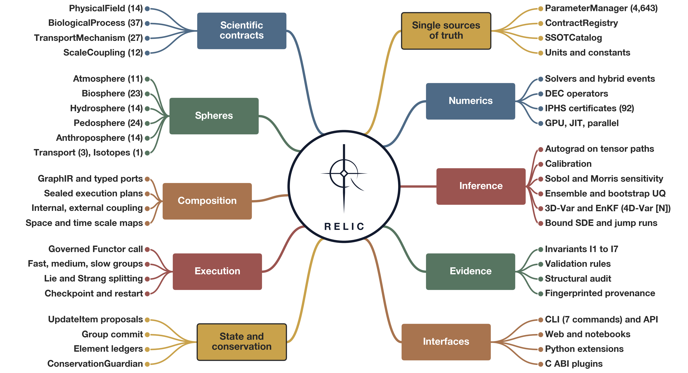
</p>

---

## Key Capabilities

### End-to-End Differentiability

Tensor-based scientific kernels support automatic differentiation and the optimization interfaces in `relic/optimization/`. Validate the executed graph, parameter bindings, implicit solves, and event boundaries before claiming gradient accuracy for sensitivity or assimilation workflows.

### Category-Theoretic Foundation

The four scientific contracts -- `PhysicalField`, `BiologicalProcess`, `TransportMechanism`, and `ScaleCoupling` -- govern composition through the unified `FunctorBase` lifecycle (`92` certified concrete scientific `Functor` classes, `0` uncertified). Conservation is enforced on declared ledgers by runtime owners, while `category_theory.py` documents the categorical design blueprint.

### Multi-Sphere Coupling

The coupling layer provides internal inter-sphere coupling, spatial and temporal scale transformations, C Application Binary Interface (ABI) native plugins, and explicit external model adapters. Budgets and typed exchanges are validated under their declared contracts. The National Unified Operational Prediction Capability (NUOPC) and Earth System Modeling Framework (ESMF) phase mapping serves as conceptual documentation without claiming a standalone external NUOPC mediator (`[N]`).

### Multi-Rate Execution Engine

Functors are organized into fast, medium, and slow execution groups with configurable triggering intervals and calendar-aware scheduling. Adaptive stepping evaluates a scaled root-mean-square (RMS) control heuristic over the state changes committed by the fast group, with at most one rollback retry. Lie and Strang operator splitting modes are available; Strang splitting reaches second-order accuracy only when sub-flows are exact or order-compatible with consistent stage times (see `docs/source/architecture_overview.md` Section 4.4.1).

### Unified Parameter System

Parameters are governed as a Single Source of Truth (SSOT) through a four-layer access architecture backed by `139` versioned YAML files (`4,762` leaf entries) that load `4,652` active runtime parameters (`810` differentiable parameters with `requires_grad=True`). Each entry declares `value`, `units`, `dtype`, `bounds`, `category`, `description`, `references`, `tags`, `provenance`, and `requires_grad` under a strict zero-hardcoding policy.

### Graph Orchestration Engine

Scientific workflows compile into sealed execution plans through the Graph Intermediate Representation (`GraphIR`), with optional constant-folding and identity-elimination passes plus explicit single-step port adapters (`AdapterRegistry` and `ExecutableAdapterFunctor`). Execution strategies support push-based and dirty-flag propagation with opt-in caching for nodes marked `deterministic_pure`. `GraphExecutor` verifies the sealed plan and registers its planned Functors into a single `RELICSimulator`, which owns time stepping and state commits.

### Stochastic Uncertainty Quantification

Sensitivity analysis provides Sobol variance indices and Morris elementary-effects screening. Uncertainty Quantification (UQ) implements ensemble (`EnsembleUQ`) and bootstrap (`BootstrapUQ`) propagation (`[I]`), while `UQMethod` enumerates `MONTE_CARLO`, `POLYNOMIAL_CHAOS`, and `BAYESIAN` as unimplemented placeholders (`[N]`). The `relic/stochastic/` package provides stochastic differential equation (SDE) solvers, Gillespie jump simulation, an ensemble runner, a weather generator, and two `GraphIR`-bound processes (`OrnsteinUhlenbeckTemperatureFunctor` and `MarkedPoissonRainfallFunctor`) with deterministic substream checkpoint replay (`[I]`); the weather-forcing `GraphIR` route remains unimplemented (`[N]`). Data assimilation in `relic/optimization/assimilation/` implements three-dimensional variational assimilation (`ThreeDVar`), Ensemble Kalman Filter (`EnKF`), and `ObservationStateFeedbackFunctor` (`[I]`), while `FourDVar` remains a framework shell without an adjoint (`[N]`).

---

## System Requirements

| Component   | Minimum                | Recommended   |
| :---------- | :--------------------- | :------------ |
| **Python**  | 3.11 or newer          | 3.11          |
| **PyTorch** | 2.0 or newer           | 2.2+          |
| **CUDA**    | Optional (CPU-only OK) | 11.8+ for GPU |
| **OS**      | Windows / Linux / macOS | --           |

Standard Conda environments separate runtime roles: `RELIC` runs model simulations, scientific preparation, and `pytest`; `dataanalysis` runs independent postprocessing and figure workflows; `sphinx_env` builds the Sphinx HTML and retrieval corpora.

---

## Getting Started

### Option A -- Conda + Editable Install _(Recommended)_

```powershell
# 1. Enter an existing checkout; replace this path with its actual location
Set-Location -LiteralPath 'C:\path\to\RELIC'

# 2. Activate the existing RELIC environment (Python 3.11)
conda activate RELIC

# 3. Install RELIC in editable (development) mode
pip install -e ".[dev]"
```

> **Note:** `pip install -e .` creates a directory link from the Python environment to this source tree. Code changes take effect without reinstallation. The `[dev]` extra installs testing, linting, and documentation dependencies.

### Option B -- pip-only Install

```powershell
pip install -e ".[dev]"
```

### Verify the Installation

```powershell
python -c "import relic; print(relic.__file__)"
# Expected output: ...\relic\__init__.py
```

### Command-Line Interface

`pyproject.toml` defines no console-script wrapper; invoke the unified command-line interface (CLI) and the standalone `GraphIR` compiler directly as Python modules inside the `RELIC` environment:

```powershell
# Unified CLI: params, optimization (opt, [N] runtime_unbound), data, compute,
#              stochastic (stoch), orchestration (graph), healthcheck (health)
python -m relic.interfaces.cli.main --help
python -m relic.interfaces.cli.main healthcheck

# Standalone GraphIR validation and sealed-plan compilation CLI (validate, compile)
python -m relic.orchestration --help
```

---

## Quick Start

This synthetic example verifies one governed state update through the existing
StateManager, BiologicalProcessFunctor, and RELICSimulator owners. Save the
complete block as a Python script and run it with the RELIC interpreter.
It demonstrates lifecycle behavior; ecological accuracy and gradient claims
require their own model-specific evidence.

```python
import torch

from relic.core.dependency_graph import DependencyGraphResolver
from relic.core.functor import BiologicalProcessFunctor, FunctorMetadata
from relic.core.functor.functor_types import (
    ProcessCategory,
    SpatialScale,
    VariableKind,
)
from relic.core.simulator import RELICSimulator
from relic.core.state import StateManager
from relic.core.state.types import StateVariableSpec, UpdateItem, UpdateMode


class IncrementFunctor(BiologicalProcessFunctor):
    def __init__(self):
        metadata = FunctorMetadata(
            name="increment",
            description="Minimal state increment example.",
            category=ProcessCategory.BIOLOGICAL_PROCESS,
            mathematical_expression="x_next = x + 1",
            references=["Executable documentation example"],
            input_variables=["x"],
            output_variables=["x"],
            spatial_scale=SpatialScale.POINT,
            variable_kind=VariableKind.STATE,
        )
        super().__init__(name="increment", config={}, metadata=metadata)

    def forward(self, state, time, dt, **kwargs):
        return {
            "x": UpdateItem(
                value=torch.ones_like(state["x"]),
                mode=UpdateMode.ACCUMULATE,
                unit="dimensionless",
                per_timestep=True,
                source_functor=self.name,
            )
        }


manager = StateManager(
    {"x": StateVariableSpec(name="x", units="dimensionless")}
)
manager.initialize({"x": torch.tensor(1.0)})

simulator = RELICSimulator({"time_step": 60.0})
simulator.initialize(manager, DependencyGraphResolver())
simulator.register_functor(IncrementFunctor(), execution_group="fast")

updates = simulator.step(60.0)
print(float(simulator.get_state()["x"]))
print(sorted(updates))
print(simulator.step_count)
```

Expected output:

```text
2.0
['x']
1
```

> For worked examples, see the [`tutorial/`](tutorial/) directory: `primary/` holds the 30 tutorial notebooks (`00`-`29`), `theory/` the theory scripts, and `case/` the Tapajos KM67 (`BR-Sa1`) single-site biogenic volatile organic compound (BVOC) case.

---

## Architecture

### Project Structure

`relic/` contains `16` subpackages (`597` subpackage `.py` files, `598` `.py` files including `relic/__init__.py`, and `319,379` subpackage lines):

```
relic/                   # 598 .py files total (relic/__init__.py + 597 subpackage files, 319,379 subpackage lines)
+-- core/                # 71 files, 40,861 lines -- Abstractions, Functor system, simulator, state management
|   +-- functor/         #   FunctorBase, bridges, metadata, stochastic substreams, type enums
|   +-- simulator/       #   RELICSimulator, execution groups, checkpoints, time and scale ops
|   +-- state/           #   StateManager, savepoints, conservation ledger
|   +-- units/           #   Unit definitions, system, validator
|   +-- config/          #   Configuration loader, models, validator
|   +-- managers/        #   Shared manager lifecycle contracts
|   +-- provenance/      #   Run-level provenance recording
|   +-- services/        #   Runtime configuration and health helpers
+-- scientific/          # 169 files, 113,023 lines -- Domain-specific process modules (92 certified Functors)
|   +-- atmosphere/      #   Radiation, turbulence, chemistry, aerosol, transport (12 Functors)
|   +-- biosphere/       #   Photosynthesis, respiration, growth, phenology, stress, BVOC (24 Functors)
|   +-- hydrosphere/     #   Soil moisture, groundwater, evapotranspiration, snow, runoff (14 Functors)
|   +-- pedosphere/      #   Carbon pools, decomposition, nutrient cycling, methane, transport (24 Functors)
|   +-- anthroposphere/  #   Land use, management, emissions (14 Functors)
|   +-- transport/       #   Generic advection, diffusion, boundary conditions (3 Functors)
|   +-- isotopes/        #   Isotope fractionation and tracking (1 Functor)
+-- coupling/            # 95 files, 46,992 lines -- Inter-sphere coupling and external model interfaces
|   +-- internal/        #   Biosphere-atmosphere, soil-vegetation, water-carbon
|   +-- external/        #   Atmospheric, climate and hydrological model adapters
|   +-- scales/          #   Spatial, temporal and hierarchical scale mapping
|   +-- protocol/        #   Field, mediator, state and time-stagger protocol
|   +-- observation/     #   Governed observation state feedback
|   +-- plugin/          #   C ABI plugin host
+-- parameters/          # 59 files, 20,323 lines -- ParameterManager + 139 YAML files (4,762 entries)
+-- data/                # 20 files, 12,000 lines -- I/O, CF-1.8 standards, quality control, streaming
+-- optimization/        # 16 files, 6,145 lines -- Calibration, data assimilation, sensitivity, UQ
+-- computation/         # 44 files, 27,757 lines -- Solvers, operators, parallel, distributed, GPU, JIT
|   +-- operators/       #   DEC, IPHS assembly and certificates, conservative operators
+-- orchestration/       # 15 files, 12,351 lines -- GraphIR, validator, compiler, adapters, executor, SSOTCatalog
+-- stochastic/          # 11 files, 7,524 lines -- SDE solvers, Gillespie, ensembles, weather generator
+-- validation/          # 39 files, 18,278 lines -- Validation framework, rules, cross-domain checks
+-- interfaces/          # 27 files, 5,153 lines -- CLI (7 subcommands), REST API, web UI, notebooks
+-- extensions/          # 8 files, 1,948 lines -- Manifest-based discovery and loading of user Functors
+-- monitoring/          # 2 files, 166 lines -- Prometheus-style API metric helpers
+-- contracts/           # 2 files, 481 lines -- Variable contracts and domain constraints
+-- models/              # 10 files, 4,484 lines -- Basin, patch and landscape entities, surrogate helpers
+-- utils/               # 9 files, 1,893 lines -- Physical constants, tensor helpers, response functions
assets/                  # Brand vector symbols (assets/brand/) and README architecture figures (assets/readme/)
books/                   # English and Chinese monograph preview PDFs (Methods of Ecological Analysis)
docs/                    # Bilingual Sphinx HTML website (docs/build/) and source docs (94 IPHS YAML certificates)
test/                    # Unit, integration, benchmark, invariant, system and scientific tests
tutorial/                # 30 chapter notebooks, theory scripts, and Tapajos KM67 BVOC case
```

### From Spheres to Committed State

<p align="center">
  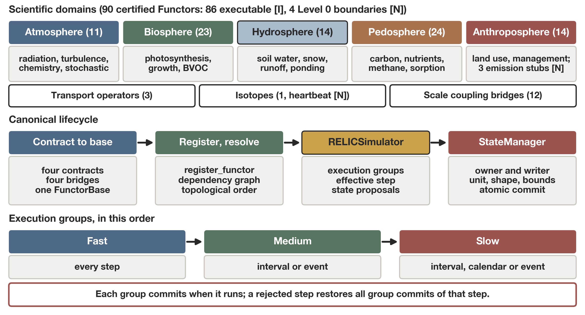
</p>

Each process belongs to a scientific domain, enters through one canonical bridge, and reaches the state only through the simulator and the StateManager.

A Functor's execution group comes from the first of these that it declares: the `register_functor` argument, `functor.execution_group`, `characteristic_time_days`, `metadata.temporal_scale`, or the `process_groups` configuration; with no declaration it runs in the fast group. Spatial scales run from `POINT`, `PATCH` and `GRID_CELL` through `HILLSLOPE`, `BASIN` and `LANDSCAPE` to `GRID_2D`, `GRID_3D`, `REGIONAL` and `GLOBAL`, and a scale change needs a `ScaleCouplingFunctor`.

### Seven Layers and the Control Plane

RELIC is partitioned into seven layers and one orthogonal control plane. Each layer has one owner in the source tree.

<p align="center">
  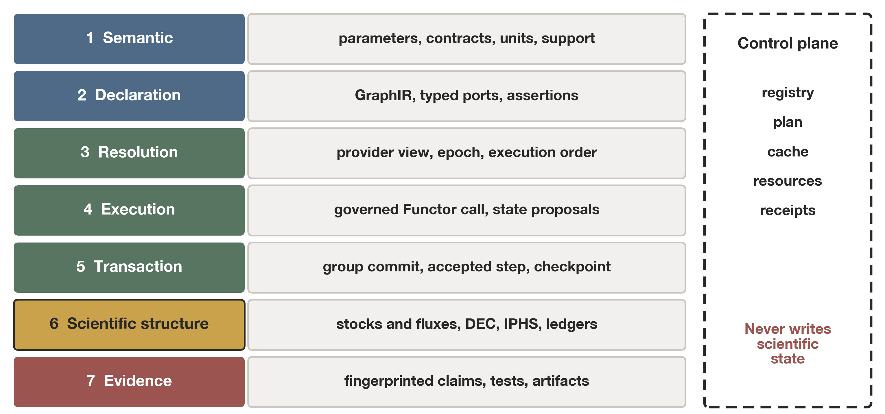
</p>

| Layer | Mathematical object | Owner | Status |
| :---- | :------------------ | :---- | :----- |
| 1 Semantic | Parameter space, variable contracts, unit, support and time morphisms | `ParameterManager`, `ContractRegistry`, `data/standards/`, `coupling/scales/temporal/` | `[I]` |
| 2 Declaration | Declared graph `G_decl`, typed ports, assertions | `orchestration/graph_ir.py`, `node_registry.py`, `validator.py`, `core/functor/functor_types.py` | `[I]` |
| 3 Resolution | Provider identity, committed view `Omega_e`, epoch, `G_res`, `G_exec` | `core/simulator/registration.py`, `core/dependency_graph.py`, `orchestration/compiler.py`, `executor.py` | `[I]` |
| 4 Execution | Governed operator `Psi_gov` with validation and local conservation | `FunctorBase.__call__`, bridges, `partition_outputs` | `[I]` |
| 5 Transaction | Group commit `T_g`, accepted step `T_step`, checkpoint and replay | `StateManager.apply_updates`, `execution_group.py`, `execution_loop.py`, `checkpoint.py` | `[I]` |
| 6 Scientific structure | Physical graph `G_phys`, Discrete Exterior Calculus (DEC) cochains, Irreversible Port-Hamiltonian System (IPHS), General Equation for Non-Equilibrium Reversible-Irreversible Coupling (GENERIC), reaction ledgers | `computation/operators/dec/`, `iphs.py`, `iphs_certificate.py`, `validation/framework/rules/` | `[I]` for owners; strict claims per certificate |
| 7 Evidence | Claim status, owner, tree hash, test, artifact, scope | `test/invariants/`, `docs/source/theory/iphs_certificates/` | `[I]` |
| Control plane | Registry, plan, cache, resource handles, epoch, receipts | `registration.py`, `distributed/launcher.py`, `core/device_policy.py`, `PluginHost`, `unload_extension` | `[I]` |

`G_decl`, `G_res` / `G_exec` and `G_phys` are three different graphs. A software incidence structure in `G_exec` is not a physical conservation proof; budgets are verified on `G_phys` ledgers.

### Core Execution Chain

RELIC has one main chain. A graph workflow is a second way in, and it joins the chain at the simulator.

<p align="center">
  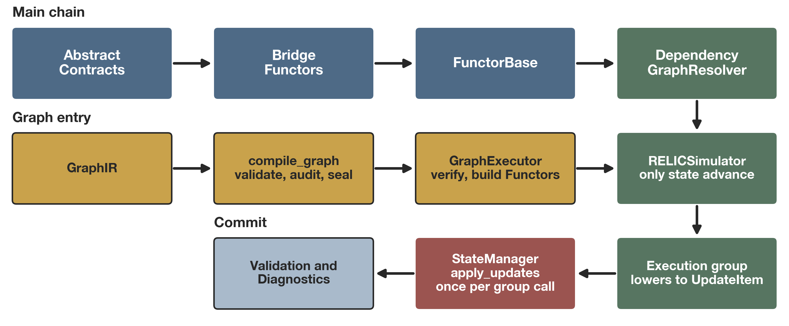
</p>

Every scientific process must satisfy this lifecycle chain. Modules that bypass any stage are non-compliant. The orchestration layer compiles and prepares; it never advances or commits scientific state. Plans compiled with `strict=False` carry a skipped witness, and `GraphExecutor` refuses to execute them.

### One Governed Step

Fast, medium and slow groups run in that order, and each one commits when it executes. A Functor proposes; the StateManager decides.

<p align="center">
  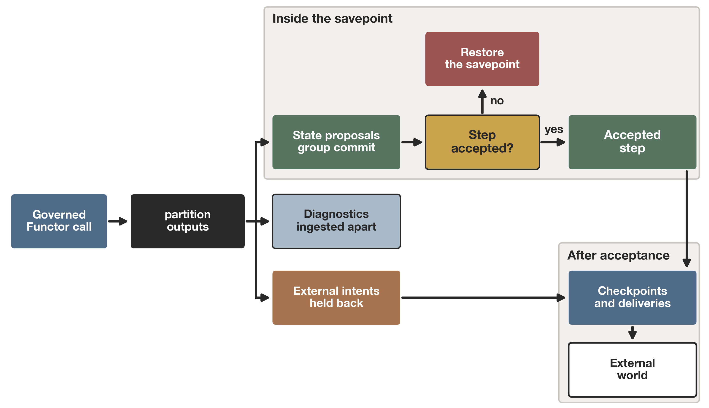
</p>

Four scopes stay separate: group commit, accepted step, post-commit checkpoint and delivery, and the external world. Only the first two sit inside the in-memory savepoint. The last two are retried and receipted, and an I/O failure never counts as a failed science step.

### Four Scientific Abstractions

Every scientific Functor implements exactly one of four contracts through its canonical bridge. Free-form code that runs without one of these meanings is not part of the RELIC path.

<p align="center">
  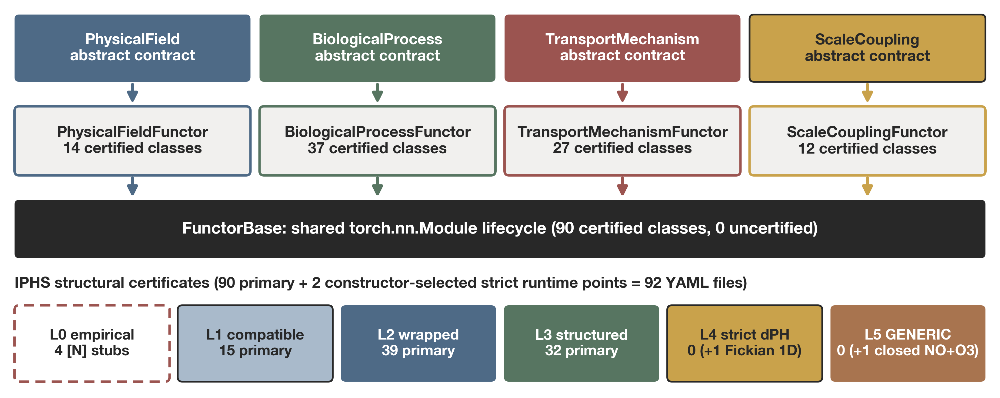
</p>

The live repository defines `92` certified concrete scientific `Functor` classes across the spheres (`0` uncertified). Of these, `88` are executable (`[I]`) and `4` are Level 0 fail-closed boundary stubs (`[N]`): `IsotopeHeartbeatFunctor`, `EmissionInventory`, `AtmosphereCoupling`, and `AnthroposphereInterfaceMapping`.

| Package | `PhysicalField` | `BiologicalProcess` | `TransportMechanism` | `ScaleCoupling` | Total |
| :------ | ---: | ---: | ---: | ---: | ---: |
| `atmosphere` | 7 | | 5 | | 12 |
| `biosphere` | | 24 | | | 24 |
| `hydrosphere` | 5 | | 9 | | 14 |
| `pedosphere` | 1 | 11 | 7 | 5 | 24 |
| `anthroposphere` | 1 | 3 | 4 | 6 | 14 |
| `transport` | | | 3 | | 3 |
| `isotopes` | | | | 1 | 1 |
| **Total** | **14** | **38** | **28** | **12** | **92** |

> Counts are verified directly from `relic/scientific/` class hierarchies and `docs/source/theory/iphs_certificates/*.yaml` (`94` YAML certificate files covering `92` unique `process_id` entries).

### Variable Roles

Each variable a Functor touches has one role. Treating a flux as a state, or a forcing as a parameter, changes the dynamics and the budget, so the role is declared and checked.

<p align="center">
  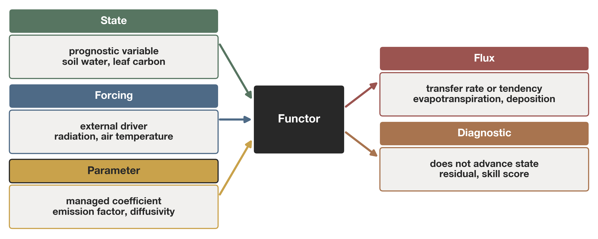
</p>

### Typed Ports and Contracts

A port match compares more than a name. A resolved port carries units, quantity, support and write semantics, so a leaf emission flux cannot connect directly to an atmospheric concentration tendency. `SSOTCatalog` defines what a variable is, and `ContractRegistry` defines who may write it.

<p align="center">
  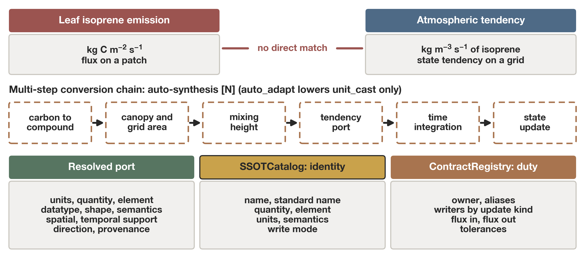
</p>

Explicit single-step port adapters are implemented in `relic/orchestration/adapters.py` through `AdapterRegistry` and `ExecutableAdapterFunctor` (`UnitCastAdapter`, `TemporalResampleAdapter`, `SemanticAdapter`, `AreaBasisTransformAdapter`, `SupportAggregationAdapter`, and `SurfaceFluxToVolumeSourceAdapter`, `[I]`). When `compile_graph(..., auto_adapt=True)` runs, the compiler automatically lowers context-free `unit_cast` mismatches only; automatic synthesis of multi-step physical conversion chains remains unimplemented (`[N]`).

### Module Dependency Matrix

This matrix is measured directly from the live Python AST under `relic/`. Each row imports from the columns, and each cell counts module-level cross-package import statements. Function-local imports and intra-package imports are excluded. The bars on the right show lines of code per subpackage.

<p align="center">
  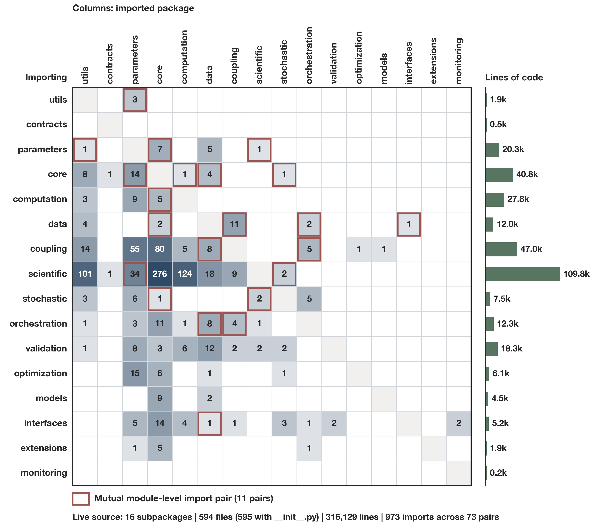
</p>

The `16` subpackages under `relic/` contain `319,379` lines across `597` Python files (`598` Python files including `relic/__init__.py`), with `985` module-level import statements across `73` directed package pairs.

The matrix records actual module-level coupling across `relic/`. Rows and columns are ordered from foundation packages (`utils`, `contracts`, `parameters`, `core`) to entry and monitoring packages (`interfaces`, `extensions`, `monitoring`); entries above the diagonal represent upward imports, and the `11` mutual module-level import pairs are outlined in brick red.

### Conservation Layers

RELIC uses four complementary conservation layers. They enforce distinct scopes, and passing a check in one layer never substitutes for the remaining layers.

| Layer | Owner | Check |
| :---- | :---- | :---- |
| 1 | `FunctorBase.__call__` | `_check_local_conservation()` during the governed call |
| 2 | `FunctorBase.check_conservation_laws()` | Evaluates declared outputs |
| 3 | `StateManager` | Element ledgers and diagnostics at commit time |
| 4 | `ConservationGuardian.check_domain()` | Domain balance |

### Parameter System Architecture

RELIC enforces a **zero-hardcoding** policy through a four-layer call architecture:

| Layer  | Scope                   | Entry Point                        |
| :----- | :---------------------- | :--------------------------------- |
| **L4** | Scripts / tools / infra | `get_global_manager().get()`       |
| **L3** | Scientific Functors     | `self.get_parameter_value()`       |
| **L2** | Manager (SSOT)          | `manager.get()` -- cache + units   |
| **L1** | Database (internal)     | `database_manager.get_parameter()` |

<p align="center">
  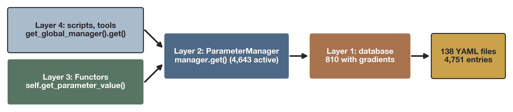
</p>

> `ParameterManager` loads **`4,652`** default active runtime parameters (`810` differentiable `torch.nn.Parameter` entries with `requires_grad=True`) from **`139`** versioned YAML files under `relic/parameters/database/` (`135` base files in `relic/` with `4,651` leaf entries and `4` files in `calibrated/` with `111` leaf entries, totaling **`4,762`** YAML leaf entries). Each entry declares `value`, `units`, `dtype`, `bounds`, `category`, `description`, `references`, `tags`, `provenance`, and `requires_grad`.

### Structural Certificates

Each process certificate in `docs/source/theory/iphs_certificates/` records how far a concrete scientific `Functor` is bound to Irreversible Port-Hamiltonian System (IPHS) structure. Levels 0-3 are descriptive tiers; an empirical or wrapped process law at Levels 1-3 is complete once its declared unit, port, and conservation contracts hold, whereas Level 0 marks fail-closed `[N]` boundary stubs. Levels 4 and 5 are strict structural claims backed by executable runtime audits.

| Level | Name | Meaning | Primary Processes | Constructor-Scoped Points |
| :---- | :--- | :------ | ---: | ---: |
| 0 | `ordinary_empirical` | Fail-closed boundary stub with no IPHS structural claim (`[N]`) | 4 | 0 |
| 1 | `iphs_compatible` | Conservation, dissipation, port or DEC metadata are compatible with IPHS | 17 | 0 |
| 2 | `iphs_wrapped` | The canonical runtime uses an IPHS operator around an existing tendency | 39 | 0 |
| 3 | `iphs_structured` | Forms, ports, Hodge, J/M/G/N or assembly evidence are declared | 32 | 0 |
| 4 | `strict_iphs` | Dissipative port-Hamiltonian dynamics with a closed-port runtime audit | 0 | 1 |
| 5 | `strict_iphs_generic` | GENERIC dynamics with double degeneracy and an executable Jacobi proof | 0 | 1 |

> `docs/source/theory/iphs_certificates/` contains `94` YAML certificate files: `92` primary process certificates (`4 / 17 / 39 / 32 / 0 / 0`) plus `2` constructor-selected strict runtime-point certificates (`FickianDiffusion(strict_runtime_point=True, spatial_dims=1)` at Level 4 and `ChemistryFunctor(physical_boundary="closed_constant_volume")` at Level 5, yielding `4 / 17 / 39 / 32 / 1 / 1` across all `94` files). Constructor-selected certificates hold strictly for their declared parameter and boundary regimes, leaving the general process class at its primary level.

Claims in the documentation carry one of five status labels: `[I]` implemented and exercised, `[N]` not implemented and fail-closed, `[H]` historical context only, `[M]` measured from a named artifact, and `[X]` contradicted or retired.

### Capability Boundary

This table separates what exists from what does not. An installation enables only the optional adapters it configures, so an entry under Available is not active everywhere.

<p align="center">
  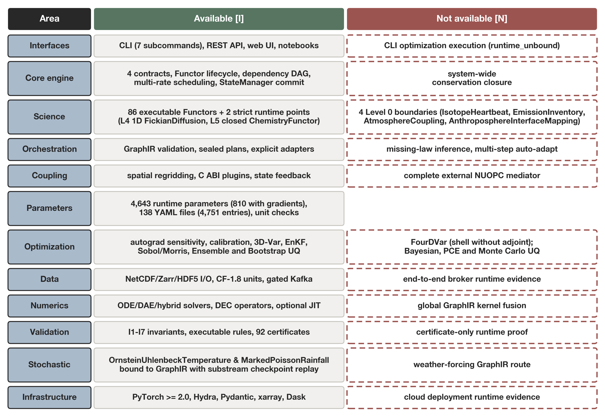
</p>

### Extension Paths

Both paths adapt a process into the existing Functor and simulator lifecycle. Neither one adds a second registry, scheduler or runtime.

| Path | Owner | Entry | Use |
| :--- | :---- | :---- | :-- |
| Python and manifest | `relic/extensions/` | `relic_extension.yaml` | User Functors in Python; each declaration states its `execution_group` |
| C ABI and shared library | `relic/coupling/plugin/` | `PluginHost`, `PluginFunctorAdapter` | Language-agnostic native coupling via C ABI shared libraries |

---

## Monographs & Theory Books

RELIC is accompanied by a comprehensive six-volume, 30-chapter theoretical and methodological monograph authored by **Yuchong Long (隆宇翀)** in both English and Chinese PDF editions (see [`books/`](books/)):

- **English Edition:** *Methods of Ecological Analysis* (4,264 pages: Prologue + 6 Volumes, 30 Chapters, 169 Sections)
- **Chinese Edition (中文版):** 《生态学分析方法》（全书 3,700 页：序章 + 六卷 30 章、169 节）

| Edition / 版本 | In-Repo Sample Preview (`< 8 MiB`, inline viewer) | In-Repo Compact Full-Page Preview (`< 75 MiB`) | High-Res 200-dpi & Lossless 600-dpi Print PDFs (GitHub Release `v1.0.0`) |
| :--- | :--- | :--- | :--- |
| **English** | [`EN_Sample_Preview.pdf` (170 pp., 5.4 MiB)](books/Methods_of_Ecological_Analysis_EN_Sample_Preview.pdf) | [`EN_Compact_Preview.pdf` (4,264 pp., 52.2 MiB)](books/Methods_of_Ecological_Analysis_EN_Compact_Preview.pdf) | [`EN_Preview_200dpi.pdf` (93.5 MiB)](https://github.com/AyinMostima/RELIC/releases/download/v1.0.0/Methods_of_Ecological_Analysis_EN_Preview_200dpi.pdf) · [`EN_Full_600dpi.pdf` (1.28 GiB)](https://github.com/AyinMostima/RELIC/releases/download/v1.0.0/Methods_of_Ecological_Analysis_EN_Full_600dpi.pdf) |
| **中文版 (Chinese)** | [`CN_Sample_Preview.pdf` (136 页, 7.4 MiB)](books/Methods_of_Ecological_Analysis_CN_Sample_Preview.pdf) | [`CN_Compact_Preview.pdf` (3,700 页, 74.2 MiB)](books/Methods_of_Ecological_Analysis_CN_Compact_Preview.pdf) | [`CN_Preview_200dpi.pdf` (114.1 MiB)](https://github.com/AyinMostima/RELIC/releases/download/v1.0.0/Methods_of_Ecological_Analysis_CN_Preview_200dpi.pdf) · [`CN_Full_600dpi.pdf` (996.7 MiB)](https://github.com/AyinMostima/RELIC/releases/download/v1.0.0/Methods_of_Ecological_Analysis_CN_Full_600dpi.pdf) |

Hands-on executable notebooks (`00`--`29`) and theory scripts paired with the 30 chapters are located in [`tutorial/`](tutorial/).

---

## Video Tutorials (Bilibili & YouTube)

A 13-episode animated mathematical derivation and code-walkthrough lecture series (~7.3 hours total; each Bilibili upload contains **P1 中文版** Chinese audio + **P2 English** audio) accompanies *Methods of Ecological Analysis* and the RELIC codebase:

- **Bilibili Channel (哔哩哔哩视频合集主页):** **[https://space.bilibili.com/3690975918557825/upload/video](https://space.bilibili.com/3690975918557825/upload/video)**

| Episode | Act | Title (中文 / English) | Duration | Bilibili (`P1 中文` / `P2 EN`) | YouTube (`EN`) |
| :---: | :---: | :--- | :---: | :---: | :---: |
| **EP01** | I | 【RELIC·生态学分析方法概论 01】公理化迷思与地球收支账本中的双端配对守恒<br>*The Axiomatic Myth and the Earth Budget Ledger* | 34:43 | [`BV1Uisp6VE3c`](https://www.bilibili.com/video/BV1Uisp6VE3c)<br>([P1 中文](https://www.bilibili.com/video/BV1Uisp6VE3c?p=1) · [P2 EN](https://www.bilibili.com/video/BV1Uisp6VE3c?p=2)) | *Uploading soon* |
| **EP02** | I | 【RELIC·生态学分析方法概论 02】非负正锥上的梅茨勒矩阵流与化学计量守恒<br>*Metzler Positive Cones and Stoichiometric Conservation* | 34:06 | [`BV1t5sH6zELE`](https://www.bilibili.com/video/BV1t5sH6zELE)<br>([P1 中文](https://www.bilibili.com/video/BV1t5sH6zELE?p=1) · [P2 EN](https://www.bilibili.com/video/BV1t5sH6zELE?p=2)) | *Uploading soon* |
| **EP03** | I | 【RELIC·生态学分析方法概论 03】边界的边界为零 · 离散斯托克斯恒等式与霍奇星算子<br>*The Boundary of a Boundary Is Zero in Discrete Calculus* | 33:25 | [`BV11JsH6KEfB`](https://www.bilibili.com/video/BV11JsH6KEfB)<br>([P1 中文](https://www.bilibili.com/video/BV11JsH6KEfB?p=1) · [P2 EN](https://www.bilibili.com/video/BV11JsH6KEfB?p=2)) | *Uploading soon* |
| **EP04** | II | 【RELIC·生态学分析方法概论 04】开放耦合系统中的端口哈密顿结构与热力学第二定律<br>*Port-Hamiltonian Mechanics and the Second Law* | 31:09 | [`BV1xJsH6KE6s`](https://www.bilibili.com/video/BV1xJsH6KE6s)<br>([P1 中文](https://www.bilibili.com/video/BV1xJsH6KE6s?p=1) · [P2 EN](https://www.bilibili.com/video/BV1xJsH6KE6s?p=2)) | *Uploading soon* |
| **EP05** | II | 【RELIC·生态学分析方法概论 05】从定型端口范畴到受治理算子的函子缺陷传播界<br>*From Typed Port Categories to Functor Defect Bounds* | 32:13 | [`BV1hgsH6GEck`](https://www.bilibili.com/video/BV1hgsH6GEck)<br>([P1 中文](https://www.bilibili.com/video/BV1hgsH6GEck?p=1) · [P2 EN](https://www.bilibili.com/video/BV1hgsH6GEck?p=2)) | *Uploading soon* |
| **EP06** | II | 【RELIC·生态学分析方法概论 06】四图中间表示下的无竞态并行调度与单源状态治理<br>*Wavefront Scheduling and Single-Source State Commits* | 33:37 | [`BV1DMsH6CEqp`](https://www.bilibili.com/video/BV1DMsH6CEqp)<br>([P1 中文](https://www.bilibili.com/video/BV1DMsH6CEqp?p=1) · [P2 EN](https://www.bilibili.com/video/BV1DMsH6CEqp?p=2)) | *Uploading soon* |
| **EP07** | III | 【RELIC·生态学分析方法概论 07】大气—冠层—土壤通量闭合与混合型理查兹守恒求解<br>*Canopy Energy Closure and Mixed-Form Richards Flow* | 35:50 | [`BV1DMsH6CEmW`](https://www.bilibili.com/video/BV1DMsH6CEmW)<br>([P1 中文](https://www.bilibili.com/video/BV1DMsH6CEmW?p=1) · [P2 EN](https://www.bilibili.com/video/BV1DMsH6CEmW?p=2)) | *Uploading soon* |
| **EP08** | III | 【RELIC·生态学分析方法概论 08】叶片光合气孔最优耦合与叶绿体异戊二烯合成机理<br>*Leaf Gas-Exchange Optimality and Chloroplast Isoprene* | 34:44 | [`BV183sH6rEjG`](https://www.bilibili.com/video/BV183sH6rEjG)<br>([P1 中文](https://www.bilibili.com/video/BV183sH6rEjG?p=1) · [P2 EN](https://www.bilibili.com/video/BV183sH6rEjG?p=2)) | *Uploading soon* |
| **EP09** | III | 【RELIC·生态学分析方法概论 09】冻融移动土层中的碳氮磷化学计量与马尔可夫碳龄<br>*Soil C-N-P Stoichiometry in Moving Permafrost Horizons* | 35:01 | [`BV1wbsH6cEce`](https://www.bilibili.com/video/BV1wbsH6cEce)<br>([P1 中文](https://www.bilibili.com/video/BV1wbsH6cEce?p=1) · [P2 EN](https://www.bilibili.com/video/BV1wbsH6cEce?p=2)) | *Uploading soon* |
| **EP10** | IV | 【RELIC·生态学分析方法概论 10】跨尺度聚合的琴生曲率偏差与海森—协方差二阶闭合<br>*Jensen Scale Bias and Hessian-Covariance Closure* | 32:14 | [`BV1r4sH6hE82`](https://www.bilibili.com/video/BV1r4sH6hE82)<br>([P1 中文](https://www.bilibili.com/video/BV1r4sH6hE82?p=1) · [P2 EN](https://www.bilibili.com/video/BV1r4sH6hE82?p=2)) | *Uploading soon* |
| **EP11** | IV | 【RELIC·生态学分析方法概论 11】多速率算子分裂、阈值跳跃矩阵与结构因果时间窗<br>*Operator Splitting, Saltation Jumps, and Causal Clocks* | 33:57 | [`BV1JhsH6ZEbJ`](https://www.bilibili.com/video/BV1JhsH6ZEbJ)<br>([P1 中文](https://www.bilibili.com/video/BV1JhsH6ZEbJ?p=1) · [P2 EN](https://www.bilibili.com/video/BV1JhsH6ZEbJ?p=2)) | *Uploading soon* |
| **EP12** | IV | 【RELIC·生态学分析方法概论 12】突破参数补偿狭谷的变量投影伴随反演与封存证伪<br>*Parameter Identifiability and Adjoint Data Assimilation* | 30:20 | [`BV1n8sH6bE5B`](https://www.bilibili.com/video/BV1n8sH6bE5B)<br>([P1 中文](https://www.bilibili.com/video/BV1n8sH6bE5B?p=1) · [P2 EN](https://www.bilibili.com/video/BV1n8sH6bE5B?p=2)) | *Uploading soon* |
| **EP13** | Finale | 【RELIC·生态学分析方法概论 13】城市绿化怎样改变近地面臭氧 · 通路开关分解与氮氧化物临界值<br>*How Urban Greening Shifts Surface Ozone* | 33:15 | [`BV1snsH6vE16`](https://www.bilibili.com/video/BV1snsH6vE16)<br>([P1 中文](https://www.bilibili.com/video/BV1snsH6vE16?p=1) · [P2 EN](https://www.bilibili.com/video/BV1snsH6vE16?p=2)) | *Uploading soon* |

---

## Documentation

### Bilingual Online & Pre-Built Documentation (`EN` / `中文`)

- **Live Documentation Website (GitHub Pages):** **[https://ayinmostima.github.io/RELIC/](https://ayinmostima.github.io/RELIC/)**
  - **English Edition:** [`https://ayinmostima.github.io/RELIC/en/index.html`](https://ayinmostima.github.io/RELIC/en/index.html)
  - **中文完整文档 (Simplified Chinese):** [`https://ayinmostima.github.io/RELIC/zh/index.html`](https://ayinmostima.github.io/RELIC/zh/index.html)
- **In-Repository Pre-Built HTML (`docs/build/`):** Open [`docs/build/index.html`](docs/build/index.html) locally in any browser (38 synchronized English and Chinese content pages, 932 table pairs, 1,970 MathJax equation nodes per language, page-preserving `EN / 中文` switcher, and light/dark theme toggle).

### Rebuilding the Documentation from Source

```powershell
conda activate sphinx_env
powershell -NoProfile -ExecutionPolicy Bypass -File .\docs\build_public_docs.ps1
python .\docs\validate_public_html.py .\docs\build
```

### Key Theory and Architecture Documents

| Document                                                                                        | Topic                                                                   |
| :---------------------------------------------------------------------------------------------- | :---------------------------------------------------------------------- |
| [Unified Theoretical Framework](docs/source/theory/00_unified_theoretical_framework.md)         | State-Flux-Process paradigm, conservation laws, symbol table            |
| [Architecture Overview](docs/source/architecture_overview.md)                                   | Full system architecture, module contracts, API specifications          |
| [Public Architecture Guide](docs/source/public/architecture.md)                                 | Reader-facing summary of the 16 subpackages and seven layers            |
| [CLI and Extensions Guide](docs/source/public/workflows/cli_and_extensions.md)                  | Module CLI invocation (`relic.interfaces.cli.main`, `relic.orchestration`) and extension manifests |
| [DEC, IPHS, and GENERIC Theory](docs/source/public/theory/dec_iphs_generic.md)                  | Discrete Exterior Calculus, port-Hamiltonian certificates, GENERIC laws |
| [Photosynthesis](docs/source/theory/photosynthesis.md)                                          | Farquhar-von Caemmerer-Berry (FvCB, C3) and Collatz (C4) models         |
| [Radiation](docs/source/theory/radiation.md)                                                    | Surface radiation balance, canopy multi-layer transfer                  |
| [Turbulence](docs/source/theory/turbulence.md)                                                  | Monin-Obukhov similarity theory                                         |
| [Decomposition](docs/source/theory/decomposition.md)                                            | Multi-pool first-order soil carbon kinetics                             |
| [Scale Coupling](docs/source/theory/scale_coupling.md)                                          | Spatiotemporal scale coupling theory                                    |

---

## Testing

RELIC employs a layered validation strategy. These test levels are separate from the [structural certificate levels](#structural-certificates): L1-L4 record how a behavior is verified, whereas Levels 0-5 record what mathematical structure a process claims.

| Level | Scope                      | Directory           |
| :---- | :------------------------- | :------------------ |
| L1    | Unit Verification          | `test/unit/`        |
| L2    | Module Integration         | `test/integration/` |
| L3    | System Benchmarking        | `test/benchmark/`, `test/system/` |
| L4    | Scientific Validation      | `test/scientific/`, `test/validation/` |
| I1-I7 | Invariant Contract Testing | `test/invariants/`  |

Other test directories cover architecture rules and static audits (`test/audit/`, `test/architecture/`, `test/lint/`), the parameter and unit systems (`test/parameters/`, `test/config/`, `test/unit_conversion/`), the orchestration layer (`test/orchestration/`), and individual packages such as `test/coupling/`, `test/core/` and `test/transport/`.

`pytest.ini` owns test discovery and markers. It recognizes `test_*.py`, `*_test.py`, `*.test.py` and `*.spec.py`. Tests that write durable evidence, need serial execution, a GPU or external data declare the `writes_artifacts`, `serial`, `gpu` or `external_data` marker.

### Running Tests

```powershell
conda activate RELIC
pytest                                    # Full test suite
pytest test/unit/ -v                      # Unit tests only
pytest test/invariants/ -v                # Invariant contract tests (I1-I7)
pytest --cov=relic --cov-report=html      # With coverage report
```

### Invariant Contracts (I1-I7)

| Contract            | Verification                                |
| :------------------ | :------------------------------------------ |
| I1 No Side Effects  | `forward()` does not mutate `StateManager`  |
| I2 Unit Consistency | Increment units match target variable       |
| I3 Conservation     | Closed transfers preserve the conserved total; open changes match explicitly routed exchanges |
| I4 Reversibility    | +delta then -delta restores initial state   |
| I5 Commutativity    | Independent increments are order-invariant  |
| I6 dt-Scaling       | `per_second` basis scales correctly with dt |
| I7 Bounds Clipping  | Clipping produces `clip_loss` diagnostic    |

---

## Contributing

We welcome contributions. Please follow these guidelines:

1. **Fork** the repository and create a feature branch
2. Follow coding standards: `black` (100 chars), `isort`, `ruff`, `mypy`
3. Write tests following the [layered validation strategy](docs/source/architecture_overview.md)
4. Ensure `pytest` passes and the formatting and lint checks above are clean
5. Submit a **Pull Request** with a clear description

> **Important:** Scientific modules must follow the Functor lifecycle chain from
> _Abstraction Contract_ through _Bridge Class_ and _FunctorBase_ to _Parameter System_.
> See the [architecture overview](docs/source/architecture_overview.md) for details.

---

## Companion Publications & Public Datasets (Zenodo)

Public simulation outputs, certified analytical benchmarks, scale-transformation operator diagnostics, and multi-decadal global gridded summary datasets accompanying the three RELIC studies are permanently archived under CC BY 4.0 on **Zenodo**:

| Study Scope | Archive Content Summary | Zenodo DOI |
| :--- | :--- | :--- |
| **Composable Scheduling & Contractual Graph Compilation** | 192-configuration compiled workflow matrix, 160-bit outward ball enclosures (24 cases), multirate ledger audits, multiyear AD sensitivity & kink diagnostics, 5-year ring-ledger restart metrics, and CPU/GPU scaling benchmarks | [](https://doi.org/10.5281/zenodo.24212913)<br>[`10.5281/zenodo.24212913`](https://doi.org/10.5281/zenodo.24212913) |
| **Structure-Preserving Spatial & Diurnal Scale Operators** | 22-year (2003--2024) global coarsening and subgrid Jensen curvature fields (`0.5°` / `2°` / `5°`), conservative coastal-mask remapping proofs, diurnal variance-projection bounds, and coupled soil-memory drift summaries | [](https://doi.org/10.5281/zenodo.24212925)<br>[`10.5281/zenodo.24212925`](https://doi.org/10.5281/zenodo.24212925) |
| **Leaf-to-Global Isoprene Mechanisms & Ozone Regimes** | Algebraic supply-compensation and Jacobian singular-value spectra, 5-point Gauss--Legendre daylight quadrature tables, 22-year global `0.5°` monthly NetCDF ensembles under alternative hydrological closures, and $\mathrm{NO}_x$/$\mathrm{O}_x$ regime diagnostics | [](https://doi.org/10.5281/zenodo.24212949)<br>[`10.5281/zenodo.24212949`](https://doi.org/10.5281/zenodo.24212949) |

> **Note on Site Measurement Agreements:** Non-public raw subdaily eddy-covariance and leaf-chamber station measurements governed by third-party site principal investigator data-sharing agreements are not redistributed here and are available from the corresponding author upon reasonable request.

---

## Author & Citation

**Author:** Yuchong Long (隆宇翀)

If you use RELIC, its documentation, its tutorials, or the accompanying monographs in academic work, please cite:

```bibtex
@software{long2026relic,
  author       = {Long, Yuchong},
  title        = {{RELIC: Recomposable Ecosystem Library for Integrated Coupling}},
  version      = {1.0.0},
  year         = {2026},
  url          = {https://github.com/AyinMostima/RELIC}
}
```

---

## License

RELIC is released under the [MIT License](LICENSE). The license covers the code and documentation in this repository, with these limits:

- **Fonts.** `matplotlibrc` configures `Helvetica Neue LT Pro` (a commercial typeface) with standard sans-serif fallbacks. Commercial font files are not redistributed in this repository; obtain your own license where exact Helvetica Neue LT Pro rendering is required.
- **Name and symbol.** The RELIC name and symbol identify the project. The license grants no trademark rights in them.
- **Data and third-party material.** Datasets and third-party components keep their own terms.

---

## Symbol

The RELIC symbol draws the idea behind the project: an observation is a section through a larger structure. The long axis stands for that structure, the fine horizontal line for the section, the open ring for a control volume with a declared boundary, and the curved stroke for what crosses that boundary. Axis, ring and stroke together suggest the letter R.

Vector files are in [`assets/brand/`](assets/brand/): `relic_mark_navy.svg` for light backgrounds and `relic_mark_white.svg` for dark ones.

---

**R E L I C** -- _Differentiable Earth System Modeling_ -- _Lunar Architecture Programme_

_Ad astra per aspera -- Through hardships to the stars_
