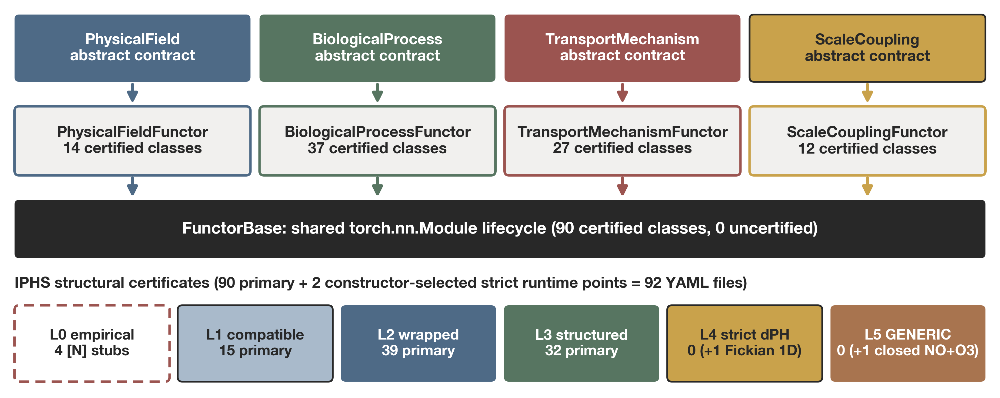
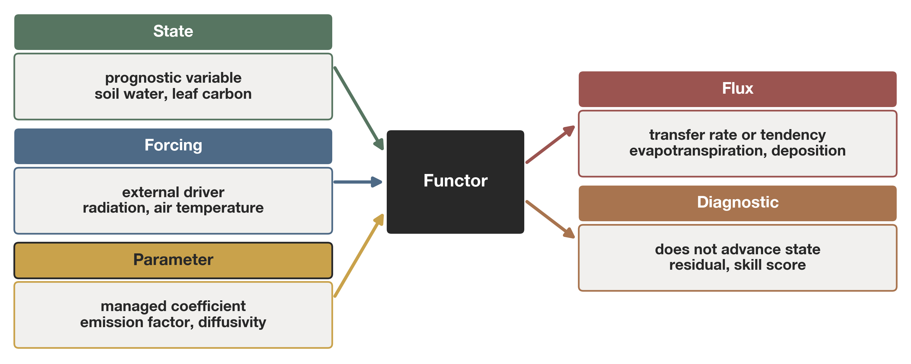

# System Architecture

## Scope and architectural contract

The Recomposable Ecosystem Library for Integrated Coupling (RELIC) is a
composable framework for biogeochemical simulation built on PyTorch tensors.
Gradients are available along the executed tensor path; bound clipping, events,
rate-group and adaptive-step decisions, and external I/O are
non-differentiable boundaries.
It operates as a system of cooperating Functors under shared runtime owners,
never as a single monolithic model.
The package architecture follows four rules:

1. reuse the canonical owner before adding a capability;
2. compose processes through declared contracts without direct
   Functor-to-Functor calls;
3. route state, parameters, units, and device selection through their existing
   managers; and
4. distinguish structural evidence from executed scientific behavior.

The package version is the public architecture version. Subsystem schema
versions, such as a GraphIR schema version, describe only that subsystem.

## Architecture capability map

```{figure} ../../../assets/readme/relic_mindmap.png
:alt: RELIC architecture from user interfaces through the core engine (autograd along tensor paths), scientific Functors, orchestration, parameter, optimization, data, validation, coupling, and computing layers
:width: 100%
:align: center

RELIC capability map. The executable core is the Functor, StateManager,
parameter, orchestration, and validation path described in this guide;
gradients are available along its tensor paths, not through clipping, event,
or step-control decisions.
```

This diagram is a capability map, not a statement that every optional
interface, streaming backend, coupling adapter, or deployment dependency is
enabled in every installation. The canonical owners and runtime boundaries
below determine what is active for a configured RELIC environment.

In particular, the diagram's `Strict IPHS` label denotes the target capability
boundary. In the live inventory documented in this guide, `90` unique concrete
scientific `Functor` classes are registered across the four canonical bridge
families (`BiologicalProcessFunctor`: `37`, `TransportMechanismFunctor`: `27`,
`PhysicalFieldFunctor`: `14`, `ScaleCouplingFunctor`: `12`; `0` uncertified)
and are backed by `92` YAML certificates. Every concrete class has one primary
certificate, giving a 90-class distribution across Levels 0 through 5 of
`4 / 15 / 39 / 32 / 0 / 0`: four unavailable Level 0 boundaries and `86`
executable classes across Levels 1 through 3 (IPHS-compatible, IPHS-wrapped,
or IPHS-structured). A Level 0 entry is a fail-closed boundary, not an
executable scientific process.

Two secondary certificates each cover one constructor selection, named in
their `constructor_selection` field, bringing the 92-certificate totals across
Levels 0 through 5 to `4 / 15 / 39 / 32 / 1 / 1`:
`FickianDiffusion(strict_runtime_point=True, spatial_dims=1)` at Level 4
(strict dissipative port-Hamiltonian, `{strict_runtime_point: true, spatial_dims: 1}`)
and `ChemistryFunctor(physical_boundary="closed_constant_volume")` at Level 5
(strict GENERIC, `{physical_boundary: closed_constant_volume}`).
`IPHSEquivalenceCertificate` accepts either one only together with the
runtime-point audit of a governed, committed step; without it the certificate
reports `process_bound_runtime_unavailable`. Only these two selections, within
their declared domain, may be described as strict. The primary certificates of
both classes remain at Level 3, and every other configuration of these classes
keeps that level.

The static overview diagram also reflects an earlier snapshot on two stochastic
status badges (`stochastic_graphir_binding` and `restartable_substream`). In
the live tree, `GraphIR` binds both certified Level 2 (`[I]`) stochastic
Functors (`OrnsteinUhlenbeckTemperatureFunctor` and
`MarkedPoissonRainfallFunctor`) with deterministic per-Functor substream
checkpoint and restart replay through `FunctorSubstreamMixin`. By contrast,
public optimization model-evaluation execution remains `[N]` (`runtime_unbound`),
and `FourDVar` in `relic.optimization.assimilation` remains an unimplemented
`[N]` framework shell without an adjoint model.

## Package ownership and seven-layer map

The `relic\` package comprises `16` top-level subpackages containing `594`
subpackage `.py` files (`595` Python files including `relic\__init__.py`) and
`316,129` lines of Python. Static import analysis across those `16`
subpackages records `73` directed cross-package edge pairs, `973`
cross-package import statements, and `11` mutual package pairs governed by the
layered dependency rules.

| Area | Canonical responsibility |
| --- | --- |
| `relic\core\` | Scientific abstractions, Functor lifecycle, simulator, state management, dependency graph, and device policy |
| `relic\scientific\` | Concrete atmosphere, biosphere, hydrosphere, pedosphere, transport, and isotope processes |
| `relic\parameters\` | `UnifiedParameterManager`, parameter database, unit-aware resolution, and metadata |
| `relic\contracts\` | Variable ownership, writer permissions, aliases, update semantics, and conservation-domain contracts |
| `relic\orchestration\` | GraphIR, typed ports, structural validation, compilation, execution plans, and graph execution |
| `relic\computation\` | Numerical solvers, DEC/IPHS operators, and compute backends |
| `relic\coupling\` | Internal, external, scale, protocol, and C ABI coupling |
| `relic\data\` | I/O, standards, quality control, streaming, and transformations |
| `relic\optimization\` | Calibration, assimilation, sensitivity analysis, and uncertainty algorithm components (`[N]` `runtime_unbound` for public model execution) |
| `relic\validation\` | Shared validation models, rules, conservation checks, and cross-domain checks |
| `relic\interfaces\` | CLI, API, Web, and Notebook-facing surfaces |
| `relic\extensions\` | Python and manifest-based extension discovery and loading |

`relic\models\`, `relic\monitoring\`, `relic\stochastic\`, and `relic\utils\`
provide bounded support services. They do not replace the simulator or any
manager listed above.

Across these `16` subpackages, the mathematical and runtime architecture is
organized into seven layers plus an orthogonal control plane:

| Layer | Mathematical and runtime role | Canonical owners | Status |
| --- | --- | --- | --- |
| `1 Semantic` | Parameter space, variable contracts, units, dimensionality, support, and calendar rules | `relic\parameters\`, `relic\contracts\`, `relic\data\standards\`, `relic\coupling\scales\temporal\` | `[I]` |
| `2 Declaration` | Declared dependency graph, typed `PortSpec` contracts, extensions, and graph assertions | `relic\orchestration\graph_ir.py`, `node_registry.py`, `port_spec.py`, `validator.py`, `relic\core\functor\functor_types.py` | `[I]` |
| `3 Resolution` | Provider identity digests, immutable `CommittedProviderView` epochs, topological orders, and sealed `ExecutionPlan` | `relic\core\simulator\registration.py`, `relic\core\dependency_graph.py`, `relic\orchestration\compiler.py`, `executor.py` | `[I]` |
| `4 Execution` | Governed call `FunctorBase.__call__` wrapping kernel `forward`, local conservation hook, and output partitioning | `relic\core\functor\functor_base.py`, `*_bridge.py`, `relic\core\state\types.py` (`partition_outputs`) | `[I]` |
| `5 Transaction` | Per-group-call `StateManager.apply_updates` commits, outer step savepoint and rollback, and durable checkpoint replay | `relic\core\state\manager.py`, `relic\core\simulator\execution_group.py`, `execution_loop.py`, `checkpoint.py` | `[I]` |
| `6 Scientific structure` | Physical exchange ledgers, DEC cochains, `LinearChainMap`, `HodgeStarSpec`, `IPHSStructureSpec`, and certificates | `relic\computation\operators\dec\`, `iphs.py`, `iphs_certificate.py`, `relic\validation\framework\rules\` | `[I]` |
| `7 Evidence` | Fingerprinted audit bundles, claim provenance, and verification scripts | `test\invariants\` suites and `analysis_results\` artifacts | `[I]` |
| `Control plane` | Provider lifecycle receipts, device fences, distributed coordination, and C ABI `PluginHost` drain/unload | `registration.py`, `relic\core\device_policy.py`, `relic\computation\distributed\launcher.py`, `relic\coupling\plugin\host.py`, `relic\extensions\loader.py` | `[I]` |

## Four scientific abstractions

Every executable scientific process declares one primary scientific contract:

| Abstract contract | Meaning | Bridge family |
| --- | --- | --- |
| `PhysicalField` | A spatial or environmental field with physical semantics | `PhysicalFieldFunctor` |
| `BiologicalProcess` | A biological or biogeochemical transformation | `BiologicalProcessFunctor` |
| `TransportMechanism` | Movement of matter, energy, or tracers | `TransportMechanismFunctor` |
| `ScaleCoupling` | Mapping or aggregation across declared scales | `ScaleCouplingFunctor` |



The required lifecycle chain is:

```text
Scientific abstraction
  -> canonical Bridge Class
  -> FunctorBase and torch.nn.Module
  -> parameter-system-backed values
  -> RELICSimulator registration
  -> dependency-resolved execution group
  -> StateManager.apply_updates(...)
  -> diagnostics and provenance
```

Bridge Classes connect the scientific interface to the system lifecycle. They
do not waive conservation, gradient, metadata, or unit obligations defined by
the abstraction.

## Functor lifecycle and metadata

`FunctorBase` owns parameter namespace resolution, metadata, device migration,
forward execution hooks, diagnostics, and local conservation integration.
Concrete Functors implement `forward(state, time, dt, **kwargs)` and return
declared updates. The simulator calls the Functor object; it does not bypass the
`__call__()` lifecycle.

`FunctorMetadata` identifies inputs, outputs, dependencies, execution stage,
spatial scale, variable kind, references, equations, units, and conserved
quantities. Empty input and output declarations reduce auditability. Competing
writers for the same non-diagnostic output are detected during registration and
may be rejected in strict dependency mode.

## Variable roles and state ownership

The framework distinguishes five variable roles:

| Role | Runtime meaning |
| --- | --- |
| `STATE` | Prognostic quantity committed through `StateManager` |
| `FLUX` | Rate or transfer used to produce a state update |
| `FORCING` | Externally supplied driver |
| `PARAMETER` | Configuration resolved through `UnifiedParameterManager` |
| `DIAGNOSTIC` | Read-only reported quantity |



`ContractRegistry` provides aliases, owners, permitted writers, increment
semantics, and conservation-domain membership when contracts are enabled.
`StateManager.apply_updates(...)` is the governed commit path. It resolves
aliases, authorizes writes, applies update semantics, maintains element
ledgers, records provenance, and rolls back failed transactional commits.

## Parameters, constants, units, and time

Scientific Functors obtain runtime values only through
`self.get_parameter_value(...)`. Non-Functor infrastructure uses
`get_global_manager().get(...)`. Parameter values, units, dtype, bounds,
references, provenance, tags, and gradient settings belong in the parameter
YAML database. Under default runtime settings, `UnifiedParameterManager` loads
`4,643` active parameters (`810` with `requires_grad=True`), backed by `138`
YAML files (`134` in the base `relic` tier with `4,642` leaf entries and `4`
in the `calibrated` tier with `109` leaf entries, totaling `4,751` YAML leaf
entries).

Physical constants are owned only by
`relic\parameters\database\relic\physical\constants.yaml` and are accessed
through `get_physical_constant(...)`. Time conversion values are resolved
through `UnifiedParameterManager`; derived fallbacks may use already resolved
values.
Scientific modules must not define duplicate constants or unit registries.

```python
from relic.core.device_policy import resolve_device
from relic.parameters import get_global_manager
from relic.utils.physical_constants import get_physical_constant

manager = get_global_manager()
kb = get_physical_constant("boltzmann_constant")
dev = resolve_device(explicit_device="cpu")
assert len(manager.list()) >= 4600
assert float(kb) > 0.0
assert dev.type == "cpu"
```

## Simulator, execution rates, and device policy

`RELICSimulator` owns registration, dependency ordering, fast/medium/slow
execution groups, stepping, output storage, checkpoint integration, provenance,
and diagnostics.

| Execution group | Trigger | Effective `dt` |
| --- | --- | --- |
| `fast` | Every global step | Current step size |
| `medium` | Configured interval or event | Time since the previous medium execution |
| `slow` | Configured interval, calendar boundary, or event | Time since the previous slow execution |

A Functor's group is fixed at registration by one priority chain: the
`execution_group` argument, then the Functor's own `execution_group`
attribute, then its characteristic time compared with two classification
thresholds from the parameter database
(`computation.scheduling.fast_group_max_characteristic_days` and
`computation.scheduling.medium_group_max_characteristic_days`; current
configuration example: 1 day and 10 days), then its temporal scale, then the
`process_groups` configuration entry, and finally `fast` when nothing is
declared. Every declared value is checked, also when a higher rule decides:
an invalid group name, a characteristic time that is not a finite
non-negative number of days, a temporal scale name that names no scale
(rejected already when the Functor's metadata is built), or a
`process_groups` entry that disagrees with the attribute, characteristic time,
or temporal scale raises `ValueError` before anything is registered. To
override a `process_groups` entry, pass the group as the argument. The
thresholds classify processes;
they are not execution intervals. The medium interval is
`medium_interval_seconds`; the slow interval is `slow_interval_seconds` or,
when that key is unset, the month of the configured calendar. A medium or slow
group also runs when one of its Functors requests a bootstrap execution or
when a registered event trigger fires; a bootstrap request is used up
whenever the group runs. A group runs at most once per step: a step that
crosses several boundaries runs it once over the whole elapsed interval.

Every call receives the start of the interval it covers as its `time`
argument, plus any sub-step offset. The fast group starts at the step start;
in Strang mode the second half-steps start half a step later; a medium or
slow group starts at its last execution time. For example, a medium group
last run at 0 s is called in the step from 1 s to 2 s with `time = 0` and
`dt = 2`. How a process samples time-dependent forcing inside that interval
is still a property of the process.

The adaptive option uses a scaled RMS metric over the state changes that the
fast group committed.
It is a control heuristic, not a Richardson or local-truncation-error estimate.
A rejected first attempt is rolled back and retried at most once, over a
shorter interval, and only when it is longer than the minimum step; an
attempt at or below the minimum step is accepted with a warning. Only
fast-group updates enter the metric. The retry result is accepted without a
second check, so an accepted step can exceed the tolerance.

`RELICSimulator(None)` normalizes `None` to the empty configuration `{}`, under
which `enable_auto_scale` defaults to `False`. Device selection is centralized
in `relic\core\device_policy.py`. Pre-registration construction places every
`FunctorBase` instance on a CPU placeholder until simulator registration
migrates it to its resolved runtime device. `resolve_device(...)` evaluates
seven precedence tiers:

1. `explicit_device` argument (unless `"auto"` or `"default"`);
2. configuration per-functor or per-module overrides (`device_overrides` and
   `module_device_overrides` at root, `simulator`, or `runtime`);
3. runtime overrides from `set_device_overrides(...)` and environment overrides
   from `RELIC_DEVICE_OVERRIDES_JSON`;
4. configuration global `device` (at root, `simulator`, or `runtime`);
5. process-wide default device from `set_default_device(...)`;
6. `RELIC_DEFAULT_DEVICE` environment variable; and
7. distributed CUDA-first selection with automatic fallback to CPU when
   `distributed=True`, or the caller's `default` (`"cpu"` by default).

Invalid override mappings raise `TypeError` and unparseable device entries
raise `RuntimeError`. Distributed and `auto` execution prefer CUDA and fall
back automatically to CPU when CUDA is unavailable (unless `require_gpu=True`
requires failure), whereas an explicit `enable_distributed: true` configuration
that cannot be satisfied raises `RuntimeError`. Scientific modules must not
perform scattered CUDA availability checks outside `relic\core\device_policy.py`.

## Structural scientific layer

RELIC reuses DEC and IPHS structures through
`relic\computation\operators\dec\` and
`relic\computation\operators\iphs.py`. Structural declarations can establish
typed cochain relationships, selected topological identities, operator
symmetry or skew-symmetry, and declared port relationships.

They do not by themselves prove an executable reaction law, a closed material
ledger, an energy or entropy closure, or a strict GENERIC implementation.
Reaction processes that claim structured execution must evaluate the declared
stoichiometric operator and rate law in the runtime path. Closed ledgers need a
runtime conservation matrix; open ledgers need an explicit route.

`IPHSEquivalenceCertificate` is the only owner of the IPHS standardization
level. Levels below strict IPHS must not be described as strict merely because
they expose compatible fields or diagnostics.

## End-to-end assembly and execution

RELIC separates model declaration, structural compilation, numerical
execution, and state commitment. The separation is functional: passing one
stage does not imply that a later stage has passed.

`GraphExecutor` builds the planned Functors and registers them into one
`RELICSimulator` per prepared run. The simulator's `step(...)` is the only
scientific state advance; `GraphExecutor` never commits state itself. Three
graphs are kept apart: the declared graph (GraphIR links and Functor
dependencies), the resolved execution order used by the simulator, and the
physical exchange graph of stocks and fluxes. An execution edge orders
computations; it does not establish a conserved transfer.

The graph path is

$$
\mathrm{GraphIR}
\xrightarrow{\mathrm{validate\_graph}}
\mathrm{ValidationReport}
\xrightarrow{\mathrm{compile\_graph}}
\mathrm{ExecutionPlan}.
$$

`compile_graph(...)` may proceed only under its selected strictness policy; a
blocking validation issue is not converted into an executable scientific
result. The runtime path for one Functor call can be written as

$$
\mathcal{F}_i:
(x,s_g,h_g,\theta_i)
\longmapsto U_i,
\qquad
U_i=\{\mathrm{UpdateItem}_{i,k}\}_k,
$$

followed by one governed commit per group call $g$ (the fast group, or each
Strang sub-execution, then the medium and slow groups when due), all inside
one step transaction

$$
x^{(g)}
=
\mathcal{C}_{\mathrm{StateManager}}
\left(
x^{(g-1)},
\bigcup_{i\in\mathcal{A}_g}U_i;
h_g,\Gamma
\right),
\qquad x^{(0)}=x^n,\quad x^{n+1}=x^{(G)},
$$

where $\theta_i$ is resolved by `UnifiedParameterManager`, $x$ is the
committed or provisional state that Functor $i$ reads, $s_g$ is the start
of the interval covered by group call $g$, $\mathcal{A}_g$ is the dependency-
and rate-selected active Functor set
of group call $g$, $G$ is the number of group calls in the step, and $\Gamma$
contains variable contracts, update modes, writer permissions, units, and
conservation-domain membership. The interval $h_g$ is the step length for the
fast group (the half or full step of a Strang sub-execution) and
$t_{\mathrm{future}}-t_{\mathrm{last}}$ for a medium or slow group. The
start $s_g$ is the step start $t_n$ for the fast group, for the first Strang
half-steps, and for the middle full step; $t_n+h/2$ for the second Strang
half-steps; and $t_{\mathrm{last}}$ for a medium or slow group. A Functor
with $m$ sub-steps is called $m$ times with $h_g/m$ at the times
$s_g+k\,h_g/m$, $k=0,\ldots,m-1$. The step is accepted or rolled back as a
whole: a failure later in the step restores every group commit of that step.
The commit operator is not an unconditional sum: `REPLACE`, `ACCUMULATE`, flux
integration, aliases, projections, and rejection or rollback retain their
declared semantics.

| Stage | Canonical owner | Consumes | Produces | Blocking condition |
| --- | --- | --- | --- | --- |
| Parameter and contract loading | `UnifiedParameterManager`, `ContractRegistry` | Parameter YAML and variable contracts | Typed values, metadata, aliases, writer and ledger rules | Missing required value, invalid unit/bounds, or inconsistent contract |
| Graph declaration | `GraphIR` | `NodeSpec`, `LinkSpec`, ports, assertions, and configuration | Declarative model graph | Malformed or contradictory declarations |
| Definition and port binding | `NodeRegistry`, `SSOTCatalog` | Class types and variable identities | `NodeDefinition` and authoritative `PortSpec` objects | Unknown class, missing port, or unit/dimension mismatch |
| Structural validation | `validate_graph(...)`, `ValidationRegistry` | Graph, registry, SSOT catalog, and assertion payloads | `ValidationReport` | Blocking graph, dependency, port, unit, topology, or scientific assertion issue |
| Compilation | `compile_graph(...)` | Validated graph and registered definitions | Sealed `ExecutionPlan` and compile report | Unresolved adapter, definition, topology, or compiler invariant |
| Registration and scheduling | `RELICSimulator` dependency and registration owners | Functor instances and execution plan | Device-assigned fast/medium/slow execution order | Duplicate writer, unresolved required dependency, or invalid device policy |
| Functor execution | `FunctorBase.__call__(...)` and the concrete `forward(...)` | Current or provisional state, time, `dt`, and resolved parameters | State proposals (`UpdateItem`), diagnostics (`diagnostics.*` names or `DERIVED` outputs), and top-level `ExternalIntent` requests that are delivered only after the step is accepted | Invalid input, execution failure, local conservation failure, or validation failure |
| Transactional state commit | `StateManager.apply_updates(...)` | Numeric updates, source map, increment metadata, contracts, and `dt` | Committed state, provenance, and conservation ledger | Unauthorized write, incompatible update, non-finite result, failed constraint, or rollback condition |
| Persistence and publication output | Existing checkpoint and data-writer owners | Committed state and run identity | Checkpoint receipt, data artifact, metadata, and hash | Incompatible checkpoint, incomplete output contract, or write failure |

Within one group call, the simulator builds a provisional state so that a
later Functor of the same call, such as a declared downstream dependency, can
consume an upstream result. That provisional state is not an independent state
owner; the authoritative state changes only through the
`StateManager.apply_updates(...)` call at the end of that group call. A failure
later in the same step restores all group commits of that step. In `strang`
mode every sub-execution is its own group call, so a downstream Functor reads
the upstream result from the state committed by the upstream's earlier
sub-execution, not from a shared provisional state. A Functor that declares
`subprocess_outputs` receives the upstream's returned outputs from the
dependency-output map that all `2n - 1` sub-executions of the fast-group
composition share; these are the outputs of the upstream's most recent earlier
sub-execution, its first half-step over `[t, t + h/2]`. The same composition
merges each Functor's diagnostics over its sub-executions by the rule that
merges the returned outputs, and StateManager stores the merged values, so the
stored diagnostics of a step equal the returned ones.

## Connection and conservation rules

An execution dependency is a declared ordering and data contract. If an edge
$i\rightarrow j$ is active, $j$ may consume only the declared output of
$i$ with compatible identity, units, shape, support, and temporal semantics.
The following rules apply:

1. A concrete Functor does not call another concrete Functor directly.
   Composition is expressed through metadata, GraphIR links, ports, adapters,
   and the simulator dependency graph.
2. Parameters flow from `UnifiedParameterManager` into Functors; GraphIR and
   `StateManager` do not become secondary parameter stores.
3. Diagnostics are reported outputs. They do not acquire prognostic ownership
   unless a separate variable contract explicitly authorizes that role.
4. Unit, support, temporal, and spatial changes require a declared executable
   adapter. A metadata relabel is not a conversion.
5. A Functor-level conservation check proves only its declared local ledger or
   constitutive relation. System conservation also requires compatible ports,
   common support and units, and the relevant storage change.

For a declared storage $S$, a step ledger has the form

$$
R_S
=
\left(S^{n+1}-S^n\right)
-
\Delta t
\left(
\sum F_{\mathrm{in}}
-
\sum F_{\mathrm{out}}
\right).
$$

The residual is meaningful only after every term is mapped to the same
quantity, unit, spatial support, and time interval. A zero structural residual,
a successful process exit, or `C N = 0` for one closed reaction ledger does not
by itself prove whole-system mass, energy, entropy, or strict GENERIC closure.
The detailed equations and applicability conditions are maintained in the
[theory guide](theory/index.rst); class-specific ports and runtime equations are
maintained in the [scientific class reference](science/index.rst).
