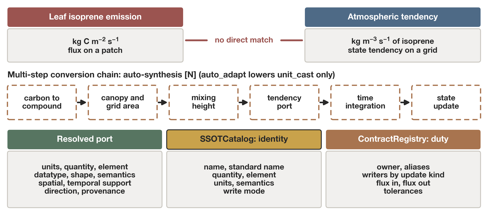

# Graph Orchestration

## Canonical owners

Graph orchestration is a layer over the existing simulator. It is not a second
runtime.

| Responsibility | Canonical owner |
| --- | --- |
| Serializable graph | `relic\orchestration\graph_ir.py` |
| Typed ports | `relic\orchestration\port_spec.py` |
| Parameter-backed variable metadata | `relic\orchestration\ssot_catalog.py` |
| Node and class resolution | `relic\orchestration\node_registry.py` |
| Connection and graph validation | `relic\orchestration\validator.py` |
| Adapter registry | `relic\orchestration\adapters.py` |
| Compilation and run-bundle serialization | `relic\orchestration\compiler.py` |
| Plan execution | `relic\orchestration\executor.py` |
| Command-line validation and compilation | `relic\orchestration\__main__.py` (`python -m relic.orchestration`) |

`RELICModelCompiler` is a facade over `compile_graph(...)`. New orchestration
features extend these owners; do not create a parallel compiler, registry, port
schema, or assertion service.

## GraphIR

`GraphIR` contains:

| Field | Contract |
| --- | --- |
| `schema_version` | Version of the serialized graph schema |
| `nodes` | Mapping from node ID to `NodeSpec` |
| `links` | Explicit `LinkSpec` connections |
| `metadata` | Graph-level metadata |
| `assertion` | Optional structural assertion container |

Each `NodeSpec` declares `class_type`, `inputs`, `outputs`, and `config`.
Explicit links are preferred for auditability. When the top-level link list is
empty, `GraphIR.from_dict(...)` may infer links from supported node input
bindings.

The executor currently understands dependency bindings in the form
`{"link": ["node_id", "port_name"]}`. Compiler constant folding may emit
`{"value": ...}`. Parameter keys remain in Functor configuration and the
canonical `UnifiedParameterManager` path; GraphIR does not provide a generic
`parameter_key` input resolver.

## PortSpec and the contract boundary

`PortSpec` carries identity, datatype, units, semantics, update behavior,
direction, support metadata (`PORT_SUPPORT_FIELDS`), and optional DEC/IPHS
structural fields. `SSOTCatalog` supplies centralized variable identity and
units from `UnifiedParameterManager`-backed definitions. `ContractRegistry` is
applied later by `StateManager`; GraphIR validation does not query it as a
substitute for `PortSpec`.



The adapter chain shown in the figure is conceptual. With `auto_adapt=True`,
the compiler automatically lowers an executable `unit_cast` adapter node only
when its triple guard holds (context-free unit conversion, strict non-unit
`can_connect(...)` compatibility, and identical explicit `execution_group` in
`{"fast", "medium", "slow"}`); all other conversions must be authored
explicitly.

| Port concern | Representative fields |
| --- | --- |
| Identity | `name`, `standard_name`, `cf_standard_name`, `quantity`, `element` |
| Data | `units`, `datatype`, `required`, `context_requirements` |
| Update | `semantics`, `update_mode`, `write_mode`, `direction`, `per_timestep`, `conservative` |
| Support (`PORT_SUPPORT_FIELDS`) | `shape`, `spatial_kind`, `area_basis`, `temporal_basis`, `vertical_basis`, `declared_support_fields` |
| Structure (DEC/IPHS) | `form_degree`, `primality`, `extensivity`, `complex_id`, `physical_domain`, `orientation_convention`, `boundary_role`, `port_kind`, `power_conjugate` |

`can_connect(...)` checks all five `PORT_SUPPORT_FIELDS` (`shape`,
`spatial_kind`, `area_basis`, `temporal_basis`, and `vertical_basis`). A
one-sided support declaration reports `missing_port_support_metadata`, and a
two-sided disagreement reports `<field>_mismatch`, requiring an explicit
support transformation adapter node.

## Validation

`can_connect(...)` and `validate_graph(...)` evaluate:

1. node and port existence;
2. datatype and declared identity compatibility;
3. unit equality or convertibility and required conversion context;
4. direction, semantics, update mode, and write mode;
5. required bindings, duplicate outputs, mutually exclusive outputs, and
   cycles; and
6. role-appropriate structural assertions.

Non-strict validation may represent some incomplete declarations as warnings.
Validation never invents missing units, owners, scientific closures, ports, or
runtime nodes.

One structural assertion item uses `phi`, `op`, `scope`, optional `context`,
and optional `audit_key`. Multiple items may be provided under `assertions`,
`items`, or `checks`. The validator may also read the supported graph metadata
fallback. Structural assertions reuse the shared validation rules and issue
model.

## Adapters

`AdapterRegistry` registers six concrete adapter classes across seven selector
keys:

| Selector key | Adapter class | Purpose |
| --- | --- | --- |
| `unit_cast` | `UnitCastAdapter` | Unit conversion delegated to the canonical `UnitConverter` |
| `temporal_resample` | `TemporalResampleAdapter` | Windowed or current-step (`interval_mean` / `interval_integral`) temporal reduction |
| `semantic_adapter` | `SemanticAdapter` | Flux-to-increment scaling by runtime `dt` |
| `flux_to_increment` | `SemanticAdapter` | Alias key bound to the same `SemanticAdapter` instance |
| `area_basis_transform` | `AreaBasisTransformAdapter` | Leaf-area to ground-area scaling via declared leaf area index |
| `surface_flux_to_volume_source` | `SurfaceFluxToVolumeSourceAdapter` | Molar surface flux (`mol m-2 s-1`) to volumetric mass source (`kg m-3 s-1`) using `cell_area`, `layer_volumes`, and a `get_physical_constant(...)` molar mass key |
| `support_aggregation` | `SupportAggregationAdapter` | Conservative support reduction governed by SSOT `spatial_basis` and `coupling.scales.defaults.conservation_tolerance` |

`ExecutableAdapterFunctor` wraps any registered adapter as a governed
`ScaleCouplingFunctor`, and `AdapterRegistry.register_executable_node(...)`
binds its authoritative source, target, and context `PortSpec` contracts in
`NodeRegistry`.

With `auto_adapt=True`, `compile_graph(...)` records each `AdapterInsertion` in
the compile report and automatically lowers an executable `unit_cast` node only
when all three guards hold:

1. the mismatch is a context-free `unit_cast` executable through the canonical
   `UnitConverter` without undeclared context;
2. strict `can_connect(...)` passes on all non-unit port attributes (identity,
   semantics, DEC structure, and support fields); and
3. both connected nodes declare the same explicit `execution_group` in
   `{"fast", "medium", "slow"}`.

After lowering, the compiler revalidates the transformed graph. Any other
adapter requirement (`temporal_resample`, `semantic_adapter`,
`flux_to_increment`, `area_basis_transform`, `surface_flux_to_volume_source`,
`support_aggregation`, context-dependent conversions, or cross-rate links) is
rejected unless authored as an explicit graph node. With `strict=True` and
`auto_adapt=False`, any connection requiring an adapter is rejected.

```python
from relic.orchestration.adapters import AdapterRegistry
from relic.orchestration.port_spec import PORT_SUPPORT_FIELDS

registry = AdapterRegistry()
keys = (
    "unit_cast",
    "temporal_resample",
    "semantic_adapter",
    "flux_to_increment",
    "area_basis_transform",
    "surface_flux_to_volume_source",
    "support_aggregation",
)
assert all(registry.get(k) is not None for k in keys)
assert registry.get("semantic_adapter") is registry.get("flux_to_increment")
assert len(PORT_SUPPORT_FIELDS) == 5
```

## Compilation and execution

The canonical flow is:

```text
GraphIR
  -> validate_graph(...)
  -> compile_graph(...)
  -> ExecutionPlan and CompileReport
  -> GraphExecutor
  -> RELICSimulator
  -> StateManager.apply_updates(...)
```

`compile_graph(...)` always performs validation. A separate validation call is
an optional preflight. The compiler produces a deterministic topological order
for the same normalized graph, with ties broken by node identifier. This order
is the registration order. At run time the simulator places each Functor in
its rate group, orders each group from the declared dependencies with the
registration order as the tie-break, runs fast, medium, and slow in that
order, and executes the Functors of a group one after another. Strict
compilation also imports, constructs, and registers every node once without
executing a step. It does not prove that a step succeeds, that dependencies
loaded only at run time are installed, or that the scientific process is
valid. A plan compiled without `strict=True` cannot be executed by
`GraphExecutor`.

`GraphExecutor` supports `PUSH` and `DIRTY` execution strategies. Both reuse
`RELICSimulator`; they are scheduling policies, not independent runtimes. Live
`GraphIR` binds both certified Level 2 (`[I]`) stochastic Functors
(`OrnsteinUhlenbeckTemperatureFunctor` and `MarkedPoissonRainfallFunctor`) with
deterministic per-Functor substream checkpoint and restart replay. Command-line
graph validation and compilation are available through
`python -m relic.orchestration` (`validate` and `compile`) and the
`orchestration` (alias `graph`) subcommand of
`python -m relic.interfaces.cli.main`. Public optimization execution remains
`[N]` (`runtime_unbound`), and `FourDVar` in `relic.optimization.assimilation`
remains an unimplemented `[N]` framework shell without an adjoint model.

## Strict IPHS/DEC boundary

Strict graphs declare only the structural operations required by their roles.
Typed cochains, Hodge properties, port matching, reaction structure, entropy
steps, overflow routing, state domains, and equivalence certificates are
checked through existing validators.

The compiler may assemble structures only from declared information. It must
not infer a missing Hamiltonian, effort, reaction affinity, conservation
matrix, shared-state equivalence, or effort-flow units from empirical code.
