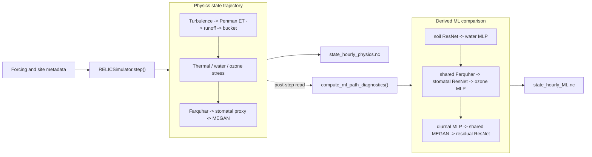

# RELIC Tapajos BVOC Tutorial Case

This directory is the executable entry point for the RELIC Tapajos KM67 BVOC tutorial case. It demonstrates a single RELIC physics trajectory plus a post-step ML comparison branch. The ML branch derives `_ML` variables after each physics step; it does not run a second simulator or advance an alternative state.

An earlier corrected implementation was verified on 2026-09-19 with the documented
full forward command (`--mode simulate`, run id `tapajos_verified_full`, 335.9 s wall
time on the reference workstation). The run directory is the dated evidence artifact:

```text
tutorial\case\output\runs\tapajos_verified_full
```

The older `dual_path_full_20260306_v1` run remains a historical documentation snapshot. It must not be used as evidence for the corrected molar-to-mass isoprene comparison or the corrected bounded-factor training link.

## Case At A Glance

- Site: Tapajos KM67, Brazil (`BR-Sa1`)
- Available window: `2014-06-01 00:00:00` to `2014-06-16 14:00:00` (`375` hourly records)
- Archived 2026-09-19 verification run: complete `375`-hour window
- Main mode: sequential 4-phase optimization
- Comparison mode: physics baseline vs post-step ML-derived output
- Physics core retained: `Farquhar` and `MEGAN`
- Runtime assembly: direct `RELICSimulator` registration
- IPHS scope: module-level certificate evidence only; no strict IPHS or GraphIR Gate 0 claim
- Main uncertain links targeted by surrogates:
  - soil moisture
  - water stress
  - stomatal conductance proxy
  - ozone stress proxy
  - isoprene residual correction
  - MEGAN diurnal activity correction

## Workflow Summary



## What This Case Demonstrates

This tutorial is not a machine-learning replacement of a process model. It is a RELIC lifecycle-compliant comparison case with three key ideas:

1. Keep the most defensible physiology explicit.
   - `CaseFarquharPhotosynthesis` remains physical.
   - `CaseMEGANModel` remains physical.

2. Compare the weakest links without replacing state advancement.
   - Six differentiable surrogates derive post-step comparison variables.
   - Shared Farquhar and MEGAN modules are re-evaluated using the derived diagnostics.

3. Preserve auditability.
   - Physics and ML outputs are written separately.
   - Checkpoints, process monitors, input snapshots, and optimization histories are archived per run.

## IPHS And DEC Scope

IPHS is intentionally emphasized at the module-evidence level:

- `AtmosphericTurbulence`, `PenmanMonteithET`, `SurfaceRunoff`, and `BucketSoilMoisture` have level-3 structured evidence.
- `FarquharPhotosynthesis`, `OzoneStress`, and `MEGAN` have level-2 wrapped evidence; reaction-like modules explicitly use their declared `N_h r_h` runtime path and open-system routing where applicable.
- `ThermalStress` has level-1 compatible evidence.
- Case adapters and the six ML surrogates do not own an IPHS certificate.

This tutorial registers Functors directly with `RELICSimulator`. It does not call `compile_graph(...)`, assemble a GraphIR execution graph, or execute the Gate 0 assertion set. Therefore neither the tutorial nor its images claim strict IPHS, level 4/5, or Gate 0 compilation.

Current case construction explicitly sets `conservation_checks=False` and clears registered Functor `metadata.conservation_laws` in `run_case.py`. Successful execution and module certificate levels therefore do not certify whole-case water/carbon conservation. The recorded-budget helper below only evaluates the available canonical bucket diagnostics on matching units and intervals; missing terms remain `NOT_EVALUATED`.

## Verified And Historical Runs

The archived verification run `tapajos_verified_full` (2026-09-19) contains the following recorded results; these values are not measurements of a later checkout:

- `375` finite physics, ML, and diagnostic samples from `2014-06-01 00:00:00` through `2014-06-16 14:00:00`
- contract-backed NetCDF unit attributes on the SCM-governed state variables (`15` of `24`
  physics variables and `13` of `19` ML variables; case-local diagnostics without a
  contract carry no `units` attribute)
- positive net photosynthesis and isoprene emission in all `170` samples with `PPFD > 50 umol m-2 s-1`
- physics isoprene RMSE `6423.77 ug m-2 h-1` (`R = 0.537`, bias `3766.06 ug m-2 h-1`)
- ML isoprene RMSE `510.04 ug m-2 h-1` (`92.06%` improvement, `R = 0.884`)
- ML isoprene bias `94.41 ug m-2 h-1`
- soil moisture RMSE `0.0560 m3 m-3` (physics) versus `0.0062 m3 m-3` (ML); net
  photosynthesis RMSE `8.81` (physics) versus `8.82` (ML) `umol CO2 m-2 s-1`
- the full figure set under `figures` regenerated with `plot_results.py` and
  `plot_megan_comparison.py` at 300 dpi

The ML surrogates are trained inside the run, so ML metrics can differ between repeated
runs; the values above are the `analyze_results.py` output of this run.

The historical run `dual_path_full_20260306_v1` still contains a broad archived output set used by older files under `tutorial\docs\case`, but it predates the current unit and bounded-target corrections.

The historical run contains:

- split NetCDF state files for physics and ML
- split process monitors
- optimization history and phase losses
- ML surrogate training summaries
- checkpoint archive
- input snapshot and provenance
- full figure set

It is important to read that run in context:

- `soil_moisture` is constrained mainly by external proxy data
- `net_photosynthesis` is constrained mainly by climatology/template data
- `isoprene` has the strongest direct observational support in the window

This means the case is informative for process-chain diagnosis, but not every target has equal observational strength.

## Executable Directory Layout

```text
tutorial/case/
  README.md
  run_case.py
  run_all.py
  analyze_results.py
  plot_results.py
  plot_megan_comparison.py
  config/
  data/
  functors/
  models/
  output/
  utils/
```

### Key Subdirectories

- `config/`
  - simulation, optimization, and case parameter YAML files
- `data/`
  - raw downloads, processed forcing, processed observations, provenance
- `functors/`
  - case-specific RELIC functors and surrogate wrappers
- `output/runs/<run_id>/`
  - all run-specific outputs, figures, checkpoints, and summaries
- `utils/`
  - diagnostics writer, loader, optimization loop, and helper infrastructure

## Documentation Map

Detailed documentation lives under `tutorial/docs/case`:

- `00_case_index.md`
- `01_functor_topology.md`
- `02_input_data_catalog.md`
- `03_theory_and_tradeoffs.md`
- `04_reference_run_v1_outputs_and_results.md`
- `05_literature_comparison.md`
- `06_relic_usage_guidance_and_templates.md`
- `07_outputs_and_monitoring.md`

Recommended reading order:

1. `01_functor_topology.md`
2. `02_input_data_catalog.md`
3. `03_theory_and_tradeoffs.md`
4. `04_reference_run_v1_outputs_and_results.md`
5. `07_outputs_and_monitoring.md`

If you want to build a new RELIC case, start with:

1. `06_relic_usage_guidance_and_templates.md`
2. `01_functor_topology.md`
3. `03_theory_and_tradeoffs.md`

## Quick Start On Windows

All commands below assume:

- Windows PowerShell
- the `RELIC` conda environment is active
- the repository root is the current working directory

### Enter The Project

```powershell
cd C:\path\to\RELIC
conda activate RELIC
```

### Run A New Full Forward Case

The following is the explicitly named execution example for this documentation round, not a claim that it has completed. Keep archived runs unchanged; choose a new unique run id when repeating the workflow.

```powershell
$caseRunId = "ma21doc-20260930-full-01"
python tutorial\case\run_case.py --case-root tutorial\case --mode simulate --run-id $caseRunId --no-progress
```

For a short smoke run, add `--days 2`. That output is intentionally partial; analysis and plotting reject it by default and require an explicit `--allow-partial` acknowledgement.

### Analyze The Run

```powershell
python tutorial\case\analyze_results.py --case-root tutorial\case --run-id $caseRunId
```

### Run Full Optimization

```powershell
python tutorial\case\run_case.py --mode optimize --run-id tapajos_opt
```

### Generate Figures

```powershell
python tutorial\case\plot_results.py --case-root tutorial\case --run-id $caseRunId --dpi 300
python tutorial\case\plot_megan_comparison.py --case-root tutorial\case --run-id $caseRunId --dpi 300
```

### Inspect Recorded Bucket Budgets

Use the newly generated run and a separate evidence directory; do not point plotting or audit outputs at archived reference runs. The budget helper requires both paths:

```powershell
$caseAuditDir = Join-Path "tutorial\case\output\audit" ($caseRunId + "_budget")
python tutorial\case\scripts\audit_conservation.py --run-dir "tutorial\case\output\runs\$caseRunId" --output-dir $caseAuditDir
```

When a run contains multiple epochs or phases, also provide `--epoch` and `--phase-id`. The helper writes `recorded_budget_report.json`; only when all required terms are available does it write a CSV and a plot. It uses recorded bucket storage, actual ET, infiltration, bucket overflow and drainage in mass units. The first post-step record is a reference, so its preceding interval is excluded. Missing diagnostic unit attributes are disclosed with the canonical owner contract; missing fluxes are never replaced by zero. Carbon remains unevaluated without a complete recorded stock/boundary budget. No water-budget pass is implied before inspecting the actual report.

### Resume An Interrupted Optimization

```powershell
python tutorial\case\run_case.py --mode optimize --resume tapajos_opt --run-id tapajos_opt_resume
```

### Initialize From A Previous Run But Start A New Optimization

```powershell
python tutorial\case\run_case.py --mode optimize --init-from-run dual_path_full_20260306_v1 --run-id tapajos_from_v1
```

### Run A Physics-Only Optimization

```powershell
python tutorial\case\run_case.py --mode optimize --run-id tapajos_phys_only --opt-phases phase1,phase2,phase3 --no-ml-surrogate
```

## Main Output Groups Per Run

Each run writes to:

```text
tutorial/case/output/runs/<run_id>/
```

The main groups are:

- `timeseries/`
  - `state_hourly.nc`
  - `state_hourly_physics.nc`
  - `state_hourly_ML.nc`
  - `diagnostics_hourly.nc`

- `aggregate/`
  - `run_summary.json`
  - `ml_training_summary.json`
  - `process_monitor.csv`
  - `process_monitor_physics.csv`
  - `process_monitor_ML.csv`
  - `progress_log.txt`

- `optimization/`
  - `optimized_parameters.yaml`
  - `initial_trainable_parameters.yaml`
  - `phase*_loss.csv`
  - `phase*_gradient_norms.csv`

- `checkpoints/`
  - optimization checkpoints
  - runtime simulation checkpoints
  - archived ML surrogate weights

- `figures/`
  - physics figures
  - separate `_ML` figures

- `input_snapshot/`
  - immutable copies of forcing, observations, metadata, and YAML inputs used by the run

## Physics Trajectory vs Derived ML Comparison

The case should be interpreted as two coordinated outputs:

### Physics Path

Use the physics path when you want:

- the mechanistic process baseline
- direct interpretation of calibrated process parameters
- comparison against the original RELIC process chain

### Derived ML Comparison

Use the derived ML output when you want:

- bounded correction of weak links in the process chain
- separate diagnostic values for stress propagation
- corrected isoprene behavior while still keeping `Farquhar` and `MEGAN` explicit

The `_ML` file is not an independently advanced trajectory. It is a post-step diagnostic complement to the physics baseline.

## Interpreting Good And Bad Results

This case is most useful when you interpret the process chain, not only the final error score.

Typical reading order for a run:

1. Check `process_monitor_physics.csv` and `process_monitor_ML.csv`
2. Inspect `state_hourly_physics.nc` and `state_hourly_ML.nc`
3. Compare `fig1`, `fig2`, and `fig3`
4. Review `run_summary.json`
5. Review `optimized_parameters.yaml`

Key diagnostic question:

```text
Did the change improve only the final isoprene fit,
or did it improve the upstream hydrology-stress-photosynthesis chain as well?
```

That distinction matters because this case is affected strongly by forcing quality and target quality heterogeneity.

## Common Pitfalls

### 1. Not All Targets Are Equally Strong

- `soil_moisture` is mainly proxy-constrained
- `net_photosynthesis` is mainly climatology-constrained
- `isoprene` is the strongest direct observation in-window

Do not over-interpret a parameter shift as a purely mechanistic truth when it may be compensating for weak upstream constraints.

### 2. Warm-Start Parameter Plots Depend On Run Metadata

For new runs, `fig5_parameter_changes` now prefers the actual optimization start values from:

```text
optimization/initial_trainable_parameters.yaml
```

If an old archived run was created before that metadata existed, figure 5 may still fall back to YAML defaults and label the reference as `Initial`.

### 3. Windows OpenMP Runtime Conflicts

`plot_results.py` now applies a Windows compatibility workaround for duplicate Intel OpenMP runtime loading. If you still hit environment-specific OpenMP issues in another script, check whether both `torch` and MKL-linked packages are being imported in the same process.

## Why RELIC Is Useful Here

This tutorial highlights several RELIC design advantages:

- explicit process decomposition into functors
- bridge-class integration instead of ad hoc executable modules
- centralized parameter SSOT in YAML
- differentiable simulator execution
- split diagnostic outputs for competing pathways
- checkpointed optimization and monitoring
- extendable hybrid workflows without replacing the scientific core

In other words, the case is not just a site run. It is a reusable pattern for building auditable, process-aware, hybrid ecological simulations inside RELIC.

## Where To Go Next

If your next task is mostly about:

- architecture and process graph:
  - read `tutorial/docs/case/01_functor_topology.md`
- forcing provenance and data gaps:
  - read `tutorial/docs/case/02_input_data_catalog.md`
- interpretation and tradeoffs:
  - read `tutorial/docs/case/03_theory_and_tradeoffs.md`
- actual archived result behavior:
  - read `tutorial/docs/case/04_reference_run_v1_outputs_and_results.md`
- reusable patterns for building a new case:
  - read `tutorial/docs/case/06_relic_usage_guidance_and_templates.md`
