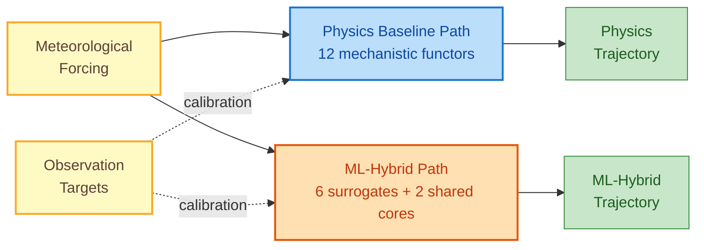
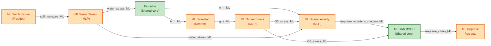

# Functor Topology and Execution Logic

This chapter documents the exact process topology used by the Tapajos tutorial case.

The actual registration order is defined in `tutorial/case/run_case.py` and contains two layers:

- A **physics baseline path** that is always registered
- An optional **ML-hybrid path** that is registered when `ml_surrogate.enabled` is true

---

## High-Level Architecture Overview

---

## Dual-Path Functor Graph

> [!NOTE]
> **Color Legend:**
>
> - **Blue nodes** = Physics-only mechanistic functors
> - **Orange nodes** = ML surrogate functors
> - **Green nodes** = Shared mechanistic cores (Farquhar, MEGAN) used by both paths
> - **Solid arrows** = Direct data flow within a path
> - **Dashed arrows** = Cross-path data bridges (fallback or reference signals)

### Physics Baseline Path

### ML-Hybrid Comparison Path

### Cross-Path Data Bridges

The ML path receives **reference signals** from the physics path through dashed bridges:

| Physics Source       | ML Target            | Data Signal                       |
| :------------------- | :------------------- | :-------------------------------- |
| Bucket Soil Moisture | ML Soil Moisture     | `soil_moisture` (reference)       |
| Stress Adapter       | ML Water Stress      | `water_stress` (fallback)         |
| Farquhar             | ML Stomatal          | `net_photosynthesis` (reference)  |
| Stomatal Proxy       | ML Ozone Stress      | `stomatal_conductance` (fallback) |
| Farquhar             | ML Diurnal Activity  | `net_photosynthesis` (reference)  |
| MEGAN BVOC           | ML Isoprene Residual | `mechanistic_isoprene` (baseline) |

A standalone Mermaid source is also stored in `assets/dual_path_functor_graph.mmd`.

---

## What Stays Physical

> [!NOTE]
> The tutorial **deliberately keeps** the following modules mechanistic because they are well-validated, well-constrained, or serve as transparent bookkeeping layers.

| Module                  | Scientific Basis                  | Why It Stays Physical                                             |
| :---------------------- | :-------------------------------- | :---------------------------------------------------------------- |
| **Turbulence**          | Monin-Obukhov similarity theory   | Well-established micrometeorological coupling                     |
| **Penman-Monteith**     | Energy-balance evapotranspiration | One of the most trusted canopy-scale formulations                 |
| **Precip Adapter**      | Throughfall partitioning          | Simple, traceable, and low uncertainty                            |
| **Surface Runoff**      | Saturation-excess routing         | Bookkeeping layer, not a major uncertainty bottleneck             |
| **Infiltration Bridge** | Water routing                     | Bookkeeping layer, not a major uncertainty bottleneck             |
| **Thermal Stress**      | Temperature response function     | Comparatively well constrained from literature                    |
| **Farquhar**            | FvCB C3 biochemistry              | Best validated leaf-level carbon assimilation model for C3 plants |
| **MEGAN BVOC**          | MEGAN 2.1 emission framework      | Remains the canonical mechanistic BVOC engine                     |

---

## What Becomes Surrogate-Controlled

> [!TIP]
> ML surrogates are introduced **only** where the archived data provenance and model structure expose genuine uncertainty bottlenecks. Each surrogate replaces a single, narrowly scoped link in the chain.

| ML Functor                 | Replaces / Augments                 | Architecture | Reason for Replacement                                                                   |
| :------------------------- | :---------------------------------- | :----------: | :--------------------------------------------------------------------------------------- |
| **`ml_soil_moisture`**     | `bucket_soil_moisture`              |    ResNet    | Most cascade-sensitive uncertainty source in the Tapajos window                          |
| **`ml_water_stress`**      | `stress_adapter` (linear)           |     MLP      | Linear stress factor is too rigid under high soil hydraulic uncertainty                  |
| **`ml_stomatal`**          | `stomatal_proxy`                    |    ResNet    | Original proxy is intentionally simple and does not represent richer response surfaces   |
| **`ml_ozone_stress`**      | `ozone_stress`                      |     MLP      | Tropical ozone detoxification capacity is uncertain and hard to constrain from site data |
| **`ml_diurnal_activity`**  | MEGAN diurnal baseline              |     MLP      | Corrects the light-temperature activity baseline specific to Tapajos                     |
| **`ml_isoprene_residual`** | Multiplicative residual after MEGAN |     MLP      | Keeps MEGAN explicit but allows bounded correction of persistent site-specific bias      |

The variable contract declares `stomatal_proxy` as a tendency writer of
`stomatal_conductance` [mol m-2 s-1], with forcing kind and no primary owner.
The proxy returns a `REPLACE` UpdateItem containing the new conductance, not
a difference to be interpreted as a replacement. The ML path supplies its
separately declared `stomatal_conductance_ML` output.

---

## Why the Hybrid Path Is Physiologically Safer Than a Pure BVOC Black Box

> [!IMPORTANT]
> The ML path does **not** jump directly from forcing to isoprene. Instead, it follows the same physiological cascade as the physics path, replacing only the weakest links.

### Hybrid Safety Chain

This means the tutorial still exposes:

- **Carbon assimilation** explicitly (Farquhar)
- **BVOC emission physics** explicitly (MEGAN)
- **Stomatal behavior** individually inspectable
- **Ozone response** individually inspectable
- **Residual correction** bounded and applied _after_ the mechanistic chain

At site scale, this is more physiologically interpretable than training a single network to predict `isoprene_emission` from meteorology alone.

---

## RELIC-Specific Advantages of This Topology

> [!TIP]
> The dual-path design is not just a convenience feature --- it is the architectural foundation that makes the tutorial scientifically auditable.

1. The **physics and ML paths are both executable** and both write outputs
2. Each surrogate is still a **RELIC functor** and therefore remains differentiable and schedulable
3. Parameter values are **not hardcoded in Python**; paths, bounds, and training knobs live in YAML
4. The same simulator provides **process provenance**, grouped execution, and checkpointing for both paths
5. The structure is **explicit enough** to support scientific audit rather than only raw prediction
