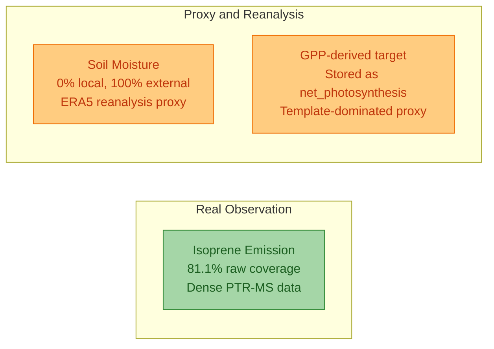

# Input Data Sources, Metadata, and Processing Rules

This chapter documents the exact input assets used by the Tapajos tutorial case, with emphasis on the archived reference run `dual_path_full_20260306_v1`.

---

## Site Metadata

| Field                | Value                            |
| :------------------- | :------------------------------- |
| **Site ID**          | `BR-Sa1`                         |
| **Site name**        | Tapajos KM67                     |
| **Latitude**         | -2.857                           |
| **Longitude**        | -54.959                          |
| **Elevation**        | 100 m                            |
| **Reference height** | 65 m                             |
| **Canopy height**    | 35 m                             |
| **PFT**              | Evergreen Broadleaf Forest (EBF) |
| **Soil type**        | Clay                             |

---

## Reference Window

| Property            | Value                          |
| :------------------ | :----------------------------- |
| **Start**           | `2014-06-01 00:00:00`          |
| **End**             | `2014-06-16 14:00:00`          |
| **Time step**       | 1 hour                         |
| **Total steps**     | 375                            |
| **Resampling rule** | `30min_to_1hr_mean_precip_sum` |

---

## Raw Observational Assets

| File                                 | Role in Case                         | Nominal Source               |
| :----------------------------------- | :----------------------------------- | :--------------------------- |
| `AMF_BR-Sa1_BASE_HH_6-5.csv`         | Site meteorology and flux inputs     | AmeriFlux                    |
| `AMF_BR-Sa3_BASE_HH_3-5.csv`         | Supplemental soil moisture site data | AmeriFlux                    |
| `Tapajos_Isop_Temp_ForChristian.csv` | Isoprene observation target          | Tapajos PTR-MS field dataset |
| `simulation.yaml`                    | Archived runtime configuration       | Tutorial config snapshot     |
| `case_parameters.yaml`               | Archived parameter snapshot          | Tutorial parameter SSOT      |

> [!NOTE]
> The reference run also snapshots **checksums** for all input files, ensuring reproducibility down to the archived file hashes.

---

## External Data Providers

| Provider / Service           | Endpoint Role                                                   |
| :--------------------------- | :-------------------------------------------------------------- |
| NASA POWER hourly API        | Ozone and soil moisture support fields                          |
| Open-Meteo ERA5 archive API  | Precipitation, wind, pressure, and thermodynamic backup forcing |
| NOAA global monthly CO2 file | Long-term atmospheric CO2 context                               |
| NOAA CarbonTracker CT2022    | Hourly CO2 at the site location                                 |
| ORNL MODIS subset API        | LAI support field                                               |

---

## External Forcing Usage Strategy

| Quantity          | Mode Used                                          |
| :---------------- | :------------------------------------------------- |
| Air temperature   | External primary                                   |
| Relative humidity | External primary                                   |
| Wind speed        | External primary                                   |
| Surface pressure  | External primary                                   |
| Precipitation     | External primary                                   |
| Net radiation     | External primary                                   |
| PPFD              | External primary                                   |
| CO2               | External primary                                   |
| Ozone             | Externally derived and scaled                      |
| LAI               | External, time-interpolated and smoothed           |
| Soil moisture     | External primary                                   |
| VPD               | Derived from air temperature and relative humidity |

Fill strategy: `site_hourly_then_external_hourly_then_time_interpolation`

---

## Coverage and Quality Classes

> [!IMPORTANT]
> **This section contains the most important fact in the case.**
> The Tapajos tutorial intentionally **exposes** data quality instead of hiding it. Understanding which targets are real observations vs. proxies is critical for interpreting all downstream results.

### Data Quality Classification



### Coverage Ratios in the Archived Reference Run

> [!WARNING]
> **All SA1 local site variables show 0.0 coverage** for the reference window. The case relies entirely on external API sources for forcing reconstruction.

| Variable Group           | Raw Local Coverage | Effective Coverage |
| :----------------------- | :----------------: | :----------------: |
| SA1 air temperature      |        0.0         |   1.0 (external)   |
| SA1 relative humidity    |        0.0         |   1.0 (external)   |
| SA1 wind speed           |        0.0         |   1.0 (external)   |
| SA1 surface pressure     |        0.0         |   1.0 (external)   |
| SA1 precipitation        |        0.0         |   1.0 (external)   |
| SA1 net radiation        |        0.0         |   1.0 (external)   |
| SA1 PPFD                 |        0.0         |   1.0 (external)   |
| SA1 CO2                  |        0.0         |   1.0 (external)   |
| SA1 GPP                  |        0.0         | 1.0 (climatology)  |
| SA3 soil moisture        |        0.0         |   1.0 (external)   |
| Raw isoprene observation |     **0.811**      |   1.0 (keep NaN)   |

### Observation Quality Labels

| Target                 | Quality Class                | Interpretation                                        |
| :--------------------- | :--------------------------- | :---------------------------------------------------- |
| **Soil moisture**      | `proxy_external_reanalysis`  | No in-window raw SA3 data; target from external proxy |
| **GPP-derived target (`net_photosynthesis`)** | `proxy_climatology_template` | Raw SA1 GPP insufficient; dominated by climatology |
| **Isoprene emission**  | `real_observation`           | Dense in-window PTR-MS measurement coverage           |

> [!TIP]
> This quality classification explains why the tutorial gives ML **more freedom** on the water-stress side while treating **isoprene as the most trustworthy** end-point target.

### GPP-Derived Target and Model Net Photosynthesis

`create_obs_dataset` in [prepare_netcdf.py](../../case/data/prepare_netcdf.py) stores the GPP-derived `gpp_obs` series under the observation key `net_photosynthesis`. The model field with that same key is net photosynthesis. A shared field name does not make gross primary productivity and net leaf assimilation the same physical quantity or spatial support; this remains a limitation of the tutorial comparison.

In the completed `paper-final-20260930-full-01` reproduction, snapshotted provenance records `proxy_climatology_template`, zero raw SA1 GPP coverage, two distinct daily target patterns, and a recommended weight multiplier of 0.25. The soil-moisture proxy has a separate multiplier of 0.35. The model NetCDF declares `net_photosynthesis` in `umol CO2 m-2 s-1`; the target NetCDF declares `umol m-2 s-1`. The source identity, rather than the shared name or unit spelling alone, identifies the latter as a GPP-derived proxy. The figure therefore labels the model as **Net photosynthesis** and the target as **GPP proxy target**.

The proxy contains a filled diurnal pattern, so its smoothness is not evidence that the model has reproduced measured transient physiology or that an optimization constraint has been validated. The current reproduction runs `simulate`, without physical-parameter optimization. Its ML observation-guidance stage trains on the same 375-hour window used for the reported comparisons; those metrics are not a held-out evaluation. See the dated results in [Reference and Current Runs](./04_reference_run_v1_outputs_and_results.md).

---

## Processed Forcing Variables in `site_forcing.nc`

| Variable                 | Units     |     Min |     Max | Role                                 |
| :----------------------- | :-------- | ------: | ------: | :----------------------------------- |
| `air_temperature`        | K         |  295.38 |  302.66 | Canopy thermodynamic driver          |
| `relative_humidity`      | 1         |  0.7158 |     1.0 | Humidity driver                      |
| `vapor_pressure_deficit` | Pa        |     0.0 | 1139.07 | Stomatal and ET driver               |
| `wind_speed`             | m/s       |     1.5 |    20.8 | Turbulence and ET driver             |
| `surface_pressure`       | Pa        |   98440 |   99270 | Thermodynamic driver                 |
| `net_radiation`          | W/m2      |  -43.48 |  724.79 | Energy input                         |
| `ppfd`                   | umol/m2/s |     0.0 | 1841.67 | Photosynthesis and BVOC light driver |
| `precipitation_flux`     | kg/m2/s   |     0.0 |  7.5e-4 | Hydrologic forcing                   |
| `co2_concentration`      | ppm       |  393.27 |  412.03 | Atmospheric CO2 forcing              |
| `o3_mixing_ratio`    | mol/mol   | 1.47e-8 | 1.53e-8 | Ozone stress forcing                 |
| `leaf_area_index`        | m2/m2     |    2.00 |    6.10 | Canopy state support                 |
| `sensible_heat_flux`     | W/m2      |  -10.87 |  181.20 | Auxiliary diagnostics                |
| `latent_heat_flux`       | W/m2      |  -32.61 |  543.59 | Auxiliary diagnostics                |

MEGAN2.1 Eq. (2) uses LAI directly in the canopy activity factor. Therefore,
`leaf_area_index` is the sole foliage forcing in this dataset. Any conversion
to foliage dry-mass density is derived only inside the production MEGAN process
that consumes it and uses that process's ParameterManager-backed coefficient;
the tutorial does not materialize a second state or parameter owner.

---

## Processed Observation Targets in `real_obs.nc`

| Variable             | Units     |   Min |   Max | Quality Interpretation            |
| :------------------- | :-------- | ----: | ----: | :-------------------------------- |
| `soil_moisture`      | m3/m3     | 0.435 | 0.465 | External proxy target             |
| `net_photosynthesis` | umol/m2/s |   0.0 | 21.40 | GPP-derived climatology proxy |
| `isoprene_emission`  | nmol/m2/s |   0.0 | 15.11 | **Real site measurement**         |

---

## Gap Filling and Target Construction Rules

The observation fill strategy archived in the reference run:

```text
soil_moisture_month_hour_climatology_then_external_fallback
gpp_month_hour_climatology_from_sa1
isoprene_keep_nan
```

This has direct modeling implications:

- **Soil moisture** targets are continuous, but they are proxy-based rather than direct in-window site measurements
- The target stored as **net_photosynthesis** is available at every step but is a climatology-filled GPP proxy; it does not independently validate model net assimilation
- **Isoprene** targets preserve missing values and are not aggressively imputed

---

## Why the Input Design Matters

> [!IMPORTANT]
> The Tapajos case is **not** a clean tower-only benchmark. It is a **realistic small-sample, mixed-provenance calibration problem**.

That is precisely why the case is useful for RELIC:

- Data quality is **explicit**
- Proxy vs real observations are **tagged**
- Forcing provenance is **archived**
- The ML path can be limited to **uncertainty bottlenecks** instead of replacing the entire physiology stack
