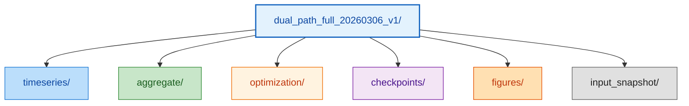

# Reference Run `dual_path_full_20260306_v1`: Outputs, Monitoring, and Results

This chapter retains the archived primary documentation run and separately records the completed 2026-09-30 reproduction. The historical optimization tables below are not measurements of the new forward run.

---

## Current Reproduction: `paper-final-20260930-full-01`

The completed run at `tutorial\case\output\runs\paper-final-20260930-full-01` uses `simulate`, real observation targets, the unchanged case configuration, and enabled ML surrogates. Its [run summary](../../case/output/runs/paper-final-20260930-full-01/aggregate/run_summary.json) records 375 hourly steps and 331.5153688 s of internal elapsed time (370.8865308 s for the conda process). The observation-guidance stage completed all 40 configured epochs, with final loss 0.0105548465. Those 40 epochs are distinct from the six surrogate pretraining counts: 50, 15, 22, 27, 191, and 25 for soil moisture, water stress, stomatal conductance, ozone stress, diurnal activity, and the isoprene residual, respectively. No physical-parameter optimization was performed in this run.

The earlier `ma21doc-20260930-full-01` forward run remains a dated artifact: 375 steps, 40 observation-guidance epochs, and 312.2760777 s internal elapsed time. It predates the final paper-repair tree and is not relabeled as the current result. The archived `dual_path_full_20260306_v1` optimization results remain unchanged in the later sections of this chapter.

The original `analyze_results.py` CLI reports the following same-window results; each comparison has 375 paired samples:

| Compared quantity | Path | R | RMSE | Bias | RMSE/bias unit |
| :--- | :--- | ---: | ---: | ---: | :--- |
| Soil-moisture proxy | Physics | 0.44298505 | 0.05531032 | -0.05476222 | m3 m-3 |
| Soil-moisture proxy | ML | 0.70486430 | 0.00544358 | 0.00109913 | m3 m-3 |
| Model net photosynthesis versus GPP proxy | Physics | 0.43936521 | 8.80507182 | -2.68116594 | umol m-2 s-1 |
| Model net photosynthesis versus GPP proxy | ML | 0.43865780 | 8.80774339 | -2.68716408 | umol m-2 s-1 |
| Isoprene emission | Physics | 0.53741203 | 7433.05231948 | 4385.72544177 | ug m-2 h-1 |
| Isoprene emission | ML | 0.89812979 | 405.46988434 | 15.25022280 | ug m-2 h-1 |

The physics path has substantial magnitude error for soil moisture and isoprene, and ML does not improve the net-photosynthesis comparison. These unfavorable values are retained. The GPP-derived target is classified `proxy_climatology_template`, with zero raw local coverage; it is not a measurement of net leaf assimilation. The ML stage uses the same window for observation-guided training and these metrics, so no held-out or generalization claim follows. MEGAN comparison figures use a separate common finite support of 304 hourly samples (144 daytime samples), which must not be mixed with the 375-sample table.

The physics, ML, and diagnostic NetCDF files each contain 375 samples with finite numerical values; they contain 24, 19, and 83 variables, of which 15, 14, and 11 have unit attributes. This is not complete runtime unit coverage. Recorded water-budget postprocessing gives `EVALUATED_DIAGNOSTIC_ONLY`: 374 intervals after the first post-step reference, storage change -50.16351318359375 kg m-2, integrated net input -50.16450882312054 kg m-2, and final/maximum absolute residual 0.000995639526792047 kg m-2. Carbon is `NOT_EVALUATED`. The three missing bucket diagnostic unit attributes and disabled case conservation checks remain disclosed in [Outputs and Monitoring](./07_outputs_and_monitoring.md); this result is not whole-model conservation certification.

The two plot CLIs completed and produced 18 PNG/PDF pairs. The forward-only run correctly skips optimization-loss figure 4; figure 6 is the existing notice directing readers to separate physics/ML figures. Current plots distinguish net photosynthesis from the GPP proxy, separate the two units in the stomatal/residual panel, and label parameter snapshots as Run start/Run final rather than implying physical optimization. Reproduction commands and output semantics are documented in [Outputs and Monitoring](./07_outputs_and_monitoring.md).

---

## Historical Run Identity

> [!NOTE]
> **Reference Run Summary**
>
> | Item                  | Value                          |
> | :-------------------- | :----------------------------- |
> | **Run ID**            | `dual_path_full_20260306_v1`   |
> | **Mode**              | `optimize`                     |
> | **Steps**             | 375                            |
> | **Elapsed wall time** | 6688.12 s (~1.86 hours)        |
> | **Phases run**        | phase1, phase2, phase3, phase4 |
> | **Gradient records**  | 3328                           |
> | **ML surrogates**     | Enabled                        |

---

## Output Directory Layout

---

## What Each Output Group Contains

### `timeseries/`

| File                      | Description                                 |
| :------------------------ | :------------------------------------------ |
| `state_hourly.nc`         | Combined state output (convenience product) |
| `state_hourly_physics.nc` | Physics-only state variables                |
| `state_hourly_ML.nc`      | ML-path variables with `_ML` suffix         |
| `diagnostics_hourly.nc`   | Additional diagnostic export                |

### `aggregate/`

| File                          | Description                                |
| :---------------------------- | :----------------------------------------- |
| `run_summary.json`            | Overall run summary and phase-level losses |
| `ml_training_summary.json`    | Per-surrogate training history             |
| `process_monitor.csv`         | Combined process monitor                   |
| `process_monitor_physics.csv` | Physics monitor only                       |
| `process_monitor_ML.csv`      | ML monitor only                            |
| `progress_log.txt`            | Timestamped progress and checkpoint log    |

### `optimization/`

| File                                  | Description                        |
| :------------------------------------ | :--------------------------------- |
| `phase1_loss.csv` ~ `phase4_loss.csv` | Per-phase loss histories           |
| `gradient_norms.csv`                  | Gradient stability records         |
| `optimized_parameters.yaml`           | Final optimized parameter values   |
| `best_params.yaml`                    | Best-performing parameter snapshot |

### `checkpoints/`

| File Pattern                      | Description                                    |
| :-------------------------------- | :--------------------------------------------- |
| `checkpoint_phase*_epoch*.pt`     | Optimization checkpoints                       |
| `simulate_final_forward_step*.pt` | Runtime state checkpoints during final forward |
| `ml_surrogates/*.pth`             | Archived surrogate model weights               |
| `ml_surrogates/manifest.json`     | Surrogate archive manifest                     |

### `figures/`

Physics and ML figure sets are saved separately. ML-specific figure names carry the `_ML` suffix.

---

## Process Monitoring Coverage

The archived run contains **dense monitoring** rather than only final statistics.

| Monitor File                  | Rows | Track Scope                |
| :---------------------------- | :--: | :------------------------- |
| `process_monitor_physics.csv` | 375  | Physics baseline variables |
| `process_monitor_ML.csv`      | 375  | ML-hybrid path variables   |

### Physics Monitor Variables

`soil_moisture`, `water_stress_factor`, `temperature_stress_factor`, `ozone_stress_factor`, `gpp`, `net_photosynthesis`, `isoprene_emission`, `stomatal_conductance`, and hydrologic routing variables.

### ML Monitor Variables

`soil_moisture_ML`, `water_stress_factor_ML`, `stomatal_conductance_ML`, `ozone_stress_factor_ML`, `diagnostics.bvoc.megan.co2_inhibition_factor_ML`, `isoprene_activity_correction_ML`, `isoprene_emission_chain_ML`, `isoprene_correction_factor_ML`, `isoprene_emission_ML`, and total BVOC diagnostic variables.

> [!TIP]
> This is significantly more transparent than a workflow that only writes a final NetCDF file. The `progress_log.txt` records phase starts, completions, checkpoint writes, and final output paths.

---

## Optimization Behavior in the Reference Run

### Final Phase Losses

| Phase      | Final Loss | Final Window Loss | Target                |
| :--------- | ---------: | ----------------: | :-------------------- |
| **phase1** |     0.0508 |           0.00728 | Hydrology calibration |
| **phase2** |  72,767.76 |          3,726.90 | GPP calibration       |
| **phase3** |      28.07 |            0.7346 | Isoprene calibration  |
| **phase4** |   1,906.56 |             75.91 | Joint fine-tuning     |

> [!NOTE]
> The large absolute scale changes between phases are **expected** because the phase objectives use different physical quantities and loss functions.

### Gradient Stability

`gradient_norms.csv` reports **3,328** gradient records with no non-finite gradient values. This confirms stable differentiable optimization throughout all phases.

---

## ML Surrogate Training Summary

| Surrogate              | Epochs Trained | Best Validation Loss | Status        |
| :--------------------- | :------------: | :------------------: | :------------ |
| `ml_soil_moisture`     |       31       |        1.9201        | Early-stopped |
| `ml_water_stress`      |       31       |        0.4709        | Early-stopped |
| `ml_stomatal`          |       97       |       0.00417        | Early-stopped |
| `ml_ozone_stress`      |       25       |       0.02486        | Early-stopped |
| `ml_isoprene_residual` |       49       |        0.3991        | Early-stopped |

---

## Reference Run Metrics Against Archived Targets

### Soil Moisture Target

| Path          |   R   |    RMSE     |     MAE     |    Bias     |  N  |
| :------------ | :---: | :---------: | :---------: | :---------: | :-: |
| **Physics**   | 0.882 |   0.00994   |   0.00826   |  -0.00825   | 375 |
| **ML-hybrid** | 0.814 | **0.00454** | **0.00347** | **0.00139** | 375 |

> [!NOTE]
> The ML path **improves magnitude error** for the soil-moisture proxy target even though the correlation is slightly lower. This is the expected behavior when the surrogate targets a proxy.

### Net Photosynthesis Proxy Target

| Path          |   R   | RMSE  | MAE  | Bias |  N  |
| :------------ | :---: | :---: | :--: | :--: | :-: |
| **Physics**   | 0.399 | 10.01 | 6.94 | 0.31 | 375 |
| **ML-hybrid** | 0.400 | 11.62 | 8.04 | 1.90 | 375 |

> [!CAUTION]
> The ML path does **not improve** the photosynthesis proxy in `v1`. This is not surprising because the archived target is a **climatology-dominated proxy** rather than a strong physiological truth source.

### Isoprene Target

| Path          |     R     |   RMSE   |  MAE   |  Bias  |  N  |
| :------------ | :-------: | :------: | :----: | :----: | :-: |
| **Physics**   |   0.549   |  844.29  | 471.46 | -29.42 | 375 |
| **ML-hybrid** | **0.595** | 1,267.67 | 665.52 | 348.99 | 375 |

> [!NOTE]
> In `v1`, the ML path **improves temporal correlation** but **over-amplifies magnitude**. This is exactly the kind of process-level behavior that the RELIC dual-path design is intended to reveal.

---

## Historical Partition Checks (Not Conservation Certification)

The original documentation reported the following checks on 375 historical physics records (`process_monitor_physics.csv`). The recorded values are retained for traceability and have not been re-established for the current checkout. Partition identities and a correlation fit do not verify a complete storage/boundary budget, the first-step time basis, or all case conservation requirements:

| Conservation Subsystem   | Mathematical Property                                            | Max Absolute Error            | Status                        |
| :----------------------- | :--------------------------------------------------------------- | :---------------------------- | :---------------------------- |
| **Canopy Interception**  | `gross_precip` = `effective_precip` + `canopy_interception_flux` | $8.09 \times 10^{-17}$        | Historical partition result |
| **Surface Infiltration** | `effective_precip` = `surface_runoff` + `infiltration`           | $0.00$                        | Historical partition result |
| **Soil Bucket Dynamics** | $\Delta SM \propto$ (`infiltration` - `ET` - `drainage`)         | Reported fit (R > 0.99) | Not a budget-closure test |

> [!IMPORTANT]  
> These historical checks do not prove absence of unrecorded sources or sinks, nor robustness over untested computations. Current `run_case.py` disables `conservation_checks` and clears Functor `conservation_laws`; case-level conservation is therefore not certified. Use the explicit recorded-budget procedure in [Outputs and Monitoring](./07_outputs_and_monitoring.md) for a new run, and retain `NOT_EVALUATED` wherever the required evidence is absent.

---

## Diagnostic State Ranges for the Final Forward ML Path

| Variable                        |    Min |    Max |   Mean |
| :------------------------------ | -----: | -----: | -----: |
| `soil_moisture_ML`              | 0.4462 | 0.4678 | 0.4530 |
| `water_stress_factor_ML`        | 0.9289 | 1.0000 | 0.9573 |
| `stomatal_conductance_ML`       | 0.0483 | 0.2843 | 0.0956 |
| `ozone_stress_factor_ML`        | 0.9469 | 0.9933 | 0.9764 |
| `diagnostics.bvoc.megan.co2_inhibition_factor_ML`      | 0.8477 | 0.9107 | 0.8857 |
| `isoprene_correction_factor_ML` | 0.7469 | 2.0548 | 1.2087 |
| `isoprene_emission_chain_ML`    | 0.0000 | 1.1125 | 0.1713 |
| `isoprene_emission_ML`          | 0.0000 | 1.9517 | 0.2561 |

---

## Key Takeaway from the Reference Run

> [!IMPORTANT]
> `dual_path_full_20260306_v1` is **not** a story of universal ML improvement. It is a more **honest** and more **useful** result.

| Aspect                 | Physics Path               | ML-Hybrid Path           | Verdict               |
| :--------------------- | :------------------------- | :----------------------- | :-------------------- |
| **Soil moisture**      | Higher R, higher error     | Lower R, **lower error** | ML helps magnitude    |
| **Net photosynthesis** | Moderate R, moderate error | Similar R, similar error | No significant change |
| **Isoprene timing**    | R = 0.549                  | **R = 0.595**            | ML improves timing    |
| **Isoprene amplitude** | Lower magnitude error      | Higher magnitude error   | ML **over-amplifies** |

That makes the archived run scientifically useful because it identifies **where** the hybrid path helps and **where** it still needs tighter control.
