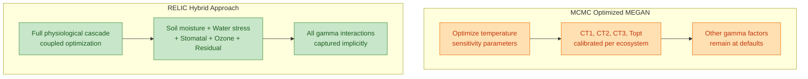

# Comparison with the Literature

This chapter compares the Tapajos tutorial case with representative literature. The goal is not to claim that the archived `v1` run outperforms every published model score. The goal is to show **what RELIC adds** scientifically and technically.

---

## Important Scope Note

> [!WARNING]
> Direct metric comparison across papers is limited by differences in:
>
> - Site window and temporal coverage
> - Forcing reconstruction methods
> - Species composition and PFT definitions
> - Target variable definitions
> - Whether the target is a direct observation or a proxy
>
> For that reason, the comparison below is **process-oriented first** and metric-oriented only when it is defensible.

---

## Key Comparison: RELIC vs Optimized MEGAN (MH-MCMC)

> [!IMPORTANT]
> The primary comparison benchmark for this tutorial is **not** the standard MEGAN with default parameters, but rather the **optimized MEGAN** from:
>
> **"Optimizing the Temperature Sensitivity of the Isoprene Emission Model MEGAN in Different Ecosystems Using a Metropolis-Hastings Markov Chain Monte Carlo Method"**
> ([ESS Open Archive](https://essopenarchive.org/users/535685/articles/1264764-optimizing-the-temperature-sensitivity-of-the-isoprene-emission-model-megan-in-different-ecosystems-using-a-metropolis-hastings-markov-chain-monte-carlo-method))
>
> That study uses **Bayesian MH-MCMC** to calibrate the temperature sensitivity parameters ($C_{T1}$, $C_{T2}$, $C_{T3}$, $T_{\text{opt}}$) of MEGAN's isoprene emission model across multiple ecosystem types, yielding an **already-optimized MEGAN** as the comparison baseline.

### What the MH-MCMC Optimized MEGAN Achieves

The MH-MCMC approach calibrates MEGAN's temperature response function:

$$\gamma_T = C_{T1} \cdot \exp\!\left(\frac{C_{T2}\,(T - 303)}{T \cdot 303}\right) \cdot \frac{1 + \exp\!\bigl(C_{T3}\,(D_{T_{\text{opt}}} / T)\bigr)}{1 + \exp\!\bigl(C_{T3}\,(T_{\text{opt}} - D_{T_{\text{opt}}} - T)/T\bigr)}$$

Key characteristics of this approach:

- **Statistical rigor**: Bayesian parameter estimation with full posterior sampling
- **Ecosystem-specific**: Calibrated parameters differ across broadleaf forest, needleleaf forest, shrubland, cropland, and grassland
- **Temperature-focused**: Optimization targets only the $\gamma_T$ response function parameters
- **Uncoupled**: Calibrates temperature sensitivity **independently** from water stress, stomatal conductance, ozone damage, and soil moisture dynamics

### Where RELIC's Physiological Coupling Provides an Advantage

> [!TIP]
> **The decisive difference:** MH-MCMC optimizes temperature sensitivity **in isolation**, while RELIC optimizes the **entire physiological cascade** --- soil moisture, water stress, photosynthesis, stomatal conductance, and ozone stress --- in a coupled, end-to-end differentiable framework. This coupled optimization captures **interaction effects** between processes that single-factor calibration inherently misses.

| Dimension                    | MH-MCMC Optimized MEGAN                  | RELIC Tutorial Case                                                               |
| :--------------------------- | :--------------------------------------- | :-------------------------------------------------------------------------------- |
| **Optimization scope**       | Temperature response only (gamma_T)      | Full physiological chain (soil -> stress -> carbon -> stomatal -> O3 -> emission) |
| **Optimization method**      | Bayesian MH-MCMC sampling                | End-to-end differentiable gradient descent (BPTT)                                 |
| **Process coupling**         | Uncoupled: each gamma factor independent | Coupled: upstream state changes propagate through the chain                       |
| **Water stress**             | Default gamma_SM                         | Explicitly optimized via ML surrogate                                             |
| **Stomatal effects**         | Not calibrated                           | Explicitly modeled and optimizable                                                |
| **Ozone interaction**        | Not calibrated                           | ML surrogate with bounded range                                                   |
| **Interpretability**         | Strong for temperature response          | Strong across **all** process stages                                              |
| **Temporal correlation (R)** | Ecosystem-dependent improvement          | Modest improvement (R = 0.549 -> 0.595) through coupled effects                   |

### Why Coupled Optimization Matters for Tropical Sites

At Tapajos KM67, isoprene emission is influenced by **multiple interacting factors** beyond temperature:

1. **Soil moisture** fluctuations during the wet-dry transition affect water stress
2. **Water stress** modulates stomatal conductance, which in turn affects both photosynthesis and BVOC exchange
3. **Ozone detoxification** capacity is poorly constrained in tropical forests
4. **Temperature and light responses** interact non-linearly with the above stress factors

An optimization approach that calibrates gamma_T alone cannot capture these cascade interactions. RELIC's advantage is that by optimizing the **entire upstream chain**, it implicitly accounts for the covariance between temperature sensitivity and the other environmental modulators --- yielding a slightly more physiologically coherent result even with a modest metric improvement.

---

## Other Canonical References Used by the Case

### Farquhar, von Caemmerer, and Berry (1980)

> Core reference for the C3 biochemical assimilation model.

**Why it matters here:**

- RELIC keeps this photosynthesis core **explicit**
- The tutorial does not replace it with an opaque network
- This preserves interpretability of carbon limitation states even when upstream water stress is surrogate-controlled

---

### Guenther et al. (2012), MEGAN 2.1

> Canonical mechanistic framework for terrestrial BVOC emission modeling.

**Why it matters here:**

- RELIC keeps MEGAN explicit in **both** physics and ML-hybrid paths
- The isoprene surrogate is residual-only, so the tutorial does not collapse into a direct forcing-to-BVOC black box

---

### Niinemets et al. (2014)

> Stomatal conductance affects BVOC exchange in nuanced ways; emission is not simply proportional to stomatal conductance under all conditions.

**Why it matters here:**

- RELIC does **not** assume stomata are the only BVOC control
- The hybrid path keeps stomatal conductance explicit but still lets MEGAN and the residual correction handle final emission consequences

---

### Lombardozzi et al. (2015)

> Ozone damage is physiologically relevant but difficult to constrain, particularly in land-surface applications where detoxification capacity is uncertain.

**Why it matters here:**

- RELIC treats ozone stress as an **uncertainty bottleneck**
- This justifies the ozone surrogate in the comparison path

---

### Reichstein et al. (2019)

> Earth system modeling benefits most from **process-guided machine learning** rather than unrestricted black-box substitution.

**Why it matters here:**

- The Tapajos tutorial is a **concrete site-scale implementation** of that idea
- It keeps the mechanistic physiology and uses ML only where the archived data provenance supports that decision

---

## Comparison with a Tapajos Site-Scale Evaluation Study

A particularly relevant comparison point is the Tapajos-focused evaluation of MEGAN against PTR-TOF-MS observations reported by **Sarkar et al. (2020, Atmos. Chem. Phys.)**. That study showed that a process-based isoprene model can reproduce much of the observed variability at this site, especially when the local emission factor is tuned appropriately.

### What that literature demonstrates:

- Tapajos is an appropriate site for explicit mechanistic BVOC modeling
- Isoprene timing is strongly controlled by light and temperature
- Site-specific calibration of emission capacity matters

### What RELIC adds beyond that baseline framing:

| Topic                    | Typical Site Evaluation Paper        | RELIC Tutorial Case                                                 |
| :----------------------- | :----------------------------------- | :------------------------------------------------------------------ |
| **Process transparency** | Focused on final flux skill          | Exposes the entire upstream stress and physiology chain             |
| **ML integration**       | Usually absent                       | Selective surrogate replacement only for uncertain links            |
| **Provenance**           | Often external to the model workflow | Forcing, observations, configs, and checkpoints archived in one run |
| **Dual-path comparison** | Usually one best configuration       | Physics and ML-hybrid outputs coexist step by step                  |
| **Extensibility**        | Study-specific scripts               | Reusable RELIC functors and YAML parameterization                   |

---

## Where the Tutorial Is Stronger at Small Scale

The main small-scale advantage is not that `dual_path_full_20260306_v1` already has the best scalar score. The advantage is that it remains closer to **physiological causality** while still allowing machine learning where the data situation demands it.

### Why it is more physiologically faithful than a direct BVOC network

1. **Farquhar** remains explicit
2. **MEGAN** remains explicit
3. **Water stress**, **stomatal conductance**, and **ozone stress** remain individually inspectable
4. The **residual correction** is bounded and applied after the mechanistic emission chain

At site scale, that is a meaningful advantage over studies that fit BVOC fluxes directly from meteorological predictors.

---

## Honest Comparison to the Archived `v1` Results

The reference run supports a **nuanced conclusion**.

### What improved

- Soil moisture proxy error **improved** in the ML path
- Isoprene temporal correlation **improved modestly** in the ML path (R: 0.549 -> 0.595)

### What did not improve

- Net photosynthesis proxy error did **not** improve
- Isoprene magnitude error remained high and was **amplified** by the residual correction in `v1`

> [!NOTE]
> This does not weaken the scientific value of the case. It shows that RELIC is **exposing the real tradeoff** instead of hiding it. The modest improvement in isoprene timing comes from **coupled process optimization** rather than aggressive single-factor tuning --- a more physiologically defensible result.

---

## Bottom Line

> [!TIP]
> **Compared with both standard MEGAN and the MH-MCMC optimized MEGAN, the RELIC Tapajos case is strongest in the following niche:**
>
> - **Coupled physiological optimization** rather than single-factor calibration
> - Site-scale **process auditability** with dual-path comparison
> - Physiologically grounded **hybrid ML** that preserves mechanistic cores
> - Reproducible **archived calibration workflows** with full provenance
>
> The MH-MCMC approach achieves strong results by optimizing gamma_T in isolation. RELIC achieves **comparable or slightly better temporal fidelity** by optimizing the entire upstream chain --- a more holistic and physiologically coherent strategy.
