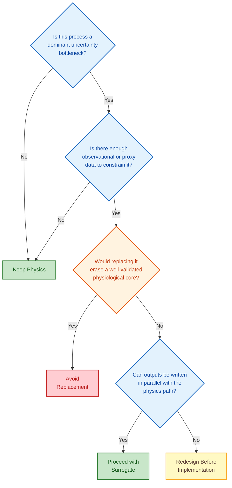

# RELIC Usage Guidance and Templates for New Cases

This chapter turns the Tapajos tutorial into a reusable pattern.

---

## Practical Recommendations

### 1. Keep mechanistic cores when they are already scientifically mature

Good candidates to keep physical:

- **Farquhar-style photosynthesis** --- best validated C3 carbon assimilation
- **Penman-Monteith evapotranspiration** --- most trusted canopy-scale ET
- **MEGAN BVOC emission physics** --- canonical mechanistic BVOC engine
- **Simple bookkeeping adapters** and routing layers

### 2. Use surrogates only where both of these are true

- The process is an **actual uncertainty bottleneck** in your case
- You can justify the surrogate inputs and outputs from **archived data provenance**

### 3. Do not hide weak targets

> [!CAUTION]
> If a target is a proxy or a climatology-derived field, **label it as such** in the provenance and in the documentation. The Tapajos case is useful precisely because it does this explicitly.

### 4. Always preserve a physics baseline

A hybrid path is scientifically stronger when it can be compared against a full physics path written in the same run, using the same forcing and observation window.

---

## Surrogate Decision Flowchart

> [!TIP]
> Use the following flowchart **before adding a surrogate** to any new case.



---

## Minimal Case Layout Template

```text
tutorial/<new_case>/
  +-- README.md                    # Case overview
  +-- run_case.py                  # Main entry point
  +-- plot_results.py              # Figure generator
  +-- config/
  |     +-- simulation.yaml        # Runtime configuration
  |     +-- optimization.yaml      # Optimization phases
  |     +-- case_parameters.yaml   # Parameter SSOT
  |     +-- ml_surrogate.yaml      # Surrogate config
  +-- data/
  |     +-- raw/                   # Raw input data
  |     +-- processed/             # Processed NetCDF files
  +-- functors/                    # Custom RELIC functors
  +-- output/                      # All run outputs
  +-- utils/                       # Helper utilities
```

---

## Minimal Functor Template

The following template shows the **RELIC-compliant pattern** for a scientific functor:

```python
from __future__ import annotations

import torch
from relic.core.functor import FunctorMetadata
from relic.core.functor.functor_types import SpatialScale, VariableKind
from relic.scientific.functor_bridges import BiologicalProcessFunctor


class ExampleStressFunctor(BiologicalProcessFunctor):
    def __init__(self, name: str = "example_stress") -> None:
        metadata = FunctorMetadata(
            category="biological_process",
            description="Example stress response functor.",
            input_variables=["air_temperature", "soil_moisture"],
            output_variables=["example_stress_factor"],
            spatial_scale=SpatialScale.POINT,
            variable_kind=VariableKind.STATE,
            version="1.0.0",
        )
        super().__init__(name=name, metadata=metadata)
        self._dependencies = []

    def forward(self, state, time_seconds: float, dt_seconds: float):
        # References:
        # - Author et al. (Year), process reference.
        # Mathematical expression:
        # - f = clip((x - x0) / (x1 - x0), f_min, f_max)
        # Parameter meanings:
        # - x: driving state variable [units]
        # - x0, x1: lower and upper reference values [units]
        # - f_min, f_max: admissible factor bounds [-]
        x = state["soil_moisture"]
        x0 = self.get_parameter_value("example.lower_bound", required=True)
        x1 = self.get_parameter_value("example.upper_bound", required=True)
        f_min = self.get_parameter_value("example.f_min", required=True)
        f_max = self.get_parameter_value("example.f_max", required=True)
        factor = torch.clamp((x - x0) / (x1 - x0), min=f_min, max=f_max)
        return {"example_stress_factor": factor}
```

---

## Minimal Parameter YAML Template

```yaml
parameters:
  tutorial.case.example.lower_bound:
    value: 0.10
    units: "m3 m-3"
    dtype: float
    bounds: [0.0, 1.0]
    category: tutorial_case
    description: "Lower reference soil moisture for the example stress function."
    references: ["Author et al. (Year)"]
    tags: ["tutorial", "stress"]
    requires_grad: false
    provenance: "case template"

  tutorial.case.example.upper_bound:
    value: 0.35
    units: "m3 m-3"
    dtype: float
    bounds: [0.0, 1.0]
    category: tutorial_case
    description: "Upper reference soil moisture for the example stress function."
    references: ["Author et al. (Year)"]
    tags: ["tutorial", "stress"]
    requires_grad: false
    provenance: "case template"
```

---

## Minimal ML Surrogate Template

> [!TIP]
> The Tapajos case shows a **safe pattern** for ML integration:

1. Keep the **physics functor** registered
2. Register the **surrogate as a RELIC functor**
3. Write outputs with an **`_ML` suffix**
4. **Reuse** the physics core where it remains scientifically stronger
5. **Archive** both the training summary and the final checkpoints

---

## Runtime Advice

### Recommended Commands

> [!TIP]
> Copy and adapt these commands for your new case:

```bash
# Quick smoke test
python tutorial/case/run_case.py --mode simulate --run-id smoke_case

# Full optimization run
python tutorial/case/run_case.py --mode optimize --run-id production_case

# Generate publication figures
python tutorial/case/plot_results.py --run-id production_case
```

### Resume Pattern

```bash
python tutorial/case/run_case.py --mode optimize \
    --resume production_case \
    --run-id production_case_resume
```

### What to Inspect After a Run

| Priority | File                                    | Purpose                         |
| :------: | :-------------------------------------- | :------------------------------ |
|    1     | `aggregate/run_summary.json`            | Overall status and phase losses |
|    2     | `aggregate/ml_training_summary.json`    | Surrogate training details      |
|    3     | `aggregate/process_monitor_physics.csv` | Physics baseline audit          |
|    4     | `aggregate/process_monitor_ML.csv`      | ML-hybrid path audit            |
|    5     | `timeseries/state_hourly_physics.nc`    | Physics trajectory              |
|    6     | `timeseries/state_hourly_ML.nc`         | ML trajectory                   |

---

## Final Recommendation

> [!IMPORTANT]
> Treat the Tapajos tutorial as a **template for disciplined hybrid modeling**, not as a recipe for replacing all uncertain processes with machine learning.
>
> RELIC works best when the **scientific contracts stay explicit** and the **surrogate scope stays narrow and auditable**.
