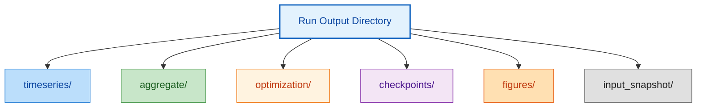
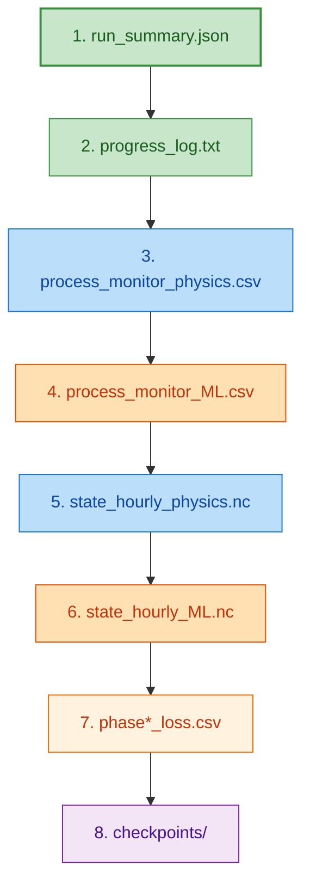

# Outputs, Monitoring, and Checkpointing

This chapter explains what the Tapajos tutorial writes during and after a run, and how case-level monitoring differs from RELIC core diagnostics.

---

## Canonical Reference Run

> [!NOTE]
> Historical examples refer to:
>
> ```text
> tutorial/case/output/runs/dual_path_full_20260306_v1
> ```
>
> This is a historical documentation snapshot. Its numerical examples do not verify a later checkout or the current conservation behavior.

---

## Current Forward Reproduction and Figure Semantics

`paper-final-20260930-full-01` is the completed current reproduction; `ma21doc-20260930-full-01` and `dual_path_full_20260306_v1` remain historical artifacts. The current run uses all 375 hourly steps and 40 observation-guidance epochs from the unchanged configuration, with real observation targets and ML enabled. It is a forward simulation with surrogate training, not a physical-parameter optimization run. See [current results and their limits](./04_reference_run_v1_outputs_and_results.md).

For another reproduction, choose a fresh run id and use the real RELIC conda environment. Do not reuse an archived run id or add a shortened `--days` window:

```powershell
$env:PYTHONNOUSERSITE = "1"
Remove-Item Env:RELIC_SKIP_CALIBRATED,Env:RELIC_SKIP_LEGACY,Env:RELIC_FAST_INIT -ErrorAction SilentlyContinue
$caseRunId = "paper-final-" + (Get-Date -Format "yyyyMMdd-HHmmss")
conda run -n RELIC --no-capture-output python -B -X utf8 tutorial\case\run_case.py --case-root tutorial\case --mode simulate --run-id $caseRunId --no-progress
conda run -n RELIC --no-capture-output python -B -X utf8 tutorial\case\analyze_results.py --case-root tutorial\case --run-id $caseRunId
conda run -n RELIC --no-capture-output python -B -X utf8 tutorial\case\plot_results.py --case-root tutorial\case --run-id $caseRunId --dpi 300
conda run -n RELIC --no-capture-output python -B -X utf8 tutorial\case\plot_megan_comparison.py --case-root tutorial\case --run-id $caseRunId --dpi 300
conda run -n RELIC --no-capture-output python -B -X utf8 tutorial\case\scripts\audit_conservation.py --run-dir "tutorial\case\output\runs\$caseRunId" --output-dir "tutorial\case\output\audit\$caseRunId-budget" --epoch 0 --phase-id 0
```

The original CLI regenerates four shared processed files and six shared model checkpoints before archiving them in the new run; the external-cache manifest is also derived output. Preserve any needed prior derived files first. The completed reproduction reused all five existing external caches, with no HTTP retrieval; a missing or invalid cache is a different input-preparation condition and must not be described as an offline reproduction.

Current plot labels follow the actual values and provenance:

- Figure 2 plots model `net_photosynthesis` (`umol CO2 m-2 s-1`) against the GPP-derived target stored under the same observation key (`umol m-2 s-1`). This run's provenance identifies `proxy_climatology_template`, so the target is labeled **GPP proxy target**. Matching names do not establish gross/net or leaf/ecosystem equivalence.
- Figure 3h uses separate axes for `stomatal_conductance` or `stomatal_conductance_ML` in `mol m-2 s-1` and `isoprene_correction_factor_ML` in `1`. The conductance units are present in the run NetCDF. The correction-factor attribute is absent in this run; its dimensionless unit comes from the actual ML owner contract and is not claimed as a recorded attribute.
- Figure 5 compares **Run start** (or the input snapshot when that is the actual source) with **Run final**, and states that physical parameters were not optimized for `simulate`. Figure 4 requires optimization-loss outputs and is skipped here. Figure 6 remains a notice rather than a mixed-path data comparison.
- Physics and ML metrics retain their original samples and values. The ML metrics use the training window and are not held-out validation. The MEGAN plots use 304 common finite samples, distinct from the main 375-sample metrics.

---

## Output Groups

Each run is organized into **six main folders**.



### 1. `timeseries/`

Primary time-resolved NetCDF outputs:

| File                      | Purpose                                       |
| :------------------------ | :-------------------------------------------- |
| `state_hourly.nc`         | Combined convenience product                  |
| `state_hourly_physics.nc` | Recorded physics baseline trajectory            |
| `state_hourly_ML.nc`      | Post-step ML diagnostics with `_ML` suffixes |
| `diagnostics_hourly.nc`   | Additional diagnostic exports                 |

### 2. `aggregate/`

Run-level summaries and monitors:

| File                          | Purpose                              |
| :---------------------------- | :----------------------------------- |
| `run_summary.json`            | Overall run summary and phase losses |
| `ml_training_summary.json`    | Per-surrogate training history       |
| `process_monitor.csv`         | Combined process monitor             |
| `process_monitor_physics.csv` | Physics monitor only                 |
| `process_monitor_ML.csv`      | ML monitor only                      |
| `progress_log.txt`            | Timestamped progress and event log   |

### 3. `optimization/`

Optimization traces and parameter outputs:

| File                        | Purpose                            |
| :-------------------------- | :--------------------------------- |
| `phase*_loss.csv`           | Per-phase loss histories           |
| `gradient_norms.csv`        | Gradient stability records         |
| `optimized_parameters.yaml` | Final optimized parameter values   |
| `best_params.yaml`          | Best-performing parameter snapshot |

### 4. `checkpoints/`

Persistent restart and audit artifacts:

| File Pattern                       | Purpose                               |
| :--------------------------------- | :------------------------------------ |
| `checkpoint_phase*_epoch*.pt`      | Optimization checkpoints (for resume) |
| `simulate_final_forward_step*.pt`  | Runtime step snapshots (for audit)    |
| `simulate_final_forward_latest.pt` | Latest runtime snapshot               |
| `ml_surrogates/*.pth`              | Frozen trained surrogate weights      |
| `ml_surrogates/manifest.json`      | Surrogate archive manifest            |

### 5. `figures/`

Publication-oriented figures, including split physics and ML figure sets. ML-specific filenames carry the `_ML` suffix.

### 6. `input_snapshot/`

Immutable copies of forcing, observations, metadata, and YAML configuration files used for the run.

---

## Case-Level Monitoring

> [!NOTE]
> The Tapajos tutorial implements an **explicit run-level monitoring layer** on top of RELIC. This is why the case is **highly auditable**.

### `process_monitor_physics.csv`

Tracks the **physics path only**. In `v1` it contains **375 rows**. Typical columns:

`soil_moisture`, `water_stress_factor`, `temperature_stress_factor`, `ozone_stress_factor`, `gpp`, `net_photosynthesis`, `isoprene_emission`, `stomatal_conductance`, and routing/runoff quantities.

> Use this file to answer: **What did the mechanistic baseline actually do at each stored step?**

### `process_monitor_ML.csv`

Tracks the **ML-hybrid path only**. In `v1` it also contains **375 rows**. Typical columns:

`soil_moisture_ML`, `water_stress_factor_ML`, `stomatal_conductance_ML`, `ozone_stress_factor_ML`, `diagnostics.bvoc.megan.co2_inhibition_factor_ML`, `isoprene_activity_correction_ML`, `isoprene_emission_chain_ML`, `isoprene_correction_factor_ML`, `isoprene_emission_ML`, and total BVOC flux diagnostics.

> Use this file to answer: **How did the hybrid path diverge from the baseline, and at which process layer did the divergence appear?**

### `process_monitor.csv`

Merged monitor file. Useful for quick scripting but less clean for side-by-side audit than the split files.

### `progress_log.txt`

Chronological event log recording:

- Phase starts and completions
- Checkpoint writes
- Final forward monitor snapshots
- Run completion and output path

> Use it for **progress reconstruction** and **interruption diagnosis**.

---

## Runtime Checkpoints

### Optimization Checkpoints

Files named like `checkpoint_phase3_epoch0012.pt` preserve enough state to **resume optimization** from a given phase and epoch.

### Simulation Checkpoints

Files named like `simulate_final_forward_step00239.pt` are **runtime forward checkpoints**. They are not optimizer-state checkpoints. They are step snapshots for **audit and recovery**.

### Archived Surrogate Checkpoints

The `ml_surrogates` subfolder stores trained weights and a manifest, giving
a frozen record of the exact surrogate state used in the run. Each surrogate
checkpoint records its ordered input and output variable names. Loading a
checkpoint with missing or different names raises `ModelLoadError` with a
retrain instruction; it does not silently initialize a new model.

---

## RELIC Core Diagnostics vs Tutorial Case Monitoring

> [!IMPORTANT]
> This distinction is important. The tutorial adds a **case-specific** monitoring layer on top of RELIC's **framework-level** diagnostics.

### Tutorial Case Monitoring (Experiment Management)

- Process monitor CSVs
- Progress log text
- Split NetCDF outputs
- Simulation step checkpoints
- Run summary JSON

### RELIC Core Diagnostics (Framework Introspection)

- `get_functor_summary()`
- `get_variable_provenance()`
- `get_simulation_summary()`
- Conservation reporting
- Scale-coupling statistics

---

## Recorded Budget Postprocessing And Limits

Current case construction sets `conservation_checks=False` and clears registered Functor `metadata.conservation_laws` in `tutorial\case\run_case.py`. Process monitors and a completed run are not proof of whole-case conservation. Module IPHS certificates do not replace the disabled case checks.

For a newly generated run, invoke the existing helper with explicit source and separate output paths:

```powershell
$caseRunId = "<new-run-id>"
python tutorial\case\scripts\audit_conservation.py --run-dir "tutorial\case\output\runs\$caseRunId" --output-dir "output_audit_tmp\$caseRunId-budget"
```

Add `--epoch` and `--phase-id` if more than one recorded group exists. The helper reuses canonical bucket storage and actual-ET diagnostics together with infiltration, bucket overflow and drainage. It verifies one consecutive fixed-step timeline against snapshotted `dt_seconds`, keeps all terms on a mass basis, and integrates only intervals after the first stored post-step reference. No soil depth is guessed. A missing field, nonfinite term or unsupported unit leaves that budget `NOT_EVALUATED`; missing runtime diagnostic unit attributes are reported separately with the source-owner unit contract.

The JSON report is always the starting point. A reconstructed residual is a diagnostic of these records, not a strict conservation certificate or proof of a physical leak. Carbon is explicitly `NOT_EVALUATED` without a complete stock/boundary inventory. The helper does not infer an open-system route or quasi-steady balance. Historical `v1` numerical claims below and elsewhere are not rewritten as new measurements.

### Measured Diagnostic Result for the Current Reproduction

For `paper-final-20260930-full-01`, all five required recorded series contain 375 finite values. The first record is a post-step reference, leaving 374 reconstructed intervals. The report is `EVALUATED_DIAGNOSTIC_ONLY`, with final and maximum absolute residual 0.000995639526792047 kg m-2, storage change -50.16351318359375 kg m-2, and integrated net input -50.16450882312054 kg m-2. The recorded bucket overflow is zero at every sample; it is not a missing field replaced by zero.

Carbon remains `NOT_EVALUATED`. Three bucket diagnostics lack NetCDF unit attributes: `diagnostics.soil_moisture_bucket.soil_water_storage` (owner contract `kg m-2`), `diagnostics.soil_moisture_bucket.adjusted_evapotranspiration`, and `diagnostics.soil_moisture_bucket.clipped_mass_residual` (both owner contracts `kg m-2 s-1`). Their reported units identify the existing `BucketSoilMoisture.forward` contract, not new runtime metadata. The broader output unit coverage is also incomplete. The case still sets `conservation_checks=False` and clears registered Functor `metadata.conservation_laws`; a small recorded residual does not certify whole-case conservation, strict IPHS, or absence of unrecorded exchanges.

## Why the Split Monitoring Design Matters

> [!TIP]
> The split design is one of the **strongest features** of the tutorial. It lets you distinguish between three questions that are often conflated:
>
> 1. **Did the run finish?** --- Check `progress_log.txt` and `run_summary.json`
> 2. **Did the physics baseline behave reasonably?** --- Check `process_monitor_physics.csv`
> 3. **Did the ML-hybrid path help or distort a specific process?** --- Compare `process_monitor_ML.csv` against the physics monitor

Because the outputs are separated, those questions can be answered **without rerunning** the simulation or manually reconstructing state from logs.

---

## Recommended Inspection Order After a New Run



This order moves from **coarse run status** to **fine process diagnosis**.
