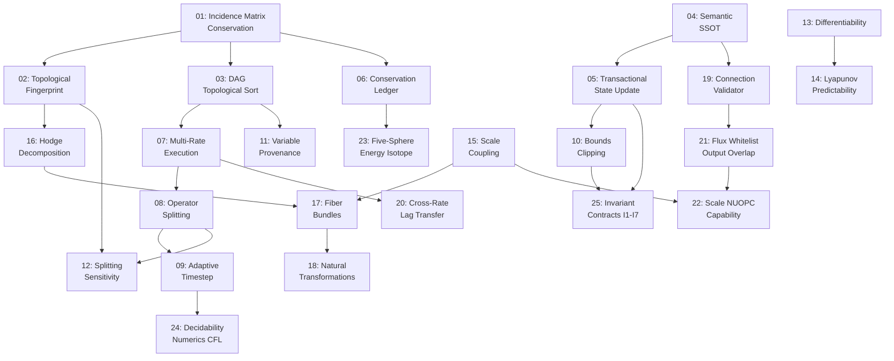

# Theory Tutorial Documentation Index

> **RELIC Framework** -- Comprehensive Theory Tutorial Suite  
> **Version**: 2026-02  
> **Total Documents**: 25 tutorial documents + this index  
> **Total Figures**: 41 publication-quality figures (math + RELIC pairs)

---

## 1. Overview

This suite documents 25 theory tutorials in `tutorial\theory`. Some call selected RELIC APIs; others are standalone NumPy/PyTorch illustrations or read stored reports. Figures, fixed scores and historical console examples do not by themselves certify the full RELIC runtime. Each page states the relevant boundary.

### Core Source Documents

| Document                                | Path                                                     | Role                                                                                                |
| --------------------------------------- | -------------------------------------------------------- | --------------------------------------------------------------------------------------------------- |
| **coertheory.md**                       | `docs\source\coertheory.md`                              | Core mathematical foundation: incidence matrix, conservation, Hodge decomposition, constraint chain |
| **spatiotemporal_scale_topology.md**    | `docs\source\theory\spatiotemporal_scale_topology.md`    | Spatiotemporal scale coupling: category theory, fiber bundles, natural transformations              |
| **00_unified_theoretical_framework.md** | `docs\source\theory\00_unified_theoretical_framework.md` | Five-sphere model, energy closure, invariant contracts                                              |

### How to Use This Documentation

1. **Newcomers**: Start with [Tutorial 01](./01_incidence_matrix_conservation.md) and follow the dependency graph below.
2. **Specific topics**: Use the thematic cluster table to find the relevant tutorials.
3. **Regenerating figures**: Run individual tutorials from `tutorial\theory` (see Section 6).

---

## 2. Dependency Graph

The following Mermaid diagram shows prerequisite relationships between tutorials. An arrow `A --> B` means Tutorial A should be read before Tutorial B.



---

## 3. Thematic Clusters

### Cluster A: Graph & Topology (Tutorials 01-03)

| Tutorial                                    | Title                         | Figures                                                 | Key Theory                                                                                 |
| ------------------------------------------- | ----------------------------- | ------------------------------------------------------- | ------------------------------------------------------------------------------------------ |
| [01](./01_incidence_matrix_conservation.md) | Incidence Matrix Conservation | `01_math_conservation.png`, `01_relic_conservation.png` | Theorem 3.1: $\mathbf{B}^\top \mathbf{1} = \mathbf{0} \Rightarrow \sum u_i = \text{const}$ |
| [02](./02_topological_fingerprint.md)       | Topological Fingerprint       | `02_math_fingerprint.png`, `02_relic_fingerprint.png`   | Corollary 2.5.5: $\sigma(\mathcal{G}) = (n, m, \text{rank}, \kappa, \beta_1)$              |
| [03](./03_dag_topological_sort.md)          | DAG Topological Sort          | `03_math_dag.png`, `03_relic_dag.png`                   | Theorem 3.6.1: Kahn's algorithm + cycle detection                                          |

### Cluster B: Semantic & State (Tutorials 04-06)

| Tutorial                                 | Title                      | Figures                                 | Key Theory                                                            |
| --- | --- | --- | --- |
| [04](./04_semantic_ssot.md)              | Semantic SSOT              | `04_math_ssot.png`, `04_relic_ssot.png` | Section 3.2: $\Pi$ (parameter mapping) + $\Gamma$ (variable contract) |
| [05](./05_transactional_state_update.md) | Transactional State Update | `05_transactional_state_update.png`     | Theorem 3.6.6: Batch commit and step-savepoint rollback               |
| [06](./06_conservation_ledger.md) | Conservation Ledger | `06_conservation_ledger.png` | $r=\lvert\Delta S-(\sum F_{\mathrm{in}}-\sum F_{\mathrm{out}})\Delta t\rvert$ |

### Cluster C: Time Integration (Tutorials 07-09)

| Tutorial                          | Title                | Figures                                           | Key Theory                                                |
| --------------------------------- | -------------------- | ------------------------------------------------- | --------------------------------------------------------- |
| [07](./07_multirate_execution.md) | Multi-Rate Execution | `07_math_multirate.png`, `07_relic_multirate.png` | Corollary 3.5.2: Fast/Medium/Slow group partitioning      |
| [08](./08_operator_splitting.md)  | Operator Splitting   | `08_operator_splitting.png`                       | Lie vs Strang splitting with exact sub-flows: $O(\Delta t)$ vs $O(\Delta t^2)$ |
| [09](./09_adaptive_timestep.md)   | Adaptive Timestep    | `09_adaptive_timestep.png`                        | Theorem 3.6.8: Step-size control (demo step doubling; runtime payload heuristic) |

### Cluster D: Robustness & Diagnostics (Tutorials 10-12)

| Tutorial                            | Title                 | Figures                        | Key Theory                                                     |
| ----------------------------------- | --------------------- | ------------------------------ | -------------------------------------------------------------- |
| [10](./10_bounds_clipping.md)       | Bounds Clipping       | `10_bounds_clipping.png`       | Theorem 3.6.3: $P_{[L,U]}$ projection + clip-loss              |
| [11](./11_variable_provenance.md)   | Variable Provenance   | `11_variable_provenance.png`   | Corollary 3.6.5: Increment attribution formula                 |
| [12](./12_splitting_sensitivity.md) | Splitting Sensitivity | `12_splitting_sensitivity.png` | Corollary 3.6.4: $\chi_{\text{comm}}$ commutativity diagnostic |

### Cluster E: Differentiability & Stability (Tutorials 13-14)

| Tutorial                              | Title                   | Figures                                         | Key Theory                                                                                 |
| ------------------------------------- | ----------------------- | ----------------------------------------------- | ------------------------------------------------------------------------------------------ |
| [13](./13_differentiability.md)       | Differentiability       | `13_differentiability.png`                      | Section 1.3 (unified framework): Adjoint sensitivity via PyTorch autograd                  |
| [14](./14_lyapunov_predictability.md) | Lyapunov Predictability | `14_math_lyapunov.png`, `14_relic_lyapunov.png` | Section 1.2: $T_p = \frac{1}{\lambda_{\max}} \ln(\Delta_{\max} / \|\delta\mathbf{x}(0)\|)$ |

### Cluster F: Scale & Coupling (Tutorials 15-18)

| Tutorial                              | Title                   | Figures                                       | Key Theory                                                                       |
| ------------------------------------- | ----------------------- | --------------------------------------------- | -------------------------------------------------------------------------------- |
| [15](./15_scale_coupling.md)          | Scale Coupling          | `15_scale_coupling.png`                       | spatiotemporal Section 2: Aggregation, broadcast (weighted adjoint), information loss |
| [16](./16_hodge_decomposition.md)     | Hodge Decomposition     | `16_math_hodge.png`, `16_relic_hodge.png`     | Theorem 3.3: $\mathbb{R}^m = \text{im}(\mathbf{B}^\top) \oplus \ker(\mathbf{B})$ |
| [17](./17_fiber_bundles.md)           | Fiber Bundles           | `17_math_fiber.png`, `17_relic_fiber.png`     | spatiotemporal Section 2.2: Scale fiber bundle $E = \mathcal{S} \times_\pi F$    |
| [18](./18_natural_transformations.md) | Natural Transformations | `18_math_natural.png`, `18_relic_natural.png` | spatiotemporal Section 3: Naturality square as a commutation diagnostic          |

### Cluster G: Governance & Validation (Tutorials 19-22)

| Tutorial                                    | Title                    | Figures                                                                 | Key Theory                                               |
| ------------------------------------------- | ------------------------ | ----------------------------------------------------------------------- | -------------------------------------------------------- |
| [19](./19_connection_validator.md)          | Connection Validator     | `19_math_connection_validator.png`, `19_relic_connection_validator.png` | Theorem 3.6.2: $\mathcal{V}(p_s, p_t)$ judgment operator |
| [20](./20_cross_rate_lag_transfer.md)       | Cross-Rate Lag Transfer  | `20_math_cross_rate_lag.png`, `20_relic_cross_rate_transfer.png`        | Theorem 3.6.7: $\text{lag}_{\max} \le \Delta t_M^{(k)}$  |
| [21](./21_flux_whitelist_output_overlap.md) | Flux Whitelist & Overlap | `21_math_governance_policies.png`, `21_relic_governance_evidence.png`   | Output overlap detection + diagnostics exemption         |
| [22](./22_scale_consistency_nuopc.md)       | Scale NUOPC Capability   | `22_math_scale_nuopc.png`, `22_relic_scale_nuopc_capability.png`        | spatiotemporal Section 5 + NUOPC clock negotiation       |

### Cluster H: Advanced Integration (Tutorials 23-25)

| Tutorial                                 | Title                      | Figures                                                                   | Key Theory                                                      |
| ---------------------------------------- | -------------------------- | ------------------------------------------------------------------------- | --------------------------------------------------------------- |
| [23](./23_five_sphere_energy_isotope.md) | Five-Sphere Energy Isotope | `23_math_five_sphere_matrix.png`, `23_relic_five_sphere_conservation.png` | Unified framework Section 2.1-5.3                               |
| [24](./24_decidability_numerics_cfl.md)  | Decidability Numerics CFL  | `24_math_decidability_open_system.png`, `24_relic_numerics_cfl.png`       | Section 1.4 (Rice's theorem) + CFL diagnostics + open-system closure |
| [25](./25_invariant_contracts_i1_i7.md)  | Invariant Contracts I1-I7  | `25_math_invariants_i1_i7.png`, `25_relic_invariants_i1_i7.png`           | I1-I7 contract verification framework                           |

---

## 4. Complete Figure Catalog

All figures are located in `tutorial\theory\figures`. Each tutorial produces either one or two PNG figures.

| #   | Figure File                             | Tutorial | Content                                                     |
| --- | --------------------------------------- | -------- | ----------------------------------------------------------- |
| 1   | `01_math_conservation.png`              | 01       | Carbon cycle graph, incidence matrix heatmap, pool dynamics |
| 2   | `01_relic_conservation.png`             | 01       | RELIC topological sort, parallel groups, VariableKind       |
| 3   | `02_math_fingerprint.png`               | 02       | Four graph configurations with topological fingerprints     |
| 4   | `02_relic_fingerprint.png`              | 02       | DependencyGraphResolver DAG classification                  |
| 5   | `03_math_dag.png`                       | 03       | Process DAG + Kahn's level decomposition                    |
| 6   | `03_relic_dag.png`                      | 03       | RELIC cycle detection + level statistics                    |
| 7   | `04_math_ssot.png`                      | 04       | Parameter mapping $\Pi$ + variable contract $\Gamma$        |
| 8   | `04_relic_ssot.png`                     | 04       | VariableKind + TemporalScale + FunctorMetadata              |
| 9   | `05_transactional_state_update.png`     | 05       | Commit/rollback/proposed-vs-actual                          |
| 10  | `06_conservation_ledger.png`            | 06       | Intact vs broken fluxes + budget residual                   |
| 11  | `07_math_multirate.png`                 | 07       | Gantt-style execution timeline + computation savings        |
| 12  | `07_relic_multirate.png`                | 07       | TemporalScale labels + demo process-scale mapping          |
| 13  | `08_operator_splitting.png`             | 08       | Lie vs Strang splitting comparison                          |
| 14  | `09_adaptive_timestep.png`              | 09       | Demo step-size control (retry until accepted)               |
| 15  | `10_bounds_clipping.png`                | 10       | Bounds projection + clip-loss diagnostics                   |
| 16  | `11_variable_provenance.png`            | 11       | Increment attribution and provenance tracking               |
| 17  | `12_splitting_sensitivity.png`          | 12       | Commutativity diagnostic across permutations                |
| 18  | `13_differentiability.png`              | 13       | Loss landscape + convergence + A/Ci curve fit               |
| 19  | `14_math_lyapunov.png`                  | 14       | Lyapunov exponent estimation + predictability horizon       |
| 20  | `14_relic_lyapunov.png`                 | 14       | RELIC chaotic dynamics + perturbation growth                |
| 21  | `15_scale_coupling.png`                 | 15       | Aggregation/broadcast and information loss                  |
| 22  | `16_math_hodge.png`                     | 16       | Hodge decomposition: gradient vs cycle flow                 |
| 23  | `16_relic_hodge.png`                    | 16       | Cycle basis + norm comparison + fingerprint                 |
| 24  | `17_math_fiber.png`                     | 17       | Fiber bundle structure for multi-scale states               |
| 25  | `17_relic_fiber.png`                    | 17       | RELIC fiber bundle implementation                           |
| 26  | `18_math_natural.png`                   | 18       | Natural transformation diagrams                             |
| 27  | `18_relic_natural.png`                  | 18       | Commutation defect (Jensen gap) analysis                    |
| 28  | `19_math_connection_validator.png`      | 19       | Connection judgment operator logic                          |
| 29  | `19_relic_connection_validator.png`     | 19       | RELIC adapter requirement analysis                          |
| 30  | `20_math_cross_rate_lag.png`            | 20       | Cross-rate lag bound theory                                 |
| 31  | `20_relic_cross_rate_transfer.png`      | 20       | RELIC cross-zone error transfer                             |
| 32  | `21_math_governance_policies.png`       | 21       | Flux whitelist + overlap governance                         |
| 33  | `21_relic_governance_evidence.png`      | 21       | RELIC governance evidence                                   |
| 34  | `22_math_scale_nuopc.png`               | 22       | Scale consistency + NUOPC clock                             |
| 35  | `22_relic_scale_nuopc_capability.png`   | 22       | RELIC scale NUOPC capability registry                       |
| 36 | `23_math_five_sphere_matrix.png` | 23 | Synthetic net matrix and computed edge-group totals |
| 37  | `23_relic_five_sphere_conservation.png` | 23       | Storage update + closure diagnostics                        |
| 38  | `24_math_decidability_open_system.png`  | 24       | Decidability boundary + open-system closure                 |
| 39  | `24_relic_numerics_cfl.png`             | 24       | CFL/diffusion diagnostics + floating-point diagnostics      |
| 40 | `25_math_invariants_i1_i7.png` | 25 | Invariant definitions and premise table |
| 41 | `25_relic_invariants_i1_i7.png` | 25 | Archived status and actual report metadata; no tests run |

---

## 5. Cross-Reference Convention

Throughout this documentation suite, we use the following citation conventions:

- **Internal links**: use the pattern `Tutorial NN -> ./NN_filename.md` for cross-references between tutorial documents (example: [Tutorial 01](./01_incidence_matrix_conservation.md))
- **coertheory.md**: `coertheory.md, Section X.Y` or `coertheory.md, Theorem 3.Y.Z`
- **spatiotemporal_scale_topology.md**: `spatiotemporal_scale_topology.md, Section X` or `Definition X.Y`
- **Unified framework**: `00_unified_theoretical_framework.md, Section X.Y`
- **External literature**: Standard author (year) format

---

## 6. Running Instructions

### Prerequisites

```powershell
# Enter repo root
cd C:\path\to\RELIC

# Use the RELIC environment Python explicitly (recommended for reproducibility)
$py = "python"

# Optional: if your conda is properly configured, you can also use activation.
# Note: on some machines conda may fail with NoWritableEnvsDirError; in that case keep using $py above.
# conda activate RELIC
# $py = "python"
```

### Run a Single Tutorial

```powershell
& $py tutorial\theory\01_incidence_matrix_conservation.py
```

### Run All Tutorials

```powershell
# Run all tutorial scripts 01..25
for ($i = 1; $i -le 25; $i++) {
    $nn = "{0:D2}" -f $i
    $script = Get-ChildItem -Path "tutorial\\theory\\${nn}_*.py" | Select-Object -First 1
    & $py $script.FullName
}
```

### Output Location

- **Figures**: `tutorial\\theory\\figures\\NN_*.png`
- **Console output**: scripts print status and numerical results to stdout. An [OK] completion message alone is not a scientific acceptance assertion.

---

## 7. Mathematical Notation Reference

| Symbol                                   | Meaning                                                                       | Defined In                                 |
| ---------------------------------------- | ----------------------------------------------------------------------------- | ------------------------------------------ |
| $\mathcal{G} = (V, E)$                   | Process-state orchestration graph                                             | coertheory.md, Section 0.2                 |
| $\mathbf{B} \in \{-1,0,1\}^{n \times m}$ | Incidence matrix                                                              | coertheory.md, Section 2.1                 |
| $\sigma(\mathcal{G})$                    | Topological fingerprint $(n, m, \text{rank}, \kappa, \beta_1)$                | coertheory.md, Corollary 2.5.5             |
| $\kappa$                                 | Connected components: $\dim\ker(\mathbf{B}^\top)$                             | coertheory.md, Section 2.1                 |
| $\beta_1$                                | Cycle rank: $\dim\ker(\mathbf{B})$                                            | coertheory.md, Theorem 3.2                 |
| $P_{[L,U]}$                              | Componentwise clamping projection                                             | coertheory.md, Theorem 3.6.3               |
| $\mathcal{U}_{\Delta t}$                 | Transactional update operator                                                 | coertheory.md, Theorem 3.6.6               |
| $\Pi$                                    | Parameter mapping $\mathcal{K} \to (\Theta, \mathcal{U}, [L,U], \text{meta})$ | coertheory.md, Section 3.2                 |
| $\Gamma$                                 | Variable contract mapping                                                     | coertheory.md, Section 3.2                 |
| $\lambda_{\max}$                         | Maximum Lyapunov exponent                                                     | coertheory.md, Section 1.2                 |
| $T_p$                                    | Predictability horizon                                                        | coertheory.md, Section 1.2                 |
| CFL                                      | Courant-Friedrichs-Lewy stability number                                      | coertheory.md, Section 3.4                 |
| $\mathcal{S}$                            | Spatial scale lattice                                                         | spatiotemporal_scale_topology.md, Def. 1.1 |
| $\mathcal{T}$                            | Temporal scale lattice                                                        | spatiotemporal_scale_topology.md, Def. 1.2 |
