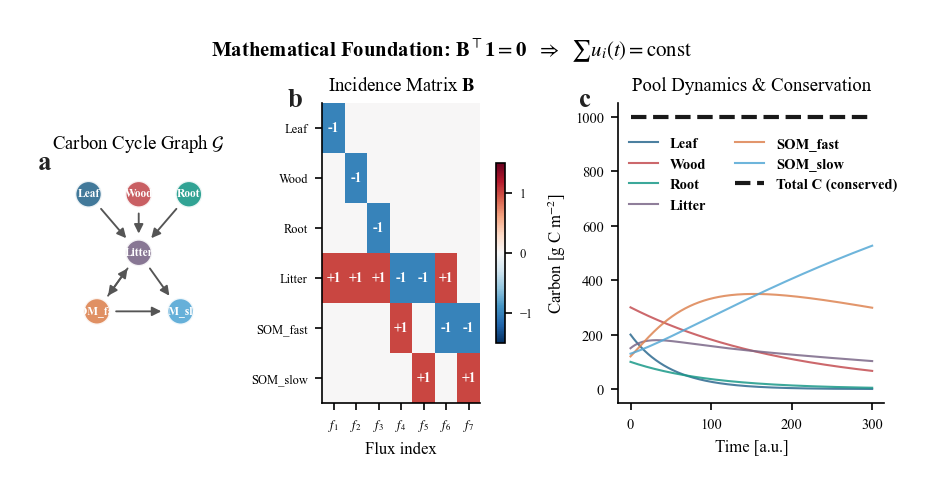
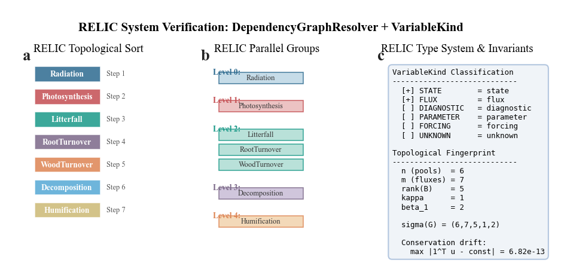

# Tutorial 01 -- Structural Conservation via Incidence Matrix

## 1. Overview

This tutorial demonstrates structural conservation for a declared physical exchange graph $\mathcal{G}=(V,E)$ with incidence matrix $\mathbf{B}$: nodes are compatible stocks and edges are internal transfers. The identity $c^\top\mathbf{B}=0$ preserves $c^\top u$ under $\dot u=\mathbf{B}f$ in exact arithmetic. It is not a consequence of the Functor dependency DAG and does not cover undeclared boundaries, incompatible units, clipping, or arbitrary numerical updates.

### Why It Matters

For this incidence construction, $\mathbf{B}^\top\mathbf{1}=\mathbf{0}$ is exact because every column contains one exactly representable +1 and -1. Computed stock trajectories still accumulate floating-point roundoff. Conservative Euler or Runge-Kutta stage updates inherit the linear invariant when every executed tendency stays in the same incidence image and no unaccounted projection or source is added.

### Prerequisites

- Basic linear algebra (matrix multiplication, null space, rank)
- Familiarity with directed graphs

---

## 2. Mathematical Foundation

### 2.1 Directed Graph and Incidence Matrix

**Definition (Incidence Matrix).** Given a directed graph $\mathcal{G} = (V, E)$ with $n = |V|$ nodes and $m = |E|$ edges, the incidence matrix $\mathbf{B} \in \{-1, 0, +1\}^{n \times m}$ is defined as:

$$
\mathbf{B}_{i,j} =
\begin{cases}
-1, & \text{if edge } j \text{ leaves node } i \\
+1, & \text{if edge } j \text{ enters node } i \\
0, & \text{otherwise}
\end{cases}
$$

> **Reference**: coertheory.md, Section 2.1

### 2.2 Closed-System Exchange Dynamics

The state evolution of a closed system is governed by:

$$
\frac{du}{dt} = \mathbf{B} f(u) \tag{1}
$$

where:

- $u(t) \in \mathbb{R}^n$ is the node (pool) state vector
- $f(u) \in \mathbb{R}^m$ is the edge (flux) vector
- $\mathbf{B} \in \{-1,0,1\}^{n \times m}$ is the incidence matrix

### 2.3 Theorem 3.1: Structural Conservation

**Theorem 3.1 (Structural Conservation, coertheory.md Section 2.2).**
For any $c \in \ker(\mathbf{B}^\top)$, the invariant $I_c(t) = c^\top u(t)$ satisfies:

$$
\frac{d}{dt} I_c(t) = 0
$$

**Proof:**

$$
\frac{d}{dt}(c^\top u) = c^\top \frac{du}{dt} = c^\top \mathbf{B} f(u) = (\mathbf{B}^\top c)^\top f(u) = \mathbf{0}^\top f(u) = 0
$$

$\square$

**Corollary (Total Quantity Conservation).** Since each column of $\mathbf{B}$ has exactly one $+1$ and one $-1$ (for graphs without self-loops), the column sums are zero: $\mathbf{B}^\top \mathbf{1} = \mathbf{0}$. Therefore $\mathbf{1} \in \ker(\mathbf{B}^\top)$, and:

$$
\sum_{i=1}^{n} u_i(t) = \text{const} \tag{2}
$$

### 2.4 Topological Fingerprint

As a secondary output, this tutorial also computes the topological fingerprint (coertheory.md, Corollary 2.5.5):

$$
\sigma(\mathcal{G}) = (n, m, \text{rank}(\mathbf{B}), \kappa, \beta_1)
$$

where:

- $\kappa = \dim\ker(\mathbf{B}^\top) = n - \text{rank}(\mathbf{B})$: number of connected components
- $\beta_1 = \dim\ker(\mathbf{B}) = m - \text{rank}(\mathbf{B})$: cycle rank (feedback complexity)

---

## 3. Computation Details

### 3.1 Carbon Cycle Graph Construction

The tutorial builds a simplified terrestrial carbon cycle with **6 pools** and **7 fluxes**:

| Pool Index | Pool Name | Biogeochemical Role                    |
| ---------- | --------- | -------------------------------------- |
| 0          | Leaf      | Foliage carbon (photosynthetic tissue) |
| 1          | Wood      | Structural woody biomass               |
| 2          | Root      | Below-ground root carbon               |
| 3          | Litter    | Dead organic matter on soil surface    |
| 4          | SOM_fast  | Fast-decomposing soil organic matter   |
| 5          | SOM_slow  | Slow/recalcitrant soil organic matter  |

| Flux Index | Source   | Sink     | Process Name        | Rate $k_j$ [time$^{-1}$] |
| ---------- | -------- | -------- | ------------------- | ------------------------ |
| 0          | Leaf     | Litter   | Litterfall          | 0.02                     |
| 1          | Wood     | Litter   | Wood turnover       | 0.005                    |
| 2          | Root     | Litter   | Root turnover       | 0.01                     |
| 3          | Litter   | SOM_fast | Fast decomposition  | 0.03                     |
| 4          | Litter   | SOM_slow | Slow decomposition  | 0.005                    |
| 5          | SOM_fast | Litter   | Microbial recycling | 0.01                     |
| 6          | SOM_fast | SOM_slow | Humification        | 0.002                    |

> **Reference**: Pool-flux structure inspired by Parton et al. (1987, CENTURY model)

### 3.2 Incidence Matrix Construction

The incidence matrix $\mathbf{B} \in \mathbb{R}^{6 \times 7}$ is constructed by setting $\mathbf{B}[\text{src}, j] = -1$ and $\mathbf{B}[\text{snk}, j] = +1$ for each edge $j$:

```python
B = np.zeros((6, 7))
for j, (src, snk) in enumerate(edges):
    B[src, j] = -1
    B[snk, j] = +1
```

### 3.3 Conservation Verification

**Step 1**: Verify $\mathbf{B}^\top \mathbf{1} = \mathbf{0}$:

```python
col_sums = B.T @ np.ones(n_pools)
assert np.allclose(col_sums, 0.0)
```

**Step 2**: Compute structural quantities:

- $\text{rank}(\mathbf{B}) = 5$
- $\kappa = 6 - 5 = 1$ (one connected component)
- $\beta_1 = 7 - 5 = 2$ (two independent cycles)

### 3.4 Forward Euler Simulation

The dynamics are simulated using donor-controlled first-order kinetics:

$$
f_j = k_j \cdot u_{\text{src}(j)} \tag{3}
$$

| Parameter    | Symbol     | Unit         | Meaning                             | Value                                   |
| ------------ | ---------- | ------------ | ----------------------------------- | --------------------------------------- |
| Flux rate    | $k_j$      | time$^{-1}$  | First-order decay rate for flux $j$ | See table above                         |
| State vector | $u_i$      | g C m$^{-2}$ | Carbon stock in pool $i$            | Initial: [200, 300, 100, 150, 120, 130] |
| Time step    | $\Delta t$ | a.u.         | Euler integration step              | 0.5                                     |
| Total steps  | $N$        | --           | Number of time steps                | 600                                     |

The Forward Euler update is:

$$
u^{n+1} = u^n + \Delta t \cdot (\mathbf{B} f(u^n)) \tag{4}
$$

> **Reference**: Donor-controlled kinetics per Parton et al. (1987)

### 3.5 RELIC Integration

The tutorial uses RELIC's `DependencyGraphResolver` to:

1. Register 7 processes matching the carbon cycle graph
2. Compute topological sort order
3. Extract parallel execution groups
4. Demonstrate `CyclicDependencyError` for cyclic graphs

---

## 4. RELIC Implementation Mapping

| RELIC Module                       | Class/Function            | Role in Tutorial                                   |
| ---------------------------------- | ------------------------- | -------------------------------------------------- |
| `relic.core.dependency_graph`      | `DependencyGraphResolver` | Topological sort + parallel group extraction       |
| `relic.core.dependency_graph`      | `CyclicDependencyError`   | Cycle detection exception                          |
| `relic.core.functor.functor_types` | `VariableKind`            | State/Flux/Diagnostic/Forcing classification       |
| `relic.core.functor.functor_types` | `ProcessCategory`         | PHYSICAL_FIELD / BIOLOGICAL_PROCESS categorization |
| `relic.core.functor.functor_types` | `FunctorMetadata`         | Metadata container for functor registration        |

### Code Path Exercised

1. `DependencyGraphResolver.__init__()` -- creates empty resolver
2. `resolver.add_functor(f)` -- registers each process with its dependencies
3. `resolver.topological_sort()` -- Kahn's algorithm (coertheory.md, Theorem 3.6.1)
4. `resolver.get_parallel_groups()` -- dependency-level decomposition (parallel candidates; RELIC executes groups sequentially)
5. `CyclicDependencyError` -- raised when a cyclic dependency is detected

---

## 5. Figures and Outputs

### 5.1 Figure 1: Mathematical Foundation (`01_math_conservation.png`)



**Panel (a): Carbon Cycle Graph $\mathcal{G}$**

- Shows the directed graph with 6 nodes (colored circles) and 7 directed edges (arrows)
- Leaf, Wood, Root form the top row (living biomass); Litter, SOM_fast, SOM_slow form the bottom row (dead organic matter)
- Arrow direction indicates flux flow from source to sink
- **Key takeaway**: The graph structure encodes all conservation information; no parameter values are needed for conservation to hold

**Panel (b): Incidence Matrix $\mathbf{B}$**

- Heatmap showing the $6 \times 7$ incidence matrix
- Blue ($-1$) indicates flux leaving a node; Red ($+1$) indicates flux entering a node
- Each column has exactly one $-1$ and one $+1$, confirming $\mathbf{B}^\top \mathbf{1} = \mathbf{0}$
- **Key takeaway**: The column-sum-zero property is visually verifiable from the matrix pattern

**Panel (c): Pool Dynamics & Conservation**

- Time series of all 6 pool stocks over 600 time steps
- Individual pools redistribute carbon dynamically
- Black dashed line shows **total carbon $\sum u_i(t)$** remaining constant at 1000 g C m$^{-2}$
- **Key takeaway**: Despite active inter-pool transfers, total carbon is conserved to machine precision

### 5.2 Figure 2: RELIC System Integration (`01_relic_conservation.png`)



**Panel (a): RELIC Topological Sort**

- Lists the 7 processes in the execution order determined by `DependencyGraphResolver.topological_sort()`
- Each process is labeled with its step number, showing deterministic ordering
- **Key takeaway**: RELIC enforces a unique, reproducible execution sequence

**Panel (b): RELIC Parallel Groups**

- Shows processes grouped by execution level (depth in the DAG)
- Processes at the same level have no dependency between them (parallel candidates); RELIC still runs them one after another
- **Key takeaway**: The level structure exposes parallel candidates without violating dependency constraints

**Panel (c): RELIC Type System & Invariants**

- Displays `VariableKind` classification (STATE, FLUX, DIAGNOSTIC, FORCING, etc.)
- Shows computed topological fingerprint $\sigma(\mathcal{G}) = (6, 7, 5, 1, 2)$
- Reports conservation drift: $\max |1^\top u - \text{const}| 6.82\times10^{-13}$ (absolute; relative drift $\sim 10^{-15}$)
- **Key takeaway**: RELIC's type system and structural analysis tools are fully integrated

---

## 6. Mathematical-RELIC Comparison

| Quantity | Mathematical Prediction | Tutorial / RELIC Output | Match |
| --- | --- | --- | --- |
| $\mathbf{B}^\top \mathbf{1}$ | $\mathbf{0}$ (exact) | $\mathbf{0}$ (exact, IEEE 754) | PASS |
| $\mathrm{rank}(\mathbf{B})$ | 5 | 5 | PASS |
| $\kappa$ (components) | 1 | 1 | PASS |
| $\beta_1$ (cycles) | 2 | 2 | PASS |
| $\sigma(\mathcal{G})$ | $(6,7,5,1,2)$ | $(6,7,5,1,2)$ | PASS |
| $\max_t \lvert\mathbf{1}^\top u(t)-\mathbf{1}^\top u(0)\rvert$ | 0 (exact theory) | $6.82\times10^{-13}$ | PASS |
| Topological sort | Valid order exists (DAG) | Kahn order + parallel groups | PASS |
| Cycle detection | Cyclic graph rejected | `CyclicDependencyError` raised | PASS |

**Error Metrics**:

- Conservation drift: $\sim 8\times 10^{-13}$ g C m$^{-2}$ (relative drift $\sim 8\times 10^{-16}$ vs total C $\approx 10^3$)
- This is consistent with IEEE 754 double-precision roundoff accumulation over 600 steps

---

## 7. Console Output Interpretation

```
[OK] B^T @ 1 = 0  (exact for integer B)
```

- Confirms the fundamental column-sum-zero property of the incidence matrix. This is exact because $\{-1, 0, +1\}$ are exactly representable in IEEE 754.

```
  sigma(G) = (6, 7, 5, 1, 2)
```

- Topological fingerprint: 6 pools, 7 fluxes, rank 5, 1 connected component, 2 independent cycles (microbial recycling loop and SOM_fast-Litter-SOM_slow triangle).

```
[OK] Max total-C drift = 6.82e-13 g C m^-2
```

- Absolute drift is $\sim 10^{-12}$, but the **relative** drift is $\sim 10^{-15}$ vs total C $\approx 10^3$. This confirms structural conservation holds up to IEEE 754 roundoff.

```
=== RELIC DependencyGraphResolver Output ===
  Topological order: ['Radiation', 'Photosynthesis', 'Litterfall', 'RootTurnover', 'WoodTurnover', 'Decomposition', 'Humification']
  Parallel groups:   [['Radiation'], ['Photosynthesis'], ['Litterfall', 'RootTurnover', 'WoodTurnover'], ['Decomposition'], ['Humification']]
```

- RELIC's `DependencyGraphResolver` successfully computes a valid topological ordering and identifies the dependency levels (parallel candidates).

```
  [OK] RELIC CyclicDependencyError raised correctly
```

- When a cyclic dependency (A $\to$ B, B $\to$ A) is introduced, RELIC correctly detects and rejects it.

```
  RELIC VariableKind values:
    STATE        = state
    FLUX         = flux
    DIAGNOSTIC   = diagnostic
    PARAMETER    = parameter
    FORCING      = forcing
    UNKNOWN      = unknown
```

- Displays the complete RELIC variable classification system, showing all recognized `VariableKind` values.

---

## 8. Connections to Other Tutorials

### Downstream Dependencies

- **[Tutorial 02](./02_topological_fingerprint.md)**: Extends the topological fingerprint concept with multi-configuration comparison
- **[Tutorial 03](./03_dag_topological_sort.md)**: Deep-dives into the DAG compilation and Kahn's algorithm
- **[Tutorial 06](./06_conservation_ledger.md)**: Shows how conservation violations manifest as non-zero budget residuals
- **[Tutorial 16](./16_hodge_decomposition.md)**: Decomposes the edge space $\mathbb{R}^m$ using the same incidence matrix $\mathbf{B}$

### Dependency Graph Position

This is the **root tutorial** of the entire suite. It introduces the incidence matrix $\mathbf{B}$, which is the central mathematical object used throughout all subsequent tutorials. No prerequisites are required.

### Key Concepts Introduced Here and Reused Later

| Concept                           | Reused In                    |
| --------------------------------- | ---------------------------- |
| Incidence matrix $\mathbf{B}$     | Tutorials 02, 06, 12, 16, 23 |
| $\sigma(\mathcal{G})$ fingerprint | Tutorials 02, 16, 22         |
| `DependencyGraphResolver`         | Tutorials 02, 03, 16-22      |
| `VariableKind`                    | Tutorials 04, 10, 11, 21, 25 |
| Conservation theorem              | Tutorials 05, 06, 23, 25     |

---

## 9. References

### RELIC Theory Documents

1. coertheory.md, Section 2.1-2.2 (Incidence matrix definition and Theorem 3.1)
2. coertheory.md, Corollary 2.5.5 (Topological fingerprint)
3. coertheory.md, Theorem 3.6.1 (DAG compilation and deterministic topological sort)
4. spatiotemporal_scale_topology.md, Section 4 (Dependency DAG structure)

### External Literature

5. Godsil, C. & Royle, G. (2001). _Algebraic Graph Theory_. Cambridge University Press.
6. Strang, G. (1988). _Linear Algebra and Its Applications_ (3rd ed.). Harcourt Brace.
7. Hirani, A.N. (2003). _Discrete Exterior Calculus_. PhD Thesis, Caltech.
8. Parton, W.J. et al. (1987). Analysis of factors controlling soil organic matter levels in Great Plains grasslands. _SSSA Journal_, 51, 1173-1179.
