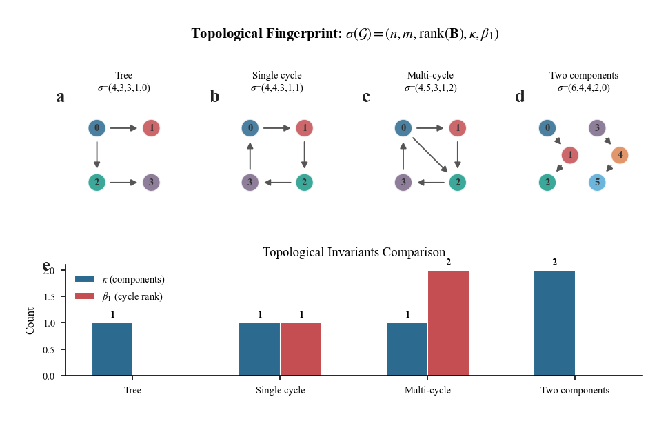
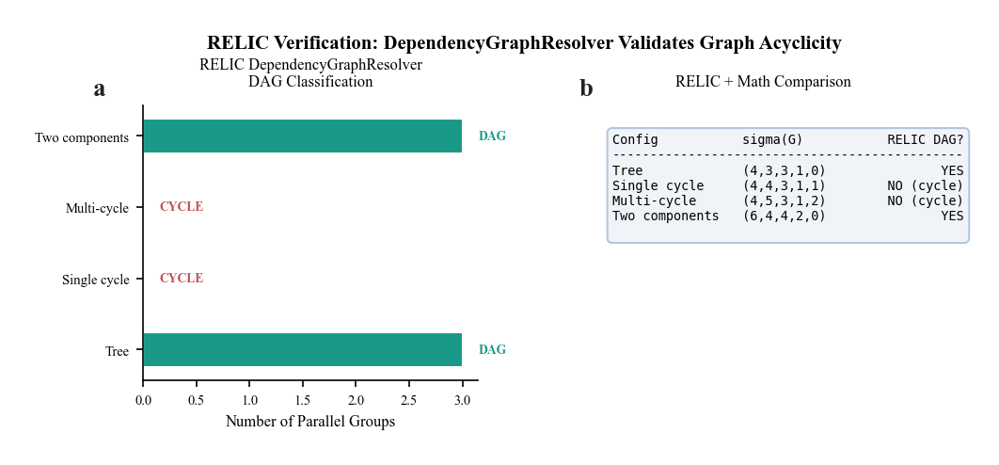

# Tutorial 02 -- Topological Fingerprint and Betti Numbers

## 1. Overview

This tutorial demonstrates the **topological fingerprint** $\sigma(\mathcal{G})$, a parameter-free structural invariant that provides a compact "structural version number" for any process graph. By comparing four different graph configurations (tree, single cycle, multi-cycle, two components), it shows how the fingerprint changes with structural modifications while remaining completely insensitive to parameter perturbations.

This is a coarse invariant, not a unique graph identifier: nonisomorphic graphs can share it, and reversing edge directions leaves these counts unchanged. Components and cycle rank refer to the underlying undirected graph; a positive cycle rank does not imply a directed cycle or decide the execution DAG. Parameter independence assumes fixed topology.

### Why It Matters

The topological fingerprint lets modelers classify different model configurations by structure alone. When conducting structural uncertainty analysis, $\sigma(\mathcal{G})$ enables grouping configurations into "structural ensembles" before discussing parameter uncertainty within each group (coertheory.md, Corollary 2.5.5). This transforms model comparison from empirical enumeration into auditable structural classification.

### Prerequisites

- [Tutorial 01](./01_incidence_matrix_conservation.md): Incidence matrix and conservation theorem

---

## 2. Mathematical Foundation

### 2.1 Topological Fingerprint Definition

**Definition (coertheory.md, Corollary 2.5.5).** The topological fingerprint of a graph $\mathcal{G} = (V, E)$ with incidence matrix $\mathbf{B}$ is:

$$
\sigma(\mathcal{G}) = \big(n, m, \text{rank}(\mathbf{B}), \kappa, \beta_1\big) \tag{1}
$$

where:

- $n = |V|$: number of nodes (pools)
- $m = |E|$: number of edges (fluxes)
- $\text{rank}(\mathbf{B})$: rank of the incidence matrix
- $\kappa = \dim\ker(\mathbf{B}^\top) = n - \text{rank}(\mathbf{B})$: number of connected components
- $\beta_1 = \dim\ker(\mathbf{B}) = m - \text{rank}(\mathbf{B})$: cycle rank (first Betti number)

### 2.2 Theorem 3.2: Cycle Rank Formula

**Theorem 3.2 (coertheory.md, Section 2.3).** For the incidence matrix $\mathbf{B}$ of a graph without self-loops:

$$
\beta_1 = m - \text{rank}(\mathbf{B}) = m - n + \kappa \tag{2}
$$

**Proof**: By the rank-nullity theorem, $\dim\ker(\mathbf{B}) = m - \text{rank}(\mathbf{B})$. For an incidence matrix, $\text{rank}(\mathbf{B}) = n - \kappa$. Substitution gives $\beta_1 = m - n + \kappa$. $\square$

### 2.3 Structural Sensitivity

From Corollary 2.5.4 (coertheory.md):

1. **Connecting two components** (adding a cross-component edge): $m \to m+1$, $\kappa \to \kappa-1$, so $\beta_1$ is unchanged but budget partitions merge.
2. **Adding an edge within a component**: $m \to m+1$, $\kappa$ unchanged, so $\beta_1 \to \beta_1+1$ -- a new independent feedback loop.

---

## 3. Computation Details

### 3.1 Four Graph Configurations

| Config | Name           | $n$ | Edges                               | Description               |
| ------ | -------------- | --- | ----------------------------------- | ------------------------- |
| 1      | Tree           | 4   | $(0,1), (0,2), (2,3)$               | Acyclic, single component |
| 2      | Single cycle   | 4   | $(0,1), (1,2), (2,3), (3,0)$        | One feedback loop         |
| 3      | Multi-cycle    | 4   | $(0,1), (1,2), (2,3), (3,0), (0,2)$ | Two independent cycles    |
| 4      | Two components | 6   | $(0,1), (1,2), (3,4), (4,5)$        | Disconnected graph        |

### 3.2 Fingerprint Results

| Config         | $n$ | $m$ | rank | $\kappa$ | $\beta_1$ | $\sigma(\mathcal{G})$ |
| -------------- | --- | --- | ---- | -------- | --------- | --------------------- |
| Tree           | 4   | 3   | 3    | 1        | 0         | $(4,3,3,1,0)$         |
| Single cycle   | 4   | 4   | 3    | 1        | 1         | $(4,4,3,1,1)$         |
| Multi-cycle    | 4   | 5   | 3    | 1        | 2         | $(4,5,3,1,2)$         |
| Two components | 6   | 4   | 4    | 2        | 0         | $(6,4,4,2,0)$         |

### 3.3 RELIC DAG Classification

Each configuration is registered with RELIC's `DependencyGraphResolver`, which classifies them as:

- **Tree**: DAG (acyclic) -- topological sort succeeds
- **Single cycle**: CYCLE (rejected) -- `CyclicDependencyError`
- **Multi-cycle**: CYCLE (rejected) -- `CyclicDependencyError`
- **Two components**: DAG -- sort succeeds (two independent chains)

---

## 4. RELIC Implementation Mapping

| Module                             | Class                     | Usage                                |
| ---------------------------------- | ------------------------- | ------------------------------------ |
| `relic.core.dependency_graph`      | `DependencyGraphResolver` | DAG classification + parallel groups |
| `relic.core.functor.functor_types` | `ProcessCategory`         | Categorizes as BIOLOGICAL_PROCESS    |
| `relic.core.functor.functor_types` | `FunctorMetadata`         | Metadata for each functor            |

---

## 5. Figures and Outputs

### 5.1 Figure 1: Mathematical Topological Fingerprint (`02_math_fingerprint.png`)



**Panels (a-d): Four Graph Configurations**

- Each panel shows a directed graph with nodes as colored circles and edges as arrows
- Below each graph: the computed fingerprint $\sigma(\mathcal{G})$
- **Key takeaway**: Visual confirmation that tree ($\beta_1=0$), single cycle ($\beta_1=1$), multi-cycle ($\beta_1=2$), and disconnected ($\kappa=2$) graphs produce distinct fingerprints

**Panel (e): Topological Invariants Comparison**

- Bar chart comparing $\kappa$ (components) and $\beta_1$ (cycles) across all four configurations
- Shows $\kappa$ and $\beta_1$ are independent "structural knobs" (Corollary 2.5.4)
- **Key takeaway**: Adding edges within a component increases $\beta_1$ but not $\kappa$; connecting components decreases $\kappa$ but not $\beta_1$

### 5.2 Figure 2: RELIC System Integration (`02_relic_fingerprint.png`)



**Panel (a): RELIC DependencyGraphResolver DAG Classification**

- Horizontal bar chart showing the number of parallel groups for each configuration
- DAG configurations (Tree, Two components) have parallel groups; cyclic configurations are rejected
- **Key takeaway**: RELIC automatically distinguishes executable (DAG) from non-executable (cyclic) structures

**Panel (b): Summary Table**

- Side-by-side comparison of mathematical fingerprint and RELIC's DAG verdict
- Confirms perfect agreement between theory and system behavior

---

## 6. Mathematical-RELIC Comparison

| Config         | $\sigma(\mathcal{G})$ | $\beta_1 > 0$? | RELIC: DAG? | Consistent? |
| -------------- | --------------------- | -------------- | ----------- | ----------- |
| Tree           | $(4,3,3,1,0)$         | No             | YES         | PASS        |
| Single cycle   | $(4,4,3,1,1)$         | Yes            | NO          | PASS        |
| Multi-cycle    | $(4,5,3,1,2)$         | Yes            | NO          | PASS        |
| Two components | $(6,4,4,2,0)$         | No             | YES         | PASS        |

> **Note**: $\beta_1 > 0$ does not necessarily imply a directed cycle (Betti numbers are computed on the undirected graph). RELIC's DAG detection is based on directed acyclicity, which is a different (stronger) condition.

---

## 7. Console Output Interpretation

```
  Tree              sigma = (4,3,3,1,0)
  Single cycle      sigma = (4,4,3,1,1)
  Multi-cycle       sigma = (4,5,3,1,2)
  Two components    sigma = (6,4,4,2,0)
```

- Each line confirms the computed fingerprint. The tree has no cycles ($\beta_1=0$), while adding edges within a component increments $\beta_1$.

```
=== RELIC Analysis ===
  Tree              DAG  groups=[['P0'], ['P1', 'P2'], ['P3']]
  Single cycle      CYCLE (rejected)  groups=None
  Multi-cycle       CYCLE (rejected)  groups=None
  Two components    DAG  groups=[['P0', 'P3'], ['P1', 'P4'], ['P2', 'P5']]
```

- RELIC correctly accepts acyclic graphs and rejects cyclic ones.

---

## 8. Connections to Other Tutorials

| Related Tutorial                                     | Relationship                                                            |
| ---------------------------------------------------- | ----------------------------------------------------------------------- |
| [Tutorial 01](./01_incidence_matrix_conservation.md) | Prerequisite: introduces $\mathbf{B}$ and conservation theorem          |
| [Tutorial 03](./03_dag_topological_sort.md)          | Extends DAG classification with Kahn's algorithm details                |
| [Tutorial 12](./12_splitting_sensitivity.md)         | Uses fingerprint to characterize splitting configurations               |
| [Tutorial 16](./16_hodge_decomposition.md)           | Uses $\beta_1$ to determine dimension of cycle space $\ker(\mathbf{B})$ |

---

## 9. References

1. coertheory.md, Sections 2.3-2.5, Corollaries 2.5.1-2.5.5
2. Godsil, C. & Royle, G. (2001). _Algebraic Graph Theory_, Chapter 8. Cambridge.
