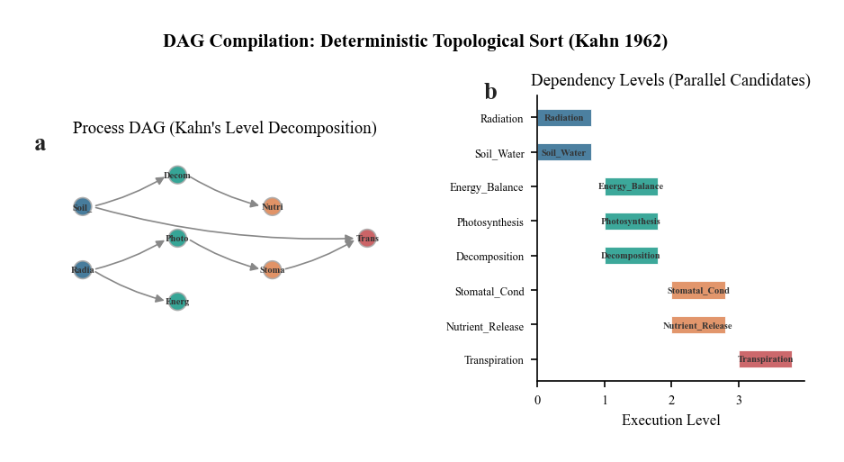
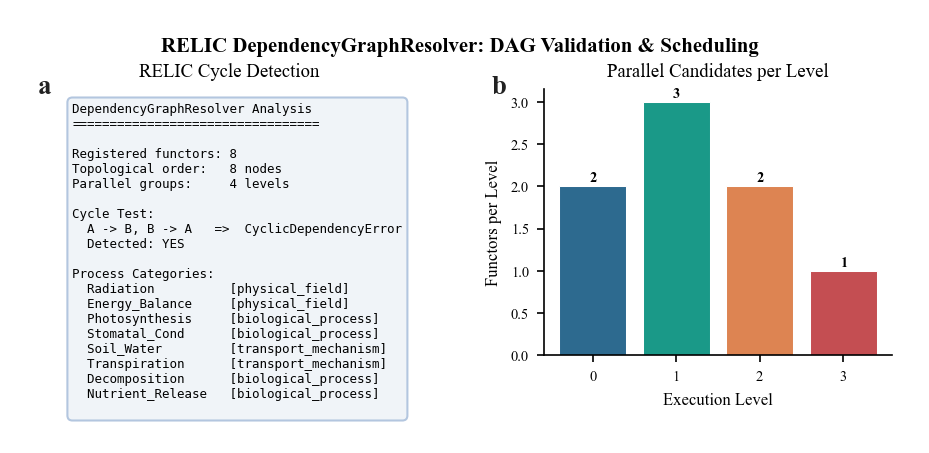

# Tutorial 03 -- DAG Compilation and Deterministic Topological Sort

## 1. Overview

This tutorial demonstrates RELIC's **DAG compilation** mechanism using Kahn's algorithm for deterministic topological sorting and RELIC's `CyclicDependencyError` for cycle rejection. It shows how 8 biogeochemical processes with explicit dependencies are compiled into a deterministic, reproducible execution schedule with identified dependency levels (parallel candidates; RELIC executes them sequentially).

### Why It Matters

Deterministic execution ordering ensures that "structural uncertainty" (changing $\mathcal{G}$) and "parameter uncertainty" (changing $\Pi$) are rigorously separated. With a fixed graph and a fixed registration order, the execution order is a non-negotiable invariant -- not an additional source of uncertainty (coertheory.md, Theorem 3.6.1).

### Prerequisites

- [Tutorial 01](./01_incidence_matrix_conservation.md): Incidence matrix basics
- [Tutorial 02](./02_topological_fingerprint.md): Graph structural properties

---

## 2. Mathematical Foundation

### 2.1 Theorem 3.6.1: DAG Compilation

**Theorem 3.6.1 (coertheory.md, Section 3.6).** Let $\mathcal{G} = (V, E)$ be a directed graph. The strict compilation operator $\mathcal{C}$ returns a node sequence $\pi = (v_1, \ldots, v_{|V|})$ if and only if:

1. $\mathcal{G}$ is a DAG (Directed Acyclic Graph)
2. $\pi$ is a valid topological order: for any $(u \to v) \in E$, $u$ precedes $v$ in $\pi$
3. With a fixed total order on nodes (RELIC: the Functor registration index), $\pi$ is deterministic

### 2.2 Kahn's Algorithm

**Algorithm (Kahn, 1962)**:

1. Initialize a min-heap $Q$, keyed by Functor registration index, with all nodes having in-degree 0
2. While $Q$ is non-empty:
   - Pop the node $v$ with the smallest registration index (RELIC's fixed total order; the NetworkX path uses the same key and gives the same plan)
   - Append $v$ to output sequence $\pi$
   - Remove all outgoing edges of $v$, updating in-degrees
   - Enqueue any nodes whose in-degree becomes 0
3. If $|\pi| < |V|$: cycle detected, raise error

> **Reference**: Kahn, A.B. (1962). Topological sorting of large networks. _Comm. ACM_; spatiotemporal_scale_topology.md, Section 4.

### 2.3 Level Decomposition

The level sets returned by `get_parallel_groups()` are the **breadth-first level decomposition** of the DAG:

- **Level 0**: Processes with no dependencies (in-degree 0)
- **Level $k+1$**: Processes whose dependencies are all in levels $\le k$

Processes in the same level have no dependency edge between them, so they are parallel *candidates*. RELIC currently executes every group as a sequential loop in plan order; it does not run DAG Functors in threads or processes. Absence of an edge does not prove the Functors commute (shared state writes can still make results order-dependent; see Tutorial 12).

---

## 3. Computation Details

### 3.1 Process Definitions (8 Processes)

| Process          | Dependencies              | Category            | Level |
| ---------------- | ------------------------- | ------------------- | ----- |
| Radiation        | --                        | PHYSICAL_FIELD      | 0     |
| Energy_Balance   | Radiation                 | PHYSICAL_FIELD      | 1     |
| Photosynthesis   | Radiation                 | BIOLOGICAL_PROCESS  | 1     |
| Stomatal_Cond    | Photosynthesis            | BIOLOGICAL_PROCESS  | 2     |
| Soil_Water       | --                        | TRANSPORT_MECHANISM | 0     |
| Transpiration    | Stomatal_Cond, Soil_Water | TRANSPORT_MECHANISM | 3     |
| Decomposition    | Soil_Water                | BIOLOGICAL_PROCESS  | 1     |
| Nutrient_Release | Decomposition             | BIOLOGICAL_PROCESS  | 2     |

### 3.2 Cycle Detection Test

A cyclic dependency (Radiation $\to$ Transpiration $\to$ Radiation) is introduced and confirmed to trigger `CyclicDependencyError`.

---

## 4. RELIC Implementation Mapping

| Module                             | Class                     | Usage                                         |
| ---------------------------------- | ------------------------- | --------------------------------------------- |
| `relic.core.dependency_graph`      | `DependencyGraphResolver` | Topological sort + parallel group computation |
| `relic.core.dependency_graph`      | `CyclicDependencyError`   | Cycle rejection                               |
| `relic.core.functor.functor_types` | `ProcessCategory`         | PHYSICAL_FIELD / BIOLOGICAL / TRANSPORT       |

---

## 5. Figures and Outputs

### 5.1 Figure 1: Mathematical DAG + Level Decomposition (`03_math_dag.png`)



**Panel (a): Process DAG Visualization**

- Directed graph showing 8 processes arranged by level (left=level 0, right=higher levels)
- Colored by execution level; arrows show dependency flow
- **Key takeaway**: The DAG structure ensures no circular dependencies

**Panel (b): Dependency Levels (Parallel Candidates, Gantt-style)**

- Horizontal bar chart showing each process positioned at its execution level
- Processes at the same level have no dependency between them (parallel candidates)
- **Key takeaway**: Level 0 has 2 independent processes (Radiation, Soil_Water); RELIC still runs them one after another

### 5.2 Figure 2: RELIC Cycle Detection & Category Summary (`03_relic_dag.png`)



**Panel (a): Cycle Detection Summary**

- Monospace text block showing: registered functors count, topological order length, parallel group count, and cycle detection result
- Lists all process categories used in the tutorial
- **Key takeaway**: RELIC's `CyclicDependencyError` is correctly raised for the cyclic test case

**Panel (b): Parallel Candidates Per Level**

- Bar chart showing the number of functors at each execution level
- **Key takeaway**: Level distribution reveals the DAG's "width" (upper bound on parallel candidates, not realised concurrency)

---

## 6. Mathematical-RELIC Comparison

| Quantity        | Theory                                                        | RELIC                                          | Match |
| --------------- | ------------------------------------------------------------- | ---------------------------------------------- | ----- |
| DAG detection   | Kahn's algorithm returns full sequence iff acyclic            | `topological_sort()` succeeds                  | PASS  |
| Cycle rejection | Kahn's algorithm fails (incomplete sequence) iff cycle exists | `CyclicDependencyError` raised                 | PASS  |
| Determinism     | Unique output with a fixed total order (registration index)   | Same order across runs                         | PASS  |
| Level count     | BFS level decomposition                                       | `get_parallel_groups()` returns correct levels | PASS  |

---

## 7. Console Output Interpretation

```
[OK] RELIC topological sort succeeded
  Order: ['Radiation', 'Energy_Balance', 'Photosynthesis', 'Stomatal_Cond', 'Soil_Water', 'Transpiration', 'Decomposition', 'Nutrient_Release']
  Parallel groups: [['Radiation', 'Soil_Water'], ['Energy_Balance', 'Photosynthesis', 'Decomposition'], ['Stomatal_Cond', 'Nutrient_Release'], ['Transpiration']]
```

- Valid topological order confirmed (ties broken by registration index); 4 dependency levels (parallel candidates) identified

```
[OK] RELIC CyclicDependencyError raised for cyclic graph
```

- Cycle detection confirmed for the Radiation-Transpiration cycle

---

## 8. Connections to Other Tutorials

| Related Tutorial                                     | Relationship                                      |
| ---------------------------------------------------- | ------------------------------------------------- |
| [Tutorial 01](./01_incidence_matrix_conservation.md) | Prerequisite: introduces graph structure          |
| [Tutorial 07](./07_multirate_execution.md)           | Extends with temporal grouping (fast/medium/slow) |
| [Tutorial 11](./11_variable_provenance.md)           | Uses DAG structure for increment attribution      |

---

## 9. References

1. Kahn, A.B. (1962). Topological sorting of large networks. _Communications of the ACM_, 5(11), 558-562.
2. Cormen, T.H. et al. (2009). _Introduction to Algorithms_, Chapter 22.
3. coertheory.md, Theorem 3.6.1
4. spatiotemporal_scale_topology.md, Section 4 (Topological Structure of the Dependency Graph)
