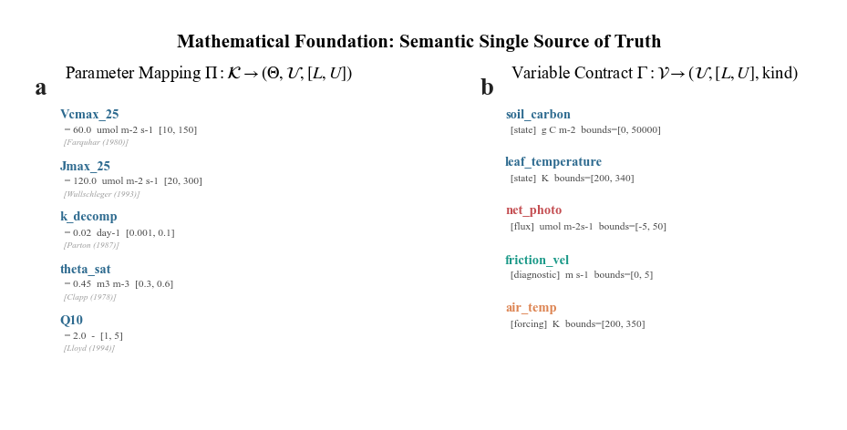
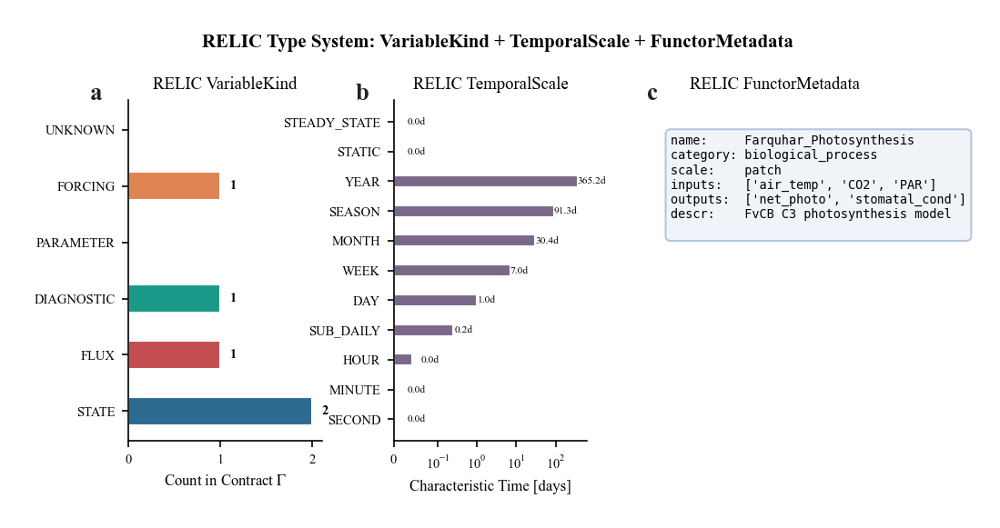

# Tutorial 04 -- Semantic Single Source of Truth (SSOT)

## 1. Overview

This tutorial demonstrates RELIC's **Semantic Single Source of Truth (SSOT)** principle: two formal mappings -- the parameter mapping $\Pi$ and the variable contract $\Gamma$ -- provide the authoritative semantic layer that gives physical meaning to the structural algebra of the incidence matrix. Without SSOT, conservation and budget closure can only be expressed as "unitless linear algebra."

### Why It Matters

SSOT assigns parameter and variable semantics to their canonical owners. ParameterManager, variable contracts, registration and runtime validation check their own declared scope; enum labels or successful construction alone do not prove units, writer authorization, or physical closure. Errors may be rejected during loading, compilation, registration, or execution.

### Prerequisites

- [Tutorial 01](./01_incidence_matrix_conservation.md): Graph structure basics
- Basic understanding of physical units and parameter ranges

---

## 2. Mathematical Foundation

### 2.1 Parameter Mapping $\Pi$

**Definition (coertheory.md, Section 3.2).** Let $\mathcal{K}$ be the set of parameter keys. The parameter mapping is:

$$
\Pi: \mathcal{K} \to (\Theta, \mathcal{U}, [L, U], \text{meta}) \tag{1}
$$

where:

- $\Theta$: parameter value space
- $\mathcal{U}$: unit group (dimensional analysis)
- $[L, U]$: allowable range
- meta: provenance, reference, description

### 2.2 Variable Contract $\Gamma$

**Definition (coertheory.md, Section 3.2).** Let $\mathcal{V}$ be the set of state variables. The variable contract is:

$$
\Gamma: \mathcal{V} \to (\mathcal{U}, [L, U], \text{owner/writer}, \text{domain tags}, \text{aliases}) \tag{2}
$$

This specifies unit, range, write permission, conservation domain membership, and standard name aliases for each variable.

### 2.3 Combined Coordinate System

The structural coordinate system is given by $\sigma(\mathcal{G})$ (from Tutorial 02); the semantic coordinate system is given by $(\Pi, \Gamma)$. Together they make budget residuals, unit consistency, and write permissions expressible as **checkable mathematical propositions**.

---

## 3. Computation Details

### 3.1 Synthetic Parameter Database Example ($\Pi$ mapping)

**Note:** This tutorial uses a small **synthetic** parameter table to visualize the mapping $\Pi$. In RELIC, the authoritative $\Pi$ lives in the YAML parameter database and is accessed via the ParameterManager API (SSOT policy).

| Key         | Value | Unit                       | Bounds       | Reference           |
| ----------- | ----- | -------------------------- | ------------ | ------------------- |
| `Vcmax_25`  | 60.0  | $\mu$mol m$^{-2}$ s$^{-1}$ | [10, 150]    | Farquhar (1980)     |
| `Jmax_25`   | 120.0 | $\mu$mol m$^{-2}$ s$^{-1}$ | [20, 300]    | Wullschleger (1993) |
| `k_decomp`  | 0.02  | day$^{-1}$                 | [0.001, 0.1] | Parton (1987)       |
| `theta_sat` | 0.45  | m$^3$ m$^{-3}$             | [0.3, 0.6]   | Clapp (1978)        |
| `Q10`       | 2.0   | --                         | [1, 5]       | Lloyd (1994)        |

Both tables are synthetic dictionaries in the script, not exports of the current parameter or contract database. A real ParameterSpec requires units, dtype, bounds and category; numeric dtypes require numeric interval bounds, with -.inf / .inf for open endpoints, while bounds: null is only for nonnumeric dtypes. Numeric value/default/bounds reject text numbers; YAML 1.1 uses 1.0e+7. Example values and units do not replace production species bases or literature parameterizations.

### 3.2 Variable Contracts ($\Gamma$ mapping)

| Variable           | Kind       | Unit                       | Bounds     |
| ------------------ | ---------- | -------------------------- | ---------- |
| `soil_carbon`      | STATE      | g C m$^{-2}$               | [0, 50000] |
| `leaf_temperature` | STATE      | K                          | [200, 340] |
| `net_photo`        | FLUX       | $\mu$mol m$^{-2}$ s$^{-1}$ | [$-5$, 50] |
| `friction_vel`     | DIAGNOSTIC | m s$^{-1}$                 | [0, 5]     |
| `air_temp`         | FORCING    | K                          | [200, 350] |

### 3.3 RELIC Type System Showcase

The tutorial demonstrates all RELIC enum types:

- **VariableKind**: STATE, FLUX, DIAGNOSTIC, PARAMETER, FORCING, UNKNOWN
- **ProcessCategory**: PHYSICAL_FIELD, BIOLOGICAL_PROCESS, TRANSPORT_MECHANISM, SCALE_COUPLING
- **SpatialScale**: POINT, PATCH, GRID_CELL, HILLSLOPE, BASIN, LANDSCAPE, GRID_2D, GRID_3D, REGIONAL, GLOBAL, UNKNOWN
- **TemporalScale**: SECOND, MINUTE, HOUR, SUB_DAILY, DAY, WEEK, MONTH, SEASON, YEAR, STATIC, STEADY_STATE, UNKNOWN (each with `to_characteristic_time_days()`)
- **FunctorMetadata**: Complete metadata container combining all of the above

---

## 4. RELIC Implementation Mapping

| Module                             | Class             | Usage                                                    |
| ---------------------------------- | ----------------- | -------------------------------------------------------- |
| `relic.core.functor.functor_types` | `VariableKind`    | Variable classification (STATE/FLUX/DIAGNOSTIC/FORCING)  |
| `relic.core.functor.functor_types` | `ProcessCategory` | Process categorization                                   |
| `relic.core.functor.functor_types` | `SpatialScale`    | Spatial resolution classification                        |
| `relic.core.functor.functor_types` | `TemporalScale`   | Temporal resolution with `to_characteristic_time_days()` |
| `relic.core.functor.functor_types` | `ExecutionPhase`  | Execution lifecycle phase                                |
| `relic.core.functor.functor_types` | `FunctorMetadata` | Composite metadata container                             |

---

## 5. Figures and Outputs

### 5.1 Figure 1: Mathematical SSOT Structure (`04_math_ssot.png`)



**Panel (a): Parameter Mapping $\Pi$**

- Lists 5 biogeochemical parameters with values, units, bounds, and literature references
- Color-coded by parameter key
- **Key takeaway**: Each parameter has a single authoritative definition with complete metadata

**Panel (b): Variable Contract $\Gamma$**

- Lists 5 state variables with their `VariableKind`, unit, and bounds
- Color-coded by kind (blue=STATE, orange=FLUX, green=DIAGNOSTIC, purple=FORCING)
- **Key takeaway**: Write permissions and unit contracts are formalized, not implicit

### 5.2 Figure 2: RELIC Type System (`04_relic_ssot.png`)



**Panel (a): VariableKind Distribution**

- Bar chart counting VariableKind labels in the synthetic dictionary; this does not inspect the contract registry.
- **Key takeaway**: VariableKind classifies a declared role; it does not prove prognostic ownership or units.

**Panel (b): TemporalScale Labels and Declared Periods**

- Logarithmic horizontal bar chart showing characteristic time for each TemporalScale value
- Ranges from SECOND (~0.00 days) to YEAR (~365 days)
- **Key takeaway**: RELIC's scale hierarchy spans 7 orders of magnitude

**Panel (c): FunctorMetadata Example**

- Monospace display of a complete `FunctorMetadata` instance for Farquhar photosynthesis
- Shows name, category, spatial scale, input/output variables, and description
- **Key takeaway**: All metadata lives in a single structured object

---

## 6. Mathematical-RELIC Comparison

| Aspect               | Theory ($\Pi$, $\Gamma$)                 | RELIC Implementation                  | Match |
| -------------------- | ---------------------------------------- | ------------------------------------- | ----- |
| Parameter bounds     | $\Pi(k) \to [L, U]$                      | YAML database with bounds             | PASS  |
| Variable unit | $\Gamma(v) \to \mathcal{U}$ | Governed variable contracts and unit validation; not VariableKind alone | Scope mapping |
| Write permission | $\Gamma(v) \to \text{owner}$ | Declared outputs plus registration and commit authorization | Scope mapping |
| Scale classification | Declared scale labels                     | `SpatialScale`, `TemporalScale` enums | PASS  |
| Metadata composition | $(n, c, s, \text{in}, \text{out})$ tuple | `FunctorMetadata` dataclass           | PASS  |

---

## 7. Console Output Interpretation

**Fresh execution output (2026-09-30):**

```text
=== RELIC Type System (Semantic SSOT) ===

VariableKind:
  STATE        = state
  FLUX         = flux
  DIAGNOSTIC   = diagnostic
  PARAMETER    = parameter
  FORCING      = forcing
  UNKNOWN      = unknown

ProcessCategory:
  PHYSICAL_FIELD         = physical_field
  BIOLOGICAL_PROCESS     = biological_process
  TRANSPORT_MECHANISM    = transport_mechanism
  SCALE_COUPLING         = scale_coupling

SpatialScale:
  POINT      = point
  PATCH      = patch
  GRID_CELL  = grid_cell
  HILLSLOPE  = hillslope
  BASIN      = basin
  LANDSCAPE  = landscape
  GRID_2D    = grid_2d
  GRID_3D    = grid_3d
  REGIONAL   = regional
  GLOBAL     = global
  UNKNOWN    = unknown

TemporalScale:
  SECOND       = second            tau = 0.00 days
  MINUTE       = minute            tau = 0.00 days
  HOUR         = hour              tau = 0.04 days
  SUB_DAILY    = sub_daily         tau = 0.25 days (declared period)
  DAY          = day               tau = 1.00 days
  WEEK         = week              tau = 7.00 days (declared period)
  MONTH        = month             tau = 30.44 days (declared period)
  SEASON       = season            tau = 91.31 days (declared period)
  YEAR         = year              tau = 365.25 days (declared period)
  STATIC       = static            tau = 0.00 days
  STEADY_STATE = steady_state      tau = 0.00 days
  UNKNOWN      = unknown           tau = (undeclared; no characteristic period)

[OK] FunctorMetadata created: Farquhar_Photosynthesis
  Category: biological_process
  Scale:    patch
```

- The enum listing and metadata construction do not verify a mathematical scale lattice or all SSOT contracts.

---

## 8. Connections to Other Tutorials

| Related Tutorial                                     | Relationship                                                 |
| ---------------------------------------------------- | ------------------------------------------------------------ |
| [Tutorial 05](./05_transactional_state_update.md)    | Uses SSOT contracts for bounds checking during state updates |
| [Tutorial 07](./07_multirate_execution.md)           | Uses `TemporalScale` for execution group assignment          |
| [Tutorial 19](./19_connection_validator.md)          | Uses $(\Pi, \Gamma)$ for connection validation logic         |
| [Tutorial 21](./21_flux_whitelist_output_overlap.md) | Uses write permissions from $\Gamma$ for overlap detection   |

---

## 9. References

1. coertheory.md, Section 3.2 (Semantic Single Source of Truth)
2. architecture_overview.md, Parameter System section
3. Farquhar, G.D., von Caemmerer, S., Berry, J.A. (1980). _Planta_, 149, 78-90.
4. Wullschleger, S.D. (1993). _Journal of Experimental Botany_, 44, 907-920.
5. Parton, W.J. et al. (1987). _SSSA Journal_, 51, 1173-1179.
6. Clapp, R.B. & Hornberger, G.M. (1978). _Water Resources Research_, 14, 601-604.
7. Lloyd, J. & Taylor, J.A. (1994). _Functional Ecology_, 8, 315-323.
