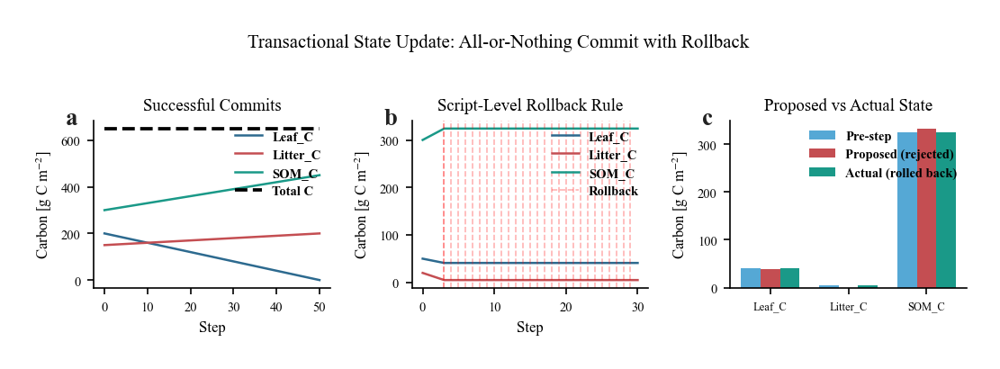

# Tutorial 05 -- Transactional State Update and Rollback

## 1. Overview

This tutorial demonstrates RELIC's **transactional state update** operator $\mathcal{U}_{\Delta t}$ for one update batch: the increments passed to one `StateManager.apply_updates` call are accumulated, checked, and either committed together or rejected (the batch snapshot is restored and an error is raised). In the simulator, each executed group call commits once (Strang splitting commits once per sub-execution; triggered medium and slow groups add further commits), later Functors in a call read the provisional state, and the whole step runs inside one step savepoint that restores StateManager state, step bookkeeping, Functor state dicts, held manager parameter bindings, provenance and supported RNG state if a captured internal failure occurs before acceptance. Declared bounds are enforced by clipping with a recorded clip loss, not by rejecting the step.

### Why It Matters

In Earth system models, multiple processes (photosynthesis, respiration, decomposition, etc.) contribute increments to the same state variables within a single time step. Without transactional semantics, a constraint failure halfway through the update cycle could leave the state in an inconsistent, partially-updated condition -- leading to untraceable conservation violations and numerical instability. Within the captured internal state, RELIC's step transaction prevents partial in-memory state from a failed step; it covers the captured owners only (StateManager, step bookkeeping, Functor state dictionaries including extra state, held manager parameter bindings, supported RNG states, provenance) and does not undo external files or services or restore Functor attributes outside `state_dict`/extra state and the explicit `parameter_bindings` channel (coertheory.md, Theorem 3.6.6).

### Prerequisites

- [Tutorial 04](./04_semantic_ssot.md): Semantic SSOT (bounds and variable contracts)

---

## 2. Mathematical Foundation

### 2.1 Cumulative Update with Bounds Projection

**Theorem 3.6.3 (coertheory.md).** For a state variable $x$ receiving $k$ increments $\Delta x_i$ in one time step:

$$
x^{n+1} = P_{[L,U]}\!\left(x^n + \sum_{i=1}^{k} \Delta x_i\right) \tag{1}
$$

where $P_{[L,U]}$ is the componentwise clamping projection:

$$
P_{[L,U]}(z)_i = \max(L_i, \min(z_i, U_i))
$$

### 2.2 Clip-Loss Diagnostic

The clip-loss records the amount removed by projection:

$$
\Delta x_{\text{clip}} = \left(x^n + \sum_{i=1}^{k} \Delta x_i\right) - x^{n+1} \tag{2}
$$

This is recorded as a diagnostic quantity and participates in budget audit.

### 2.3 Theorem 3.6.6: Transactional Semantics

**Theorem 3.6.6 (coertheory.md, Section 3.6).** The transactional update operator $\mathcal{U}_{\Delta t}$ guarantees:

- **If all constraints pass**: new state is committed; conservation checks, range validation, and alias consistency are all satisfied.
- **If any constraint fails**: the batch is not committed; inside the simulator the step savepoint restores the captured internal state (StateManager, step bookkeeping, Functor state dicts, held manager parameter bindings, provenance, supported RNG), so no partial update of that state remains.

**Proof sketch** (under the stated coverage): the snapshot is taken before any group commit, every blocking failure reaches the single restore path, and restore succeeds; state outside the captured set and external effects are not covered. $\square$

---

## 3. Computation Details

### 3.1 StateManager Calls Used by the Script

The script uses the real `StateManager`: it takes a snapshot, calls `apply_updates(updates, dt=1.0, check_conservation=True, rollback_on_failure=False)` for the batch, and in Scenario B restores the saved snapshot manually when its post-step rule fails. This is not the simulator savepoint or durable checkpoint. Durable simulator checkpoints write format 3 with `{state_dict, parameter_bindings}` per Functor and can upgrade version 2 on read. Post-acceptance external delivery does not roll back the accepted state.

| Method                  | Mathematical Operation | Description                                                                                  |
| ----------------------- | ---------------------- | -------------------------------------------------------------------------------------------- |
| `checkpoint()`          | Save $x^n$             | Records state before update                                                                  |
| `apply_updates(...)`    | Apply Eq. (1)          | Accumulates the increments, clips to bounds (recording clip loss), checks conservation, commits the batch |
| `restore(snapshot)`     | Restore $x^n$          | Called by the script in Scenario B to demonstrate rollback                                   |

### 3.2 Scenario A: Successful Commit

- **Initial state**: Leaf_C=200, Litter_C=150, SOM_C=300 (total=650)
- **Increments per step**: Litterfall ($-4, +4, 0$) + Decomposition ($0, -3, +3$)
- **Result over 50 steps**: All commits succeed; total C drift $\approx 0$ (machine)

### 3.3 Scenario B: Rollback on Constraint Failure

- **Initial state**: Leaf_C=50, Litter_C=20, SOM_C=300
- **Aggressive decomposition**: drains Litter faster than replenished
- **Script-level rule**: after `apply_updates` has committed the step (clipping at the bounds if needed), the script restores the snapshot when Litter_C reaches zero. RELIC itself clips to the bound and records the clip loss; `apply_updates` rejects a batch (restores its snapshot and raises) only for errors such as unauthorized writes, a conservation violation configured to raise, or a failed state validation
- **Result**: 27 of 30 steps are rolled back; from step 3 on, every proposed step drives Litter_C to 0, so the state stays at the last accepted values $(41, 5, 324)$

### 3.4 Parameter Table

| Parameter            | Symbol                  | Unit                     | Meaning                             | Value                          |
| -------------------- | ----------------------- | ------------------------ | ----------------------------------- | ------------------------------ |
| Lower bound          | $L$                     | g C m$^{-2}$             | Minimum allowed pool value          | 0.0                            |
| Upper bound          | $U$                     | g C m$^{-2}$             | Maximum allowed pool value          | 1000.0                         |
| Litterfall increment | $\Delta x_{\text{lit}}$ | g C m$^{-2}$ step$^{-1}$ | Carbon transfer from Leaf to Litter | $(-4, +4, 0)$                  |
| Decomp increment     | $\Delta x_{\text{dec}}$ | g C m$^{-2}$ step$^{-1}$ | Carbon transfer from Litter to SOM  | $(0, -3, +3)$ or $(0, -8, +8)$ |

---

## 4. RELIC Implementation Mapping

The tutorial calls RELIC's `StateManager` (in `relic.core.state.manager`) directly; the step-level rows below are added by the simulator and are not exercised by the script:

| RELIC Concept          | Tutorial Analog                                                                     | Theorem       |
| ---------------------- | ----------------------------------------------------------------------------------- | ------------- |
| State snapshot         | `sm.checkpoint()`                                                                   | Theorem 3.6.6 |
| Increment accumulation | `UpdateItem(..., mode=UpdateMode.ACCUMULATE)` payloads passed to `apply_updates`    | Theorem 3.6.3 |
| Batch commit           | `sm.apply_updates(...)` (one call per executed group call in the simulator)         | Theorem 3.6.6 |
| Bounds projection      | clipping inside `apply_updates` (`PhysicalConstraintManager.apply_constraints`)     | Theorem 3.6.3 |
| Clip-loss diagnostic   | `clip_loss = proposed - clamped` (signed; positive removes storage)                 | Eq. (2)       |
| Rollback               | `sm.restore(snapshot)` (script-level rule in Scenario B)                            | Theorem 3.6.6 |
| Whole-step rollback    | `step_simulation` savepoint (`create_transaction_savepoint` / `restore_transaction_savepoint`), which also captures Functor `state_dict()`, `parameter_bindings`, RNG, and step bookkeeping | Theorem 3.6.6 |
| Commit granularity     | Eq. (1) with $P_{[L,U]}$ is applied at each group commit, so a multi-group step composes several projections | Theorem 3.6.3 |

---

## 5. Figures and Outputs

### 5.1 Figure 1: Transactional State Update (`05_transactional_state_update.png`)



**Panel (a): Successful Commits**

- Time series of 3 pools (Leaf_C, Litter_C, SOM_C) over 50 steps
- Black dashed line: total carbon remains constant at 650
- **Key takeaway**: Under normal conditions, transactional updates preserve conservation exactly

**Panel (b): Script-Level Rollback Rule**

- Time series with aggressive decomposition
- Red dashed vertical lines mark rollback events
- The state stays at the last accepted values once every proposed step would deplete Litter_C (script rule)
- **Key takeaway**: The script-level rollback keeps the last accepted state; negative values would already be prevented by the bound clipping inside `apply_updates`

**Panel (c): Proposed vs Actual State**

- Bar chart comparing pre-step, proposed (rejected), and actual (rolled-back) states at the first rollback step
- The proposed state drives Litter_C to its lower bound 0 (the script's failure rule); the actual state equals the pre-step snapshot
- **Key takeaway**: Restoring the snapshot leaves no partial update of the managed state

---

## 6. Mathematical-RELIC Comparison

| Metric               | Scenario A      | Scenario B                           | Expected                     |
| -------------------- | --------------- | ------------------------------------ | ---------------------------- |
| Total C drift        | 0.00e+00        | 0 (every batch is balanced; not printed) | $\le \epsilon_{\text{mach}}$ |
| Kept steps           | 50/50           | 3/30                                 | --                           |
| Rollback count       | 0               | 27                                   | Constraint-dependent         |
| State after rollback | --              | $(41, 5, 324)$ = pre-step snapshot   | PASS                         |
| Clip-loss recorded   | $\mathbf{0}$    | $\mathbf{0}$ (Litter_C reaches the bound exactly; no clipping) | PASS |

---

## 7. Console Output Interpretation

```
[OK] Scenario A (valid): total C drift = 0.00e+00
```

- Conservation holds to machine precision over 50 successful commits.

```
[OK] Scenario B (rollback): 27 steps rolled back
  State after rollback = [ 41.   5. 324.]  (unchanged from pre-failure snapshot)
```

- Confirms that the script's manual `restore(snapshot)` restores the pre-step state (steps 3-29 are rolled back).

---

## 8. Connections to Other Tutorials

| Related Tutorial                                 | Relationship                                                                      |
| ------------------------------------------------ | --------------------------------------------------------------------------------- |
| [Tutorial 04](./04_semantic_ssot.md)             | Prerequisite: provides bounds and contracts used in constraint checking           |
| [Tutorial 10](./10_bounds_clipping.md)           | Deep-dives into $P_{[L,U]}$ projection and clip-loss diagnostics                  |
| [Tutorial 25](./25_invariant_contracts_i1_i7.md) | I4 (reversibility) and I7 (bounds clipping) directly test transactional semantics |

---

## 9. References

1. coertheory.md, Theorem 3.6.3 (Contractual increment composition)
2. coertheory.md, Theorem 3.6.6 (Transactional constraint gating)
3. spatiotemporal_scale_topology.md, Section 7.3, Proposition 7.1 (State transition formalization)
