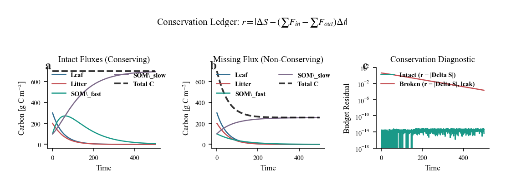

# Tutorial 06 -- Conservation Ledger and Budget Residual

## 1. Overview

This tutorial demonstrates the idea behind RELIC's **conservation ledger** and **budget residual** mechanism with a standalone NumPy script. For declared conservation domains with enabled checks, RELIC evaluates budget residuals at each group commit against the tolerances in `validation\conservation.yaml`, turning conservation violations in those domains from silent long-term drift into flagged, diagnosable events; a flux that is not declared in the domain or route cannot be detected by this ledger.

### Why It Matters

In complex biogeochemical models with dozens of interconnected flux pathways, a single missing or misconfigured flux can cause a slow, insidious mass leak that goes undetected for thousands of simulation steps. The conservation ledger provides a per-commit diagnostic that catches such errors in declared domains, up to the configured tolerance (coertheory.md, Section 3.3).

### Prerequisites

- [Tutorial 01](./01_incidence_matrix_conservation.md): Incidence matrix and conservation theorem
- Basic understanding of budget closure in Earth system science

---

## 2. Mathematical Foundation

### 2.1 Budget Closure Check

**Definition (coertheory.md, Section 3.3).** For a conservation domain $D$, the budget closure equation is:

$$
\Delta S = \left(\sum F_{\text{in}} - \sum F_{\text{out}}\right) \Delta t \tag{1}
$$

The budget residual measures deviation from closure:

$$
r = \left|\Delta S - \left(\sum F_{\text{in}} - \sum F_{\text{out}}\right) \Delta t\right| \tag{2}
$$

In this tutorial, the intact scenario assumes **no explicit boundary fluxes** (all fluxes are internal exchanges), so $(\sum F_{\text{in}} - \sum F_{\text{out}})\Delta t = 0$ for the total-C domain and the residual reduces to $r=|\Delta S|$. The broken-pathway scenario is equivalent to introducing an **implicit exterior sink** without explicitly adding an environment node (coertheory.md, Corollary 2.5.6).

### 2.2 Closed-System Total Conservation

For a closed system whose physical exchange graph (stocks and fluxes, `G_phys`) has incidence matrix $\mathbf{B}$ (Theorem 3.1); the Functor dependency graph used for execution order is a different graph and does not establish this identity:

$$
\frac{d}{dt}\left(\mathbf{1}^\top u\right) = 0 \implies \sum_i \Delta u_i = 0 \tag{3}
$$

### 2.3 Structural Drift Diagnostic

When a user provides conservation coefficients $c \in \ker(\mathbf{B}^\top)$ and a stock-coordinate tendency vector $F$ on the same units and support, the structural drift is:

$$
\text{drift} = (c^\top F) \Delta t \tag{4}
$$

Here $F$ is a node tendency. If $f$ instead denotes edge fluxes, substitute $F=\mathbf{B}f$, giving $\text{drift}=(c^\top\mathbf{B}f)\Delta t$. This is a directed structural audit, not proof that undeclared external exchanges close.

---

## 3. Computation Details

### 3.1 Four-Pool Carbon Cycle

| Pool Index | Pool Name | Initial Value [g C m$^{-2}$] |
| ---------- | --------- | ---------------------------- |
| 0          | Leaf      | 300.0                        |
| 1          | Litter    | 200.0                        |
| 2          | SOM_fast  | 100.0                        |
| 3          | SOM_slow  | 100.0                        |

| Flux  | Source   | Sink     | Rate $k_j$ [time$^{-1}$] | Process            |
| ----- | -------- | -------- | ------------------------ | ------------------ |
| $f_0$ | Leaf     | Litter   | 0.02                     | Litterfall         |
| $f_1$ | Litter   | SOM_fast | 0.04                     | Fast decomposition |
| $f_2$ | Litter   | SOM_slow | 0.005                    | Slow decomposition |
| $f_3$ | SOM_fast | SOM_slow | 0.01                     | Humification       |

> **Reference**: Rate constants based on Parton et al. (1987) CENTURY model; Manzoni & Porporato (2009) for decomposition kinetics.

### 3.2 Simulation Parameters

| Parameter          | Symbol     | Unit | Value         |
| ------------------ | ---------- | ---- | ------------- |
| Time step          | $\Delta t$ | a.u. | 0.5           |
| Total steps        | $N$        | --   | 1000          |
| Integration method | --         | --   | Forward Euler |

### 3.3 Two Scenarios

**Scenario 1 (Intact fluxes)**: All 4 fluxes are active. Conservation holds in exact arithmetic:

- Budget residual at floating-point round-off (max $6.39\times 10^{-14}$ here)
- Total C: constant within floating-point precision

**Scenario 2 (Broken pathway / leak)**: Flux magnitude $f_1$ is still computed, but its **sink endpoint is missing** in the incidence column (a one-sided update). Concretely, we remove the $+1$ entry in column $j=1$ so that the column sum is no longer zero:

- Interpretable failure mode: carbon leaves Litter via $f_1$, but is not credited to SOM_fast (leak to an implicit exterior)
- Structural signature: that column now has a $-1$ without a balancing $+1$, so $\mathbf{B}^\top \mathbf{1}\neq \mathbf{0}$
- Observable consequence: total C decreases monotonically; the budget residual becomes orders of magnitude larger than the intact case

### 3.4 Forward Euler with Budget Tracking

At each step:

```python
# Compute fluxes using donor-controlled kinetics
f = k * u[sources]

B_eff = B
if break_flux is not None:
    # Break the sink endpoint (leak): remove the +1 in the incidence column.
    B_eff = B.copy()
    sink_row = np.where(B_eff[:, break_flux] > 0.0)[0][0]
    B_eff[sink_row, break_flux] = 0.0

# Update state
dudt = B_eff @ f
u_new = u + dt * dudt

# Closed-system ledger: Sum F_in = Sum F_out => residual = |Delta S|
delta_S = (u_new - u).sum()
residual = abs(delta_S)
```

---

## 4. RELIC Implementation Mapping

This standalone NumPy script illustrates the concept; it does not call RELIC. In RELIC the commit-time ledger is evaluated by `StateManager.apply_updates` at each group commit; `generate_conservation_report` is an explicit reporting API, and `step()` does not automatically build a conservation report; `ConservationGuardian.check_domain()` is a non-blocking domain diagnostic (it logs a breach and returns the result).

| RELIC Concept | Tutorial Analog | Code / Doc Anchor |
| --- | --- | --- |
| Conservation ledger (domain membership) | Pools grouped into a conservation domain $D$ (here: total C) | `relic\core\state\conservation.py` + contracts/parameters; coertheory.md Section 3.3 |
| Commit-time ledger | Residual evaluated after each update (here: each Euler step) | `StateManager.apply_updates` (per group commit) and `generate_conservation_report` (explicit request) |
| Budget residual $\mathcal{R}_{\Delta t}$ | Eq. (2); for closed internal exchange, $r=\lvert\Delta S\rvert$ | `relic\validation\conservation_guardian.py` (non-blocking); coertheory.md Section 3.3 |
| Diagnostics as data | Residual time series + comparison plot (Fig. 1c) | spatiotemporal_scale_topology.md Section 8.1; tutorial figures |

---

## 5. Figures and Outputs

### 5.1 Figure 1: Conservation Ledger (`06_conservation_ledger.png`)



**Panel (a): Intact Fluxes (Conserving)**

- Time series of all 4 pools and total carbon over 1000 steps
- Individual pools redistribute; total C (black dashed) remains constant
- **Key takeaway**: With all fluxes intact, the closed-system conservation theorem guarantees zero drift in exact arithmetic; the computed drift stays at floating-point round-off (about 1e-14 here)

**Panel (b): Missing Flux (Non-Conserving)**

- Same flux magnitudes, but the sink endpoint of $f_1$ is missing in the incidence column (one-sided leak)
- Total C drifts downward continuously
- **Key takeaway**: A single misconfigured pathway produces an immediate, monotonic conservation violation

**Panel (c): Conservation Diagnostic**

- Semi-log plot comparing residuals between scenarios
- Intact: residual near floating-point roundoff (here $\sim 10^{-14}$)
- Broken: residual orders of magnitude larger (here max $\sim 4$ g C m$^{-2}$ per step initially), then decays as the leaking pool depletes
- **Key takeaway**: The budget residual is a sensitive, immediate indicator of missing flux pathways

---

## 6. Mathematical-RELIC Comparison

The values come from the standalone script, not from a RELIC run.

| Metric | Scenario 1 (Intact) | Scenario 2 (Broken leak) | Interpretation |
| --- | --- | --- | --- |
| Max residual $r$ | $6.39\times 10^{-14}$ | $4.00\times 10^{0}$ | Intact near roundoff; broken has an O(1) per-step leak signal |
| Total C range | $[700.0000, 700.0000]$ | Monotonically decreasing | Conservation violated |
| Total C drift at $t=500$ | $\approx 0$ | $-444.42$ g C m$^{-2}$ | Lost mass from one-sided pathway |
| Diagnosis | PASS | FAIL (sink endpoint missing for $f_1$) | Residual localizes a structural misconfiguration |

---

## 7. Console Output Interpretation

```
[OK] Scenario 1 (intact): max residual = 6.39e-14
  Total C range: [700.0000, 700.0000]
```

- Residual is at floating-point roundoff scale, consistent with a closed internal-exchange system.

```
[OK] Scenario 2 (broken): max residual = 4.00e+00
  Total C drift: -444.42 g C m^-2
```

- Non-zero residual and negative drift immediately flag the missing sink endpoint (one-sided leak).

```
[OK] Tutorial 06 completed successfully.
  Demonstrated: budget residual detects missing flux pathways
```

---

## 8. Connections to Other Tutorials

| Related Tutorial                                     | Relationship                                                   |
| ---------------------------------------------------- | -------------------------------------------------------------- |
| [Tutorial 01](./01_incidence_matrix_conservation.md) | Prerequisite: conservation theorem underlying the ledger       |
| [Tutorial 05](./05_transactional_state_update.md)    | Transactional commit uses similar budget checking              |
| [Tutorial 11](./11_variable_provenance.md)           | Provenance tracking attributes residuals to specific processes |
| [Tutorial 23](./23_five_sphere_energy_isotope.md)    | Applies budget closure to five-sphere inter-sphere exchanges   |

---

## 9. References

1. coertheory.md, Section 3.3 (Conservation ledger and domain budget residual)
2. Manzoni, S. & Porporato, A. (2009). Soil carbon and nitrogen mineralization: Theory and models across scales. _Soil Biology and Biochemistry_, 41, 1355-1379.
3. Parton, W.J. et al. (1987). Analysis of factors controlling soil organic matter levels in Great Plains grasslands. _SSSA Journal_, 51, 1173-1179.
