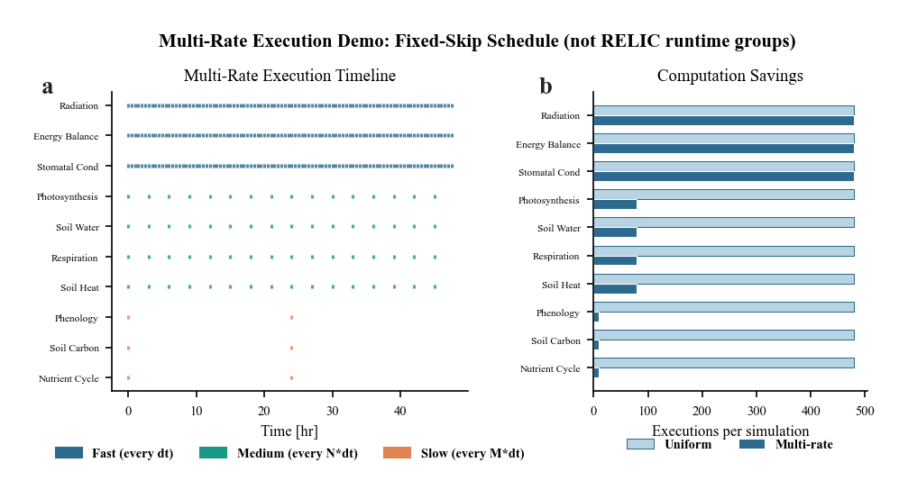
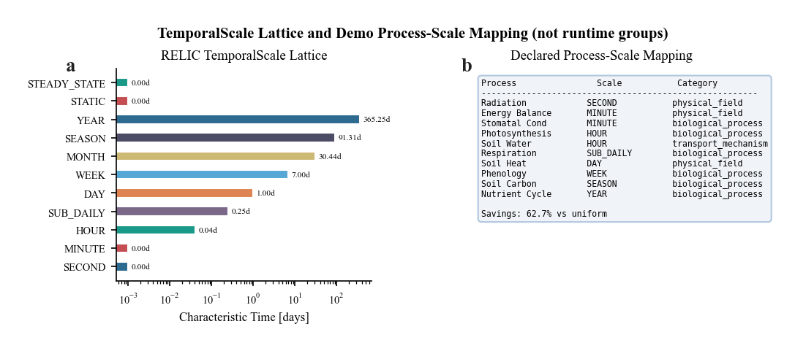

# Tutorial 07 -- Multi-Rate Execution

## 1. Overview

This tutorial demonstrates RELIC's **multi-rate execution** strategy, where processes are partitioned into temporal groups (Fast, Medium, Slow). Assignment uses, in order: an explicit `execution_group` at registration, the Functor's `execution_group` attribute, `characteristic_time_days` against the YAML thresholds, the `temporal_scale` metadata mapping, `process_groups` configuration, and finally `fast`. This avoids locking slow biogeochemical processes to the time resolution demanded by fast atmospheric processes, yielding significant computational savings.

### Why It Matters

Earth-system processes span many time scales. Multi-rate execution is one way to reduce unnecessary evaluations of slow processes; it is a modeling and numerical choice, not a mathematical necessity. Coupling lag, conservation and accuracy still require validation for the selected cadence.

### Prerequisites

- [Tutorial 03](./03_dag_topological_sort.md): DAG compilation
- [Tutorial 04](./04_semantic_ssot.md): `TemporalScale` enum

---

## 2. Mathematical Foundation

### 2.1 Corollary 3.5.2: Multi-Rate Necessity

**Corollary 3.5.2 (coertheory.md).** Let the process operator set be partitioned into three groups $\mathcal{F}_F, \mathcal{F}_M, \mathcal{F}_S$ with nominal trigger intervals $\tau_F = \Delta t, \tau_M, \tau_S$. Each executed group call commits once through `StateManager.apply_updates`; medium and slow groups receive the accumulated interval $h_g = t_{\text{future}} - t_{\text{last}}$ (not $\Delta t$). Every group call receives the interval it accounts for as `(time, dt) = (start, length)`: the fast group starts at $t_{\text{current}}$ with length $\Delta t$ (in Strang mode the second half-steps start at $t_{\text{current}} + \Delta t/2$), and a medium or slow call starts at $t_{\text{last}}$ of its group with length $h_g$ (example: $t_{\text{last}} = 0$, $t_{\text{current}} = 1$, $t_{\text{future}} = 2$ gives `time=0, dt=2`). Sub-step $k$ (from 0) of $m$ receives start $+\,k\,\text{dt}/m$. All group calls of one step sit inside one step transaction.

### 2.2 Computational Savings

If $N$ processes execute for $T_{\text{total}} / \Delta t$ steps at the fastest rate, then:

- **Uniform**: all $N$ processes execute every step $\Rightarrow$ cost $= N \times T_{\text{total}} / \Delta t$
- **Multi-rate**: fast processes every step; medium when the interval index $\lfloor t/\tau_M \rfloor$ increases (every $\tau_M/\Delta t$ steps only when $\tau_M$ is an integer multiple of a fixed $\Delta t$ and no event or bootstrap trigger fires); slow on the same rule with `slow_interval_seconds`, or on calendar-month boundaries when that key is unset. A step that crosses several boundaries runs the group once with the whole elapsed interval $\Rightarrow$ significant reduction

---

## 3. Computation Details

This tutorial defines **10 processes** and places them in a hand-chosen demo schedule (the Group column below is NOT the RELIC runtime assignment):

- Base time step: $\Delta t_{\text{base}} = 0.5$ hr
- Total steps: $N = 480$ (10 days)
- Group trigger skips (demo schedule): Fast = 1, Medium = 6, Slow = 48

**Note (symbol + implementation alignment):** This tutorial uses an explicit demo schedule (fixed skips) to visualize multi-rate savings. In RELIC runtime, the `temporal_scale` mapping is only priority 4 of the assignment chain (explicit `execution_group`, Functor attribute, `characteristic_time_days`, `temporal_scale`, `process_groups`, default fast). For SECOND/MINUTE/HOUR/DAY it compares `TemporalScale.to_characteristic_time_days()` with `computation.scheduling.fast_group_max_characteristic_days` (1 day) and `computation.scheduling.medium_group_max_characteristic_days` (10 days), read by `resolve_scheduling_thresholds()` in `relic\core\simulator\dependency_ops.py`; SUB_DAILY is fast, WEEK medium, MONTH/SEASON/YEAR slow. These thresholds classify processes; they are not execution intervals (medium uses `medium_interval_seconds`, slow uses `slow_interval_seconds` or calendar months; spatiotemporal_scale_topology.md Section 5). The Runtime group column is printed by the script from `dependency_ops._resolve_temporal_scale_group`.

| Process | TemporalScale | Group (demo) | Fires Every | Calls Over 10 Days | Runtime group (temporal_scale mapping) |
| --- | --- | --- | --- | --- | --- |
| Radiation | SECOND | Fast | 1 step | 480 | fast |
| Energy Balance | MINUTE | Fast | 1 step | 480 | fast |
| Stomatal Cond | MINUTE | Fast | 1 step | 480 | fast |
| Photosynthesis | HOUR | Medium | 6 steps (3 hr) | 80 | fast |
| Soil Water | HOUR | Medium | 6 steps (3 hr) | 80 | fast |
| Respiration | SUB_DAILY | Medium | 6 steps (3 hr) | 80 | fast |
| Soil Heat | DAY | Medium | 6 steps (3 hr) | 80 | fast |
| Phenology | WEEK | Slow | 48 steps (24 hr) | 10 | medium |
| Soil Carbon | SEASON | Slow | 48 steps (24 hr) | 10 | slow |
| Nutrient Cycle | YEAR | Slow | 48 steps (24 hr) | 10 | slow |

---

## 4. RELIC Implementation Mapping

| Module                             | Class/Enum                                    | Usage                         |
| ---------------------------------- | --------------------------------------------- | ----------------------------- |
| `relic.core.functor.functor_types` | `TemporalScale`                               | SECOND/MINUTE/HOUR/DAY/SEASON |
| `relic.core.functor.functor_types` | `TemporalScale.to_characteristic_time_days()` | Computes $\tau$ in days       |
| `relic.core.simulator.dependency_ops` | `_resolve_temporal_scale_group()`, `resolve_scheduling_thresholds()` | Runtime `temporal_scale` group mapping (printed as `runtime=`) |

---

## 5. Figures and Outputs

### 5.1 Figure 1: Multi-Rate Scheduling (`07_math_multirate.png`; demo schedule with fixed skips, not RELIC runtime groups)



**Panel (a): Gantt-Style Execution Timeline**

- Horizontal bars showing when each process fires over the simulation period
- Fast processes (blue) fire continuously; Medium (green) fire periodically; Slow (orange) fire rarely
- **Key takeaway**: Visual confirmation of the massive difference in invocation frequency

**Panel (b): Computation Savings**

- Bar chart comparing total process invocations under uniform vs multi-rate scheduling
- Shows percentage savings (typically >90% for slow processes)
- **Key takeaway**: Multi-rate execution dramatically reduces wasted computation (counts follow the demo schedule, not the runtime groups)

### 5.2 Figure 2: TemporalScale Labels and Demo Mapping (`07_relic_multirate.png`)



**Panel (a): TemporalScale Labels**

- Log-scale bar chart of all `TemporalScale` enum values with characteristic times
- Spans from SECOND (about 1.2e-5 days, drawn at the 0.001-day plot floor) to YEAR (365.25 days, declared period); SUB_DAILY, WEEK, MONTH, SEASON and YEAR use the script's declared example periods (MONTH has no fixed length in RELIC)
- **Key takeaway**: TemporalScale labels require declared periods where the calendar or schedule determines duration.

**Panel (b): Process-Scale Classification**

- Monospace summary table mapping each of the 10 processes to its declared `TemporalScale` and `ProcessCategory` (demo grouping; runtime grouping follows `dependency_ops`, see the `runtime=` column of the console output)
- Also prints the computed savings vs uniform stepping (from the same execution-count model used in Figure 1b)

---

## 6. Mathematical-RELIC Comparison

| Metric | Schedule Prediction | Script Output | Match |
| --- | --- | --- | --- |
| Fast calls per process | $N/1 = 480$ | 480 | PASS |
| Medium calls per process | $N/6 = 80$ | 80 | PASS |
| Slow calls per process | $N/48 = 10$ | 10 | PASS |
| Savings vs uniform | $1 - \frac{3\cdot 480 + 4\cdot 80 + 3\cdot 10}{10\cdot 480} = 62.7\%$ | 62.7% | PASS |

---

## 7. Console Output Interpretation

```
=== RELIC TemporalScale Classification ===
  Radiation           SECOND            tau=0.00 days  [physical_field]  runtime=fast
  Energy Balance      MINUTE            tau=0.00 days  [physical_field]  runtime=fast
  Stomatal Cond       MINUTE            tau=0.00 days  [biological_process]  runtime=fast
  Photosynthesis      HOUR              tau=0.04 days  [biological_process]  runtime=fast
  Soil Water          HOUR              tau=0.04 days  [transport_mechanism]  runtime=fast
  Respiration         SUB_DAILY         tau=0.25 days  [biological_process]  runtime=fast
  Soil Heat           DAY               tau=1.00 days  [physical_field]  runtime=fast
  Phenology           WEEK              tau=7.00 days  [biological_process]  runtime=medium
  Soil Carbon         SEASON            tau=91.31 days  [biological_process]  runtime=slow
  Nutrient Cycle      YEAR              tau=365.25 days  [biological_process]  runtime=slow
  (runtime = RELIC temporal_scale mapping; the demo schedule uses fixed skips)

[OK] Multi-rate saves 62.7% of computation vs uniform stepping
```

---

## 8. Connections to Other Tutorials

| Tutorial                                       | Relationship                                     |
| ---------------------------------------------- | ------------------------------------------------ |
| [Tutorial 08](./08_operator_splitting.md)      | Extends with Lie/Strang splitting of the fast group |
| [Tutorial 20](./20_cross_rate_lag_transfer.md) | Analyzes information lag between temporal groups |

---

## 9. References

1. coertheory.md, Corollary 3.5.2 (Multi-rate execution)
2. spatiotemporal_scale_topology.md, Section 5 (Temporal grouping)
3. Hundsdorfer, W. & Verwer, J.G. (2003). _Numerical Solution of Time-Dependent Advection-Diffusion-Reaction Equations_. Springer.
