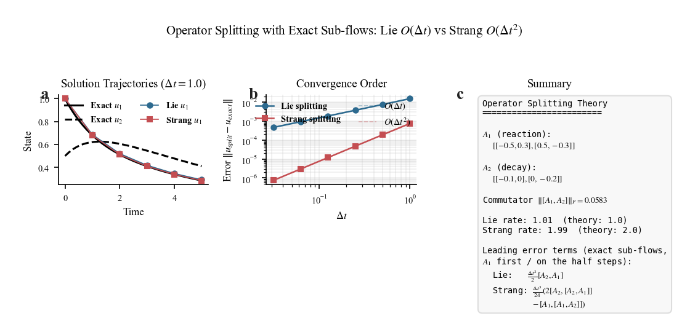

# Tutorial 08 -- Operator Splitting: Lie vs Strang

## 1. Overview

This tutorial compares **Lie splitting** and **Strang splitting** for a linear ODE whose sub-flows are solved exactly (matrix exponentials); under that condition Lie is first order ($O(\Delta t)$) and Strang second order ($O(\Delta t^2)$). Convergence order is verified empirically via a log-log error-vs-$\Delta t$ plot, and the commutator $[A_1, A_2]$ is computed to explain why splitting error exists.

### Why It Matters

In RELIC, process operators are applied sequentially within each temporal group. The splitting error depends on operator non-commutativity. Understanding Lie vs Strang convergence helps modelers choose appropriate splitting strategies and time step sizes (spatiotemporal_scale_topology.md, Section 6).

### Prerequisites

- [Tutorial 07](./07_multirate_execution.md): Multi-rate execution groups

---

## 2. Mathematical Foundation

### 2.1 Lie Splitting (Definition 6.1)

$$
\Phi_{\text{Lie}}^{\Delta t} = \Phi_{A_2}^{\Delta t} \circ \Phi_{A_1}^{\Delta t} \tag{1}
$$

**Error**: $O(\Delta t^2)$ per step $\Rightarrow$ $O(\Delta t)$ global (for exact sub-flows of smooth vector fields; with approximate sub-integrators the composite order is limited by the sub-integrator order). For linear operators with sub-flows $e^{\Delta t A_k}$ and $A_1$ applied first, the leading term of $\log \Phi_{\text{Lie}}^{\Delta t} - \Delta t(A_1 + A_2)$ is $\frac{\Delta t^2}{2}[A_2, A_1]$.

### 2.2 Strang Splitting (Definition 6.2)

$$
\Phi_{\text{Strang}}^{\Delta t} = \Phi_{A_1}^{\Delta t/2} \circ \Phi_{A_2}^{\Delta t} \circ \Phi_{A_1}^{\Delta t/2} \tag{2}
$$

**Error**: $O(\Delta t^3)$ per step $\Rightarrow$ $O(\Delta t^2)$ global (for exact sub-flows of smooth vector fields; with approximate sub-integrators the composite order is limited by the sub-integrator order). For linear operators with sub-flows $e^{\Delta t A_k}$ and $A_1$ on the half steps,

$$
\log \Phi_{\text{Strang}}^{\Delta t} = \Delta t(A_1 + A_2) + \frac{\Delta t^3}{24}\left(2[A_2,[A_2,A_1]] - [A_1,[A_1,A_2]]\right) + O(\Delta t^5)
$$

(the signs flip under the vector-field convention for nonlinear flows).

For a fast-group plan order $F_1, \ldots, F_n$, RELIC's `splitting_mode = "strang"` uses the palindrome
$\Phi_{F_1}^{\Delta t/2} \circ \cdots \circ \Phi_{F_{n-1}}^{\Delta t/2} \circ \Phi_{F_n}^{\Delta t} \circ \Phi_{F_{n-1}}^{\Delta t/2} \circ \cdots \circ \Phi_{F_1}^{\Delta t/2}$
($2n - 1$ sub-executions, each committed separately). When every sub-execution is the exact flow of a smooth sub-field, the composition is symmetric and second order for any $n$. Each sub-execution receives the interval it covers: the first half-steps and the middle full step start at $t$, the second half-steps at $t + \Delta t/2$, so non-autonomous sub-flows see the correct stage times (a second half-step started at $t$ would leave an $O(\Delta t^2)$ local error). The call order alone does not make numerical sub-integrators symmetric. The effective order of one step is $q = \min(s, \min_i p_i)$ with $s = 1$ (Lie) or $s = 2$ (Strang) and $p_i$ declared by `FunctorMetadata.sub_flow_accuracy` (`EXACT` counts as infinite, `ORDER_2`, `ORDER_1`; one `UNDECLARED` Functor makes $q$ "unverified"); `RELICSimulator.get_splitting_order_report()` returns $q$. Explicit-Euler sub-steps therefore stay first order. A regression test measures error ratios on step halving of about 4.00 (Strang, exact sub-flows), 1.99 (Lie) and 2.01 (Strang, explicit Euler) on a rotation problem with a time-dependent rate.
For a plan containing only one fast Functor, no splitting occurs and the effective order is that Functor's declared order. Medium and slow groups are not part of this composition; they run sequentially at their own cadence.

### 2.3 Lie Bracket (Commutator)

$$
[A_1, A_2] = A_1 A_2 - A_2 A_1 \tag{3}
$$

With exact sub-flows, $[A_1, A_2] = 0$ makes both splittings exact. $\|[A_1, A_2]\|_F$ scales the leading Lie error; the Strang leading error involves the nested commutators $[A_2,[A_2,A_1]]$ and $[A_1,[A_1,A_2]]$.

> **Reference**: Sportisse (2000); Strang (1968); spatiotemporal_scale_topology.md, Section 6.1-6.2

---

## 3. Computation Details

### 3.1 Test System

A 2-component coupled linear ODE $du/dt = (A_1 + A_2)u$:

$$
A_1 = \begin{pmatrix} -0.5 & 0.3 \\ 0.5 & -0.3 \end{pmatrix} \quad (\text{reaction}), \quad
A_2 = \begin{pmatrix} -0.1 & 0 \\ 0 & -0.2 \end{pmatrix} \quad (\text{decay})
$$

- **Exact solution**: $u(t) = e^{(A_1 + A_2)t} u_0$ via `scipy.linalg.expm`
- **Initial condition**: $u_0 = [1.0, 0.5]^\top$
- **Final time**: $T = 5.0$

### 3.2 Convergence Study

$\Delta t$ values: $\{1.0, 0.5, 0.25, 0.125, 0.0625, 0.03125\}$

| $\Delta t$ | Lie Error                | Strang Error             |
| ---------- | ------------------------ | ------------------------ |
| 1.0        | $1.5 \times 10^{-2}$     | $7.5 \times 10^{-4}$     |
| 0.03125    | $4.6 \times 10^{-4}$     | $7.4 \times 10^{-7}$     |

(Final-time errors from the script's error arrays, plotted in panel (b); the script does not print them.)

Measured rates: Lie $\approx 1.0$, Strang $\approx 2.0$ (from log-log regression).

---

## 4. RELIC Implementation Mapping

Within each group call, RELIC applies Functors sequentially in plan order (a Lie composition). `splitting_mode` (`lie` or `strang`, in `relic.core.simulator.execution_loop._execute_fast_group`) changes only the fast group; medium and slow groups always run as one sequential call after the fast group. Each call is `_execute_group(order, dt, start_time=...)` (`start_time` has no default); Strang sub-executions share one `GroupComposition`; `merge_sequential_updates` preserves the last plain diagnostic/REPLACE observation, sums ACCUMULATE amounts and plain state increments, and weights per-second rates by `h / H` (a time-weighted mean over substeps, summed across Functors in one group call). During execution the boundary-rate stage view sums the latest contribution of each writer in the current composition, without an old-step mean. Provider substeps expose their latest reduced rate; the completed provider exposes its interval mean. The complete weighted mean is published only at composition completion, with no second boundary transfer. Stored diagnostics follow the same rule; a rejected adaptive attempt leaves no diagnostic result. This script is a standalone NumPy/SciPy demonstration with exact sub-flows; it does not call the RELIC simulator.

---

## 5. Figures and Outputs

### 5.1 Figure: Operator Splitting (`08_operator_splitting.png`)



**Panel (a): Solution Trajectories ($\Delta t = 1.0$)**

- Black curves: exact solution for $u_1$ (solid) and $u_2$ (dashed)
- Blue circles: Lie splitting result (shown for $u_1$); Red squares: Strang splitting result (shown for $u_1$)
- **Key takeaway**: Strang tracks the exact solution more closely than Lie at the same $\Delta t$

**Panel (b): Convergence Order (Log-Log)**

- Lie errors (blue circles) follow an $O(\Delta t)$ reference slope
- Strang errors (red squares) follow an $O(\Delta t^2)$ reference slope
- **Key takeaway**: Empirical convergence rates match theoretical predictions

**Panel (c): Summary Box**

- Displays matrices $A_1$, $A_2$, commutator norm, measured rates, and leading error terms (exact sub-flows; Lie $\frac{\Delta t^2}{2}[A_2,A_1]$, Strang $\frac{\Delta t^3}{24}(2[A_2,[A_2,A_1]] - [A_1,[A_1,A_2]])$)
- $\|[A_1, A_2]\|_F = 0.0583$ -- non-zero confirms operators do not commute
- **Key takeaway**: The commutator magnitude drives the Lie splitting error; nested commutators drive the Strang error

---

## 6. Mathematical-RELIC Comparison

| Metric                            | Theory   | Measured      | Match |
| --------------------------------- | -------- | ------------- | ----- |
| Lie convergence rate              | 1.0      | $\approx 1.0$ | PASS  |
| Strang convergence rate           | 2.0      | $\approx 2.0$ | PASS  |
| $[A_1,A_2] = 0 \Rightarrow$ exact | Non-zero | Error exists  | PASS  |

---

## 7. Console Output Interpretation

```
[OK] Lie splitting convergence rate: 1.01 (expected ~1.0)
[OK] Strang splitting convergence rate: 1.99 (expected ~2.0)
  Commutator ||[A1,A2]||_F = 0.0583
```

---

## 8. Connections to Other Tutorials

| Tutorial                                     | Relationship                                                |
| -------------------------------------------- | ----------------------------------------------------------- |
| [Tutorial 09](./09_adaptive_timestep.md)     | Uses adaptive $\Delta t$ within splitting                   |
| [Tutorial 12](./12_splitting_sensitivity.md) | Measures order-dependent sensitivity ($\chi_{\text{comm}}$) |

---

## 9. References

1. spatiotemporal_scale_topology.md, Section 6.1-6.2 (Lie and Strang definitions)
2. Strang, G. (1968). On the construction and comparison of difference schemes. _SIAM J. Numer. Anal._, 5(3), 506-517.
3. Sportisse, B. (2000). An analysis of operator splitting techniques. _J. Comp. Phys._, 161(1), 140-168.
4. Hundsdorfer, W. & Verwer, J.G. (2003). _Numerical Solution of Time-Dependent Advection-Diffusion-Reaction Equations_. Springer.
