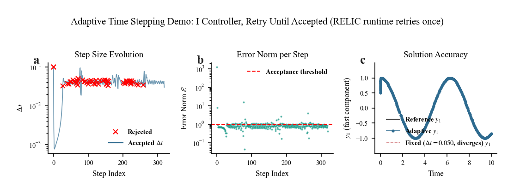

# Tutorial 09 -- Adaptive Time Stepping with Error Control

## 1. Overview

This tutorial demonstrates **adaptive time stepping** with a safety-factor (I-controller) rule. The demo estimates error by step doubling and retries a rejected step until accepted. RELIC instead measures the state change actually committed by StateManager over the fast group, $u_k=x'_k-x_k$: integrated amounts, per-second rates or FLUX integrated once over the real interval, clipping and distributed reduction are included. A boundary-rate aggregate is stored as a rate, so a steady rate contributes zero state change. RELIC retries a rejected step at most once and accepts that retry without a second check.

### Why It Matters

Fixed time stepping either wastes computation (too small) or risks instability (too large). Adaptive stepping automatically resolves the stiff fast dynamics ($\lambda \approx -100$) while taking large steps through smooth slow dynamics. In RELIC this is a step-size heuristic, not a stability or CFL guarantee (coertheory.md, Theorem 3.6.8).

### Prerequisites

- [Tutorial 08](./08_operator_splitting.md): Operator splitting concepts

---

## 2. Mathematical Foundation

### 2.1 Error Norm (Theorem 3.6.8)

$$
\mathcal{E} = \sqrt{\frac{1}{M} \sum_{k=1}^{M} \left(\frac{\Delta y_k}{\varepsilon_{\text{abs}} + \varepsilon_{\text{rel}} |y_k|}\right)^2} \tag{1}
$$

where $\Delta y_k$ is the step-doubling estimate of this standalone demo. The RELIC runtime uses the actual committed change $u_k=x'_k-x_k$, not a returned proposal; $x_k$ is the pre-fast-group state. The squared normalized ratios are averaged over each variable's tensor elements, then equally over monitored variables before taking the square root. With $x_k=300$ kg m$^{-2}$, $q=0.006$ kg m$^{-2}$ s$^{-1}$ and $h=60$ s, the committed change is 0.36 kg m$^{-2}$ and $\mathcal E\approx1.2$, leading to one retry at about 49.3 s. Before 2026-09-26 the rate itself produced $\mathcal E\approx0.02$; before 2026-09-23 a REPLACE proposal was measured without subtracting the pre-step state. The runtime quantity is a control heuristic, not a truncation-error estimate.

### 2.2 Step Size Control

$$
\Delta t_{\text{new}} = \Delta t \cdot \min\!\left(f_{\max},\, \max\!\left(f_{\min},\, \frac{f_s}{\mathcal{E}^{1/(p+1)}}\right)\right) \tag{2}
$$

| Parameter     | Symbol     | Value | Meaning                           |
| ------------- | ---------- | ----- | --------------------------------- |
| Safety factor | $f_s$      | 0.9   | Conservative multiplier           |
| Min factor    | $f_{\min}$ | 0.1   | Prevents catastrophic shrinkage   |
| Max factor    | $f_{\max}$ | 5.0   | Prevents overly aggressive growth |
| Order         | $p$        | 1     | Euler method order                |

These are the demo values (the demo multiplies by $f_{\max}$ when $\mathcal{E} = 0$). RELIC runtime: exponent fixed at $1/2$; on acceptance $\Delta t_{\text{new}}=\Delta t\min(5,\max(0.1,0.9/\sqrt{\mathcal E}))$, or $2\Delta t$ if $\mathcal E=0$, clipped to [`adaptive_dt_min`, `adaptive_dt_max`].

### 2.3 Reject-Rollback-Retry

Demo: if $\mathcal{E} > 1$ the state rolls back and the step is retried with $\max(\Delta t_{\min}, 0.9\Delta t/\sqrt{\mathcal E})$ until accepted. RELIC runtime: if the rejected attempt is longer than $\Delta t_{\min}$, the fast group is rolled back once and re-run with $\max(\Delta t\max(0.1, 0.9/\sqrt{\mathcal E}), \Delta t_{\min})$, which is always shorter than the attempt; that retry is accepted without a second check. An attempt at or below $\Delta t_{\min}$ has no shorter retry: it is accepted without rollback, a WARNING names $\mathcal E$ and $\Delta t_{\min}$, and the next proposal follows the accepted-step rule. An accepted runtime step may therefore have $\mathcal E>1$, and `run()` never passes its end time.

> **Reference**: coertheory.md, Theorem 3.6.8; Hairer & Wanner (1996)

---

## 3. Computation Details

### 3.1 Stiff ODE System

$$
\frac{dy_1}{dt} = -100(y_1 - \cos t), \quad \frac{dy_2}{dt} = -0.5 y_2 + \sin t
$$

- $y_1$: fast component (stiffness ratio $\sim$200)
- $y_2$: slow component
- $y_0 = [0.5, 1.0]^\top$, $T = 10.0$

### 3.2 Results

- Adaptive: 269 accepted steps and 51 rejected attempts (320 attempts, each with one full and two half Euler steps for the error estimate)
- Fixed ($\Delta t = 0.05$): 200 forward-Euler steps; $|1 - 100\,\Delta t| = 4 > 1$, so the fast component $y_1$ diverges (magnitude of order $10^{120}$ at $t = 10$)

---

## 4. RELIC Implementation Mapping

This script is a standalone NumPy demonstration and does not invoke the RELIC controller. The runtime reads `computation.scheduling.adaptive.atol`, `.rtol`, `.dt_min_seconds` and `.dt_max_factor` only when `adaptive_dt_enabled` is true; explicit `adaptive_*` settings override them. Factors 0.9, 0.1, 5 and 2 remain fixed code controls. The metric is the StateManager committed change, including rate integration, clipping and reduction. Update names first map to actual StateManager targets (`delta_x` to `x`), and each target is counted once before monitor filtering and pre/post-state lookup; read aliases remain unwritable. The metric reads boundary rates after the composition publishes its complete mean, not a partial mean. Strang sub-executions use `GroupComposition` and the single `merge_sequential_updates` rule: ACCUMULATE amounts sum, per-second rates have weight `h / H`, and diagnostics retain their declared observation or accumulation semantics. A rejected attempt longer than `adaptive_dt_min` is retried once on a shorter interval and accepted without a second check; an attempt at or below the minimum is accepted with a warning. This is the sole runtime step-size controller. Solver `forward(..., adaptive=True)` was removed; passing `adaptive` raises `TypeError`.

---

## 5. Figures and Outputs

### 5.1 Figure: Adaptive Time Stepping (`09_adaptive_timestep.png`)



The figure shows the demo controller (step doubling, retry until accepted). RELIC's runtime retries at most once (never for an attempt at or below `adaptive_dt_min`) and accepts the retry without a second check.

**Panel (a): Step Size Evolution**

- Semi-log plot of $\Delta t$ vs step index
- Red crosses mark rejected steps (where $\mathcal{E} > 1$)
- $\Delta t$ shrinks during stiff transients and grows during smooth phases
- **Key takeaway**: The controller automatically adapts to local dynamics

**Panel (b): Error Norm Per Step**

- Scatter plot of $\mathcal{E}$ for each attempted step
- Red dashed line at $\mathcal{E} = 1$ marks the acceptance threshold
- Points above the line correspond to rejected steps
- **Key takeaway**: In this demo (retry until accepted) every accepted step has $\mathcal E\le 1$; the RELIC runtime retries at most once and accepts without a second check, so it does not guarantee this

**Panel (c): Solution Accuracy**

- Black: high-resolution reference solution
- Blue circles: adaptive stepping result
- Dashed orange: fixed-step result, drawn only while it stays inside the axis range (it diverges within the first steps)
- **Key takeaway**: Adaptive stepping follows the reference solution while the fixed step of 0.05 is unstable for the fast component; the adaptive run needs 320 attempts, so its benefit here is stability and accuracy, not fewer steps

---

## 6. Demo Results (the script does not call the RELIC controller)

| Metric                               | Theory                    | Observed           | Match |
| ------------------------------------ | ------------------------- | ------------------ | ----- |
| Rejection criterion                  | $\mathcal{E} > 1$         | Correctly triggers | PASS  |
| Rollback on rejection                | State = pre-step snapshot | Confirmed          | PASS  |
| $\Delta t$ shrinks near stiff region | Expected                  | Observed           | PASS  |
| $\Delta t$ grows in smooth region    | Expected                  | Observed           | PASS  |
| RELIC retry acceptance               | At most one retry (none at or below `adaptive_dt_min`), accepted without second check | Not exercised here | --    |

---

## 7. Console Output Interpretation

```
[OK] Adaptive stepping: 269 accepted steps, 51 rejected
  dt range: [0.000766, 0.1000]
```

---

## 8. Connections to Other Tutorials

| Tutorial                                          | Relationship                           |
| ------------------------------------------------- | -------------------------------------- |
| [Tutorial 05](./05_transactional_state_update.md) | Rollback mechanism used in rejection   |
| [Tutorial 24](./24_decidability_numerics_cfl.md)  | CFL and diffusion-number diagnostics (separate from the adaptive controller) |

---

## 9. References

1. coertheory.md, Theorem 3.6.8 (Adaptive step with rollback)
2. spatiotemporal_scale_topology.md, Section 7.1-7.3
3. Hairer, E. & Wanner, G. (1996). _Solving Ordinary Differential Equations II: Stiff and Differential-Algebraic Problems_. Springer.
