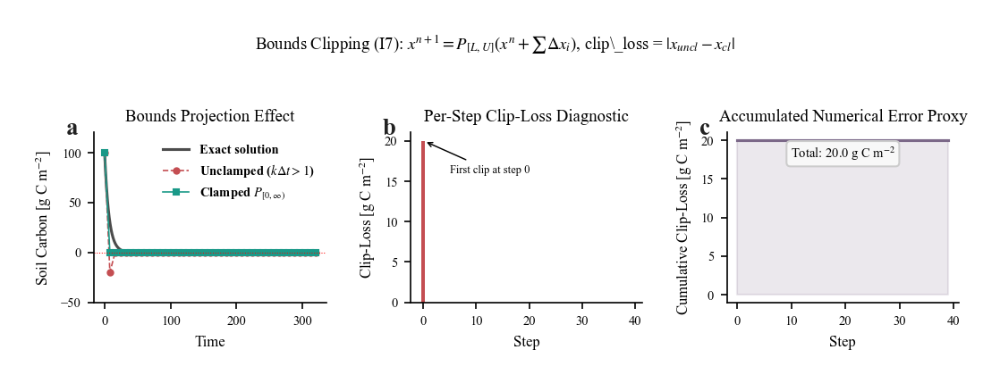

# Tutorial 10 -- Bounds Clipping and Clip-Loss Diagnostics (I7)

## 1. Overview

This tutorial demonstrates RELIC's **bounds projection** $P_{[L,U]}$ and the associated **clip-loss diagnostic** (Invariant I7). When Forward Euler with aggressive $\Delta t$ drives a pool negative, the projection operator clamps the value to physical bounds and records exactly how much was clipped.

### Prerequisites

- [Tutorial 05](./05_transactional_state_update.md): Transactional state update

---

## 2. Mathematical Foundation

### 2.1 Bounds Projection (Theorem 3.6.3)

$$
x^{n+1} = P_{[L,U]}\!\left(x^n + \sum_{i=1}^{k} \Delta x_i\right), \quad P_{[L,U]}(z) = \max(L, \min(z, U)) \tag{1}
$$

### 2.2 Clip-Loss Diagnostic

$$
x_{\text{unclamped}} := x^n + \sum_{i=1}^{k} \Delta x_i, \quad
\Delta x_{\text{clip}} := x_{\text{unclamped}} - x^{n+1} \tag{2}
$$

The non-negative clip-loss magnitude is then:

$$
\text{clip\_magnitude} := \left|\Delta x_{\text{clip}}\right|. \tag{3}
$$

Cumulative clip-loss serves as a proxy for the magnitude of projection corrections. Non-zero clip-loss signals that $\Delta t$ is too large or the process formulation needs revision.

> **Reference**: coertheory.md, Theorem 3.6.3; spatiotemporal_scale_topology.md, Section 8.2

---

## 3. Computation Details

### 3.1 Setup

- First-order decay: $dC/dt = -kC$, analytical solution $C(t) = C_0 e^{-kt}$
- Forward Euler: $C_{n+1} = C_n(1 - k\Delta t)$
- When $k\Delta t > 1$: Forward Euler violates non-negativity and can produce $C_{n+1}<0$ even if $C_n\ge 0$
- When $k\Delta t > 2$: Forward Euler is also unstable in magnitude ($|1-k\Delta t|>1$)

### 3.2 Two Scenarios

| Scenario   | $\Delta t$ | $k\Delta t$ | Clipping needed? |
| ---------- | ---------- | ----------- | ---------------- |
| Safe       | 1.0        | 0.15        | No               |
| Aggressive | 8.0        | 1.2         | Yes (violates non-negativity) |

---

## 4. RELIC Implementation Mapping

The standalone NumPy script plots the nonnegative magnitude in Eq. (3). RELIC instead records signed `clip_loss.<variable>` from Eq. (2) at state commit: positive for upper-bound removal and negative for lower-bound addition. A recorded correction does not by itself close a physical budget. Invariant I7 checks this diagnostic channel.

---

## 5. Figures and Outputs

### 5.1 Figure: Bounds Clipping (`10_bounds_clipping.png`)



**Panel (a): Unclamped vs Clamped Trajectories**

- Black curve: exact analytical solution (smooth exponential decay)
- Red markers: unclamped Euler with $k\Delta t = 1.2$ -- produces a negative value on the first step ($C_1<0$)
- Green markers: clamped trajectory -- projection clamps at $L = 0$ and the state then stays at the bound
- Red dotted line at $C = 0$: physical lower bound
- **Key takeaway**: Without clipping, aggressive $\Delta t$ produces unphysical negative concentrations

**Panel (b): Per-Step Clip-Loss**

- Bar chart showing clip-loss magnitude at each step
- Only the first step clips in this setup (after clamping, $C$ stays at 0 so later proposed values remain within bounds)
- Annotation marks the first clipping event
- **Key takeaway**: Clip-loss is non-zero only when the unclamped value violates bounds

**Panel (c): Cumulative Clip-Loss**

- Step function: cumulative clip-loss jumps at the first clip event and then stays constant
- Total clip-loss displayed in text box
- **Key takeaway**: Cumulative clip-loss quantifies total numerical error from aggressive time stepping

---

## 6. Mathematical-RELIC Comparison

| Metric                               | Expected | Observed | Match |
| ------------------------------------ | -------- | -------- | ----- |
| Clipping triggers at $k\Delta t > 1$ | Yes      | Yes      | PASS  |
| Clip-loss = 0 when $k\Delta t < 1$   | Yes      | Yes      | PASS  |
| $P_{[0,\infty)}(x) = \max(0, x)$     | Exact    | Exact    | PASS  |

---

## 7. Console Output Interpretation

```
[OK] Aggressive dt=8.0: 1 steps required clipping
  Total clip-loss = 20.00 g C m^-2
  k*dt = 1.2 (>1 -> violates non-negativity)
```

---

## 8. Connections to Other Tutorials

| Tutorial                                         | Relationship                                                       |
| ------------------------------------------------ | ------------------------------------------------------------------ |
| [Tutorial 25](./25_invariant_contracts_i1_i7.md) | I7 invariant: bounds clipping always produces clip-loss diagnostic |

---

## 9. References

1. coertheory.md, Theorem 3.6.3
2. spatiotemporal_scale_topology.md, Section 8.2 (Invariant I7)
3. Parton, W.J. et al. (1987). CENTURY model.
