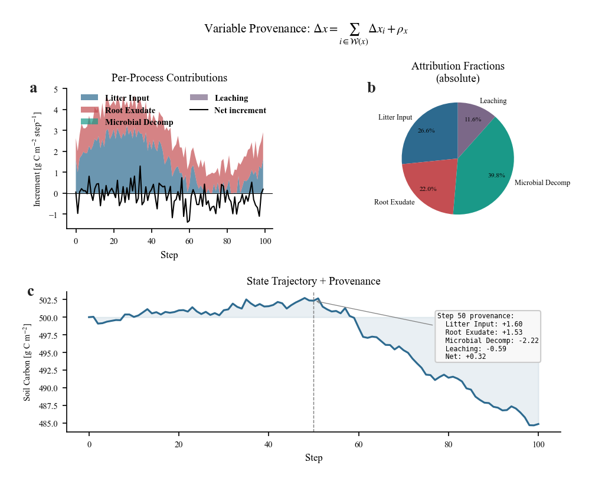

# Tutorial 11 -- Variable Provenance and Increment Attribution

## 1. Overview

This tutorial demonstrates RELIC's **variable provenance** system, which records per-step, per-variable increment decomposition. This enables attributing state changes to specific processes, turning budget residuals from unexplained numbers into a ranked list of process-level contributions.

### Prerequisites

- [Tutorial 03](./03_dag_topological_sort.md): DAG structure for process ordering

---

## 2. Mathematical Foundation

### 2.1 Increment Decomposition (Corollary 3.6.5)

$$
x^{n+1} - x^n = \sum_{i \in \mathcal{W}(x)} \Delta x_i + \rho_x \tag{1}
$$

where:

- $\mathcal{W}(x)$: set of processes that write to variable $x$
- $\Delta x_i$: increment contributed by process $i$
- $\rho_x$: system correction (clipping, constraint enforcement)

### 2.2 Linear Diagnostic Attribution

For any linear diagnostic $J(u) = w^\top u$:

$$
J(u^{n+1}) - J(u^n) = \sum_j w_j \sum_{i \in \mathcal{W}(u_j)} \Delta u_{j,i} + w^\top \rho \tag{2}
$$

> **Reference**: coertheory.md, Corollary 3.6.5; spatiotemporal_scale_topology.md, Section 10.1

---

## 3. Computation Details

### 3.1 Four Processes Acting on `soil_carbon`

The following process formulas are conceptual labels. Executed increments are prescribed seasonal sinusoids plus seeded Gaussian noise; the script does not evaluate litter, NPP, dissolved-carbon or soil-process Functors.

| Process          | Direction | Formulation                                                   | Typical magnitude |
| ---------------- | --------- | ------------------------------------------------------------- | ----------------- |
| Litter Input     | Positive  | $k_{\text{lit}} \cdot C_{\text{litter}} \cdot f(T)$           | $+3$ seasonal     |
| Root Exudate     | Positive  | $k_{\text{root}} \cdot \text{NPP} \cdot f(\text{season})$     | $+1.5$            |
| Microbial Decomp | Negative  | $-k_{\text{dec}} \cdot C_{\text{soil}} \cdot f(T, \theta)$    | $-3.5$ seasonal   |
| Leaching         | Negative  | $-k_{\text{leach}} \cdot C_{\text{diss}} \cdot \text{precip}$ | $-0.8$            |

- 100 time steps with seasonal modulation and stochastic noise
- Initial `soil_carbon` = 500 g C m$^{-2}$

---

## 4. RELIC Implementation Mapping

RELICSimulator records current-step increments and writers and exposes `get_variable_provenance()`. These records participate in the step transaction. StateManager emits signed `clip_loss.<variable>`, while the actual clipping correction in Eq. (1) is $\rho_x=-\text{clip\_loss}$; the sign must be reversed when attributing the applied change. This standalone script does not call RELIC and uses synthetic increments without clipping.

---

## 5. Figures and Outputs

### 5.1 Figure: Variable Provenance (`11_variable_provenance.png`)



**Panel (a): Per-Process Contributions (Stacked Area)**

- Stacked area chart showing positive (above zero) and negative (below zero) contributions from each process
- Black line: net increment per step
- Seasonal oscillation visible in Litter Input and Microbial Decomp
- **Key takeaway**: Process-level contributions are individually tracked and sum to the net change

**Panel (b): Attribution Fractions (Pie Chart)**

- Pie chart showing the absolute contribution fraction of each process over all 100 steps
- Microbial Decomposition typically dominates, followed by Litter Input
- **Key takeaway**: Identifies which processes drive the most change

**Panel (c): State Trajectory with Provenance Annotation**

- Soil carbon trajectory over time with vertical line at step 50
- Annotation box shows the exact provenance record for step 50: each process's contribution and the net increment
- **Key takeaway**: Any step's state change can be fully attributed to individual process contributions

---

## 6. Mathematical-RELIC Comparison

The observed column comes from the standalone script, not from a RELIC run.

| Metric                                   | Theory              | Observed               | Match |
| ---------------------------------------- | ------------------- | ---------------------- | ----- |
| $\sum \Delta x_i + \rho = x^{n+1} - x^n$ | Exact decomposition | Verified at every step | PASS  |
| Fraction sum = 100%                      | By definition       | Confirmed              | PASS  |

---

## 7. Console Output Interpretation

```
[OK] Provenance tracking completed
  Soil C: 500.0 -> 484.9 g C m^-2
  Litter Input        : total = +149.1  fraction = 26.6%
  Root Exudate        : total = +123.4  fraction = 22.0%
  Microbial Decomp    : total = -222.8  fraction = 39.8%
  Leaching            : total = -64.8  fraction = 11.6%
```

---

## 8. Connections to Other Tutorials

| Tutorial                                         | Relationship                                                |
| ------------------------------------------------ | ----------------------------------------------------------- |
| [Tutorial 06](./06_conservation_ledger.md)       | Provenance attributes budget residuals to processes         |
| [Tutorial 25](./25_invariant_contracts_i1_i7.md) | I5 (commutativity) tests if provenance is order-independent |

---

## 9. References

1. coertheory.md, Corollary 3.6.5 (Provenance and attribution)
2. spatiotemporal_scale_topology.md, Section 10.1, Definition 10.1
