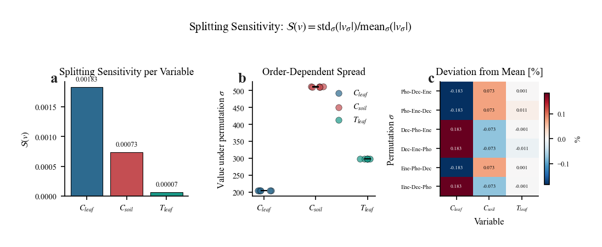

# Tutorial 12 -- Splitting Sensitivity (Commutativity Diagnostic)

## 1. Overview

This tutorial demonstrates the **splitting sensitivity functional** $\mathcal{S}(v)$ from coertheory.md Corollary 3.6.4. By running three non-commuting operators (Photosynthesis, Decomposition, Energy Balance) in all $3! = 6$ permutations, it quantifies how much the execution order affects each state variable.

### Prerequisites

- [Tutorial 08](./08_operator_splitting.md): Operator splitting theory

---

## 2. Mathematical Foundation

### 2.1 Splitting Sensitivity (Corollary 3.6.4)

$$
\mathcal{S}(v) = \frac{\text{std}_\sigma(|v_\sigma|)}{\text{mean}_\sigma(|v_\sigma|)} \tag{1}
$$

$$
\chi_{\text{comm}} = \max_v \mathcal{S}(v) \tag{2}
$$

where $\sigma$ ranges over all permutations of the operator execution order:

- $\mathcal{S}(v)=0$: no magnitude spread is observed for this fixture; opposite signs with equal magnitudes are invisible to this statistic. A zero denominator makes it undefined. This is not proof of commutation.
- $\mathcal{S}(v) > 0$: variable $v$ is sensitive to execution order

> **Reference**: coertheory.md, Corollary 3.6.4; spatiotemporal_scale_topology.md, Theorem 6.1

---

## 3. Computation Details

### 3.1 Three Operators

| Operator       | State Variables                                                        | Non-linearity                 |
| -------------- | ---------------------------------------------------------------------- | ----------------------------- |
| Photosynthesis | $C_{\text{leaf}} \uparrow$                                             | Gaussian $T$-response at 298K |
| Decomposition  | $C_{\text{leaf}} \downarrow$, $C_{\text{soil}} \uparrow$, $T \uparrow$ | $C$-dependent flux + heat     |
| Energy Balance | $T \downarrow$                                                         | Newtonian cooling + albedo    |

State vector: $x = [C_{\text{leaf}}, C_{\text{soil}}, T_{\text{leaf}}]^\top$, initial $x_0 = [200, 500, 298]^\top$

### 3.2 All 6 Permutations

Since the operators are nonlinear and couple temperature to carbon, different orderings produce different final states. Results are collected for all $3! = 6$ permutations and the sensitivity is computed.

---

## 4. RELIC Implementation Mapping

This standalone NumPy script samples six orderings of three illustrative kernels. It does not invoke a RELIC simulator diagnostic or prove that RELIC changes its splitting strategy automatically. The positive fixture avoids the zero-denominator and sign-blindness limitations of Eq. (1).

---

## 5. Figures and Outputs

### 5.1 Figure: Splitting Sensitivity (`12_splitting_sensitivity.png`)



**Panel (a): $\mathcal{S}(v)$ Per Variable**

- Bar chart of splitting sensitivity for $C_{\text{leaf}}$, $C_{\text{soil}}$, $T_{\text{leaf}}$
- Values annotated above each bar
- **Key takeaway**: In this configuration, $C_{\text{leaf}}$ is the most order-sensitive variable; the ranking depends on which nonlinear couplings dominate

**Panel (b): Order-Dependent Spread**

- Scatter plot showing final values of each variable under all 6 permutations
- Error bars show mean $\pm$ std
- **Key takeaway**: The spread visualizes the magnitude of non-commutativity

**Panel (c): Deviation Heatmap**

- $6 \times 3$ heatmap showing percentage deviation from mean for each (permutation, variable) pair
- Red-Blue diverging colormap; annotated with exact deviation values
- Row labels show the operator ordering (e.g., "Pho-Dec-Ene")
- **Key takeaway**: Identifies which ordering combinations produce the largest deviations

---

## 6. Mathematical-RELIC Comparison

| Metric                                          | Theory   | Observed                   | Match |
| ----------------------------------------------- | -------- | -------------------------- | ----- |
| $\mathcal{S}(v) = 0$ for commuting operators    | Expected | not computed in this script | --    |
| $\chi_{\text{comm}} > 0$ for nonlinear coupling | Expected | Confirmed                  | PASS  |
| 6 distinct results for $3!$ permutations        | Expected | Observed                   | PASS  |

---

## 7. Console Output Interpretation

```
[OK] Splitting sensitivity computed over 6 permutations
  C_leaf: range = [204.2493, 205.0000], S = 0.001833
  C_soil: range = [510.0000, 510.7500], S = 0.000735
  T_leaf: range = [297.9700, 298.0375], S = 0.000066
  chi_comm = max S(v) = 0.001833
```

---

## 8. Connections to Other Tutorials

| Tutorial                                         | Relationship                                               |
| ------------------------------------------------ | ---------------------------------------------------------- |
| [Tutorial 08](./08_operator_splitting.md)        | Commutator $[A_1,A_2]$ quantifies linear non-commutativity |
| [Tutorial 25](./25_invariant_contracts_i1_i7.md) | I5 (commutativity) invariant formally tests this property  |

---

## 9. References

1. coertheory.md, Corollary 3.6.4 (Splitting sensitivity functional)
2. spatiotemporal_scale_topology.md, Theorem 6.1 (Order sensitivity)
3. Sportisse, B. (2000). An analysis of operator splitting techniques. _JCP_, 161, 140-168.
