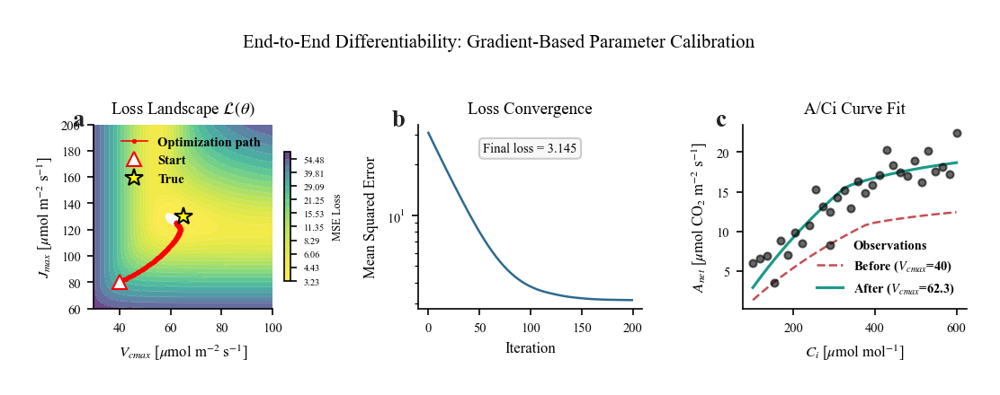

# Tutorial 13 -- End-to-End Differentiability via PyTorch Autograd

## 1. Overview

This standalone PyTorch script demonstrates autograd through one simplified Farquhar kernel for gradient-based parameter calibration; it does not run the RELIC simulator. The kernel is optimized against synthetic A/Ci curve data, showing how the gradient $\nabla_\theta \mathcal{L}$ flows through a smooth tensor kernel, which is the prerequisite for gradient use inside RELIC Functors.

### Why It Matters

Differentiability is a RELIC design goal: state variables are `torch.Tensor` and the simulator is a `torch.nn.Module`, so gradients are available along the executed tensor path. Bound clipping, events, rate-group and adaptive-step decisions, and non-smooth expressions such as `min` break or zero gradients; verify gradients on the executed graph before relying on them for gradient-based optimization, adjoint sensitivity analysis, or data assimilation.

### Prerequisites

- Basic PyTorch and autograd concepts
- Photosynthesis fundamentals (Farquhar model)

---

## 2. Mathematical Foundation

### 2.1 Simplified Farquhar Model

The net CO$_2$ assimilation rate:

$$
A = \min(A_c, A_j) - R_d \tag{1}
$$

where:

$$
A_c = V_{c,\max} \frac{C_i - \Gamma^*}{C_i + K_c(1 + O/K_o)} \tag{2}
$$

$$
A_j = \frac{J \cdot (C_i - \Gamma^*)}{4(C_i + 2\Gamma^*)} \tag{3}
$$

where the electron transport rate $J$ is parameterized from $J_{\max}$ and fixed PAR (as implemented in the tutorial script):

$$
J = \frac{J_{\max}\cdot \mathrm{PAR}}{\mathrm{PAR} + 2.1\,J_{\max}}. \tag{4}
$$

The `min` in Eq. (1) makes $A$ piecewise smooth: at $A_c = A_j$ it is not differentiable (autograd then splits the gradient between both branches), and elsewhere autograd returns the gradient of the active branch only, so the parameters of the inactive limitation receive zero gradient.

| Parameter                 | Symbol       | Unit                       | Description                |
| ------------------------- | ------------ | -------------------------- | -------------------------- |
| Max carboxylation rate    | $V_{c,\max}$ | $\mu$mol m$^{-2}$ s$^{-1}$ | Rubisco-limited capacity   |
| Max electron transport    | $J_{\max}$   | $\mu$mol m$^{-2}$ s$^{-1}$ | Light-limited capacity     |
| CO$_2$ compensation point | $\Gamma^*$   | $\mu$mol mol$^{-1}$        | Photorespiration threshold |
| Dark respiration          | $R_d$        | $\mu$mol m$^{-2}$ s$^{-1}$ | Mitochondrial respiration  |

> **Reference**: Farquhar, G.D., von Caemmerer, S. & Berry, J.A. (1980). _Planta_, 149, 78-90.

### 2.2 Loss Function

$$
\mathcal{L}(\theta) = \frac{1}{N} \sum_{i=1}^{N} \left(A_{\text{pred}}(C_i; \theta) - A_{\text{obs}}(C_i)\right)^2 \tag{5}
$$

### 2.3 Gradient-Based Optimization

$$
\theta^{(k+1)} = \theta^{(k)} - \alpha \nabla_\theta \mathcal{L}(\theta^{(k)}) \tag{6}
$$

Using Adam optimizer with $\alpha = 0.5$, optimizing $V_{c,\max}$ and $J_{\max}$ (and thus $J$ through Eq. (4)).

---

## 3. Computation Details

- Synthetic A/Ci data generated with known "true" parameters: $V_{c,\max}^* = 65$, $J_{\max}^* = 130$
- Additive Gaussian noise is injected into observations (fixed seed) to mimic measurement uncertainty
- Starting guess: $V_{c,\max}^{(0)} = 40$, $J_{\max}^{(0)} = 80$
- 200 optimization steps
- Loss landscape computed on a $50 \times 50$ grid

---

## 4. RELIC Implementation Mapping

| Concept                   | RELIC Implementation                                                 |
| ------------------------- | -------------------------------------------------------------------- |
| Differentiable parameters | ParameterManager-owned `nn.Parameter` held by reference; private module parameters remain distinct                                      |
| Forward pass              | The governed Functor call (`functor(state, time=..., dt=...)`) returns tensors that keep autograd along smooth operations |
| Loss computation          | Standard PyTorch loss on `torch.Tensor`                              |
| Gradient flow             | `loss.backward()` computes $\nabla_\theta \mathcal{L}$ automatically |
| Optimizer                 | `torch.optim.Adam` or equivalent                                     |

---

Held manager bindings are absent from Functor.parameters() and state_dict(); optimizers use the manager get_trainable_parameters path and durable format-3 checkpoints save parameter_bindings. parameter_sensitivity raises TypeError for a held binding. This two-parameter synthetic PyTorch fit does not test those lifecycle contracts.

## 5. Figures and Outputs

### 5.1 Figure: Differentiability (`13_differentiability.png`)



**Panel (a): Loss Landscape**

- 2D contour plot of $\mathcal{L}(V_{c,\max}, J_{\max})$ on a log scale
- Yellow star: true parameters; White triangle: initial guess; Red trajectory: optimization path
- **Key takeaway**: This synthetic fit demonstrates useful gradients on the executed piecewise-smooth path, not global-minimum convergence.

**Panel (b): Convergence**

- Log-scale loss vs iteration number
- Rapid convergence in $\sim$50 iterations
- **Key takeaway**: Gradient-based optimization converges efficiently

**Panel (c): Predicted vs Observed A/Ci Curves**

- Black circles: synthetic observations
- Red dashed: prediction at the initial guess; Green solid: prediction after optimization
- **Key takeaway**: After optimization, predictions match observations closely

---

## 6. Mathematical-RELIC Comparison

| Metric                | Expected                               | Observed                               | Match |
| --------------------- | ---------------------------------- | -------------------------- | ----- |
| Final $V_{c,\max}$    | $\approx 65$ (noisy data)              | 62.3 (true = 65.0)                    | PASS  |
| Final $J_{\max}$      | $\approx 130$ (noisy data)             | 125.3 (true = 130.0)                  | PASS  |
| Final loss            | $> 0$ (noise floor + model mismatch)   | 3.1452                                | PASS  |
| Gradient availability | $\nabla_\theta \mathcal{L}$ exists | `loss.backward()` succeeds | PASS  |

---

## 7. Console Output Interpretation

```
[OK] Optimization converged
  Vcmax: 40.00 -> 62.30 (true: 65.0)
  Jmax:  80.00 -> 125.30 (true: 130.0)
  Final loss: 3.1452
```

---

## 8. Connections to Other Tutorials

| Tutorial                                       | Relationship                                |
| ---------------------------------------------- | ------------------------------------------- |
| [Tutorial 14](./14_lyapunov_predictability.md) | Illustrates finite-time divergence of nearby Lorenz trajectories |

---

## 9. References

1. Farquhar, G.D., von Caemmerer, S. & Berry, J.A. (1980). A biochemical model of photosynthetic CO$_2$ assimilation. _Planta_, 149, 78-90.
2. Medlyn, B.E. et al. (2002). Temperature response of parameters of a biochemically based model. _Plant, Cell & Environment_, 25, 1167-1179.
3. Kingma, D.P. & Ba, J. (2015). Adam: A method for stochastic optimization. _ICLR_.
