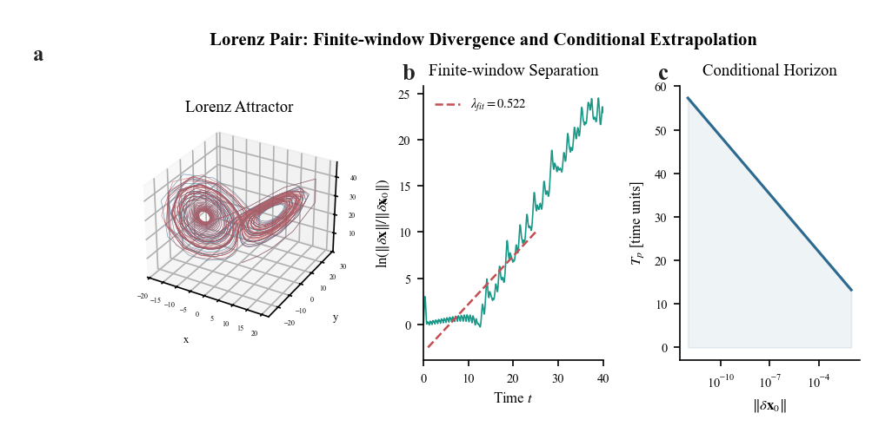
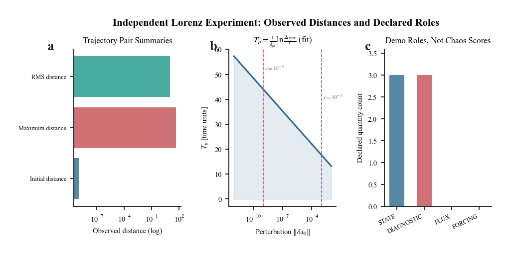

# Tutorial 14 -- Lyapunov Exponent and Predictability Horizon

## 1. Overview

This standalone Lorenz-63 demonstration estimates finite-time divergence of two nearby trajectories. It motivates complementing trajectory checks with declared structural invariants and physical budgets; it does not replace trajectory, statistical, or observational validation and does not test a RELIC simulation.

### Prerequisites

- [Tutorial 13](./13_differentiability.md): Differentiability and gradient-based calibration

---

## 2. Mathematical Foundation

### 2.1 Maximum Lyapunov Exponent

$$
\lambda_{\max} = \sup_{v\ne0}\limsup_{t \to \infty} \frac{1}{t} \ln \frac{\|D\Phi_t(x_0)v\|}{\|v\|} \tag{1}
$$

Here $D\Phi_t(x_0)v$ is the linearized tangent perturbation. The script neither integrates the tangent system nor repeatedly renormalizes perturbations; it fits distances between trajectories at fixed finite separation. Saturated separation does not estimate the asymptotic exponent.

### 2.2 Predictability Horizon (coertheory.md, Section 1.2)

$$
T_p \approx \frac{1}{\hat{\lambda}_{\max}} \ln \frac{\Delta_{\max}}{\|\delta \mathbf{x}_0\|} \tag{2}
$$

Beyond $T_p$, trajectories diverge beyond useful accuracy ($\Delta_{\max}$).

### 2.3 RELIC Implication

- **Structural invariants and budgets**: remain checkable while their declared topology, units, domains and physical assumptions hold; chaos does not establish those assumptions.
- **Trajectory matching**: only valid for $t < T_p$

> **Reference**: Lorenz (1963); coertheory.md, Section 1.2

---

## 3. Computation Details

- **System**: Lorenz-63 ($\sigma=10, \rho=28, \beta=8/3$)
- **Integration**: RK4 with $\Delta t = 0.01$, $N = 5000$ steps
- **Perturbation**: $\epsilon = 10^{-9}$ on $x_0$
- **Result (finite-time fit in this tutorial)**: $\lambda_{\max} \approx 0.522$ (literature: $\sim 0.905$; estimate depends on fit window and perturbation direction)
- **Fit window (implementation detail)**: $\hat{\lambda}_{\max}$ is obtained by a linear regression of $\ln(\|\delta\mathbf{x}\|/\|\delta\mathbf{x}_0\|)$ over the finite interval $t\in(1,25)$ where the divergence is in the exponential-growth regime.

---

## 4. RELIC Implementation Mapping

| Concept          | RELIC                 | Implementation                   |
| ---------------- | --------------------- | -------------------------------- |
| $\lambda_{\max}$ | DIAGNOSTIC variable   | Computed as post-processing      |
| State trajectory | STATE variables       | `torch.Tensor`, subject to chaos |
| Structural test  | $\sigma(\mathcal{G})$ | Independent of trajectory        |

---

## 5. Figures and Outputs

### 5.1 Figure 1: Mathematical Lorenz Analysis (`14_math_lyapunov.png`)



**Panel (a): 3D Lorenz Attractor** -- Two trajectories (blue, orange) from nearly identical initial conditions diverge visibly after $\sim$20 time units, forming the characteristic butterfly pattern.

**Panel (b): Lyapunov Divergence** -- $\ln(\|\delta\mathbf{x}\|/\|\delta\mathbf{x}_0\|)$ vs time. Linear fit yields $\lambda_{\max}$. The slope confirms exponential divergence in the chaotic regime.

**Panel (c): Predictability Horizon** -- $T_p$ vs perturbation size $\|\delta\mathbf{x}_0\|$, showing logarithmic dependence. Smaller initial perturbations extend predictability, but only logarithmically.

### 5.2 Figure 2: RELIC Validation Strategy (`14_relic_lyapunov.png`)



**Panel (a): Trajectory Pair Summaries** -- Log-scale bars show the measured initial, maximum and RMS separation of the two computed Lorenz trajectories.

**Panel (b): Predictability Horizon** -- Detailed $T_p(\epsilon)$ curve with marked perturbation levels ($10^{-9}$ and $10^{-3}$ chosen example perturbations, not machine epsilon or measured RELIC uncertainty).

**Panel (c): Demo Roles, Not Chaos Scores** -- Counts are three state coordinates and three declared derived quantities (separation, fitted slope, conditional horizon), with no FLUX or FORCING quantity in this standalone example. These are role counts, not Lyapunov measurements.

Note: `VariableKind.PARAMETER` exists in RELIC's SSOT, but is not plotted in this tutorial figure because the Lorenz-63 demonstration treats parameters as fixed constants rather than evolving state variables.

---

## 6-9. Comparison, Console Output, Connections, References

| Metric           | Expected (literature) | Observed (this tutorial) | Match |
| ---------------- | ---------- | ------------- | ----- |
| $\lambda_{\max}$ | $\sim 0.9$ (asymptotic reference) | 0.522 (finite-window fit) | Different estimators; not a numerical match |

**Console (observed)**:

```text
[INFO] finite-window log-separation slope = 0.522
  Reference ~0.9 is asymptotic; this fit is not a numerical PASS against it
  T_p for eps=1e-9: 44.1 time units
```

**Connections**: Tutorial 01 (structural invariants) | **References**: Lorenz (1963); Strogatz (2015); coertheory.md Section 1.2
