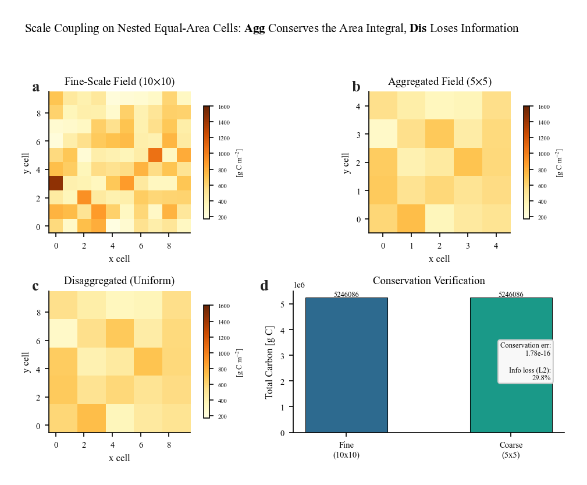

# Tutorial 15 -- Scale Coupling: Aggregation, Broadcast, and Information Loss

## 1. Overview

This tutorial demonstrates aggregation (area-weighted mean) and broadcast disaggregation on nested cells. With area-weighted inner products the broadcast is the adjoint of the area-weighted mean ($R=M_c^{-1}P^TM_f$). Aggregation conserves the area integral on nested, fully covered cells, while disaggregation cannot recover sub-cell variability. The script is a standalone NumPy demonstration that imports only the `SpatialScale` enum from RELIC.

### Prerequisites

- [Tutorial 04](./04_semantic_ssot.md): `SpatialScale` enum

---

## 2. Mathematical Foundation

### 2.1 Aggregation (Upscaling)

**Intensive**: $\phi_{\text{coarse}} = \sum_i w_i \phi_i / \sum_i w_i$ (area-weighted mean)

**Extensive**: $\Phi_{\text{coarse}} = \sum_i \phi_i A_i$ for an area density $\phi_i$ [kg m$^{-2}$] on nested cells (conservative sum). `ConservativeRemap` expects per-cell totals $X_i=\phi_iA_i$ and must not receive densities; `HierarchicalAggregator` expects densities. The numbers in Section 3 come from a NumPy block average on nested equal-area cells, where conservation holds by construction; they are not a test of a RELIC operator.

### 2.2 Disaggregation (Downscaling)

$$\phi_{\text{fine},i} = \phi_{\text{coarse},J(i)} \quad \text{(uniform)}$$

### 2.3 Weighted Adjoint and Information Loss

With $M_f=\mathrm{diag}(A_i)$ and $M_c=\mathrm{diag}(A_J)$, $\langle Pc,f\rangle_{M_f}=\langle c,Rf\rangle_{M_c}$ and $RP=I$, but $PR\neq I$: $\|\phi_f-P(R\phi_f)\|>0$ unless $\phi_f$ is constant within every coarse cell ($P$ = broadcast Dis, $R$ = area-weighted mean Agg).

> **Reference**: spatiotemporal_scale_topology.md, Sections 1.1, 2.1-2.3; Jones (1999)

---

## 3. Computation Details

- Fine grid: $10 \times 10$, lognormal $C_{\text{soil}} \sim \text{LogN}(\mu=\ln 500, \sigma=0.5)$
- Coarse grid: $5 \times 5$ (area-weighted mean)
- Conservation error (relative, $|\Sigma_{\text{fine}}-\Sigma_{\text{coarse}}|/\Sigma_{\text{fine}}$): $1.78\times 10^{-16}$ ($0.0000\%$)
- Information loss (relative L2): $0.2975$ ($29.75\%$)

---

## 4-5. RELIC Mapping and Figures

### Figure: Scale Coupling (`15_scale_coupling.png`)

**Panel (a): Fine-Scale Field (10x10)** -- Heterogeneous soil carbon with lognormal distribution. Color intensity shows spatial variability.

**Panel (b): Aggregated Field (5x5)** -- Spatially smoothed version; within-block variability lost.

**Panel (c): Disaggregated (Uniform)** -- Each fine cell gets its coarse-cell mean -- block-uniform pattern visible.

**Panel (d): Conservation Verification** -- Bar chart showing fine vs coarse total carbon are identical. Text box reports conservation error ($1.78\times 10^{-16}$, relative $0.0000\%$) and information loss percentage ($29.75\%$).

---

## 6-9. Comparison, Console Output, Connections, References

| Metric             | Expected | Observed     | Match |
| ------------------ | -------- | ------------ | ----- |
| Conservation error | $\sim 0$ | $1.78\times 10^{-16}$ | PASS  |
| Info loss          | $> 0$    | $29.75\%$ | PASS  |

**Console**: `[OK] Upscaling: 10x10 -> 5x5` ... `Conservation error: 1.78e-16 (0.0000%)` | **Connections**: Tutorial 17 (fiber bundles), Tutorial 18 (natural transformations) | **References**: Jones (1999); Wood et al. (2004); spatiotemporal_scale_topology.md
