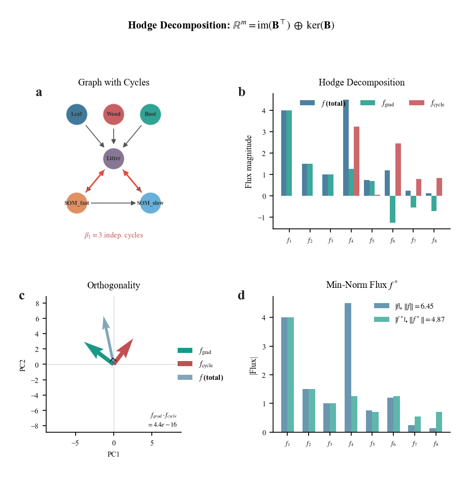
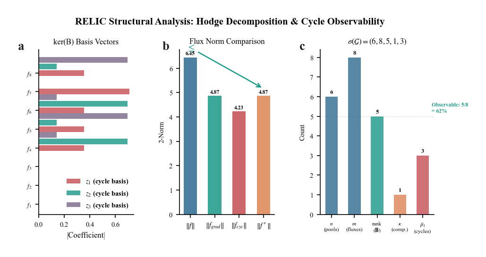

# Tutorial 16 -- Hodge Decomposition on Biogeochemical Graphs

## 1. Overview

This standalone NumPy/SciPy tutorial demonstrates the Euclidean orthogonal decomposition of signed edge vectors into an incidence-gradient component and the kernel of the incidence matrix. It does not exercise RELIC typed DEC/Hodge operators, impose physical nonnegative transfer constraints, or certify energy/entropy closure.

### Prerequisites

- [Tutorial 01](./01_incidence_matrix_conservation.md): Incidence matrix
- [Tutorial 02](./02_topological_fingerprint.md): Betti numbers and cycle rank

---

## 2. Mathematical Foundation

### 2.1 Hodge Decomposition (coertheory.md, Section 2.4 / Theorem 3.3)

$$
\mathbb{R}^m = \text{im}(\mathbf{B}^\top) \oplus \ker(\mathbf{B}) \tag{1}
$$

$$
f = f_{\text{grad}} + f_{\text{cyc}} \tag{2}
$$

where $f_{\text{grad}} = \mathbf{B}^\top (\mathbf{B} \mathbf{B}^\top)^+ \mathbf{B} f$ and $f_{\text{cyc}} = (I - P_{\text{im}(\mathbf{B}^\top)}) f$.

This uses the unit-weight Euclidean inner product; nontrivial Hodge weights change the adjoint and orthogonal projection. Linear feasibility permits signed $f$; imposing $f\ge0$ or rate bounds adds constraints. The kernel represents signed circulations invisible to node tendencies, not necessarily feasible directed biochemical feedback.

### 2.2 Key Properties

- **Orthogonality**: $\langle f_{\text{grad}}, f_{\text{cyc}} \rangle = 0$
- **Uniqueness**: decomposition is unique
- Dimension of cycle space: $\beta_1 = m - n + \kappa$
- **Feasibility (closed system)**: a node tendency $g\in\mathbb{R}^n$ is realizable by internal exchange iff $\exists f\in\mathbb{R}^m$ s.t. $g=\mathbf{B}f$
- **Minimum-norm flux**: among all $f$ such that $\mathbf{B}f=g$, the unique minimum-2-norm solution is $f^*=\mathbf{B}^\top (\mathbf{B}\mathbf{B}^\top)^+ g$

> **Reference**: coertheory.md, Section 2.4 (Theorem 3.3) and Corollary 2.5.1-2.5.3

---

## 3. Computation Details

- Graph: 6 pools, 8 fluxes (with $\beta_1=3$ independent cycles)
- Incidence matrix $\mathbf{B} \in \mathbb{R}^{6 \times 8}$
- Convention: $\mathbf{B}_{i,j}=+1$ if edge $j$ enters node $i$, and $-1$ if it leaves node $i$
- Topological fingerprint (from Tutorial 02): $\sigma(\mathcal{G})=(n,m,\mathrm{rank}(\mathbf{B}),\kappa,\beta_1)=(6,8,5,1,3)$
- Uses `np.linalg.pinv` for Moore-Penrose pseudoinverse
- Uses `scipy.linalg.null_space` for $\ker(\mathbf{B})$

---

## 4-5. RELIC Mapping and Figures

### Figure 1: Mathematical Hodge Decomposition (`16_math_hodge.png`)

**Panel (a): Process Graph** -- Directed graph with 6 pools and 8 fluxes. Recycling edges are highlighted; the annotation reports $\beta_1=3$ independent cycles.

**Panel (b): Flux Decomposition** -- Grouped bar chart showing original $f$, gradient $f_{\text{grad}}$, and cyclic $f_{\text{cyc}}$ for each edge.

**Panel (c): Orthogonality** -- Visual projection showing $f_{\text{grad}} \perp f_{\text{cyc}}$ with inner product $\approx 10^{-15}$.

**Panel (d): Minimum-Norm Flux** -- Bar chart comparing $f^*$ (minimum-norm flux) vs original flux; the norm reduction is shown.

### Figure 2: RELIC Structural Analysis (`16_relic_hodge.png`)

**Panel (a): $\ker(\mathbf{B})$ Basis Vectors** -- Horizontal bars show the absolute coefficients of a cycle-space basis ($Z_1,Z_2,Z_3$). The number of basis vectors equals $\beta_1$.

**Panel (b): Flux Norm Comparison** -- Bars compare $\|f\|$, $\|f_{\text{grad}}\|$, $\|f_{\text{cyc}}\|$, and $\|f^*\|$.

**Panel (c): Fingerprint and Observability** -- Bar chart of $(n,m,\mathrm{rank},\kappa,\beta_1)$ with an annotation showing the observable fraction $\mathrm{rank}(\mathbf{B})/m$.

---

## 6-9. Comparison, Console Output, Connections, References

| Metric                                   | Expected    | Observed     | Match |
| ---------------------------------------- | ----------- | ------------ | ----- |
| Orthogonality $\langle f_g, f_c \rangle$ | $\approx 0$ | $< 10^{-14}$ | PASS  |
| $\beta_1 = m - n + \kappa$               | 3           | 3            | PASS  |

**Console**: `[OK] Hodge decomposition: f_grad . f_cycle = 4.44e-16` | **Connections**: Tutorial 02 ($\beta_1$), Tutorial 01 (incidence matrix) | **References**: coertheory.md, Section 2.4 and Corollary 2.5.1-2.5.3
