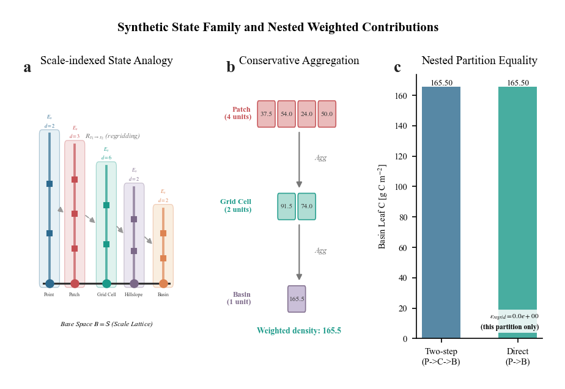
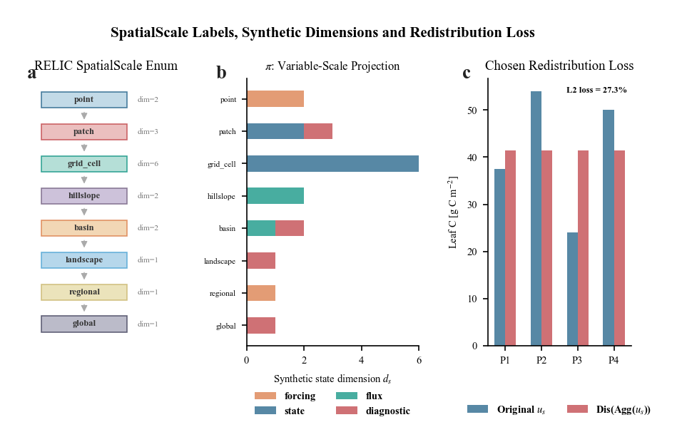

# Tutorial 17 -- Fiber Bundle Structure of Multi-Scale State Spaces

## 1. Overview

This standalone NumPy tutorial uses a scale-indexed family of state spaces as a fiber-bundle analogy. SpatialScale labels and synthetic dimensions do not establish local triviality, a smooth bundle, or a geometric connection. The numerical example checks only nested aggregation and its information loss.

### Prerequisites

- [Tutorial 15](./15_scale_coupling.md): Upscaling/downscaling basics

---

## 2. Mathematical Foundation

### 2.1 Fiber Bundle (spatiotemporal_scale_topology.md, Definition 2.2)

$$
\pi: E \to B, \quad B = \mathcal{S}, \quad E_s = \prod_{v \in V_s} \mathbb{R}^{d_v} \tag{1}
$$

### 2.2 Connection (Definition 2.3)

Let $R_{s_1 \to s_2}:E_{s_1}\to E_{s_2}$ denote a declared aggregation map. The example satisfies $R_{s_2\to s_3}\circ R_{s_1\to s_2}=R_{s_1\to s_3}$ because its partitions are nested and all maps use consistent extensive sums. General conservative regridding need not be transitive or invertible and is not thereby geometric parallel transport.

### 2.3 Reconstruction Error (Information Loss)

$\|u_s-\text{Dis}(\text{Agg}(u_s))\|$ measures reconstruction error, which is positive for the heterogeneous example and zero on the reconstruction subspace. It is not differential-geometric curvature.

> **Reference**: Husemoller (1993); Jones (1999); spatiotemporal_scale_topology.md, Sections 2.3-2.4

---

## 3-5. Computation, RELIC Mapping, and Figures

### Figure 1: Mathematical Fiber Bundle (`17_math_fiber.png`)

**Panel (a): Fiber Bundle Schematic** -- Vertical fibers over the scale lattice base space. Each fiber height represents state vector dimensionality. Dashed arrows show parallel transport (regridding) between scales.

**Panel (b): Conservative Aggregation** -- Flow diagram: 4 patches $\to$ 2 grid cells $\to$ 1 basin, with total C conserved at each level.

**Panel (c): Transitivity Check** -- Bar chart comparing two-step vs direct aggregation. Transitivity error $= 0.00\mathrm{e}{+00}$ (exact for extensive quantities in this constructed example).

### Figure 2: RELIC SpatialScale Integration (`17_relic_fiber.png`)

**Panel (a): RELIC SpatialScale Enum** -- Scale labels from POINT to GLOBAL with synthetic example dimensions; these are not runtime state sizes.

**Panel (b): Variable-Scale Projection** -- Stacked bar chart showing fiber dimension per VariableKind (FORCING/STATE/FLUX/DIAGNOSTIC) at each scale.

**Panel (c): Reconstruction Error (Info Loss)** -- Grouped bars: original vs Dis(Agg(original)) at patch level.

---

## 6-9. Comparison, Console Output, Connections, References

**Fresh console results**: nested weighted sum 165.5000; this-partition equality error 0.00e+00; redistribution L2 loss 23.4667, relative loss 27.28%. These results apply to the chosen synthetic partition and redistribution rule.
