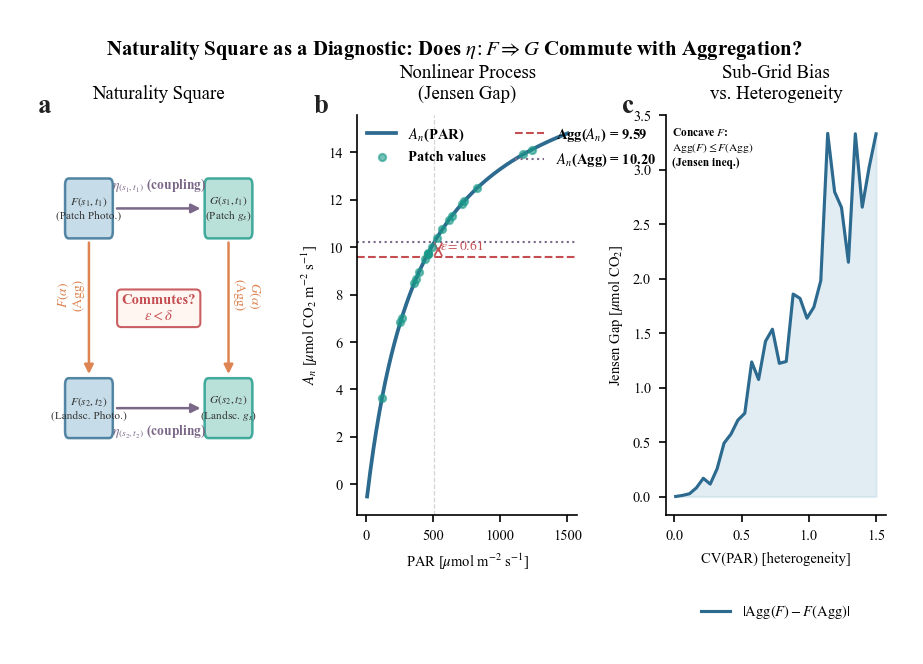
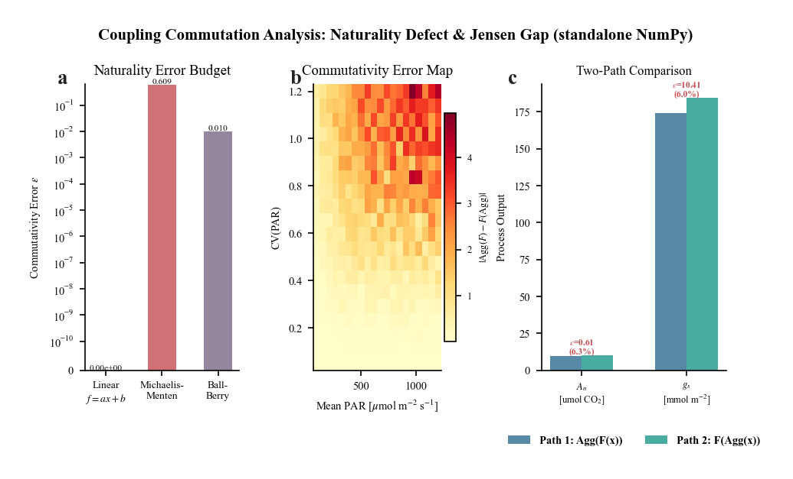

# Tutorial 18 -- Natural Transformations: Naturality Square as a Coupling Diagnostic

## 1. Overview

This tutorial uses the naturality square of a **natural transformation** $\eta: F \Rightarrow G$ (spatiotemporal_scale_topology.md, Definition 3.3) as a diagnostic: it measures whether a process commutes with spatial aggregation. RELIC couplings are not natural transformations in general. The square commutes for affine processes with normalized weights, and for nonlinear processes (Michaelis-Menten photosynthesis) the defect is the **Jensen gap** (aggregation bias). RELIC does not check this at runtime; the script is a standalone NumPy demonstration that imports only RELIC metadata enums.

### Prerequisites

- [Tutorial 15](./15_scale_coupling.md): Aggregation operator
- [Tutorial 17](./17_fiber_bundles.md): Fiber bundle structure

---

## 2. Mathematical Foundation

### 2.1 Naturality Square

$$
\begin{array}{ccc}
F(s_1,t_1) & \xrightarrow{\eta_{(s_1,t_1)}} & G(s_1,t_1) \\
\downarrow F(\alpha) & & \downarrow G(\alpha) \\
F(s_2,t_2) & \xrightarrow{\eta_{(s_2,t_2)}} & G(s_2,t_2)
\end{array}
\tag{1}
$$

If a coupling were natural, the square would commute for every scale transition $\alpha:(s_1,t_1)\to(s_2,t_2)$:

$$
G(\alpha)\circ \eta_{(s_1,t_1)} = \eta_{(s_2,t_2)}\circ F(\alpha). \tag{2}
$$

In this tutorial, we specialize $\alpha$ to the spatial aggregation morphism (PATCH $\to$ landscape). The commutativity test becomes the two-path comparison:

$$
\mathrm{Agg}(F(x)) \stackrel{?}{=} F(\mathrm{Agg}(x)). \tag{3}
$$

### 2.2 Jensen Gap

For concave $F$: $\mathbb{E}[F(X)] \le F(\mathbb{E}[X])$ (Jensen inequality). The gap $\epsilon = |F(\text{Agg}(x)) - \text{Agg}(F(x))|$ quantifies sub-grid bias for the declared distribution and aggregation weights. CV alone does not determine its magnitude; the plotted trend is specific to the sampled Gamma family.

> **Reference**: Mac Lane (1971); Jensen (1906); spatiotemporal_scale_topology.md, Section 3.4

---

## 3. Computation Details

- $F$: Michaelis-Menten photosynthesis $A_n = A_{\max} \cdot \text{PAR} / (\text{PAR} + K_{\text{PAR}}) - R_d$ (concave)
- $G$: Ball-Berry stomatal conductance $g_s = g_0 + g_1 A_n RH / C_s$ (linear in $A_n$)
- 20 patches with heterogeneous PAR ($\text{Gamma}(3, 200)$)
- Linear process: $f(x) = ax + b$ -- commutes exactly ($\epsilon \approx 10^{-14}$)

---

## 4-5. RELIC Mapping and Figures

### Figure 1: Mathematical Naturality (`18_math_natural.png`)

**Panel (a): Naturality Square Diagram** -- Four nodes (Patch Photo., Patch $g_s$, Landscape Photo., Landscape $g_s$) with horizontal coupling arrows ($\eta$) and vertical aggregation arrows ($\alpha$). Central box asks "Commutes?"

**Panel (b): Nonlinear Process (Jensen Gap)** -- Blue curve: $A_n(\text{PAR})$; scattered dots: patch values; horizontal lines compare $\text{Agg}(A_n)$ vs $A_n(\text{Agg})$; double arrow shows $\epsilon$.

**Panel (c): Jensen Gap vs Heterogeneity** -- $\epsilon$ grows with CV(PAR), illustrating the trend for this synthetic Gamma-family experiment, not a general monotonicity theorem.

### Figure 2: Coupling Commutation Analysis (`18_relic_natural.png`)

**Panel (a): Naturality Error Budget** -- Bar chart (observed): linear ($0.00e+00$), Michaelis-Menten ($0.6085$), Ball-Berry ($0.0104$).

**Panel (b): Commutativity Error Map** -- Heatmap of $\epsilon$ over mean PAR $\times$ CV(PAR) space.

**Panel (c): Two-Path Comparison** -- Grouped bars comparing Path 1 (Agg(F)) vs Path 2 (F(Agg)) for $A_n$ and $g_s$.

---

## 6-9. Comparison, Console Output, Connections, References

| Metric                   | Expected                                      | Observed     | Match |
| ------------------------ | --------------------------------------------- | ------------ | ----- |
| Linear $\epsilon$        | $\approx 0$                                   | $0.00e+00$   | PASS  |
| Photosynthesis $\epsilon_A$ | $>0$ (concave Jensen gap)                  | $0.6085$     | PASS  |
| Stomatal $\epsilon_{g_s}$ | small but non-zero                          | $0.0104$     | PASS  |
| Jensen direction         | $\text{Agg}(F) \le F(\text{Agg})$ for concave | $9.5903\le 10.1988$ | PASS  |

**References**: Mac Lane (1971); Jensen (1906); Farquhar et al. (1980); Ball et al. (1987)
