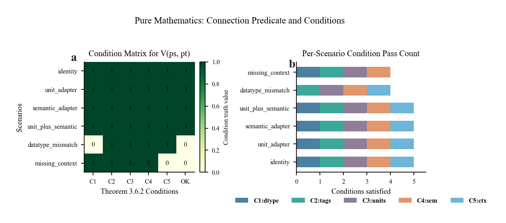
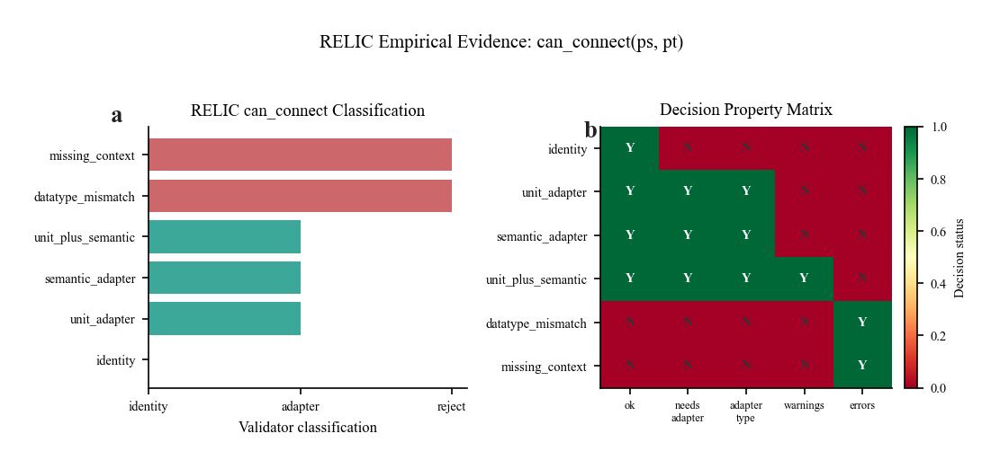

# Tutorial 19 -- Connection Validator and Adapter Requirement

## 1. Overview

This tutorial demonstrates **Theorem 3.6.2** (coertheory.md): the connection validation predicate $\mathcal{V}(p_s, p_t;\ \mathsf{strict}) = (\mathsf{ok}, A, W)$, which checks datatype compatibility (C1), optional tag match (C2), unit closure (C3), semantic compatibility (C4), and context requirements (C5) before allowing two ports to connect.

### Prerequisites

- [Tutorial 04](./04_semantic_ssot.md): Semantic SSOT and type system

---

## 2. Mathematical Foundation

### 2.1 Connection Predicate (Theorem 3.6.2)

Port specification: $p = (\tau, \mathsf{u}, T, \mathsf{s}, K)$ where $\tau$ = datatype, $\mathsf{u}$ = units, $T$ = tags, $\mathsf{s}$ = semantics, $K$ = context.

$$
\mathcal{V}(p_s, p_t;\ \mathsf{strict}) =
\begin{cases}
(\mathsf{ok}=1, A, W) & \text{if } C_1 \land C_2 \land C_3 \land C_4 \land C_5 \\
(\mathsf{ok}=0, \emptyset, \text{errors}) & \text{otherwise}
\end{cases}
\tag{1}
$$

| Condition | Check                               | Example Violation / Adapter Need |
| --------- | ----------------------------------- | --------------------------- |
| C1        | $\tau_s = \tau_t$ or either missing | scalar $\ne$ tensor         |
| C2        | Tag match when both declared        | quantity mismatch           |
| C3        | Unit convertibility                 | units differ $\Rightarrow$ unit adapter (if convertible) |
| C4        | Semantic compatibility              | flux $\to$ state $\Rightarrow$ semantic adapter (if allowed) |
| C5        | Context requirements satisfied      | missing `air_density`       |

> **Reference**: coertheory.md, Theorem 3.6.2; `relic\orchestration\validator.py`

---

## 3-5. Computation, RELIC Mapping, and Figures

Six scenarios: identity, unit_adapter, semantic_adapter, unit+semantic, datatype_mismatch, missing_context.

### Figure 1: Mathematical Condition Matrix (`19_math_connection_validator.png`)



**Panel (a): Condition Matrix** -- 6x6 heatmap showing C1-C5 and OK for each scenario. Green (1) = pass, yellow (0) = fail.

**Panel (b): Per-Scenario Condition Pass Count** -- Stacked horizontal bars showing which conditions each scenario satisfies, color-coded by condition type.

### Figure 2: RELIC Validator Evidence (`19_relic_connection_validator.png`)



**Panel (a): RELIC `can_connect` Classification** -- Horizontal bars: identity/adapter/reject per scenario.

**Panel (b): Decision Property Matrix** -- Heatmap of ok/needs_adapter/adapter_type/warnings/errors per scenario.

---

## 6-9. Comparison, Console Output, Connections, References

**Console (observed, strict=True)**:

```text
identity           | theorem_ok=True | validator_ok=True | adapter=None | errors=[]
unit_adapter       | theorem_ok=True | validator_ok=True | adapter=unit_cast | errors=[]
semantic_adapter   | theorem_ok=True | validator_ok=True | adapter=semantic_adapter | errors=[]
unit_plus_semantic | theorem_ok=True | validator_ok=True | adapter=semantic_adapter | errors=[]
datatype_mismatch  | theorem_ok=False | validator_ok=False | adapter=None | errors=['datatype_mismatch']
missing_context    | theorem_ok=False | validator_ok=False | adapter=None | errors=['missing_context_requirements']
```

**Connections**: Tutorial 04 (SSOT contracts), Tutorial 21 (output overlap) | **References**: coertheory.md Theorem 3.6.2; `relic\\orchestration\\validator.py`
