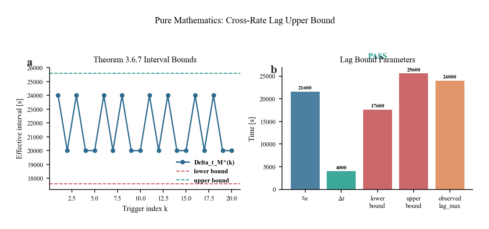
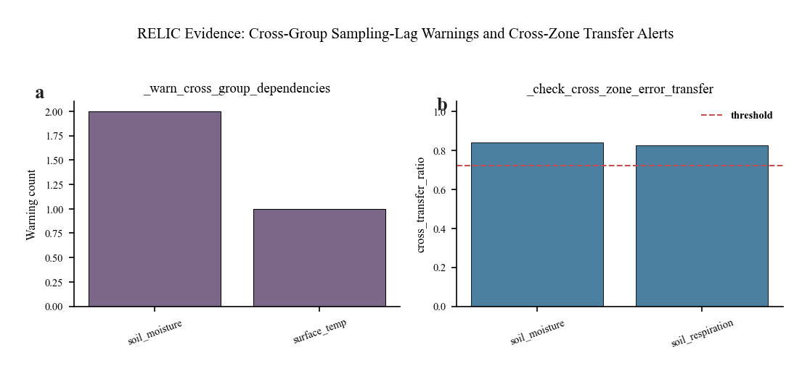

# Tutorial 20 -- Cross-Rate Lag Bound and Cross-Zone Error Transfer

## 1. Overview

This tutorial demonstrates **Theorem 3.6.7** (coertheory.md): the cross-rate lag bound for multi-rate execution. For a fixed step $\Delta t$ and interval-index triggers only (no event trigger, no bootstrap/reset first execution, no adaptive change of $\Delta t$), the accumulated medium interval satisfies $\max(0, \tau_M - \Delta t) \le \Delta t_M^{(k)} \le \tau_M + \Delta t$. The medium Functors receive this accumulated length as dt and the start of the interval, $t_{\text{last}}$ of the medium group, as their time argument (`time = t_last`, `dt = t_future - t_last`). RELIC's `_warn_cross_group_dependencies` runs at every provider-view publication and warns in both directions: a slower consumer of a faster output ("Cross-group sampling lag") and a faster consumer of a slower output ("Cross-group hold lag"). `_check_cross_zone_error_transfer` monitors cross-zone imbalance.

### Prerequisites

- [Tutorial 07](./07_multirate_execution.md): Multi-rate execution groups

---

## 2. Mathematical Foundation

### 2.1 Lag Bound (Theorem 3.6.7)

$$
\max(0, \tau_M - \Delta t) \le \Delta t_M^{(k)} \le \tau_M + \Delta t \tag{1}
$$

### 2.2 Cross-Group Sampling-Lag Warning

When a slower Functor reads a variable produced by a faster Functor, it reads the value committed in the current step but samples it only when its own group executes, so fast variability between its executions is not seen (sampling interval $\tau_M$ for medium, the slow interval or calendar month for slow); RELIC warns "Cross-group sampling lag" for this direction. When a fast Functor reads a medium or slow output, it holds the value committed when the producer last ran, which can be up to one medium/slow interval old; RELIC warns "Cross-group hold lag" for this direction. A consumer that lists the producer in its `lagged` dependencies acknowledges the read (logged at DEBUG only); the declaration keeps the edge out of the same-step graph but does not make the consumer read the previous accepted step. With `strict_cross_group_dependencies=True` an unacknowledged read raises `RuntimeError` and the registration, retirement, or restore that would publish the plan is rolled back. With `resolve_cross_group_deps=True` a slow consumer with an unacknowledged sampling lag is moved (not copied) into the medium group; a Functor that was already a scheduled slow member moves only when $t_{\text{last,slow}} = t_{\text{last,medium}}$, otherwise the publication raises `RuntimeError`. Nothing moves into `fast`, and no staleness bound is computed.

### 2.3 Cross-Zone Transfer Ratio

$$
r = \frac{\max_{\text{zone}} |\text{contrib}|}{\sum_{\text{zones}} |\text{contrib}|} \tag{2}
$$

If $r >$ threshold, a dominant-zone transfer warning is issued.

> **Reference**: coertheory.md, Theorem 3.6.7; spatiotemporal_scale_topology.md, Sections 5.2-5.3

---

## 3-5. Computation, RELIC Mapping, and Figures

- $\Delta t = 4000$ s, $\tau_M = 21600$ s, horizon = 5 days
- All observed intervals within theoretical bounds: PASS

### Figure 1: Mathematical Lag Bound (`20_math_cross_rate_lag.png`)

**Panel (a): Interval Bounds** -- Trigger intervals $\Delta t_M^{(k)}$ plotted against trigger index, with upper/lower bound lines. All points within bounds.

**Panel (b): Lag Bound Parameters** -- Bar chart of $\tau_M$, $\Delta t$, lower/upper bounds, and observed lag_max with PASS/FAIL annotation.

### Figure 2: RELIC Cross-Zone Evidence (`20_relic_cross_rate_transfer.png`)

**Panel (a): Sampling-Lag Warnings** -- Bar of warning count per variable from `_warn_cross_group_dependencies` (the script counts only "Cross-group sampling lag" messages; the fixture has three slower-reads-faster reads and no fast consumer of a medium or slow output, so no "Cross-group hold lag" warning is emitted).

**Panel (b): Cross-Zone Transfer** -- Violation ratios vs threshold from `_check_cross_zone_error_transfer`.

---

## 6-9. Comparison, Console Output, Connections, References

**Console**: `Medium interval bounds: [17600.0, 25600.0] s | observed max Delta_t_M=24000.0 s | within bound=True` / `Cross-group sampling-lag warning variables: {'soil_moisture': 2, 'surface_temp': 1}` / `Cross-zone violations: 2` | **Connections**: Tutorial 07 (multi-rate), Tutorial 12 (splitting sensitivity) | **References**: coertheory.md Theorem 3.6.7; spatiotemporal_scale_topology.md Sections 5.2-5.3
