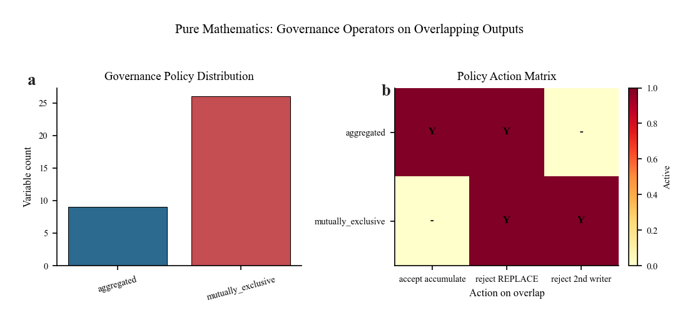
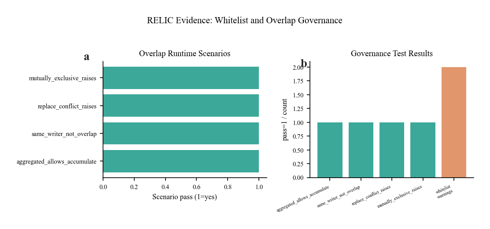

# Tutorial 21 -- Flux Whitelist and Output Overlap Governance

## 1. Overview

This tutorial calls RELIC helpers for flux-whitelist warnings and output-overlap governance. The current overlap policies are aggregated (compatible additive writers may proceed) and mutually_exclusive (different writers are rejected). A REPLACE conflict is rejected under either policy. Re-emission by the same writer is not treated as a second writer.

### Prerequisites

- [Tutorial 04](./04_semantic_ssot.md): Variable contracts and write permissions
- [Tutorial 11](./11_variable_provenance.md): Writer tracking

---

## 2. Mathematical Foundation

### 2.1 Overlap Policy Algebra

| Policy | Second ACCUMULATE writer | REPLACE conflict | Same writer |
| ------------------ | ------------- | ----------- | ---------- |
| aggregated | Accept | Reject | Not an overlap |
| mutually_exclusive | Reject | Reject | Not an overlap |

### 2.2 Flux Whitelist

Fresh execution captures two whitelist warnings: one unauthorized input and one unauthorized output. Authorized and zero-flow controls produce zero warnings. All four overlap scenarios also pass. This verifies these fixtures, not global authorization under arbitrary configurations.

For each conserved state variable $v$, a whitelist $\mathcal{W}_v = (\mathcal{W}_v^{\text{in}}, \mathcal{W}_v^{\text{out}})$ specifies which Functors are permitted to increase or decrease $v$:

$$
\text{If } \Delta v_F > 0: \quad F \in \mathcal{W}_v^{\text{in}} \\
\text{If } \Delta v_F < 0: \quad F \in \mathcal{W}_v^{\text{out}}
$$

Violations trigger warnings (non-fatal in the current runtime), emitted by `_check_flux_whitelist()` in `relic\\core\\simulator\\execution_group.py`.

> **Reference**: spatiotemporal_scale_topology.md, Sections 8.3-8.4

---

## 3-5. Computation, RELIC Mapping, and Figures

Four scenarios tested against `_resolve_overlap_and_maybe_skip`:

- **A**: aggregated allows accumulation -- PASS
- **B**: the same writer is not an overlap -- expected pass
- **C**: a REPLACE conflict raises RuntimeError -- expected pass
- **D**: mutually_exclusive raises RuntimeError -- PASS

### Figure 1: Governance Policies (`21_math_governance_policies.png`)



**Panel (a): Policy Distribution** -- Bar chart of variable count per policy type.

**Panel (b): Policy Action Matrix** -- 2x3 heatmap: accept a second ACCUMULATE writer, reject a REPLACE conflict, reject any second writer.

### Figure 2: RELIC Governance Evidence (`21_relic_governance_evidence.png`)



**Panel (a): Overlap Runtime Scenarios** -- Horizontal pass/fail bars for each scenario.

**Panel (b): Governance Test Results** -- Combined bar chart of scenario outcomes and whitelist warning count.

---

## 6-9. Comparison, Console Output, Connections, References

**Fresh execution output (2026-09-30):**

```text
Loaded policies: 35
Policy counts: {'aggregated': 9, 'mutually_exclusive': 26}
Overlap outcomes: {'aggregated_allows_accumulate': 'pass', 'same_writer_not_overlap': 'pass', 'replace_conflict_raises': 'pass', 'mutually_exclusive_raises': 'pass'}
Flux whitelist warning counts: {'warning_count': 2, 'input_warning_count': 1, 'output_warning_count': 1, 'control_warning_count': 0}
```

**Connections**: Tutorial 04 (SSOT), Tutorial 19 (connection validator) | **References**: spatiotemporal_scale_topology.md Sections 8.3-8.4
