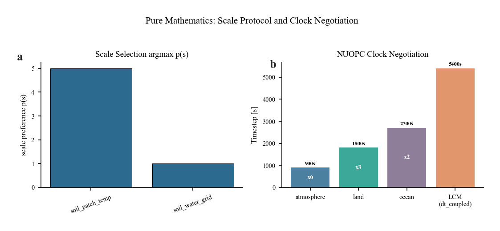
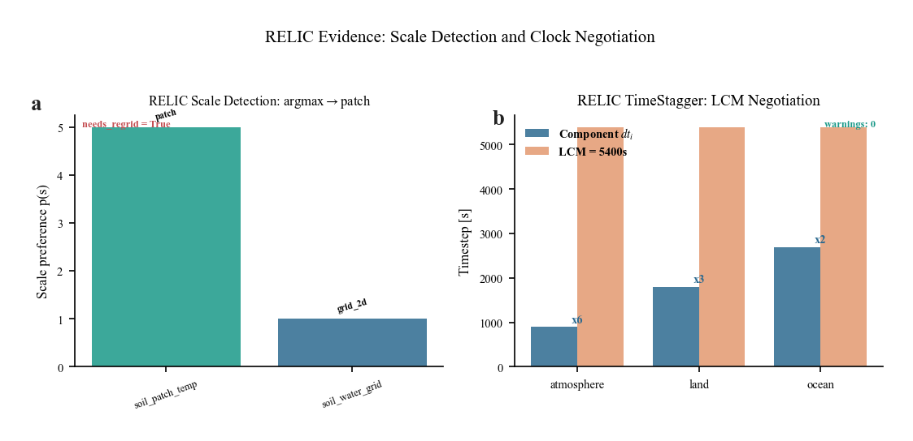

# Tutorial 22 -- Scale Consistency, NUOPC Clock Negotiation, Capability Registry

## 1. Overview

This tutorial closes several protocol/governance gaps from spatiotemporal_scale_topology.md: **metadata-first scale consistency detection** (Section 9.2), **functor summary introspection** (Section 10.2), **NUOPC-compatible clock negotiation** via the LCM of commensurable steps (Section 11.1), and the **capability registry** (Section 11.2).

### Prerequisites

- [Tutorial 15](./15_scale_coupling.md): SpatialScale labels and declared aggregation
- [Tutorial 07](./07_multirate_execution.md): TemporalScale groups

---

## 2. Mathematical Foundation

### 2.1 Scale Consistency

$$
s^* = \arg\max_{s \in U} p(s) \tag{1}
$$

where $U$ is the set of detected unique spatial scales in the current state.

Metadata-declared scales (Tier 1) are used exclusively whenever any checked output is declared; the name/shape heuristic (Tier 2) runs only when no checked output is declared. The result is a label comparison; executing a regrid additionally requires explicit source and target grid descriptors.

### 2.2 NUOPC Clock Negotiation

$$
\Delta t_{\text{coupled}} = \mathrm{lcm}(\Delta t_1, \Delta t_2, \ldots, \Delta t_n) \tag{2}
$$

Eq. (2) is valid only for commensurable steps that are integer multiples of 1 ms on a common time origin; the implementation truncates each step to integer milliseconds, ignores `start_time`, and cannot express calendar periods, so arbitrary float steps can give a wrong LCM (1/3 s and 1 s give 333 s). `TimeStagger` serves external coupling only.

Subcycle ratio (LCM mode): $r_i = \Delta t_{\text{coupled}} / \Delta t_i$ (component steps per coupled step).

> **Reference**: spatiotemporal_scale_topology.md, Sections 9.2, 10.2, 11.1-11.2

---

## 3-5. Computation, RELIC Mapping, and Figures

- Scale detection: PATCH and GRID_2D are both metadata-declared; the undeclared `aux_scalar` is ignored because declared outputs exist; target label = PATCH
- Clock negotiation: atm=900s, land=1800s, ocean=2700s $\Rightarrow$ LCM=5400s

### Figure 1: Scale Protocol and Clock Negotiation (`22_math_scale_nuopc.png`)



**Panel (a): Scale Selection** -- Bar chart of preference values $p(s)$ per detected variable. Highest preference determines target scale.

**Panel (b): NUOPC Clock Negotiation** -- Bar chart of component timesteps with LCM result. Subcycle ratios annotated (LCM mode: component steps per coupled step).

### Figure 2: RELIC Evidence (`22_relic_scale_nuopc_capability.png`)



**Panel (a): RELIC Scale Detection** -- Metadata-first detection with argmax$\to$target_scale. `needs_regrid` flag shown.

**Panel (b): RELIC TimeStagger LCM** -- Grouped bars: component $\Delta t_i$ vs negotiated LCM. Subcycle ratios annotated (LCM mode).

---

## 6-9. Comparison, Console Output, Connections, References

**Console (observed)**:

```text
=== Tutorial 22: Scale consistency, NUOPC, capability registry ===
  Scale check needs_regrid: True
  Detected scales: {'soil_patch_temp': 'patch', 'soil_water_grid': 'grid_2d'}
  Target scale: patch
  NUOPC negotiated dt: 5400.0 s
  NUOPC subcycle ratios: {'atmosphere': 6, 'land': 3, 'ocean': 2}
  Capability counts: implemented=10, partial=0, not_implemented=1
  Functor summary keys: ['FastHydro', 'SlowBiogeochem']
```

**Connections**: Tutorial 07 (temporal groups), Tutorial 15 (spatial scales) | **References**: spatiotemporal_scale_topology.md Sections 9.2, 10.2, 11.1-11.2
