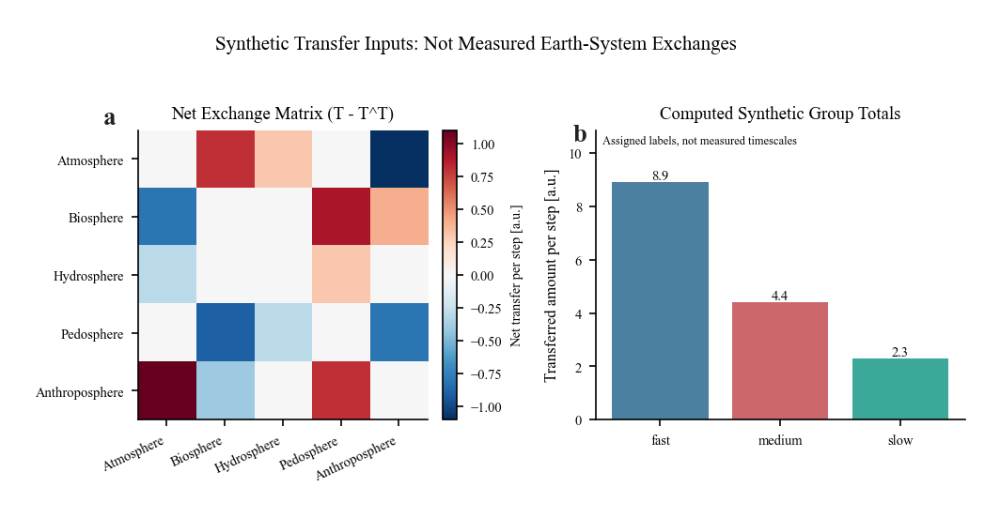
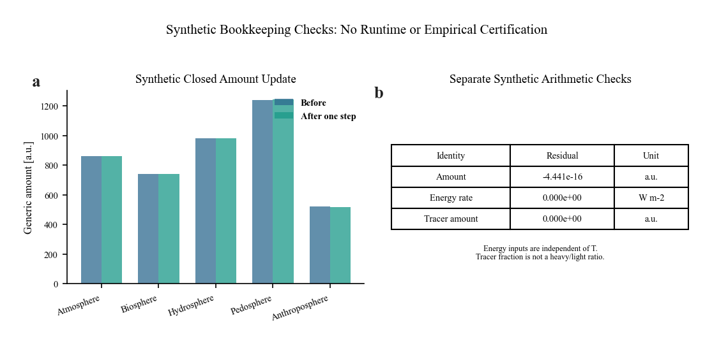

# Tutorial 23 -- Unified Five-Sphere Exchange: Energy and Isotope Conservation

## 1. Overview

This standalone NumPy tutorial uses five sphere labels and a synthetic $5 \times 5$ amount-transfer matrix. It checks cancellation of internal transfers, an independent prescribed surface-energy arithmetic example, and a synthetic tracer inventory. It does not execute RELIC scientific Functors or verify a physical multi-species or $\delta^{13}C$ budget.

### Prerequisites

- [Tutorial 01](./01_incidence_matrix_conservation.md): Conservation theorem
- [Tutorial 06](./06_conservation_ledger.md): Budget residual

---

## 2. Mathematical Foundation

### 2.1 Directed Transfer Matrix (Per-Step Amounts)

Let the five spheres be indexed by
$i\in\{0,1,2,3,4\}=\{\text{Atm},\text{Bio},\text{Hydro},\text{Pedo},\text{Anthro}\}$.
Let $\mathbf{S}\in\mathbb{R}^5$ be the sphere storage vector.

Define a **directed transfer matrix** $\mathbf{T}\in\mathbb{R}_{\ge 0}^{5\times 5}$ where
$T_{ij}$ is the amount transferred from sphere $i\to j$ in one step (diagonal is 0), on the same synthetic storage basis as $S_i$. External $F_i^{\text{ext}}$ likewise denotes an amount per step here, not a rate.
Then the storage increment is:

$$
\Delta S_i
= \Big(\sum_{j} T_{j i} - \sum_{j} T_{i j} + F_i^{\text{ext}}\Big),
\qquad i=0,\dots,4. \tag{1}
$$

Vector form (with $\mathbf{1}$ the all-ones vector):

$$
\Delta \mathbf{S} = \big(\mathbf{T}^\top\mathbf{1} - \mathbf{T}\mathbf{1} + \mathbf{F}_{\text{ext}}\big). \tag{2}
$$

For a **closed internal transfer network** ($\mathbf{F}_{\text{ext}}=\mathbf{0}$),

$$
\mathbf{1}^\top \Delta\mathbf{S} = 0. \tag{3}
$$

For visualization, we also define the antisymmetric **net exchange matrix**
$\mathbf{N}:=\mathbf{T}-\mathbf{T}^\top$, where $N_{ij}>0$ means net exchange from $i\to j$
dominates over $j\to i$ for that pair.

### 2.2 Energy Closure (Surface Energy Balance)

We use the standard closure diagnostic:

$$
r_E = R_{\text{net}} - \big(H + LE + G + \Delta S_{\text{canopy}}\big), \tag{4}
$$

All Eq. (4) terms, including the script variable $\Delta S_{\text{canopy}}$, are rates in W m$^{-2}$; that last label means canopy storage rate, not an energy increment. The prescribed numbers satisfy $525=130+330+40+25$. This independent arithmetic example is not derived from the transfer matrix.

### 2.3 Isotope Closure Under Internal Transfers

Interpret $R_i$ as a synthetic tracer fraction and define tracer storage
$M_i^{13} := S_i R_i$. The superscript is illustrative. If $R_i$ were a heavy/light isotope ratio and $S_i$ total isotope amount, the exact inventory would instead be $S_iR_i/(1+R_i)$. For each synthetic transfer $i\to j$ with multiplier $\alpha_{ij}$,
the tracer amount transferred in one step is:

$$
F^{13}_{i\to j} = T_{ij}\,R_i\,\alpha_{ij}. \tag{5}
$$

Update rule:

$$
M_i^{13,\text{new}} = M_i^{13,\text{old}} - \sum_j F^{13}_{i\to j} + \sum_j F^{13}_{j\to i}. \tag{6}
$$

Closed-network tracer residual (equal donor subtraction and recipient addition cancel algebraically; this alone does not validate isotope fractionation physics):

$$
r_{13} = \sum_i M_i^{13,\text{new}} - \sum_i M_i^{13,\text{old}}. \tag{7}
$$

---

## 3. Computation Details (This Tutorial's Numbers)

- Spheres: Atmosphere, Biosphere, Hydrosphere, Pedosphere, Anthroposphere
- $\mathbf{T}$: synthetic per-step amounts on one arbitrary storage basis; carbon, water and nutrient labels do not authorize summing different physical quantities.
- $\mathbf{S}(t)$: synthetic storage baseline, updated by Eq. (1)
- Diagnostics:
  - Mass closure residual: $\sum_i \Delta S_i$
  - Energy closure residual: $r_E$ from Eq. (4)
  - Isotope closure residual: $r_{13}$ from Eq. (7)
  - Coupling strengths: sums of selected $\mathbf{T}$ entries grouped into fast/medium/slow edge sets

---

## 4. Figures and Outputs

### 4.1 Figure 1: Mathematical Framework (`23_math_five_sphere_matrix.png`)



**Panel (a): Net Exchange Matrix $\mathbf{N}=\mathbf{T}-\mathbf{T}^\top$**

- Heatmap over the five spheres
- Positive (red) means net exchange from row-sphere to column-sphere dominates
- Negative (blue) means the reverse direction dominates
- Diagonal is 0 by construction (pairwise net exchange)

**Panel (b): Illustrative Fixture Scope**

- The panel sums the actual synthetic matrix into assigned fast/medium/slow edge groups: 8.9/4.4/2.3 a.u. per step. Names are assigned labels, not inferred time scales.

### 4.2 Figure 2: Synthetic Closure Diagnostics (`23_relic_five_sphere_conservation.png`)



**Panel (a): Storage Update $\mathbf{S}(t)\to \mathbf{S}(t+\Delta t)$**

- Bar chart of each sphere's storage before and after applying Eq. (1)
- Caption includes aggregated coupling strengths for fast/medium/slow edge groups

**Panel (b): Closure Diagnostics**

- A table lists synthetic amount residual (a.u.), the independent prescribed energy identity residual (W m-2), and tracer residual (a.u.) separately; different units do not share a numerical axis.
- All residuals should be near floating-point roundoff for a closed internal transfer demo

---

## 5. Console Output Interpretation

```text
=== Tutorial 23: Synthetic amount/tracer arithmetic, not runtime validation ===
  Synthetic amount residual [a.u.] (sum dS): -4.441e-16
  Independent prescribed energy identity residual: 0.000e+00 W m-2
  Synthetic tracer residual [a.u.]: 0.000e+00
  Assigned edge-group totals [a.u. per step]: {'fast': 8.9, 'medium': 4.4, 'slow': 2.3}
```

---

## 6. References

1. `docs\source\theory\00_unified_theoretical_framework.md`, Sections 2.1-2.3 and 5.2-5.3
2. coertheory.md, Sections 2.2 and 3.3 (structural conservation and budget residual framing)
3. Bonan (2019), _Climate Change and Terrestrial Ecosystem Modeling_
