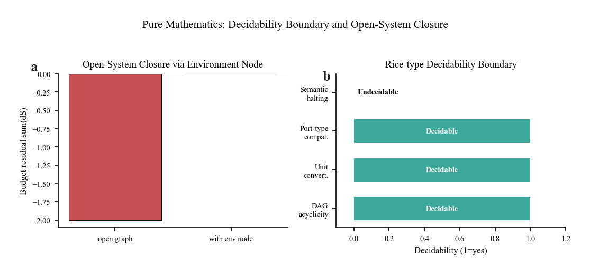
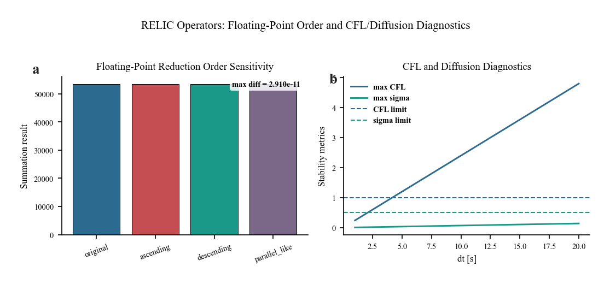

# Tutorial 24 -- Decidability Boundary, Floating-Point, CFL Diagnostics, Open-System Closure

## 1. Overview

This tutorial closes four remaining coertheory.md gaps: (1) **floating-point non-associativity** (Section 1.3) showing summation-order sensitivity, (2) **Rice-type decidability boundary** (Section 1.4) classifying which properties are algorithmically checkable, (3) **CFL and diffusion stability diagnostics** (Section 3.4): the script counts which $\Delta t$ satisfy $\text{CFL} \le 1$ and $\sigma \le 0.5$; RELIC's adaptive step controller does not apply these limits, so any gate belongs to the calling process, and (4) **open-system closure** (Section 2.5.6) via adding an environment node.

### Prerequisites

- [Tutorial 09](./09_adaptive_timestep.md): Adaptive time stepping
- [Tutorial 01](./01_incidence_matrix_conservation.md): Incidence matrix

---

## 2. Mathematical Foundation

### 2.1 Floating-Point Non-Associativity

$\text{fl}(\sum x_i)$ depends on reduction order -- different orderings yield different results due to finite precision.

### 2.2 CFL and Diffusion Stability

$$
\text{CFL} = \frac{|v| \Delta t}{\Delta x} \le 1, \quad \sigma = \frac{D \Delta t}{\Delta x^2} \le 0.5 \tag{1}
$$

The thresholds apply to the illustrated 1D uniform-grid explicit schemes: first-order upwind advection uses $\text{CFL}_{max}=1.0$ and centered forward-Euler diffusion uses $S_{max}=0.5$. They are not sufficient stability conditions for arbitrary multidimensional, coupled, or higher-order schemes. The diffusion number is $\sigma=D\Delta t/\Delta x^2$.

### 2.3 Open-System Closure

Let $\mathbf{B}$ be the incidence matrix (coertheory.md: $\dot{u}=\mathbf{B}f(u)$). An open system can be represented by a graph where a boundary flux leaves a node without a receiving endpoint, so a column of $\mathbf{B}$ contains only a single $-1$ entry. This breaks the closed-system identity $\mathbf{B}^\top\mathbf{1}=0$ and produces a non-zero aggregate tendency $\mathbf{1}^\top \dot{u}$ on the internal node set.

Adding an environment node closes the augmented algebra only if each boundary amount is actually credited there on the same units, support and time basis: $\mathbf{B}_{ext}^\top\mathbf{1}=0$. The internal subsystem remains open. A label, port, or diagnostic residual alone does not establish physical closure.

### 2.4 Decidability Boundary

| Property                     | Decidable? | Method           |
| ---------------------------- | ---------- | ---------------- |
| DAG acyclicity               | Yes        | Kahn's algorithm |
| Unit convertibility          | Yes        | Unit algebra     |
| Port-type compatibility      | Yes        | Pattern matching |
| General semantic correctness | No         | Rice's theorem   |

> **Reference**: coertheory.md, Sections 1.3, 1.4, 2.5.6, 3.4; Higham (2002); Rice (1953)

---

## 3-5. Computation, RELIC Mapping, and Figures

### Figure 1: Math: Decidability and Open-System (`24_math_decidability_open_system.png`)



**Panel (a): Open-System Closure** -- Bar chart: open graph residual $\ne 0$; with environment node residual $= 0$.

**Panel (b): Decidability Boundary** -- Horizontal bars: decidable properties have value 1. The undecidable "Semantic halting" property is drawn at value 0 with an explicit text label (Rice-type boundary).

### Figure 2: RELIC Numerics and CFL (`24_relic_numerics_cfl.png`)



**Panel (a): FP Reduction Order Sensitivity** -- Bar chart of summation results under original/ascending/descending/parallel orderings. max diff shown.

**Panel (b): CFL and Diffusion Diagnostics** -- Line plots of max CFL and max $\sigma$ vs $\Delta t$ from `compute_cfl_number` and `compute_diffusion_stability`. Threshold lines at 1.0 and 0.5 mark the explicit-scheme stability limits used by the script; the RELIC step controller does not apply them.

---

## 6-9. Comparison, Console Output, Connections, References

**Console (observed)**:

```text
=== Tutorial 24: Decidability and numerical stability boundaries ===
  Open-system residual before closure: -2.000000
  Residual after adding environment node: 0.000000
  Floating-point max order difference: 2.910383e-11
  Stable dt count (CFL<=1 and sigma<=0.5): 7/40
```

**References**: Higham (2002); Rice (1953); coertheory.md
