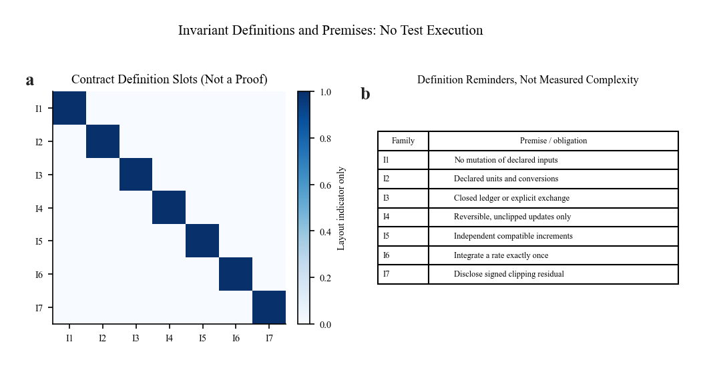
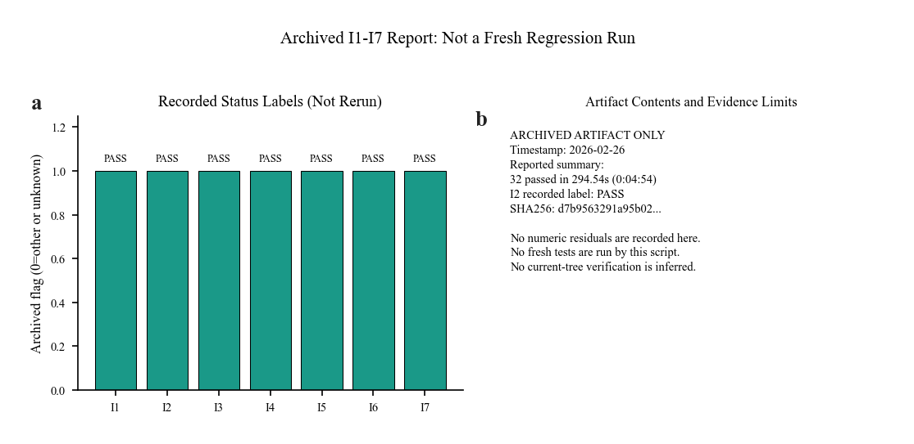

# Tutorial 25 -- Invariant Contracts I1-I7

## 1. Overview

This tutorial demonstrates RELIC's seven **invariant contracts** (I1-I7) and how they are verified in practice (spatiotemporal_scale_topology.md Section 8.2; 00_unified_theoretical_framework.md Section 5.4).

It produces two deliverables:

1. **Definition view** (Fig. 1): an illustrative contract matrix and premise/obligation table, without verification-complexity scores.
2. **Empirical regression view** (Fig. 2): load `test\\invariants\\invariant_report.json` (generated by `python -m test.invariants.generate_report`) and visualize stored PASS/UNKNOWN status; it does not run the tests.

### Why It Matters

Trajectory agreement alone is insufficient. These contracts define checkable requirements on their declared domains and tested fixtures; the finite regression suite does not prove them for every Functor, configuration or time step. A stored report is evidence only for its recorded run.

### Prerequisites

- All preceding tutorials (I1-I7 summarize the full structural + semantic + numerical framework)

---

## 2. Mathematical Foundation

Let $\mathcal{X}$ denote the simulator state (a `StateManager` snapshot), and let $\delta$ denote a proposed state increment produced by one or more Functors during a time step of size $\Delta t$. Let the transactional commit operator be $\mathcal{U}_{\Delta t}$ (coertheory.md Theorem 3.6.6), which accumulates increments, validates constraints, and then **commits-or-rolls-back** atomically.

### 2.1 Contract Catalog (spatiotemporal_scale_topology.md, Section 8.2)

**I1 -- No Side Effects.** A Functor's `forward()` must not mutate its input state:

$$
\mathcal{X}_{\text{before}} = \mathcal{X}_{\text{after\_forward}}.
$$

Meaning: forward must not mutate the input StateManager state. This is narrower than mathematical purity: governed Functor extra state and supported RNG channels may evolve.

**I2 -- Unit Consistency.** For `ACCUMULATE` mode, the increment units match the target variable units:

$$
[\Delta x_v] = [x_v].
$$

Meaning: dimensional analysis is enforced via the SSOT catalog/contract layer.

**I3 -- Conservation (Budget Residual).** For any conserved quantity
$Q(t)=\sum_{i=1}^{n} w_i x_i(t)$ with declared sources $S_j$ and sinks $L_k$, the per-step budget residual is bounded:

$$
r_Q
=
\left| \sum_{i=1}^{n} w_i \Delta x_i - \left(\sum_j S_j - \sum_k L_k\right)\Delta t \right|
\le \epsilon_{\text{conservation}}.
$$

Special case (closed internal exchange): $(\sum_j S_j-\sum_k L_k)=0$, so $r_Q = \left|\sum_i w_i \Delta x_i\right|$.

**I4 -- Reversibility.** Applying $+\delta$ then $-\delta$ restores the initial state (up to roundoff):

$$
\mathcal{U}_{\Delta t}(-\delta,\ \mathcal{U}_{\Delta t}(+\delta,\ \mathcal{X}))
=
\mathcal{X} + \mathcal{O}(\epsilon_{\text{machine}}).
$$

Meaning: this additive inverse check requires successful authorization and validation, no active clipping, and no intervening state-dependent calculation. It does not assert physical time reversibility.

**I5 -- Commutativity (Additive Updates).** Independent increments are order-invariant:

$$
\mathcal{U}_{\Delta t}(\delta_b,\ \mathcal{U}_{\Delta t}(\delta_a,\ \mathcal{X}))
=
\mathcal{U}_{\Delta t}(\delta_a,\ \mathcal{U}_{\Delta t}(\delta_b,\ \mathcal{X})).
$$

Meaning: fixed independent ACCUMULATE increments commute in exact arithmetic when neither ordering activates projection or state-dependent validation. Floating-point comparisons need a tolerance; sequential nonlinear Functors need not commute.

**I6 -- dt-Scaling.** For increments computed on a `per_second` basis, scaling the time step scales the increment linearly:

$$
\Delta x(\alpha\Delta t) = \alpha\,\Delta x(\Delta t) + \mathcal{O}(\Delta t^2).
$$

Meaning: the rate, units and support are held fixed while testing time-basis conversion. This does not assert that nonlinear trajectories at different step sizes coincide.

**I7 -- Bounds Clipping.** When bounds projection is applied, a `clip_loss` diagnostic is produced:

$$
x^{n+1} = \text{clamp}(x^n + \delta,\ L,\ U),
\qquad
\text{clip\_loss} = x^{\text{unclamped}} - x^{n+1}.
$$

Meaning: clip_loss is signed: positive removes proposed storage at an upper bound; negative adds storage at a lower bound. It discloses a correction and does not by itself route or close a physical budget.

---

## 3. Computation Details

### 3.1 Report Source of Truth

The empirical evidence comes from:

- Report path: `test\\invariants\\invariant_report.json`
- Generation command: `python -m test.invariants.generate_report`

The report includes:

- `timestamp`: UTC timestamp of the run
- `summary`: pytest summary line
- `invariants`: a PASS/UNKNOWN summary for I1-I7
- captured `stdout`/`stderr`

### 3.2 Figure Generation Behavior

The plotting script `tutorial\\theory\\25_invariant_contracts_i1_i7.py`:

1. Loads the JSON report (or substitutes a "missing" stub if absent).
2. Converts PASS/UNKNOWN into pass flags (1/0) for I1-I7.
3. Produces:
   - Fig. 1: contract definitions and premises.
   - Fig. 2: archived labels and actual report metadata; no tests run.

Note: the report has no per-invariant numeric residuals. Figure 2b now displays its actual timestamp, summary, I2 archived label and SHA256, explicitly without current-tree verification. Fixed residuals and fixed MATCH annotations were removed. A zero flag can mean UNKNOWN and is not equivalent to FAIL.

---

## 4. RELIC Implementation Mapping

The invariant test suite lives under `test\\invariants\\` (Python files ending with `.test.py`):

- I1: `side_effects.test.py`
- I2: `units.test.py`
- I3: `conservation.test.py`, `mass_energy_balance.test.py`
- I4: `reversibility.test.py`
- I5: `commutativity.test.py`
- I6: `dt_scaling.test.py`, `test_update_modes.py`
- I7: `bounds_clipping.test.py`

---

## 5. Figures and Outputs

### 5.1 Figure 1: Pure Mathematics (`25_math_invariants_i1_i7.png`)



**Panel (a): Invariant Basis I1-I7**

- Identity-like matrix: a didactic representation that treats each contract as an independent verification axis.

**Panel (b): Premises and Obligations** -- A seven-row definition table states input immutability, units, declared ledgers, unclipped additive inverses, independent increments, fixed-rate time conversion and signed clipping diagnostics; no measured complexity is claimed.

### 5.2 Figure 2: RELIC Regression Status (`25_relic_invariants_i1_i7.png`)



**Panel (a): Invariant Test Outcomes**

- PASS flags (1=PASS) for I1-I7, derived from `invariant_report.json`.

**Panel (b): Archived Report Fields** -- Displays the 2026-02-26 timestamp, historical 32-passed summary, archived I2 PASS and actual artifact SHA256; it computes no residuals, runs no tests and does not certify the current checkout.

---

## 6. Mathematical-RELIC Comparison

| Invariant | Mathematical predicate (Section 2.1) | Evidence source | Expected outcome |
| --- | --- | --- | --- |
| I1 | $\mathcal{X}_{\text{before}}=\mathcal{X}_{\text{after\_forward}}$ | `side_effects.test.py` | PASS |
| I2 | $[\Delta x_v]=[x_v]$ | `units.test.py` | PASS |
| I3 | $r_Q \le \epsilon_{\text{conservation}}$ | `conservation.test.py` | PASS |
| I4 | $\mathcal{U}(-\delta,\mathcal{U}(+\delta,\mathcal{X}))=\mathcal{X}$ | `reversibility.test.py` | PASS |
| I5 | order-invariant additive commit | `commutativity.test.py` | PASS |
| I6 | $\Delta x(\alpha\Delta t)\approx \alpha\Delta x(\Delta t)$ | `dt_scaling.test.py` | PASS |
| I7 | clipping implies `clip_loss` emitted | `bounds_clipping.test.py` | PASS |

---

## 7. Console Output Interpretation

Fresh rendering of the archived report; historical tests were not rerun:

```text
=== Tutorial 25: Invariant definitions and archived labels; no tests run ===
  Archived report timestamp: 2026-02-26T12:58:47.652931+00:00
  Archived report summary: ======================= 32 passed in 294.54s (0:04:54) ========================
  Archived labels encoded for display (not new test results): [1.0, 1.0, 1.0, 1.0, 1.0, 1.0, 1.0]
```

---

## 8. Connections to Other Tutorials

| Invariant | Related Tutorial |
| --- | --- |
| I1 | Tutorial 05 (transactional update and rollback) |
| I3 | Tutorials 01 and 06 (incidence conservation and budget residual) |
| I5 | Tutorial 12 (splitting sensitivity diagnostic) |
| I6 | Tutorial 09 (adaptive stepping uses error norms and retry) |
| I7 | Tutorial 10 (bounds projection and clip-loss) |

---

## 9. References

1. docs\\source\\theory\\spatiotemporal_scale_topology.md, Section 8.2
2. docs\\source\\theory\\00_unified_theoretical_framework.md, Section 5.4
3. coertheory.md, Theorems 3.6.3 and 3.6.6 (projection and transactional semantics)
4. test\\invariants\\*.test.py
