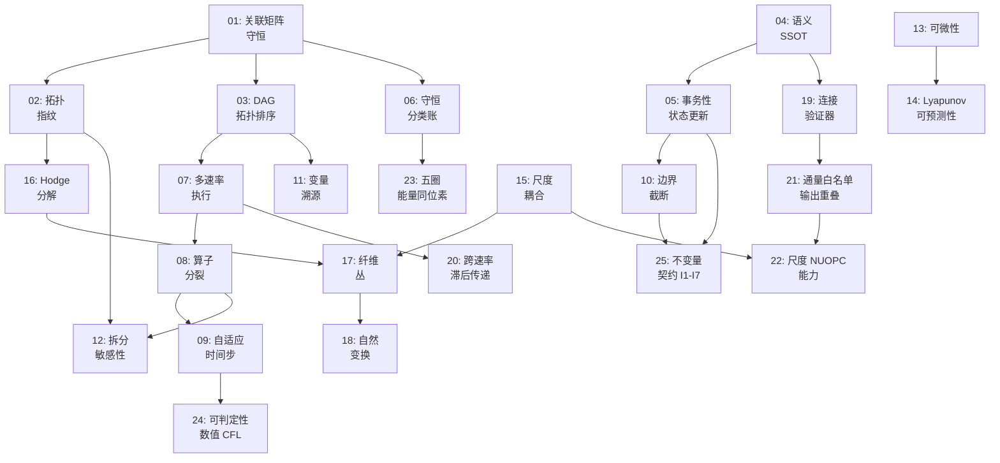

# 理论教程文档索引

> **RELIC 框架** -- 综合理论教程套件
> **版本**：2026-02
> **文档总数**：25 份教程文档 + 本索引
> **图表总数**：41 幅出版品质图表（数学 + RELIC 配对）

---

## 1. 概述

本套文档说明 `tutorial\theory` 中的 25 个理论教程。其中一部分调用特定 RELIC API，其他是独立 NumPy/PyTorch 演示或读取既有报告。图示、固定评分和历史控制台示例本身不认证完整 RELIC 运行时；各页分别说明适用范围。

### 核心源文件

| 文件                                    | 路径                                                     | 角色                                             |
| --------------------------------------- | -------------------------------------------------------- | ------------------------------------------------ |
| **coertheory.md**                       | `docs\source\coertheory.md`                              | 核心数学基础：关联矩阵、守恒、Hodge 分解、约束链 |
| **spatiotemporal_scale_topology.md**    | `docs\source\theory\spatiotemporal_scale_topology.md`    | 时空尺度耦合：范畴论、纤维丛、自然变换           |
| **00_unified_theoretical_framework.md** | `docs\source\theory\00_unified_theoretical_framework.md` | 五圈模型、能量闭合、不变量契约                   |

### 如何使用本文档

1. **新手**：从[教程 01](./01_incidence_matrix_conservation.md)开始，按照下方的依赖图前进。
2. **特定主题**：使用主题聚类表查找相关教程。
3. **重新生成图表**：从 `tutorial\theory` 运行各教程脚本（见第 6 节）。

---

## 2. 依赖图

下面的 Mermaid 图展示了教程之间的先修关系。箭头 `A --> B` 表示应在教程 B 之前阅读教程 A。



---

## 3. 主题聚类

### 聚类 A：图与拓扑（教程 01-03）

| 教程                                        | 标题         | 图表                                                    | 核心理论                                                                                |
| ------------------------------------------- | ------------ | ------------------------------------------------------- | --------------------------------------------------------------------------------------- |
| [01](./01_incidence_matrix_conservation.md) | 关联矩阵守恒 | `01_math_conservation.png`, `01_relic_conservation.png` | 定理 3.1: $\mathbf{B}^\top \mathbf{1} = \mathbf{0} \Rightarrow \sum u_i = \text{const}$ |
| [02](./02_topological_fingerprint.md)       | 拓扑指纹     | `02_math_fingerprint.png`, `02_relic_fingerprint.png`   | 推论 2.5.5: $\sigma(\mathcal{G}) = (n, m, \text{rank}, \kappa, \beta_1)$                |
| [03](./03_dag_topological_sort.md)          | DAG 拓扑排序 | `03_math_dag.png`, `03_relic_dag.png`                   | 定理 3.6.1: Kahn 算法 + 循环检测                                                        |

### 聚类 B：语义与状态（教程 04-06）

| 教程                                     | 标题           | 图表                                    | 核心理论                                           |
| --- | --- | --- | --- |
| [04](./04_semantic_ssot.md)              | 语义 SSOT      | `04_math_ssot.png`, `04_relic_ssot.png` | 第 3.2 节: $\Pi$（参数映射）+ $\Gamma$（变量契约） |
| [05](./05_transactional_state_update.md) | 事务性状态更新 | `05_transactional_state_update.png`     | 定理 3.6.6: 批次提交与步事务 savepoint 回滚        |
| [06](./06_conservation_ledger.md) | 守恒分类账 | `06_conservation_ledger.png` | $r=\lvert\Delta S-(\sum F_{\mathrm{in}}-\sum F_{\mathrm{out}})\Delta t\rvert$ |

### 聚类 C：时间积分（教程 07-09）

| 教程                              | 标题         | 图表                                              | 核心理论                                             |
| --------------------------------- | ------------ | ------------------------------------------------- | ---------------------------------------------------- |
| [07](./07_multirate_execution.md) | 多速率执行   | `07_math_multirate.png`, `07_relic_multirate.png` | 推论 3.5.2: 快/中/慢组分区                           |
| [08](./08_operator_splitting.md)  | 算子分裂     | `08_operator_splitting.png`                       | 精确子流下的 Lie vs Strang 分裂: $O(\Delta t)$ vs $O(\Delta t^2)$ |
| [09](./09_adaptive_timestep.md)   | 自适应时间步 | `09_adaptive_timestep.png`                        | 定理 3.6.8: 步长控制（演示用步长加倍；运行时为 payload 启发式） |

### 聚类 D：鲁棒性与诊断（教程 10-12）

| 教程                                | 标题       | 图表                           | 核心理论                                    |
| ----------------------------------- | ---------- | ------------------------------ | ------------------------------------------- |
| [10](./10_bounds_clipping.md)       | 边界截断   | `10_bounds_clipping.png`       | 定理 3.6.3: $P_{[L,U]}$ 投影 + 截断损失     |
| [11](./11_variable_provenance.md)   | 变量溯源   | `11_variable_provenance.png`   | 推论 3.6.5: 增量归因公式                    |
| [12](./12_splitting_sensitivity.md) | 拆分敏感性 | `12_splitting_sensitivity.png` | 推论 3.6.4: $\chi_{\text{comm}}$ 交换律诊断 |

### 聚类 E：可微性与稳定性（教程 13-14）

| 教程                                  | 标题              | 图表                                            | 核心理论                                                                                 |
| ------------------------------------- | ----------------- | ----------------------------------------------- | ---------------------------------------------------------------------------------------- |
| [13](./13_differentiability.md)       | 可微性            | `13_differentiability.png`                      | 第 1.3 节（统一框架）: 通过 PyTorch autograd 的伴随敏感性                                |
| [14](./14_lyapunov_predictability.md) | Lyapunov 可预测性 | `14_math_lyapunov.png`, `14_relic_lyapunov.png` | 第 1.2 节: $T_p = \frac{1}{\lambda_{\max}} \ln(\Delta_{\max} / \|\delta\mathbf{x}(0)\|)$ |

### 聚类 F：尺度与耦合（教程 15-18）

| 教程                                  | 标题       | 图表                                          | 核心理论                                                                      |
| ------------------------------------- | ---------- | --------------------------------------------- | ----------------------------------------------------------------------------- |
| [15](./15_scale_coupling.md)          | 尺度耦合   | `15_scale_coupling.png`                       | 时空第 2 节: 聚合、广播（加权伴随）与信息损失                                 |
| [16](./16_hodge_decomposition.md)     | Hodge 分解 | `16_math_hodge.png`, `16_relic_hodge.png`     | 定理 3.3: $\mathbb{R}^m = \text{im}(\mathbf{B}^\top) \oplus \ker(\mathbf{B})$ |
| [17](./17_fiber_bundles.md)           | 纤维丛     | `17_math_fiber.png`, `17_relic_fiber.png`     | 时空第 2.2 节: 尺度纤维丛 $E = \mathcal{S} \times_\pi F$                      |
| [18](./18_natural_transformations.md) | 自然变换   | `18_math_natural.png`, `18_relic_natural.png` | 时空第 3 节: 自然性方图作为交换性诊断                                         |

### 聚类 G：治理与验证（教程 19-22）

| 教程                                        | 标题             | 图表                                                                    | 核心理论                                             |
| ------------------------------------------- | ---------------- | ----------------------------------------------------------------------- | ---------------------------------------------------- |
| [19](./19_connection_validator.md)          | 连接验证器       | `19_math_connection_validator.png`, `19_relic_connection_validator.png` | 定理 3.6.2: $\mathcal{V}(p_s, p_t)$ 判断算子         |
| [20](./20_cross_rate_lag_transfer.md)       | 跨速率滞后传递   | `20_math_cross_rate_lag.png`, `20_relic_cross_rate_transfer.png`        | 定理 3.6.7: $\text{lag}_{\max} \le \Delta t_M^{(k)}$ |
| [21](./21_flux_whitelist_output_overlap.md) | 通量白名单与重叠 | `21_math_governance_policies.png`, `21_relic_governance_evidence.png`   | 输出重叠检测 + 诊断豁免                              |
| [22](./22_scale_consistency_nuopc.md)       | 尺度 NUOPC 能力  | `22_math_scale_nuopc.png`, `22_relic_scale_nuopc_capability.png`        | 时空第 5 节 + NUOPC 时钟协商                         |

### 聚类 H：高级集成（教程 23-25）

| 教程                                     | 标题             | 图表                                                                      | 核心理论                                        |
| ---------------------------------------- | ---------------- | ------------------------------------------------------------------------- | ----------------------------------------------- |
| [23](./23_five_sphere_energy_isotope.md) | 五圈能量同位素   | `23_math_five_sphere_matrix.png`, `23_relic_five_sphere_conservation.png` | 统一框架第 2.1-5.3 节                           |
| [24](./24_decidability_numerics_cfl.md)  | 可判定性数值 CFL | `24_math_decidability_open_system.png`, `24_relic_numerics_cfl.png`       | 第 1.4 节（Rice 定理）+ CFL 诊断 + 开放系统闭合 |
| [25](./25_invariant_contracts_i1_i7.md)  | 不变量契约 I1-I7 | `25_math_invariants_i1_i7.png`, `25_relic_invariants_i1_i7.png`           | I1-I7 契约验证框架                              |

---

## 4. 完整图表目录

所有图表位于 `tutorial\theory\figures`。每个教程生成一或两幅 PNG 图表。

| #   | 图表文件                                | 教程 | 内容                                           |
| --- | --------------------------------------- | ---- | ---------------------------------------------- |
| 1   | `01_math_conservation.png`              | 01   | 碳循环图、关联矩阵热力图、储库动态             |
| 2   | `01_relic_conservation.png`             | 01   | RELIC 拓扑排序、并行组、VariableKind           |
| 3   | `02_math_fingerprint.png`               | 02   | 四种图配置及其拓扑指纹                         |
| 4   | `02_relic_fingerprint.png`              | 02   | DependencyGraphResolver DAG 分类               |
| 5   | `03_math_dag.png`                       | 03   | 过程 DAG + Kahn 层级分解                       |
| 6   | `03_relic_dag.png`                      | 03   | RELIC 循环检测 + 层级统计                      |
| 7   | `04_math_ssot.png`                      | 04   | 参数映射 $\Pi$ + 变量契约 $\Gamma$             |
| 8   | `04_relic_ssot.png`                     | 04   | VariableKind + TemporalScale + FunctorMetadata |
| 9   | `05_transactional_state_update.png`     | 05   | 提交/回滚/提议值 vs 实际值                     |
| 10  | `06_conservation_ledger.png`            | 06   | 完整 vs 破损通量 + 预算残差                    |
| 11  | `07_math_multirate.png`                 | 07   | 甘特图式执行时间线 + 计算节省                  |
| 12  | `07_relic_multirate.png`                | 07   | TemporalScale 晶格 + 演示过程-尺度映射         |
| 13  | `08_operator_splitting.png`             | 08   | Lie vs Strang 分裂比较                         |
| 14  | `09_adaptive_timestep.png`              | 09   | 演示步长控制（重试直至接受）                   |
| 15  | `10_bounds_clipping.png`                | 10   | 边界投影 + 截断损失诊断                        |
| 16  | `11_variable_provenance.png`            | 11   | 增量归因与溯源追踪                             |
| 17  | `12_splitting_sensitivity.png`          | 12   | 排列交换律诊断                                 |
| 18  | `13_differentiability.png`              | 13   | 损失曲面 + 收敛 + A/Ci 曲线拟合                |
| 19  | `14_math_lyapunov.png`                  | 14   | Lyapunov 指数估计 + 可预测性视界               |
| 20  | `14_relic_lyapunov.png`                 | 14   | RELIC 混沌动力学 + 扰动增长                    |
| 21  | `15_scale_coupling.png`                 | 15   | 聚合/广播与信息损失                            |
| 22  | `16_math_hodge.png`                     | 16   | Hodge 分解：梯度流 vs 循环流                   |
| 23  | `16_relic_hodge.png`                    | 16   | 循环基 + 范数比较 + 指纹                       |
| 24  | `17_math_fiber.png`                     | 17   | 多尺度状态的纤维丛结构                         |
| 25  | `17_relic_fiber.png`                    | 17   | RELIC 纤维丛实现                               |
| 26  | `18_math_natural.png`                   | 18   | 自然变换图                                     |
| 27  | `18_relic_natural.png`                  | 18   | 交换缺陷（Jensen 间隙）分析                    |
| 28  | `19_math_connection_validator.png`      | 19   | 连接判断算子逻辑                               |
| 29  | `19_relic_connection_validator.png`     | 19   | RELIC 适配器需求分析                           |
| 30  | `20_math_cross_rate_lag.png`            | 20   | 跨速率滞后界理论                               |
| 31  | `20_relic_cross_rate_transfer.png`      | 20   | RELIC 跨区误差传递                             |
| 32  | `21_math_governance_policies.png`       | 21   | 通量白名单 + 重叠治理                          |
| 33  | `21_relic_governance_evidence.png`      | 21   | RELIC 治理证据                                 |
| 34  | `22_math_scale_nuopc.png`               | 22   | 尺度一致性 + NUOPC 时钟                        |
| 35  | `22_relic_scale_nuopc_capability.png`   | 22   | RELIC 尺度 NUOPC 能力注册                      |
| 36 | `23_math_five_sphere_matrix.png` | 23 | 合成净交换矩阵与实算边组总量 |
| 37  | `23_relic_five_sphere_conservation.png` | 23   | 存储更新 + 闭合诊断                            |
| 38  | `24_math_decidability_open_system.png`  | 24   | 可判定性边界 + 开放系统闭合                    |
| 39  | `24_relic_numerics_cfl.png`             | 24   | CFL/扩散诊断 + 浮点诊断                        |
| 40 | `25_math_invariants_i1_i7.png` | 25 | 不变量定义与适用前提表 |
| 41 | `25_relic_invariants_i1_i7.png` | 25 | 归档状态与真实报告元数据；不执行测试 |

---

## 5. 交叉引用约定

本文档套件中使用以下引用约定：

- **内部链接**：使用 `教程 NN -> ./NN_filename.md` 模式在教程文档间交叉引用（示例：[教程 01](./01_incidence_matrix_conservation.md)）
- **coertheory.md**：`coertheory.md，第 X.Y 节` 或 `coertheory.md，定理 3.Y.Z`
- **spatiotemporal_scale_topology.md**：`spatiotemporal_scale_topology.md，第 X 节` 或 `定义 X.Y`
- **统一框架**：`00_unified_theoretical_framework.md，第 X.Y 节`
- **外部文献**：标准 作者（年份）格式

---

## 6. 运行说明

### 前置条件

```powershell
# 进入仓库根目录
cd C:\path\to\RELIC

# 显式使用 RELIC 环境 Python（推荐，确保可复现性）
$py = "python"

# 可选：如果您的 conda 已正确配置，也可以使用激活方式。
# 注意：在某些机器上 conda 可能会因 NoWritableEnvsDirError 失败；此时请继续使用上面的 $py。
# conda activate RELIC
# $py = "python"
```

### 运行单个教程

```powershell
& $py tutorial\theory\01_incidence_matrix_conservation.py
```

### 运行所有教程

```powershell
# 运行所有教程脚本 01..25
for ($i = 1; $i -le 25; $i++) {
    $nn = "{0:D2}" -f $i
    $script = Get-ChildItem -Path "tutorial\\theory\\${nn}_*.py" | Select-Object -First 1
    & $py $script.FullName
}
```

### 输出位置

- **图表**: `tutorial\\theory\\figures\\NN_*.png`
- **控制台输出**：脚本向 stdout 打印状态与数值结果；[OK] 完成消息本身不是科学验收断言。

---

## 7. 数学符号参考

| 符号                                     | 含义                                                                 | 定义于                                     |
| ---------------------------------------- | -------------------------------------------------------------------- | ------------------------------------------ |
| $\mathcal{G} = (V, E)$                   | 过程-状态编排图                                                      | coertheory.md，第 0.2 节                   |
| $\mathbf{B} \in \{-1,0,1\}^{n \times m}$ | 关联矩阵                                                             | coertheory.md，第 2.1 节                   |
| $\sigma(\mathcal{G})$                    | 拓扑指纹 $(n, m, \text{rank}, \kappa, \beta_1)$                      | coertheory.md，推论 2.5.5                  |
| $\kappa$                                 | 连通分量数：$\dim\ker(\mathbf{B}^\top)$                              | coertheory.md，第 2.1 节                   |
| $\beta_1$                                | 环秩：$\dim\ker(\mathbf{B})$                                         | coertheory.md，定理 3.2                    |
| $P_{[L,U]}$                              | 分量式截断投影                                                       | coertheory.md，定理 3.6.3                  |
| $\mathcal{U}_{\Delta t}$                 | 事务性更新算子                                                       | coertheory.md，定理 3.6.6                  |
| $\Pi$                                    | 参数映射 $\mathcal{K} \to (\Theta, \mathcal{U}, [L,U], \text{meta})$ | coertheory.md，第 3.2 节                   |
| $\Gamma$                                 | 变量契约映射                                                         | coertheory.md，第 3.2 节                   |
| $\lambda_{\max}$                         | 最大 Lyapunov 指数                                                   | coertheory.md，第 1.2 节                   |
| $T_p$                                    | 可预测性视界                                                         | coertheory.md，第 1.2 节                   |
| CFL                                      | Courant-Friedrichs-Lewy 稳定性数                                     | coertheory.md，第 3.4 节                   |
| $\mathcal{S}$                            | 空间尺度晶格                                                         | spatiotemporal_scale_topology.md，定义 1.1 |
| $\mathcal{T}$                            | 时间尺度晶格                                                         | spatiotemporal_scale_topology.md，定义 1.2 |
