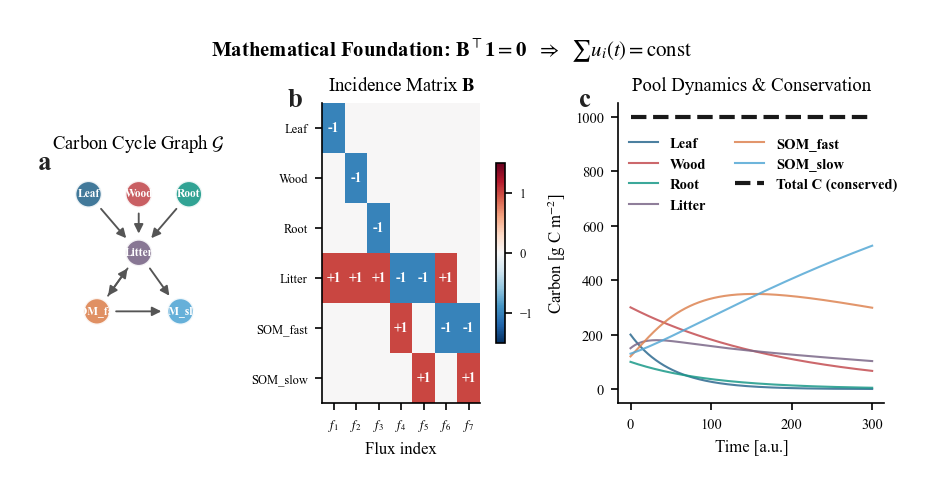
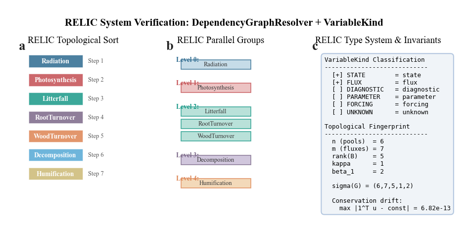

# 教程 01 -- 基于关联矩阵的结构守恒

## 1. 概述

本教程演示已声明物理交换图 $\mathcal{G}=(V,E)$ 及其关联矩阵 $\mathbf{B}$ 的结构守恒：节点为基准兼容的储量，边为内部转移。在精确算术下，恒等式 $c^\top\mathbf{B}=0$ 使 $\dot u=\mathbf{B}f$ 保持 $c^\top u$。这不是 Functor 依赖 DAG 的推论，也不覆盖未声明边界、不兼容单位、截断或任意数值更新。

### 为什么它很重要

对这里的关联矩阵构造，每列含可精确表示的 +1 和 -1，因此 $\mathbf{B}^\top\mathbf{1}=\mathbf{0}$ 精确成立。计算出的库存轨迹仍积累浮点舍入误差。只有实际各阶段变化率保持在同一关联矩阵像空间、且没有未记账投影或源项时，守恒 Euler 或 Runge-Kutta 更新才继承该线性不变量。

### 先决条件

- 基本线性代数（矩阵乘法、零空间、秩）
- 有向图基础

---

## 2. 数学基础

### 2.1 有向图与关联矩阵

**定义（关联矩阵）。** 给定有向图 $\mathcal{G} = (V, E)$，有 $n = |V|$ 个节点和 $m = |E|$ 条边，关联矩阵 $\mathbf{B} \in \{-1, 0, +1\}^{n \times m}$ 定义为：

$$
\mathbf{B}_{i,j} =
\begin{cases}
-1, & \text{若边 } j \text{ 离开节点 } i \\
+1, & \text{若边 } j \text{ 进入节点 } i \\
0, & \text{其他情况}
\end{cases}
$$

> **参考文献**：coertheory.md，第 2.1 节

### 2.2 闭合系统交换动力学

闭合系统的状态演化由以下方程决定：

$$
\frac{du}{dt} = \mathbf{B} f(u) \tag{1}
$$

其中：

- $u(t) \in \mathbb{R}^n$：节点（储库）状态向量
- $f(u) \in \mathbb{R}^m$：边（通量）向量
- $\mathbf{B} \in \{-1,0,1\}^{n \times m}$：关联矩阵

### 2.3 定理 3.1：结构守恒

**定理 3.1（结构守恒，coertheory.md 第 2.2 节）。**
对于任意 $c \in \ker(\mathbf{B}^\top)$，不变量 $I_c(t) = c^\top u(t)$ 满足：

$$
\frac{d}{dt} I_c(t) = 0
$$

**证明：**

$$
\frac{d}{dt}(c^\top u) = c^\top \frac{du}{dt} = c^\top \mathbf{B} f(u) = (\mathbf{B}^\top c)^\top f(u) = \mathbf{0}^\top f(u) = 0
$$

$\square$

**推论（总量守恒）。** 由于 $\mathbf{B}$ 的每列恰有一个 $+1$ 和一个 $-1$（对于无自环图），列和为零：$\mathbf{B}^\top \mathbf{1} = \mathbf{0}$。因此 $\mathbf{1} \in \ker(\mathbf{B}^\top)$，且：

$$
\sum_{i=1}^{n} u_i(t) = \text{const} \tag{2}
$$

### 2.4 拓扑指纹

作为附带输出，本教程还计算了拓扑指纹（coertheory.md，推论 2.5.5）：

$$
\sigma(\mathcal{G}) = (n, m, \text{rank}(\mathbf{B}), \kappa, \beta_1)
$$

其中：

- $\kappa = \dim\ker(\mathbf{B}^\top) = n - \text{rank}(\mathbf{B})$：连通分量数
- $\beta_1 = \dim\ker(\mathbf{B}) = m - \text{rank}(\mathbf{B})$：环秩（反馈复杂度）

---

## 3. 计算细节

### 3.1 碳循环图构建

本教程构建了一个简化的陆地碳循环，包含 **6 个储库** 和 **7 个通量**：

| 储库索引 | 储库名称 | 生物地球化学角色        |
| -------- | -------- | ----------------------- |
| 0        | Leaf     | 叶碳（光合组织）        |
| 1        | Wood     | 结构性木质生物量        |
| 2        | Root     | 地下根碳                |
| 3        | Litter   | 土壤表面死有机质        |
| 4        | SOM_fast | 快速分解的土壤有机质    |
| 5        | SOM_slow | 慢速/难降解的土壤有机质 |

| 通量索引 | 源       | 汇       | 过程名称     | 速率 $k_j$ [time$^{-1}$] |
| -------- | -------- | -------- | ------------ | ------------------------ |
| 0        | Leaf     | Litter   | 凋落物       | 0.02                     |
| 1        | Wood     | Litter   | 木材周转     | 0.005                    |
| 2        | Root     | Litter   | 根周转       | 0.01                     |
| 3        | Litter   | SOM_fast | 快速分解     | 0.03                     |
| 4        | Litter   | SOM_slow | 慢速分解     | 0.005                    |
| 5        | SOM_fast | Litter   | 微生物再循环 | 0.01                     |
| 6        | SOM_fast | SOM_slow | 腐殖化       | 0.002                    |

> **参考文献**：储库-通量结构参考 Parton et al. (1987, CENTURY 模型)

### 3.2 关联矩阵构建

关联矩阵 $\mathbf{B} \in \mathbb{R}^{6 \times 7}$ 通过对每条边 $j$ 设 $\mathbf{B}[\text{src}, j] = -1$ 和 $\mathbf{B}[\text{snk}, j] = +1$ 来构建：

```python
B = np.zeros((6, 7))
for j, (src, snk) in enumerate(edges):
    B[src, j] = -1
    B[snk, j] = +1
```

### 3.3 守恒验证

**步骤 1**：验证 $\mathbf{B}^\top \mathbf{1} = \mathbf{0}$：

```python
col_sums = B.T @ np.ones(n_pools)
assert np.allclose(col_sums, 0.0)
```

**步骤 2**：计算结构量：

- $\text{rank}(\mathbf{B}) = 5$
- $\kappa = 6 - 5 = 1$（一个连通分量）
- $\beta_1 = 7 - 5 = 2$（两个独立循环）

### 3.4 前向 Euler 模拟

动力学使用供体控制的一阶动力学进行模拟：

$$
f_j = k_j \cdot u_{\text{src}(j)} \tag{3}
$$

| 参数     | 符号       | 单位         | 含义                    | 值                                     |
| -------- | ---------- | ------------ | ----------------------- | -------------------------------------- |
| 通量速率 | $k_j$      | time$^{-1}$  | 通量 $j$ 的一阶衰减速率 | 见上表                                 |
| 状态向量 | $u_i$      | g C m$^{-2}$ | 储库 $i$ 的碳储量       | 初始值: [200, 300, 100, 150, 120, 130] |
| 时间步长 | $\Delta t$ | a.u.         | Euler 积分步长          | 0.5                                    |
| 总步数   | $N$        | --           | 时间步数                | 600                                    |

前向 Euler 更新为：

$$
u^{n+1} = u^n + \Delta t \cdot (\mathbf{B} f(u^n)) \tag{4}
$$

> **参考文献**：供体控制动力学参考 Parton et al. (1987)

### 3.5 RELIC 集成

本教程使用 RELIC 的 `DependencyGraphResolver` 来：

1. 注册与碳循环图匹配的 7 个过程
2. 计算拓扑排序顺序
3. 提取并行执行组
4. 演示循环图的 `CyclicDependencyError`

---

## 4. RELIC 实现映射

| RELIC 模块                         | 类/函数                   | 在教程中的角色                           |
| ---------------------------------- | ------------------------- | ---------------------------------------- |
| `relic.core.dependency_graph`      | `DependencyGraphResolver` | 拓扑排序 + 并行组提取                    |
| `relic.core.dependency_graph`      | `CyclicDependencyError`   | 循环检测异常                             |
| `relic.core.functor.functor_types` | `VariableKind`            | 状态/通量/诊断/强迫分类                  |
| `relic.core.functor.functor_types` | `ProcessCategory`         | PHYSICAL_FIELD / BIOLOGICAL_PROCESS 分类 |
| `relic.core.functor.functor_types` | `FunctorMetadata`         | 函子注册的元数据容器                     |

### 执行的代码路径

1. `DependencyGraphResolver.__init__()` -- 创建空解析器
2. `resolver.add_functor(f)` -- 注册每个过程及其依赖
3. `resolver.topological_sort()` -- Kahn 算法（coertheory.md，定理 3.6.1）
4. `resolver.get_parallel_groups()` -- 依赖层级分解（并行候选；RELIC 顺序执行各组）
5. `CyclicDependencyError` -- 检测到循环依赖时抛出

---

## 5. 图表与输出

### 5.1 图 1：数学基础 (`01_math_conservation.png`)



**图 (a)：碳循环图 $\mathcal{G}$**

- 显示包含 6 个节点（彩色圆圈）和 7 条有向边（箭头）的有向图
- Leaf、Wood、Root 构成上排（活生物量）；Litter、SOM_fast、SOM_slow 构成下排（死有机质）
- 箭头方向表示从源到汇的通量流动
- **关键结论**：图结构编码了所有守恒信息；守恒的成立不需要参数值

**图 (b)：关联矩阵 $\mathbf{B}$**

- 展示 $6 \times 7$ 关联矩阵的热力图
- 蓝色 ($-1$) 表示通量离开节点；红色 ($+1$) 表示通量进入节点
- 每列恰有一个 $-1$ 和一个 $+1$，确认 $\mathbf{B}^\top \mathbf{1} = \mathbf{0}$
- **关键结论**：列和为零的性质可从矩阵模式中直观验证

**图 (c)：储库动态与守恒**

- 600 个时间步中所有 6 个储库碳储量的时间序列
- 各储库动态地重新分配碳
- 黑色虚线显示**总碳 $\sum u_i(t)$** 保持在 1000 g C m$^{-2}$ 不变
- **关键结论**：尽管有活跃的储库间转移，总碳守恒到机器精度

### 5.2 图 2：RELIC 系统集成 (`01_relic_conservation.png`)



**图 (a)：RELIC 拓扑排序**

- 列出由 `DependencyGraphResolver.topological_sort()` 确定的执行顺序中的 7 个过程
- 每个过程标有其步骤编号，显示确定性排序
- **关键结论**：RELIC 强制执行唯一的、可重复的执行序列

**图 (b)：RELIC 并行组**

- 显示按执行层级（DAG 中的深度）分组的过程
- 同一层级的过程之间无依赖（并行候选）；RELIC 仍依次执行
- **关键结论**：层级结构在不违反依赖约束的情况下给出并行候选

**图 (c)：RELIC 类型系统与不变量**

- 显示 `VariableKind` 分类（STATE, FLUX, DIAGNOSTIC, FORCING 等）
- 显示计算得到的拓扑指纹 $\sigma(\mathcal{G}) = (6, 7, 5, 1, 2)$
- 报告守恒漂移：$\max |1^\top u - \text{const}| 6.82\times10^{-13}$（绝对值；相对漂移 $\sim 10^{-15}$）
- **关键结论**：RELIC 的类型系统和结构分析工具已完全集成

---

## 6. 数学-RELIC 对比

| 量                           | 数学预测                                          | 教程/RELIC 输出                | 匹配          |
| --- | --- | --- | --- |
| $\mathbf{B}^\top \mathbf{1}$ | $\mathbf{0}$（精确）                              | $\mathbf{0}$（精确，IEEE 754） | PASS          |
| $\mathrm{rank}(\mathbf{B})$  | 5                                                 | 5                              | PASS          |
| $\kappa$（分量）             | 1                                                 | 1                              | PASS          |
| $\beta_1$（循环）            | 2                                                 | 2                              | PASS          |
| $\sigma(\mathcal{G})$        | $(6,7,5,1,2)$                                     | $(6,7,5,1,2)$                  | PASS          |
| $\max_t \lvert\mathbf{1}^\top u(t)-\mathbf{1}^\top u(0)\rvert$ | 0（精确理论） | $6.82\times10^{-13}$ | PASS |
| 拓扑排序                     | 有效顺序存在（DAG）                               | Kahn 排序 + 并行组             | PASS          |
| 循环检测                     | 循环图被拒绝                                      | `CyclicDependencyError` 被抛出 | PASS          |

**误差度量**：

- 守恒漂移：$\sim 8\times 10^{-13}$ g C m$^{-2}$（相对漂移 $\sim 8\times 10^{-16}$，对比总 C $\approx 10^3$）
- 这与 600 步积累的 IEEE 754 双精度舍入误差一致

---

## 7. 控制台输出解释

```
[OK] B^T @ 1 = 0  (exact for integer B)
```

- 确认关联矩阵的基本列和为零性质。由于 $\{-1, 0, +1\}$ 在 IEEE 754 中可精确表示，所以是精确的。

```
  sigma(G) = (6, 7, 5, 1, 2)
```

- 拓扑指纹：6 个储库、7 个通量、秩 5、1 个连通分量、2 个独立循环（微生物再循环回路和 SOM_fast-Litter-SOM_slow 三角形）。

```
[OK] Max total-C drift = 6.82e-13 g C m^-2
```

- 绝对漂移约 $\sim 10^{-12}$，但**相对**漂移约 $\sim 10^{-15}$（对比总 C $\approx 10^3$）。这确认了结构守恒保持到 IEEE 754 舍入精度。

```
=== RELIC DependencyGraphResolver Output ===
  Topological order: ['Radiation', 'Photosynthesis', 'Litterfall', 'RootTurnover', 'WoodTurnover', 'Decomposition', 'Humification']
  Parallel groups:   [['Radiation'], ['Photosynthesis'], ['Litterfall', 'RootTurnover', 'WoodTurnover'], ['Decomposition'], ['Humification']]
```

- RELIC 的 `DependencyGraphResolver` 成功计算了有效的拓扑排序并识别了依赖层级（并行候选）。

```
  [OK] RELIC CyclicDependencyError raised correctly
```

- 当引入循环依赖（A $\to$ B, B $\to$ A）时，RELIC 正确检测并拒绝。

```
  RELIC VariableKind values:
    STATE        = state
    FLUX         = flux
    DIAGNOSTIC   = diagnostic
    PARAMETER    = parameter
    FORCING      = forcing
    UNKNOWN      = unknown
```

- 显示完整的 RELIC 变量分类系统，展示所有可识别的 `VariableKind` 值。

---

## 8. 与其他教程的关联

### 下游依赖

- **[教程 02](./02_topological_fingerprint.md)**：通过多配置比较扩展拓扑指纹概念
- **[教程 03](./03_dag_topological_sort.md)**：深入讲解 DAG 编译和 Kahn 算法
- **[教程 06](./06_conservation_ledger.md)**：展示守恒违反如何表现为非零预算残差
- **[教程 16](./16_hodge_decomposition.md)**：使用相同的关联矩阵 $\mathbf{B}$ 分解边空间 $\mathbb{R}^m$

### 依赖图位置

这是整个套件的**根教程**。它引入了关联矩阵 $\mathbf{B}$，这是贯穿所有后续教程的核心数学对象。无需先修课程。

### 此处引入并在后续复用的关键概念

| 概念                       | 复用于                  |
| -------------------------- | ----------------------- |
| 关联矩阵 $\mathbf{B}$      | 教程 02, 06, 12, 16, 23 |
| $\sigma(\mathcal{G})$ 指纹 | 教程 02, 16, 22         |
| `DependencyGraphResolver`  | 教程 02, 03, 16-22      |
| `VariableKind`             | 教程 04, 10, 11, 21, 25 |
| 守恒定理                   | 教程 05, 06, 23, 25     |

---

## 9. 参考文献

### RELIC 理论文档

1. coertheory.md，第 2.1-2.2 节（关联矩阵定义与定理 3.1）
2. coertheory.md，推论 2.5.5（拓扑指纹）
3. coertheory.md，定理 3.6.1（DAG 编译与确定性拓扑排序）
4. spatiotemporal_scale_topology.md，第 4 节（依赖 DAG 结构）

### 外部文献

5. Godsil, C. & Royle, G. (2001). _Algebraic Graph Theory_. Cambridge University Press.
6. Strang, G. (1988). _Linear Algebra and Its Applications_ (3rd ed.). Harcourt Brace.
7. Hirani, A.N. (2003). _Discrete Exterior Calculus_. PhD Thesis, Caltech.
8. Parton, W.J. et al. (1987). Analysis of factors controlling soil organic matter levels in Great Plains grasslands. _SSSA Journal_, 51, 1173-1179.
