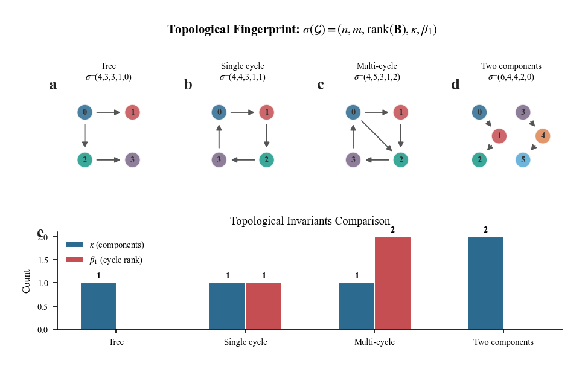
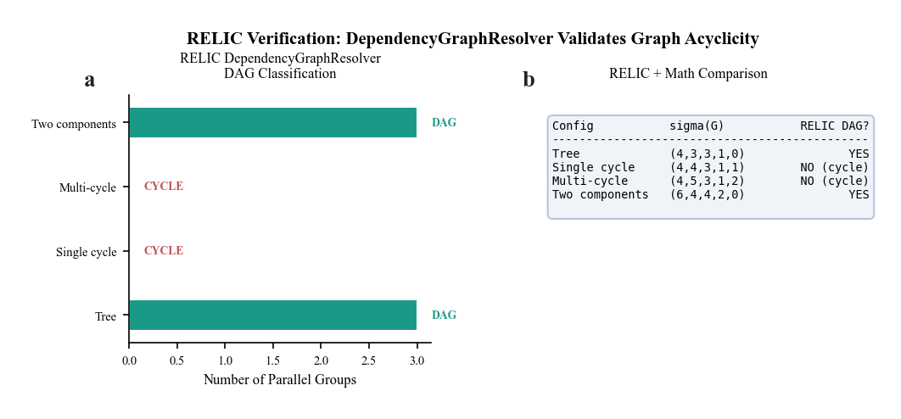

# 教程 02 -- 拓扑指纹与 Betti 数

## 1. 概述

本教程演示了**拓扑指纹** $\sigma(\mathcal{G})$，一个无参数的结构不变量，为任何过程图提供紧凑的"结构版本号"。通过比较四种不同的图配置（树、单循环、多循环、两个分量），展示指纹如何随结构修改而变化，同时对参数扰动完全不敏感。

这是粗粒度不变量，不是唯一图指纹：非同构图可能拥有相同数值，边反向也不改变这些量。分量和循环秩指底层无向图；循环秩大于零不意味着存在有向循环，不能据此判定执行 DAG。只有固定拓扑时它才独立于参数。

### 为什么它很重要

拓扑指纹使建模者能仅通过结构来分类不同的模型配置。在进行结构不确定性分析时，$\sigma(\mathcal{G})$ 能将配置分组为"结构集成体"，然后再讨论各组内的参数不确定性（coertheory.md，推论 2.5.5）。

### 先决条件

- [教程 01](./01_incidence_matrix_conservation.md)：关联矩阵与守恒定理

---

## 2. 数学基础

### 2.1 拓扑指纹定义

**定义（coertheory.md，推论 2.5.5）。** 图 $\mathcal{G} = (V, E)$ 的拓扑指纹及其关联矩阵 $\mathbf{B}$ 为：

$$
\sigma(\mathcal{G}) = \big(n, m, \text{rank}(\mathbf{B}), \kappa, \beta_1\big) \tag{1}
$$

其中：

- $n = |V|$：节点数（储库）
- $m = |E|$：边数（通量）
- $\text{rank}(\mathbf{B})$：关联矩阵的秩
- $\kappa = \dim\ker(\mathbf{B}^\top) = n - \text{rank}(\mathbf{B})$：连通分量数
- $\beta_1 = \dim\ker(\mathbf{B}) = m - \text{rank}(\mathbf{B})$：环秩（第一 Betti 数）

### 2.2 定理 3.2：环秩公式

**定理 3.2（coertheory.md，第 2.3 节）。** 对于无自环图的关联矩阵 $\mathbf{B}$：

$$
\beta_1 = m - \text{rank}(\mathbf{B}) = m - n + \kappa \tag{2}
$$

**证明**：由秩零化度定理，$\dim\ker(\mathbf{B}) = m - \text{rank}(\mathbf{B})$。对于关联矩阵，$\text{rank}(\mathbf{B}) = n - \kappa$。代入得 $\beta_1 = m - n + \kappa$。$\square$

### 2.3 结构敏感性

由推论 2.5.4（coertheory.md）：

1. **连接两个分量**（添加跨分量边）：$m \to m+1$，$\kappa \to \kappa-1$，$\beta_1$ 不变但预算分区合并。
2. **在分量内添加边**：$m \to m+1$，$\kappa$ 不变，$\beta_1 \to \beta_1+1$ -- 新增一个独立反馈环路。

---

## 3. 计算细节

### 3.1 四种图配置

| 配置 | 名称     | $n$ | 边                                  | 描述             |
| ---- | -------- | --- | ----------------------------------- | ---------------- |
| 1    | 树       | 4   | $(0,1), (0,2), (2,3)$               | 无环，单连通分量 |
| 2    | 单循环   | 4   | $(0,1), (1,2), (2,3), (3,0)$        | 一个反馈环       |
| 3    | 多循环   | 4   | $(0,1), (1,2), (2,3), (3,0), (0,2)$ | 两个独立循环     |
| 4    | 两个分量 | 6   | $(0,1), (1,2), (3,4), (4,5)$        | 不连通图         |

### 3.2 指纹结果

| 配置     | $n$ | $m$ | 秩  | $\kappa$ | $\beta_1$ | $\sigma(\mathcal{G})$ |
| -------- | --- | --- | --- | -------- | --------- | --------------------- |
| 树       | 4   | 3   | 3   | 1        | 0         | $(4,3,3,1,0)$         |
| 单循环   | 4   | 4   | 3   | 1        | 1         | $(4,4,3,1,1)$         |
| 多循环   | 4   | 5   | 3   | 1        | 2         | $(4,5,3,1,2)$         |
| 两个分量 | 6   | 4   | 4   | 2        | 0         | $(6,4,4,2,0)$         |

### 3.3 RELIC DAG 分类

每种配置通过 RELIC 的 `DependencyGraphResolver` 注册，分类结果为：

- **树**：DAG（无环）-- 拓扑排序成功
- **单循环**：CYCLE（被拒绝）-- `CyclicDependencyError`
- **多循环**：CYCLE（被拒绝）-- `CyclicDependencyError`
- **两个分量**：DAG -- 排序成功（两条独立链）

---

## 4. RELIC 实现映射

| 模块                               | 类                        | 用途                      |
| ---------------------------------- | ------------------------- | ------------------------- |
| `relic.core.dependency_graph`      | `DependencyGraphResolver` | DAG 分类 + 并行组         |
| `relic.core.functor.functor_types` | `ProcessCategory`         | 分类为 BIOLOGICAL_PROCESS |
| `relic.core.functor.functor_types` | `FunctorMetadata`         | 各函子的元数据            |

---

## 5. 图表与输出

### 5.1 图 1：数学拓扑指纹 (`02_math_fingerprint.png`)



**图 (a-d)：四种图配置**

- 每幅图展示一个有向图，节点为彩色圆圈，边为箭头
- 每幅图下方：计算得到的指纹 $\sigma(\mathcal{G})$
- **关键结论**：直观确认树（$\beta_1=0$）、单循环（$\beta_1=1$）、多循环（$\beta_1=2$）和不连通（$\kappa=2$）图产生不同的指纹

**图 (e)：拓扑不变量比较**

- 条形图比较所有四种配置的 $\kappa$（分量数）和 $\beta_1$（循环数）
- 显示 $\kappa$ 和 $\beta_1$ 是独立的"结构旋钮"（推论 2.5.4）
- **关键结论**：在分量内添加边增加 $\beta_1$ 但不增加 $\kappa$；连接分量减少 $\kappa$ 但不减少 $\beta_1$

### 5.2 图 2：RELIC 系统集成 (`02_relic_fingerprint.png`)



**图 (a)：RELIC DependencyGraphResolver DAG 分类**

- 水平条形图显示各配置的并行组数
- DAG 配置（树、两个分量）有并行组；循环配置被拒绝
- **关键结论**：RELIC 自动区分可执行（DAG）和不可执行（循环）结构

**图 (b)：汇总表**

- 数学指纹与 RELIC DAG 判定的并排比较
- 确认理论与系统行为完全一致

---

## 6. 数学-RELIC 对比

| 配置     | $\sigma(\mathcal{G})$ | $\beta_1 > 0$? | RELIC: DAG? | 一致? |
| -------- | --------------------- | -------------- | ----------- | ----- |
| 树       | $(4,3,3,1,0)$         | 否             | 是          | PASS  |
| 单循环   | $(4,4,3,1,1)$         | 是             | 否          | PASS  |
| 多循环   | $(4,5,3,1,2)$         | 是             | 否          | PASS  |
| 两个分量 | $(6,4,4,2,0)$         | 否             | 是          | PASS  |

> **注意**：$\beta_1 > 0$ 不一定意味着有向循环（Betti 数在无向图上计算）。RELIC 的 DAG 检测基于有向无环性，这是一个不同的（更强的）条件。

---

## 7. 控制台输出解释

```
  Tree              sigma = (4,3,3,1,0)
  Single cycle      sigma = (4,4,3,1,1)
  Multi-cycle       sigma = (4,5,3,1,2)
  Two components    sigma = (6,4,4,2,0)
```

- 各行确认计算得到的指纹。树无循环（$\beta_1=0$），而在分量内添加边使 $\beta_1$ 递增。

```
=== RELIC Analysis ===
  Tree              DAG  groups=[['P0'], ['P1', 'P2'], ['P3']]
  Single cycle      CYCLE (rejected)  groups=None
  Multi-cycle       CYCLE (rejected)  groups=None
  Two components    DAG  groups=[['P0', 'P3'], ['P1', 'P4'], ['P2', 'P5']]
```

- RELIC 正确接受无环图并拒绝循环图。

---

## 8. 与其他教程的关联

| 相关教程                                         | 关系                                                  |
| ------------------------------------------------ | ----------------------------------------------------- |
| [教程 01](./01_incidence_matrix_conservation.md) | 先修：引入 $\mathbf{B}$ 和守恒定理                    |
| [教程 03](./03_dag_topological_sort.md)          | 通过 Kahn 算法细节扩展 DAG 分类                       |
| [教程 12](./12_splitting_sensitivity.md)         | 使用指纹表征拆分配置                                  |
| [教程 16](./16_hodge_decomposition.md)           | 使用 $\beta_1$ 确定循环空间 $\ker(\mathbf{B})$ 的维度 |

---

## 9. 参考文献

1. coertheory.md，第 2.3-2.5 节，推论 2.5.1-2.5.5
2. Godsil, C. & Royle, G. (2001). _Algebraic Graph Theory_, Chapter 8. Cambridge.
