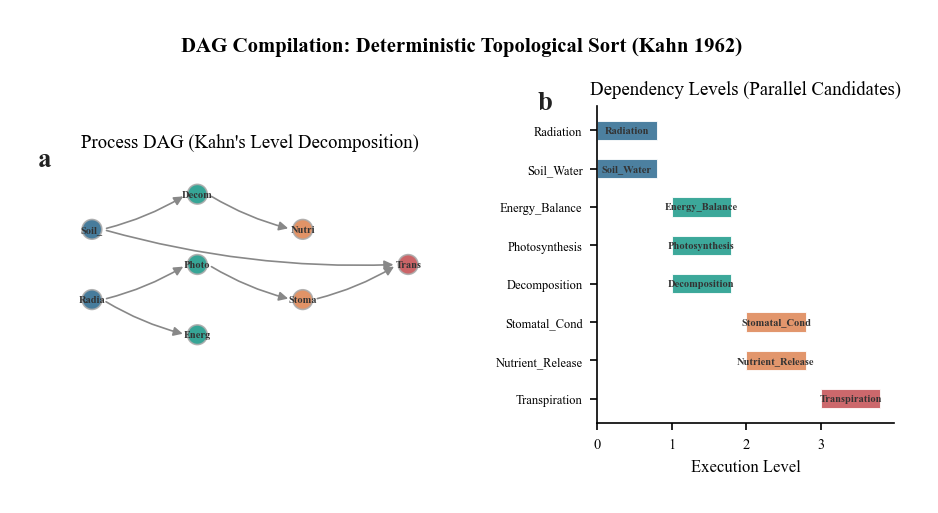
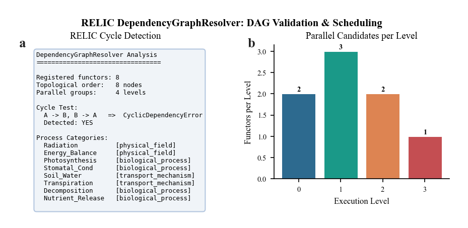

# 教程 03 -- DAG 编译与确定性拓扑排序

## 1. 概述

本教程演示了 RELIC 的 **DAG 编译**机制，使用 Kahn 算法进行确定性拓扑排序，以及 RELIC 的 `CyclicDependencyError` 用于循环拒绝。展示了 8 个具有显式依赖的生物地球化学过程如何被编译成确定性、可重复的执行调度，并识别出依赖层级（并行候选；RELIC 顺序执行）。

### 为什么它很重要

确定性执行排序确保"结构不确定性"（更改 $\mathcal{G}$）和"参数不确定性"（更改 $\Pi$）被严格分离。在固定图与固定注册顺序下，执行顺序是不可协商的不变量——而非额外的不确定性来源（coertheory.md，定理 3.6.1）。

### 先决条件

- [教程 01](./01_incidence_matrix_conservation.md)：关联矩阵基础
- [教程 02](./02_topological_fingerprint.md)：图结构性质

---

## 2. 数学基础

### 2.1 定理 3.6.1：DAG 编译

**定理 3.6.1（coertheory.md，第 3.6 节）。** 令 $\mathcal{G} = (V, E)$ 为有向图。严格编译算子 $\mathcal{C}$ 返回节点序列 $\pi = (v_1, \ldots, v_{|V|})$ 当且仅当：

1. $\mathcal{G}$ 是 DAG（有向无环图）
2. $\pi$ 是有效的拓扑序：对于任意 $(u \to v) \in E$，$u$ 在 $\pi$ 中先于 $v$
3. 在固定的节点全序下（RELIC：函子注册序号），$\pi$ 是确定性的

### 2.2 Kahn 算法

**算法（Kahn, 1962）**：

1. 用所有入度为 0 的节点初始化以 Functor 注册序号为键的最小堆 $Q$
2. 当 $Q$ 非空时：
   - 弹出注册序号最小的节点 $v$（RELIC 的固定全序；NetworkX 路径使用同一键，两条路径给出同一份 plan）
   - 将 $v$ 追加到输出序列 $\pi$
   - 移除 $v$ 的所有出边，更新入度
   - 将入度变为 0 的节点入队
3. 若 $|\pi| < |V|$：检测到环，抛出错误

> **参考文献**：Kahn, A.B. (1962). Topological sorting of large networks. _Comm. ACM_；spatiotemporal_scale_topology.md，第 4 节。

### 2.3 层级分解

`get_parallel_groups()` 返回的层级集合对应 DAG 的**广度优先层级分解**：

- **层级 0**：无依赖的过程（入度 0）
- **层级 $k+1$**：所有依赖都在层级 $\le k$ 的过程

同一层级内的过程之间没有依赖边，是并行*候选*。RELIC 当前按 plan 顺序以顺序循环执行每个组，不以线程或进程并发执行 DAG 函子。无依赖边也不证明可交换（共享状态写入仍会使结果依赖顺序，见教程 12）。

---

## 3. 计算细节

### 3.1 过程定义（8 个过程）

| 过程             | 依赖                      | 类别                | 层级 |
| ---------------- | ------------------------- | ------------------- | ---- |
| Radiation        | --                        | PHYSICAL_FIELD      | 0    |
| Energy_Balance   | Radiation                 | PHYSICAL_FIELD      | 1    |
| Photosynthesis   | Radiation                 | BIOLOGICAL_PROCESS  | 1    |
| Stomatal_Cond    | Photosynthesis            | BIOLOGICAL_PROCESS  | 2    |
| Soil_Water       | --                        | TRANSPORT_MECHANISM | 0    |
| Transpiration    | Stomatal_Cond, Soil_Water | TRANSPORT_MECHANISM | 3    |
| Decomposition    | Soil_Water                | BIOLOGICAL_PROCESS  | 1    |
| Nutrient_Release | Decomposition             | BIOLOGICAL_PROCESS  | 2    |

### 3.2 循环检测测试

引入循环依赖（Radiation $\to$ Transpiration $\to$ Radiation）并确认触发 `CyclicDependencyError`。

---

## 4. RELIC 实现映射

| 模块                               | 类                        | 用途                                    |
| ---------------------------------- | ------------------------- | --------------------------------------- |
| `relic.core.dependency_graph`      | `DependencyGraphResolver` | 拓扑排序 + 并行组计算                   |
| `relic.core.dependency_graph`      | `CyclicDependencyError`   | 循环拒绝                                |
| `relic.core.functor.functor_types` | `ProcessCategory`         | PHYSICAL_FIELD / BIOLOGICAL / TRANSPORT |

---

## 5. 图表与输出

### 5.1 图 1：数学 DAG + 层级分解 (`03_math_dag.png`)



**图 (a)：过程 DAG 可视化**

- 有向图显示 8 个过程按层级排列（左=层级 0，右=更高层级）
- 按执行层级着色；箭头显示依赖流
- **关键结论**：DAG 结构确保无循环依赖

**图 (b)：依赖层级（并行候选，甘特图式）**

- 水平条形图显示每个过程在其执行层级的位置
- 同一层级的过程之间无依赖（并行候选）
- **关键结论**：层级 0 有 2 个独立过程（Radiation, Soil_Water），RELIC 仍依次执行

### 5.2 图 2：RELIC 循环检测与类别摘要 (`03_relic_dag.png`)



**图 (a)：循环检测摘要**

- 等宽文本块显示：注册的函子数、拓扑序长度、并行组数和循环检测结果
- 列出本教程使用的所有过程类别
- **关键结论**：RELIC 的 `CyclicDependencyError` 对循环测试用例正确抛出

**图 (b)：每层级并行候选数**

- 条形图显示每个执行层级的函子数
- **关键结论**：层级分布揭示 DAG 的"宽度"（并行候选上界，并非实际并发）

---

## 6. 数学-RELIC 对比

| 量       | 理论                                      | RELIC                                | 匹配 |
| -------- | ----------------------------------------- | ------------------------------------ | ---- |
| DAG 检测 | Kahn 算法返回完整序列当且仅当无环         | `topological_sort()` 成功            | PASS |
| 循环拒绝 | Kahn 算法失败（不完整序列）当且仅当存在环 | `CyclicDependencyError` 被抛出       | PASS |
| 确定性   | 在固定全序（注册序号）下输出唯一          | 跨运行相同排序                       | PASS |
| 层级数   | BFS 层级分解                              | `get_parallel_groups()` 返回正确层级 | PASS |

---

## 7. 控制台输出解释

```
[OK] RELIC topological sort succeeded
  Order: ['Radiation', 'Energy_Balance', 'Photosynthesis', 'Stomatal_Cond', 'Soil_Water', 'Transpiration', 'Decomposition', 'Nutrient_Release']
  Parallel groups: [['Radiation', 'Soil_Water'], ['Energy_Balance', 'Photosynthesis', 'Decomposition'], ['Stomatal_Cond', 'Nutrient_Release'], ['Transpiration']]
```

- 确认有效的拓扑序（平局按注册序号决定）；识别出 4 个依赖层级（并行候选）

```
[OK] RELIC CyclicDependencyError raised for cyclic graph
```

- 确认 Radiation-Transpiration 循环的循环检测

---

## 8. 与其他教程的关联

| 相关教程                                         | 关系                         |
| ------------------------------------------------ | ---------------------------- |
| [教程 01](./01_incidence_matrix_conservation.md) | 先修：引入图结构             |
| [教程 07](./07_multirate_execution.md)           | 通过时间分组扩展（快/中/慢） |
| [教程 11](./11_variable_provenance.md)           | 使用 DAG 结构进行增量归因    |

---

## 9. 参考文献

1. Kahn, A.B. (1962). Topological sorting of large networks. _Communications of the ACM_, 5(11), 558-562.
2. Cormen, T.H. et al. (2009). _Introduction to Algorithms_, Chapter 22.
3. coertheory.md，定理 3.6.1
4. spatiotemporal_scale_topology.md，第 4 节（依赖图的拓扑结构）
