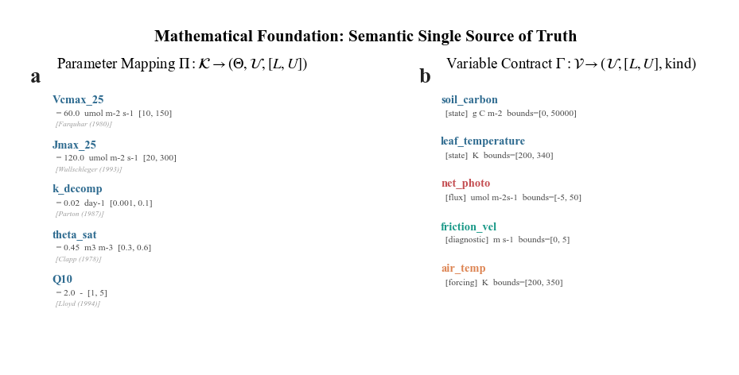
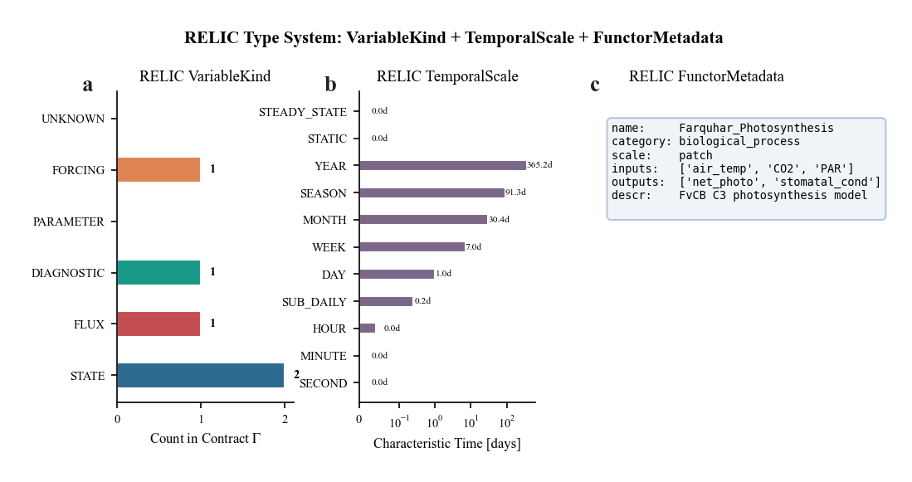

# 教程 04 -- 语义单一真实来源（SSOT）

## 1. 概述

本教程演示了 RELIC 的**语义单一真实来源（SSOT）** 原则：两个形式化映射——参数映射 $\Pi$ 和变量契约 $\Gamma$——提供了权威的语义层，为关联矩阵的结构代数赋予物理意义。没有 SSOT，守恒和预算闭合只能表达为"无量纲线性代数"。

### 为什么它很重要

SSOT 将参数和变量语义交给各自的规范所有者。ParameterManager、变量契约、注册和运行时验证分别检查已声明的范围；枚举标签或构造成功本身不能证明单位、写入授权或物理闭合。错误可能在加载、编译、注册或执行阶段被拒绝。

### 先决条件

- [教程 01](./01_incidence_matrix_conservation.md)：图结构基础
- 物理单位和参数范围的基本理解

---

## 2. 数学基础

### 2.1 参数映射 $\Pi$

**定义（coertheory.md，第 3.2 节）。** 令 $\mathcal{K}$ 为参数键集合。参数映射为：

$$
\Pi: \mathcal{K} \to (\Theta, \mathcal{U}, [L, U], \text{meta}) \tag{1}
$$

其中：

- $\Theta$：参数值空间
- $\mathcal{U}$：单位群（量纲分析）
- $[L, U]$：允许范围
- meta：溯源、参考文献、描述

### 2.2 变量契约 $\Gamma$

**定义（coertheory.md，第 3.2 节）。** 令 $\mathcal{V}$ 为状态变量集合。变量契约为：

$$
\Gamma: \mathcal{V} \to (\mathcal{U}, [L, U], \text{owner/writer}, \text{domain tags}, \text{aliases}) \tag{2}
$$

指定每个变量的单位、范围、写权限、守恒域归属和标准名称别名。

### 2.3 组合坐标系

结构坐标系由 $\sigma(\mathcal{G})$（来自教程 02）给出；语义坐标系由 $(\Pi, \Gamma)$ 给出。两者结合使预算残差、单位一致性和写权限成为**可检验的数学命题**。

---

## 3. 计算细节

### 3.1 合成参数数据库示例（$\Pi$ 映射）

**注意：** 本教程使用一个小型**合成**参数表来可视化映射 $\Pi$。在 RELIC 中，权威的 $\Pi$ 存在于 YAML 参数数据库中，并通过 ParameterManager API（SSOT 策略）访问。

| 键          | 值    | 单位                       | 界限         | 参考文献            |
| ----------- | ----- | -------------------------- | ------------ | ------------------- |
| `Vcmax_25`  | 60.0  | $\mu$mol m$^{-2}$ s$^{-1}$ | [10, 150]    | Farquhar (1980)     |
| `Jmax_25`   | 120.0 | $\mu$mol m$^{-2}$ s$^{-1}$ | [20, 300]    | Wullschleger (1993) |
| `k_decomp`  | 0.02  | day$^{-1}$                 | [0.001, 0.1] | Parton (1987)       |
| `theta_sat` | 0.45  | m$^3$ m$^{-3}$             | [0.3, 0.6]   | Clapp (1978)        |
| `Q10`       | 2.0   | --                         | [1, 5]       | Lloyd (1994)        |

两张表均为脚本内合成字典，不是当前参数库或契约库的导出。真实 ParameterSpec 必须声明 units、dtype、bounds、category；数值 dtype 的 bounds 必须是数值区间，开放端写 -.inf / .inf，非数值 dtype 才能使用 bounds: null。数值 value/default/bounds 不接受文本数值；YAML 1.1 使用 1.0e+7。示例参数及单位不能代替生产模型的物种基准和文献参数化。

### 3.2 变量契约（$\Gamma$ 映射）

| 变量               | 类型       | 单位                       | 界限       |
| ------------------ | ---------- | -------------------------- | ---------- |
| `soil_carbon`      | STATE      | g C m$^{-2}$               | [0, 50000] |
| `leaf_temperature` | STATE      | K                          | [200, 340] |
| `net_photo`        | FLUX       | $\mu$mol m$^{-2}$ s$^{-1}$ | [$-5$, 50] |
| `friction_vel`     | DIAGNOSTIC | m s$^{-1}$                 | [0, 5]     |
| `air_temp`         | FORCING    | K                          | [200, 350] |

### 3.3 RELIC 类型系统展示

本教程演示了所有 RELIC 枚举类型：

- **VariableKind**: STATE, FLUX, DIAGNOSTIC, PARAMETER, FORCING, UNKNOWN
- **ProcessCategory**: PHYSICAL_FIELD, BIOLOGICAL_PROCESS, TRANSPORT_MECHANISM, SCALE_COUPLING
- **SpatialScale**: POINT, PATCH, GRID_CELL, HILLSLOPE, BASIN, LANDSCAPE, GRID_2D, GRID_3D, REGIONAL, GLOBAL, UNKNOWN
- **TemporalScale**: SECOND, MINUTE, HOUR, SUB_DAILY, DAY, WEEK, MONTH, SEASON, YEAR, STATIC, STEADY_STATE, UNKNOWN（每个都带 `to_characteristic_time_days()`）
- **FunctorMetadata**: 组合上述所有信息的完整元数据容器

---

## 4. RELIC 实现映射

| 模块                               | 类                | 用途                                           |
| ---------------------------------- | ----------------- | ---------------------------------------------- |
| `relic.core.functor.functor_types` | `VariableKind`    | 变量分类（STATE/FLUX/DIAGNOSTIC/FORCING）      |
| `relic.core.functor.functor_types` | `ProcessCategory` | 过程分类                                       |
| `relic.core.functor.functor_types` | `SpatialScale`    | 空间分辨率分类                                 |
| `relic.core.functor.functor_types` | `TemporalScale`   | 时间分辨率，含 `to_characteristic_time_days()` |
| `relic.core.functor.functor_types` | `ExecutionPhase`  | 执行生命周期阶段                               |
| `relic.core.functor.functor_types` | `FunctorMetadata` | 组合元数据容器                                 |

---

## 5. 图表与输出

### 5.1 图 1：数学 SSOT 结构 (`04_math_ssot.png`)



**图 (a)：参数映射 $\Pi$**

- 列出 5 个生物地球化学参数及其值、单位、界限和文献参考
- 按参数键着色
- **关键结论**：每个参数有一个带完整元数据的单一权威定义

**图 (b)：变量契约 $\Gamma$**

- 列出 5 个状态变量及其 `VariableKind`、单位和界限
- 按类型着色（蓝色=STATE，橙色=FLUX，绿色=DIAGNOSTIC，紫色=FORCING）
- **关键结论**：写权限和单位契约是形式化的，而非隐式的

### 5.2 图 2：RELIC 类型系统 (`04_relic_ssot.png`)



**图 (a)：VariableKind 分布**

- 条形图统计合成字典中的 VariableKind 标签，不读取契约注册表。
- **关键结论**：VariableKind 分类已声明的角色，不证明预报状态所有权或单位。

**图 (b)：TemporalScale 标签与声明周期**

- 对数水平条形图显示各 TemporalScale 值的特征时间
- 范围从 SECOND（约 0.00 天）到 YEAR（约 365 天）
- **关键结论**：RELIC 的尺度层级跨越 7 个数量级

**图 (c)：FunctorMetadata 示例**

- 以等宽字体显示 Farquhar 光合作用的完整 `FunctorMetadata` 实例
- 显示名称、类别、空间尺度、输入/输出变量和描述
- **关键结论**：所有元数据存储在单一结构化对象中

---

## 6. 数学-RELIC 对比

| 方面       | 理论 ($\Pi$, $\Gamma$)                  | RELIC 实现                           | 匹配 |
| ---------- | --------------------------------------- | ------------------------------------ | ---- |
| 参数界限   | $\Pi(k) \to [L, U]$                     | YAML 数据库含界限                    | PASS |
| 变量单位 | $\Gamma(v) \to \mathcal{U}$ | 受治理变量契约和单位验证；不是 VariableKind 本身 | 范围映射 |
| 写权限 | $\Gamma(v) \to \text{owner}$ | 输出声明加注册与提交授权 | 范围映射 |
| 尺度分类   | 声明的尺度标签                                | `SpatialScale`, `TemporalScale` 枚举 | PASS |
| 元数据组合 | $(n, c, s, \text{in}, \text{out})$ 元组 | `FunctorMetadata` 数据类             | PASS |

---

## 7. 控制台输出解释

以下输出已对照 2026-09-30 新鲜执行日志核验。

```text
=== RELIC Type System (Semantic SSOT) ===

VariableKind:
  STATE        = state
  FLUX         = flux
  DIAGNOSTIC   = diagnostic
  PARAMETER    = parameter
  FORCING      = forcing
  UNKNOWN      = unknown

ProcessCategory:
  PHYSICAL_FIELD         = physical_field
  BIOLOGICAL_PROCESS     = biological_process
  TRANSPORT_MECHANISM    = transport_mechanism
  SCALE_COUPLING         = scale_coupling

SpatialScale:
  POINT      = point
  PATCH      = patch
  GRID_CELL  = grid_cell
  HILLSLOPE  = hillslope
  BASIN      = basin
  LANDSCAPE  = landscape
  GRID_2D    = grid_2d
  GRID_3D    = grid_3d
  REGIONAL   = regional
  GLOBAL     = global
  UNKNOWN    = unknown

TemporalScale:
  SECOND       = second            tau = 0.00 days
  MINUTE       = minute            tau = 0.00 days
  HOUR         = hour              tau = 0.04 days
  SUB_DAILY    = sub_daily         tau = 0.25 days (declared period)
  DAY          = day               tau = 1.00 days
  WEEK         = week              tau = 7.00 days (declared period)
  MONTH        = month             tau = 30.44 days (declared period)
  SEASON       = season            tau = 91.31 days (declared period)
  YEAR         = year              tau = 365.25 days (declared period)
  STATIC       = static            tau = 0.00 days
  STEADY_STATE = steady_state      tau = 0.00 days
  UNKNOWN      = unknown           tau = (undeclared; no characteristic period)

[OK] FunctorMetadata created: Farquhar_Photosynthesis
  Category: biological_process
  Scale:    patch
```

- 枚举列表与元数据构造不验证数学尺度格，也不验证全部 SSOT 契约。

---

## 8. 与其他教程的关联

| 相关教程                                         | 关系                                     |
| ------------------------------------------------ | ---------------------------------------- |
| [教程 05](./05_transactional_state_update.md)    | 使用 SSOT 契约在状态更新期间进行界限检查 |
| [教程 07](./07_multirate_execution.md)           | 使用 `TemporalScale` 进行执行组分配      |
| [教程 19](./19_connection_validator.md)          | 使用 $(\Pi, \Gamma)$ 进行连接验证逻辑    |
| [教程 21](./21_flux_whitelist_output_overlap.md) | 使用 $\Gamma$ 中的写权限进行重叠检测     |

---

## 9. 参考文献

1. coertheory.md，第 3.2 节（语义单一真实来源）
2. architecture_overview.md，参数系统章节
3. Farquhar, G.D., von Caemmerer, S., Berry, J.A. (1980). _Planta_, 149, 78-90.
4. Wullschleger, S.D. (1993). _Journal of Experimental Botany_, 44, 907-920.
5. Parton, W.J. et al. (1987). _SSSA Journal_, 51, 1173-1179.
6. Clapp, R.B. & Hornberger, G.M. (1978). _Water Resources Research_, 14, 601-604.
7. Lloyd, J. & Taylor, J.A. (1994). _Functional Ecology_, 8, 315-323.
