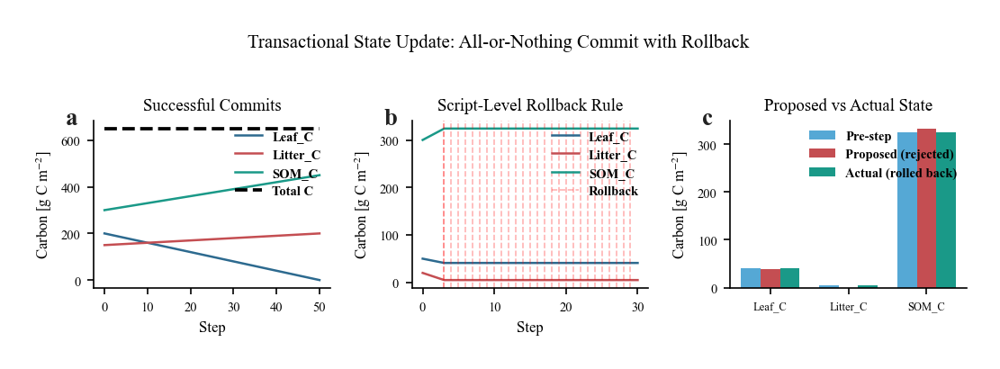

# 教程 05 -- 事务性状态更新与回滚

## 1. 概述

本教程演示 RELIC 对单批更新的**事务型状态更新**算子 $\mathcal{U}_{\Delta t}$：一次 `StateManager.apply_updates` 调用中的增量一起累积、检查并提交，或恢复批快照并报错。模拟器每次执行组调用提交一次，组内后续 Functor 读取临时状态；Strang 子调用和触发的中慢组分别提交。整步保存点在接受前发生已捕获的内部失败时恢复 StateManager、步记账、Functor 状态字典、管理器持有参数绑定、溯源和受支持的随机数状态。边界通过截断并记录 clip loss 实施，不是仅因越界就拒绝整步。

### 为什么它很重要

在地球系统模型中，多个过程（光合作用、呼吸、分解等）在单个时间步内向相同的状态变量贡献增量。没有事务语义，更新周期中途的约束失败可能导致状态处于不一致的、部分更新的状态——导致无法追踪的守恒违反和数值不稳定。在已捕获的内部状态范围内，RELIC 的整步事务可防止失败步留下部分更新的内存状态；其范围仅限于被捕获的对象（StateManager、步记账、含 extra state 的 Functor 状态字典、管理器持有参数绑定、受支持的随机数状态、溯源记录），不撤销外部文件或外部服务，也不恢复 `state_dict`/extra state 和显式 `parameter_bindings` 通道之外的 Functor 属性（coertheory.md，定理 3.6.6）。

### 先决条件

- [教程 04](./04_semantic_ssot.md)：语义 SSOT（界限和变量契约）

---

## 2. 数学基础

### 2.1 带界限投影的累积更新

**定理 3.6.3（coertheory.md）。** 对于在一个时间步内接收 $k$ 个增量 $\Delta x_i$ 的状态变量 $x$：

$$
x^{n+1} = P_{[L,U]}\!\left(x^n + \sum_{i=1}^{k} \Delta x_i\right) \tag{1}
$$

其中 $P_{[L,U]}$ 是分量式截断投影：

$$
P_{[L,U]}(z)_i = \max(L_i, \min(z_i, U_i))
$$

### 2.2 截断损失诊断

截断损失记录投影移除的量：

$$
\Delta x_{\text{clip}} = \left(x^n + \sum_{i=1}^{k} \Delta x_i\right) - x^{n+1} \tag{2}
$$

这作为诊断量被记录，并参与预算审计。

### 2.3 定理 3.6.6：事务语义

**定理 3.6.6（coertheory.md，第 3.6 节）。** 事务性更新算子 $\mathcal{U}_{\Delta t}$ 保证：

- **所有约束通过**：新状态被提交；守恒检查、范围验证和别名一致性均满足。
- **任何约束失败**：该批次不提交；在模拟器中，步事务 savepoint 恢复已捕获的内部状态（StateManager、步记账、Functor state dict、管理器持有参数绑定、provenance、所支持的 RNG），这些状态不残留部分更新。

**证明要点**（在上述覆盖范围内）：快照在任何 group 提交前建立，所有阻断失败都进入唯一恢复路径，且恢复本身成功；捕获范围之外的状态与外部副作用不在保证内。$\square$

---

## 3. 计算细节

### 3.1 脚本使用的 StateManager 调用

本脚本直接调用真实 `StateManager`：保存快照后调用 `apply_updates(updates, dt=1.0, check_conservation=True, rollback_on_failure=False)`，场景 B 的步后规则失败时手动恢复快照。这不是模拟器保存点或持久化检查点。模拟器持久化检查点写入格式 3，每个 Functor 为 `{state_dict, parameter_bindings}`，读取时可升级版本 2。接受后的外部交付失败不会倒退已接受的状态。

| 方法                 | 数学操作      | 描述                                                   |
| -------------------- | ------------- | ------------------------------------------------------ |
| `checkpoint()`       | 保存 $x^n$    | 更新前记录状态                                         |
| `apply_updates(...)` | 应用公式 (1)  | 累积增量、按界限截断（记录截断损失）、检查守恒并提交批次 |
| `restore(snapshot)`  | 恢复 $x^n$    | 场景 B 中由脚本调用以演示回滚                          |

### 3.2 场景 A：成功提交

- **初始状态**：Leaf_C=200, Litter_C=150, SOM_C=300（总计=650）
- **每步增量**：凋落物 ($-4, +4, 0$) + 分解 ($0, -3, +3$)
- **50 步结果**：所有提交成功；总 C 漂移 $\approx 0$（机器精度）

### 3.3 场景 B：约束失败时回滚

- **初始状态**：Leaf_C=50, Litter_C=20, SOM_C=300
- **激进分解**：Litter 耗尽速度快于补充
- **脚本级规则**：`apply_updates` 提交该步后（必要时已按界限截断），脚本在 Litter_C 达到零时恢复快照。RELIC 本身截断到界限并记录截断损失；只有未授权写入、配置为抛出的守恒违反或状态验证失败等错误才会使 `apply_updates` 拒绝批次（恢复其快照并抛出错误）
- **结果**：30 步中 27 步被回滚；从第 3 步起每个提议步都会使 Litter_C 降为 0，因此状态停留在最后接受的值 $(41, 5, 324)$

### 3.4 参数表

| 参数       | 符号                    | 单位                     | 含义                    | 值                             |
| ---------- | ----------------------- | ------------------------ | ----------------------- | ------------------------------ |
| 下限       | $L$                     | g C m$^{-2}$             | 允许的最小储库值        | 0.0                            |
| 上限       | $U$                     | g C m$^{-2}$             | 允许的最大储库值        | 1000.0                         |
| 凋落物增量 | $\Delta x_{\text{lit}}$ | g C m$^{-2}$ step$^{-1}$ | 从叶到凋落物的碳转移    | $(-4, +4, 0)$                  |
| 分解增量   | $\Delta x_{\text{dec}}$ | g C m$^{-2}$ step$^{-1}$ | 从凋落物到 SOM 的碳转移 | $(0, -3, +3)$ 或 $(0, -8, +8)$ |

---

## 4. RELIC 实现映射

本教程直接调用 RELIC `StateManager`（`relic.core.state.manager` 中）；下表中步级各行由模拟器提供，脚本未执行：

| RELIC 概念   | 教程对应                                                                  | 定理       |
| ------------ | ------------------------------------------------------------------------- | ---------- |
| 状态快照     | `sm.checkpoint()`                                                         | 定理 3.6.6 |
| 增量累积     | 传给 `apply_updates` 的 `UpdateItem(..., mode=UpdateMode.ACCUMULATE)`     | 定理 3.6.3 |
| 批次提交     | `sm.apply_updates(...)`（模拟器中每次 group 调用一次）                    | 定理 3.6.6 |
| 界限投影     | `apply_updates` 内部截断（`PhysicalConstraintManager.apply_constraints`） | 定理 3.6.3 |
| 截断损失诊断 | `clip_loss = proposed - clamped`（带符号；正值表示移除储量）              | 公式 (2)   |
| 回滚         | `sm.restore(snapshot)`（场景 B 的脚本级规则）                             | 定理 3.6.6 |
| 整步回滚     | `step_simulation` savepoint（`create_transaction_savepoint` / `restore_transaction_savepoint`），同时捕获 Functor `state_dict()`、`parameter_bindings`、随机数状态和步记账 | 定理 3.6.6 |
| 提交粒度     | 公式 (1) 及 $P_{[L,U]}$ 在每次组提交时执行，多组步因此是多次投影的复合    | 定理 3.6.3 |

---

## 5. 图表与输出

### 5.1 图：事务性状态更新 (`05_transactional_state_update.png`)



**图 (a)：成功提交**

- 3 个储库（Leaf_C, Litter_C, SOM_C）50 步的时间序列
- 黑色虚线：总碳保持在 650 不变
- **关键结论**：在正常条件下，事务性更新精确保持守恒

**图 (b)：脚本级回滚规则**

- 激进分解下的时间序列
- 红色虚线垂直线标记回滚事件
- 一旦每个提议步都会耗尽 Litter_C，状态停留在最后接受的值（脚本规则）
- **关键结论**：脚本级回滚保留最后接受的状态；负值本已由 `apply_updates` 内的界限截断阻止

**图 (c)：提议值 vs 实际值**

- 条形图比较首次回滚步的步前值、提议值（被拒绝）和实际值（回滚后）
- 提议的状态使 Litter_C 降到下限 0（脚本的失败规则）；实际状态等于步前快照
- **关键结论**：恢复快照后受管状态不残留部分更新

---

## 6. 数学-RELIC 对比

| 指标         | 场景 A          | 场景 B                       | 预期                         |
| ------------ | --------------- | ---------------------------- | ---------------------------- |
| 总 C 漂移    | 0.00e+00        | 0（每个批次收支平衡；未打印） | $\le \epsilon_{\text{mach}}$ |
| 保留步数     | 50/50           | 3/30                         | --                           |
| 回滚次数     | 0               | 27                           | 取决于约束                   |
| 回滚后状态   | --              | $(41, 5, 324)$ = 步前快照    | PASS                         |
| 截断损失记录 | $\mathbf{0}$    | $\mathbf{0}$（Litter_C 恰好到达界限，无截断） | PASS          |

---

## 7. 控制台输出解释

```
[OK] Scenario A (valid): total C drift = 0.00e+00
```

- 50 次成功提交中守恒保持到机器精度。

```
[OK] Scenario B (rollback): 27 steps rolled back
  State after rollback = [ 41.   5. 324.]  (unchanged from pre-failure snapshot)
```

- 确认脚本手动调用的 `restore(snapshot)` 恢复了步前状态（第 3-29 步被回滚）。

---

## 8. 与其他教程的关联

| 相关教程                                     | 关系                                          |
| -------------------------------------------- | --------------------------------------------- |
| [教程 04](./04_semantic_ssot.md)             | 先修：提供约束检查使用的界限和契约            |
| [教程 10](./10_bounds_clipping.md)           | 深入讲解 $P_{[L,U]}$ 投影和截断损失诊断       |
| [教程 25](./25_invariant_contracts_i1_i7.md) | I4（可逆性）和 I7（界限截断）直接测试事务语义 |

---

## 9. 参考文献

1. coertheory.md，定理 3.6.3（契约性增量组合）
2. coertheory.md，定理 3.6.6（事务性约束门控）
3. spatiotemporal_scale_topology.md，第 7.3 节，命题 7.1（状态转换形式化）
