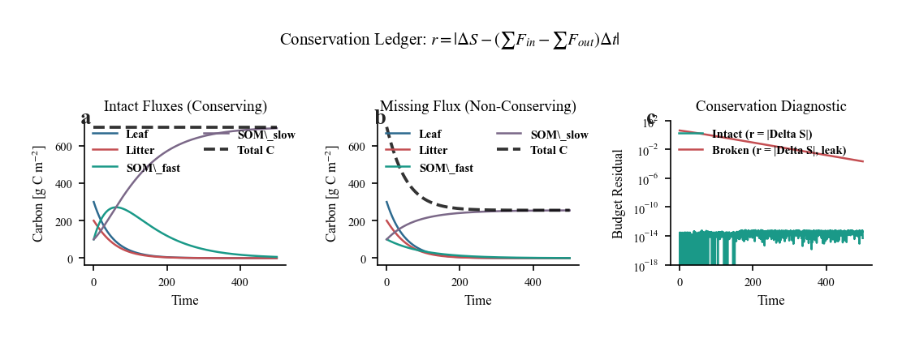

# 教程 06 -- 守恒分类账与预算残差

## 1. 概述

本教程用一个独立的 NumPy 脚本演示 RELIC **守恒分类账**和**预算残差**机制背后的思想。对已声明且启用检查的守恒域，RELIC 在每次组提交时按 `validation\conservation.yaml` 中的容差计算预算残差，将这些域中的守恒违反从静默的长期漂移转变为被标记的、可诊断的事件；未在该域或路由中声明的通量无法由此账本检测。

### 为什么它很重要

在具有数十个互连通量路径的复杂生物地球化学模型中，单个缺失或配置错误的通量可能导致缓慢、隐蔽的质量泄漏，在数千步模拟中毫无察觉。守恒分类账提供逐次提交的诊断，在所配置的容差范围内捕获已声明域中的这类错误（coertheory.md，第 3.3 节）。

### 先决条件

- [教程 01](./01_incidence_matrix_conservation.md)：关联矩阵与守恒定理
- 地球系统科学中预算闭合的基本理解

---

## 2. 数学基础

### 2.1 预算闭合检查

**定义（coertheory.md，第 3.3 节）。** 对于守恒域 $D$，预算闭合方程为：

$$
\Delta S = \left(\sum F_{\text{in}} - \sum F_{\text{out}}\right) \Delta t \tag{1}
$$

预算残差衡量偏离闭合的程度：

$$
r = \left|\Delta S - \left(\sum F_{\text{in}} - \sum F_{\text{out}}\right) \Delta t\right| \tag{2}
$$

在本教程中，完整场景假设**无显式边界通量**（所有通量为内部交换），因此总碳域的 $(\sum F_{\text{in}} - \sum F_{\text{out}})\Delta t = 0$，残差简化为 $r=|\Delta S|$。破损路径场景等价于引入一个**隐式外部汇**而未显式添加环境节点（coertheory.md，推论 2.5.6）。

### 2.2 闭合系统总量守恒

对于物理交换图（储库与通量，`G_phys`）关联矩阵为 $\mathbf{B}$ 的闭合系统（定理 3.1）；用于执行顺序的 Functor 依赖图是另一张图，不能由它推出该恒等式：

$$
\frac{d}{dt}\left(\mathbf{1}^\top u\right) = 0 \implies \sum_i \Delta u_i = 0 \tag{3}
$$

### 2.3 结构漂移诊断

当用户提供守恒系数 $c \in \ker(\mathbf{B}^\top)$ 以及同单位、同支撑的库存坐标变化率向量 $F$ 时，结构漂移为：

$$
\text{drift} = (c^\top F) \Delta t \tag{4}
$$

这里 $F$ 是节点变化率。若 $f$ 表示边通量，应代入 $F=\mathbf{B}f$，得到 $\text{drift}=(c^\top\mathbf{B}f)\Delta t$。这是定向结构审计，不证明未声明的外部交换已闭合。

---

## 3. 计算细节

### 3.1 四储库碳循环

| 储库索引 | 储库名称 | 初始值 [g C m$^{-2}$] |
| -------- | -------- | --------------------- |
| 0        | Leaf     | 300.0                 |
| 1        | Litter   | 200.0                 |
| 2        | SOM_fast | 100.0                 |
| 3        | SOM_slow | 100.0                 |

| 通量  | 源       | 汇       | 速率 $k_j$ [time$^{-1}$] | 过程     |
| ----- | -------- | -------- | ------------------------ | -------- |
| $f_0$ | Leaf     | Litter   | 0.02                     | 凋落物   |
| $f_1$ | Litter   | SOM_fast | 0.04                     | 快速分解 |
| $f_2$ | Litter   | SOM_slow | 0.005                    | 慢速分解 |
| $f_3$ | SOM_fast | SOM_slow | 0.01                     | 腐殖化   |

> **参考文献**：速率常数基于 Parton et al. (1987) CENTURY 模型；Manzoni & Porporato (2009) 分解动力学。

### 3.2 模拟参数

| 参数     | 符号       | 单位 | 值         |
| -------- | ---------- | ---- | ---------- |
| 时间步长 | $\Delta t$ | a.u. | 0.5        |
| 总步数   | $N$        | --   | 1000       |
| 积分方法 | --         | --   | 前向 Euler |

### 3.3 两种场景

**场景 1（完整通量）**：所有 4 个通量都活跃。在精确算术下守恒严格成立：

- 预算残差处于浮点舍入量级（此处最大 $6.39\times 10^{-14}$）
- 总 C：在浮点精度内保持不变

**场景 2（破损路径/泄漏）**：通量 $f_1$ 的大小仍被计算，但其**汇端点在关联矩阵列中缺失**（单侧更新）。具体而言，移除列 $j=1$ 中的 $+1$ 条目，使列和不再为零：

- 可解释的失败模式：碳通过 $f_1$ 离开 Litter，但未计入 SOM_fast（泄漏到隐式外部）
- 结构特征：该列现在有 $-1$ 而无平衡的 $+1$，因此 $\mathbf{B}^\top \mathbf{1}\neq \mathbf{0}$
- 可观测后果：总 C 单调递减；预算残差比完整情况大数个数量级

---

## 4. RELIC 实现映射

本脚本是独立的 NumPy 示例，不调用 RELIC。在 RELIC 中，提交时账本由 `StateManager.apply_updates` 在每次组提交时计算；`generate_conservation_report` 是显式报告 API，`step()` 不自动构建守恒报告；`ConservationGuardian.check_domain()` 是非阻断的域诊断（记录违反并返回结果）。

| RELIC 概念                        | 教程对应                                             | 代码/文档锚点                                                           |
| --------------------------------- | ---------------------------------------------------- | ----------------------------------------------------------------------- |
| 守恒分类账（域成员）              | 储库分组到守恒域 $D$（此处：总 C）                   | `relic\core\state\conservation.py` + 契约/参数；coertheory.md 第 3.3 节 |
| 提交时账本                        | 每次更新后计算残差（此处：每个 Euler 步）            | `StateManager.apply_updates`（每次组提交）与 `generate_conservation_report`（显式请求） |
| 预算残差 $\mathcal{R}_{\Delta t}$ | 公式 (2)；对于闭合内部交换，$r=\lvert\Delta S\rvert$ | `relic\validation\conservation_guardian.py`（非阻断）；coertheory.md 第 3.3 节 |
| 诊断即数据                        | 残差时间序列 + 比较图（图 1c）     | spatiotemporal_scale_topology.md 第 8.1 节；教程图表                    |

---

## 5. 图表与输出

### 5.1 图：守恒分类账 (`06_conservation_ledger.png`)



**图 (a)：完整通量（守恒）**

- 1000 步中 4 个储库和总碳的时间序列
- 各储库重新分配碳；总 C（黑色虚线）保持不变
- **关键结论**：所有通量完整时，闭合系统守恒定理在精确算术下保证零漂移；计算得到的漂移保持在浮点舍入量级（此处约 1e-14）

**图 (b)：缺失通量（非守恒）**

- 相同通量大小，但 $f_1$ 的汇端点在关联矩阵列中缺失（单侧泄漏）
- 总 C 持续向下漂移
- **关键结论**：单个配置错误的路径产生即时的、单调的守恒违反

**图 (c)：守恒诊断**

- 半对数图比较两种场景的残差
- 完整：残差接近浮点舍入（约 $\sim 10^{-14}$）
- 破损：残差大数个数量级（初始最大约 $\sim 4$ g C m$^{-2}$ 每步），随后随泄漏储库耗尽而衰减
- **关键结论**：预算残差是缺失通量路径的灵敏、即时指标

---

## 6. 数学-RELIC 对比

表中数值来自独立脚本，而非 RELIC 运行结果。

| 指标                  | 场景 1（完整）         | 场景 2（破损泄漏）       | 解释                                       |
| --------------------- | ---------------------- | ------------------------ | ------------------------------------------ |
| 最大残差 $r$          | $6.39\times 10^{-14}$  | $4.00\times 10^{0}$      | 完整在舍入附近；破损有 O(1) 的每步泄漏信号 |
| 总 C 范围             | $[700.0000, 700.0000]$ | 单调递减                 | 守恒被违反                                 |
| $t=500$ 时的总 C 漂移 | $\approx 0$            | $-444.42$ g C m$^{-2}$   | 单侧路径导致的质量损失                     |
| 诊断                  | PASS                   | FAIL（$f_1$ 汇端点缺失） | 残差定位了结构配置错误                     |

---

## 7. 控制台输出解释

```
[OK] Scenario 1 (intact): max residual = 6.39e-14
  Total C range: [700.0000, 700.0000]
```

- 残差在浮点舍入尺度，与闭合内部交换系统一致。

```
[OK] Scenario 2 (broken): max residual = 4.00e+00
  Total C drift: -444.42 g C m^-2
```

- 非零残差和负漂移立即标记了缺失的汇端点（单侧泄漏）。

```
[OK] Tutorial 06 completed successfully.
  Demonstrated: budget residual detects missing flux pathways
```

---

## 8. 与其他教程的关联

| 相关教程                                         | 关系                         |
| ------------------------------------------------ | ---------------------------- |
| [教程 01](./01_incidence_matrix_conservation.md) | 先修：分类账的基础守恒定理   |
| [教程 05](./05_transactional_state_update.md)    | 事务性提交使用类似的预算检查 |
| [教程 11](./11_variable_provenance.md)           | 溯源追踪将残差归因到具体过程 |
| [教程 23](./23_five_sphere_energy_isotope.md)    | 将预算闭合应用于五圈间交换   |

---

## 9. 参考文献

1. coertheory.md，第 3.3 节（守恒分类账和域预算残差）
2. Manzoni, S. & Porporato, A. (2009). Soil carbon and nitrogen mineralization: Theory and models across scales. _Soil Biology and Biochemistry_, 41, 1355-1379.
3. Parton, W.J. et al. (1987). Analysis of factors controlling soil organic matter levels in Great Plains grasslands. _SSSA Journal_, 51, 1173-1179.
