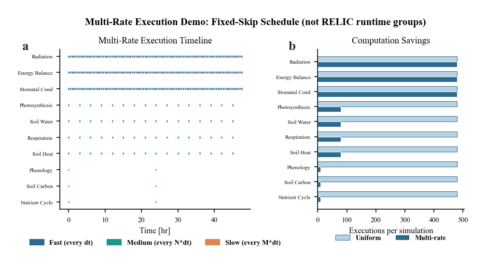
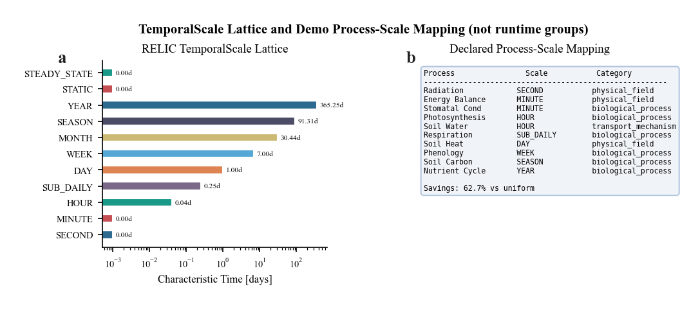

# 教程 07 -- 多速率执行

## 1. 概述

本教程演示 RELIC 的**多速率执行**策略，过程被划分为快速、中等、缓慢三个时间组。分组依次采用：注册时显式传入的 `execution_group`、Functor 的 `execution_group` 属性、`characteristic_time_days` 与 YAML 阈值比较、`temporal_scale` 元数据映射、`process_groups` 配置，最后默认 fast。这避免了将缓慢的生物地球化学过程锁定在快速大气过程所要求的时间分辨率上，从而产生显著的计算节省。

### 为什么它很重要

地球系统过程跨越多种时间尺度。多速率执行是减少慢过程重复计算的一种方法，属于建模和数值选择，并非数学上唯一必要方案。所选执行节奏的耦合滞后、守恒和精度仍需验证。

### 先决条件

- [教程 03](./03_dag_topological_sort.md)：DAG 编译
- [教程 04](./04_semantic_ssot.md)：`TemporalScale` 枚举

---

## 2. 数学基础

### 2.1 推论 3.5.2：多速率必要性

**推论 3.5.2（coertheory.md）。** 令过程算子集合被划分为三组 $\mathcal{F}_F, \mathcal{F}_M, \mathcal{F}_S$，具有名义触发间隔 $\tau_F = \Delta t, \tau_M, \tau_S$。每次执行的 group 调用经 `StateManager.apply_updates` 提交一次；medium 与 slow 组收到累计间隔 $h_g = t_{\text{future}} - t_{\text{last}}$（而非 $\Delta t$）。每次 group 调用以 `(time, dt) = (起点, 长度)` 收到它所覆盖的区间：fast 组起点为 $t_{\text{current}}$、长度为 $\Delta t$（Strang 模式下后半步起点为 $t_{\text{current}} + \Delta t/2$）；medium 或 slow 调用起点为该组的 $t_{\text{last}}$、长度为 $h_g$（例：$t_{\text{last}} = 0$、$t_{\text{current}} = 1$、$t_{\text{future}} = 2$ 时为 `time=0, dt=2`）。$m$ 个子步中的第 $k$ 个（从 0 计）收到 起点 $+\,k\,\text{dt}/m$。同一步的所有 group 调用处于同一步事务内。

### 2.2 计算节省

若 $N$ 个过程以最快速率执行 $T_{\text{total}} / \Delta t$ 步，则：

- **均匀**：所有 $N$ 个过程每步执行 $\Rightarrow$ 成本 $= N \times T_{\text{total}} / \Delta t$
- **多速率**：快速过程每步执行；中等过程在区间索引 $\lfloor t/\tau_M \rfloor$ 增加时执行（仅当 $\tau_M$ 是固定 $\Delta t$ 的整数倍且无事件或 bootstrap 触发时才恰为每 $\tau_M/\Delta t$ 步）；缓慢过程按 `slow_interval_seconds` 同一规则执行，未设置时按日历月边界执行。一步跨越多个边界时该组只执行一次，覆盖整段累计时长 $\Rightarrow$ 显著降低

---

## 3. 计算细节

本教程定义了**10 个过程**，并放入人工选定的演示调度（下表“组”列不是 RELIC 运行时分组）：

- 基础时间步：$\Delta t_{\text{base}} = 0.5$ hr
- 总步数：$N = 480$（10 天）
- 组触发跳步（演示调度）：快速 = 1，中等 = 6，缓慢 = 48

**注（符号+实现对齐）：** 本教程使用显式演示调度（固定跳步）来可视化多速率节省。在 RELIC 运行时，`temporal_scale` 映射只是分组链的第 4 级（显式 `execution_group`、Functor 属性、`characteristic_time_days`、`temporal_scale`、`process_groups`、默认 fast）。SECOND/MINUTE/HOUR/DAY 以 `TemporalScale.to_characteristic_time_days()` 与 `computation.scheduling.fast_group_max_characteristic_days`（1 天）、`computation.scheduling.medium_group_max_characteristic_days`（10 天）比较，阈值由 `relic\core\simulator\dependency_ops.py` 中的 `resolve_scheduling_thresholds()` 读取；SUB_DAILY 为 fast，WEEK 为 medium，MONTH/SEASON/YEAR 为 slow。阈值只用于分类，不是执行间隔（medium 用 `medium_interval_seconds`，slow 用 `slow_interval_seconds` 或日历月；spatiotemporal_scale_topology.md 第 5 节）。“运行时组”列由脚本调用 `dependency_ops._resolve_temporal_scale_group` 打印得到。

| 过程           | TemporalScale | 组（演示） | 触发频率          | 10 天内调用次数 | 运行时组（temporal_scale 映射） |
| -------------- | ------------- | ---------- | ----------------- | --------------- | ------------------------------- |
| Radiation      | SECOND        | 快速       | 每步              | 480             | 快速                            |
| Energy Balance | MINUTE        | 快速       | 每步              | 480             | 快速                            |
| Stomatal Cond  | MINUTE        | 快速       | 每步              | 480             | 快速                            |
| Photosynthesis | HOUR          | 中等       | 每 6 步（3 hr）   | 80              | 快速                            |
| Soil Water     | HOUR          | 中等       | 每 6 步（3 hr）   | 80              | 快速                            |
| Respiration    | SUB_DAILY     | 中等       | 每 6 步（3 hr）   | 80              | 快速                            |
| Soil Heat      | DAY           | 中等       | 每 6 步（3 hr）   | 80              | 快速                            |
| Phenology      | WEEK          | 缓慢       | 每 48 步（24 hr） | 10              | 中等                            |
| Soil Carbon    | SEASON        | 缓慢       | 每 48 步（24 hr） | 10              | 缓慢                            |
| Nutrient Cycle | YEAR          | 缓慢       | 每 48 步（24 hr） | 10              | 缓慢                            |

---

## 4. RELIC 实现映射

| 模块                               | 类/枚举                                       | 用途                          |
| ---------------------------------- | --------------------------------------------- | ----------------------------- |
| `relic.core.functor.functor_types` | `TemporalScale`                               | SECOND/MINUTE/HOUR/DAY/SEASON |
| `relic.core.functor.functor_types` | `TemporalScale.to_characteristic_time_days()` | 计算 $\tau$（天）             |
| `relic.core.simulator.dependency_ops` | `_resolve_temporal_scale_group()`、`resolve_scheduling_thresholds()` | 运行时 `temporal_scale` 分组映射（输出为 `runtime=`） |

---

## 5. 图表与输出

### 5.1 图 1：多速率调度 (`07_math_multirate.png`；固定跳步的演示调度，不是 RELIC 运行时分组)



**图 (a)：甘特图式执行时间线**

- 水平条显示每个过程在模拟期间执行的时间
- 快速过程（蓝色）连续执行；中等（绿色）周期性执行；缓慢（橙色）很少执行
- **关键结论**：直观确认调用频率的巨大差异

**图 (b)：计算节省**

- 条形图比较均匀 vs 多速率调度的总过程调用
- 显示节省百分比（缓慢过程通常 >90%）
- **关键结论**：多速率执行大幅减少浪费的计算（调用次数按演示调度计算，不是运行时分组）

### 5.2 图 2：TemporalScale 标签与演示映射 (`07_relic_multirate.png`)



**图 (a)：TemporalScale 标签**

- 所有 `TemporalScale` 枚举值及特征时间的对数刻度条形图
- 从 SECOND（约 1.2e-5 天，按 0.001 天绘图下限显示）到 YEAR（声明周期 365.25 天）；SUB_DAILY、WEEK、MONTH、SEASON、YEAR 使用脚本声明的示例周期（RELIC 中 MONTH 没有固定长度）
- **关键结论**：当日历或调度决定时长时，TemporalScale 标签需要显式声明周期。

**图 (b)：过程-尺度分类**

- 等宽字体汇总表，将 10 个过程映射到其声明的 `TemporalScale` 和 `ProcessCategory`（演示分组；运行时分组遵循 `dependency_ops`，见控制台输出的 `runtime=` 列）
- 同时打印相对于均匀步进的计算节省（使用与图 1b 相同的执行计数模型）

---

## 6. 数学-RELIC 对比

| 指标                   | 调度预测                                                              | 脚本输出 | 匹配 |
| ---------------------- | --------------------------------------------------------------------- | -------- | ---- |
| 每个快速过程的调用次数 | $N/1 = 480$                                                           | 480      | PASS |
| 每个中等过程的调用次数 | $N/6 = 80$                                                            | 80       | PASS |
| 每个缓慢过程的调用次数 | $N/48 = 10$                                                           | 10       | PASS |
| 相对均匀的节省         | $1 - \frac{3\cdot 480 + 4\cdot 80 + 3\cdot 10}{10\cdot 480} = 62.7\%$ | 62.7%    | PASS |

---

## 7. 控制台输出解释

```
=== RELIC TemporalScale Classification ===
  Radiation           SECOND            tau=0.00 days  [physical_field]  runtime=fast
  Energy Balance      MINUTE            tau=0.00 days  [physical_field]  runtime=fast
  Stomatal Cond       MINUTE            tau=0.00 days  [biological_process]  runtime=fast
  Photosynthesis      HOUR              tau=0.04 days  [biological_process]  runtime=fast
  Soil Water          HOUR              tau=0.04 days  [transport_mechanism]  runtime=fast
  Respiration         SUB_DAILY         tau=0.25 days  [biological_process]  runtime=fast
  Soil Heat           DAY               tau=1.00 days  [physical_field]  runtime=fast
  Phenology           WEEK              tau=7.00 days  [biological_process]  runtime=medium
  Soil Carbon         SEASON            tau=91.31 days  [biological_process]  runtime=slow
  Nutrient Cycle      YEAR              tau=365.25 days  [biological_process]  runtime=slow
  (runtime = RELIC temporal_scale mapping; the demo schedule uses fixed skips)

[OK] Multi-rate saves 62.7% of computation vs uniform stepping
```

---

## 8. 与其他教程的关联

| 教程                                       | 关系                         |
| ------------------------------------------ | ---------------------------- |
| [教程 08](./08_operator_splitting.md)      | 扩展了 fast 组内的 Lie/Strang 分裂 |
| [教程 20](./20_cross_rate_lag_transfer.md) | 分析时间组间的信息滞后       |

---

## 9. 参考文献

1. coertheory.md，推论 3.5.2（多速率执行）
2. spatiotemporal_scale_topology.md，第 5 节（时间分组）
3. Hundsdorfer, W. & Verwer, J.G. (2003). _Numerical Solution of Time-Dependent Advection-Diffusion-Reaction Equations_. Springer.
