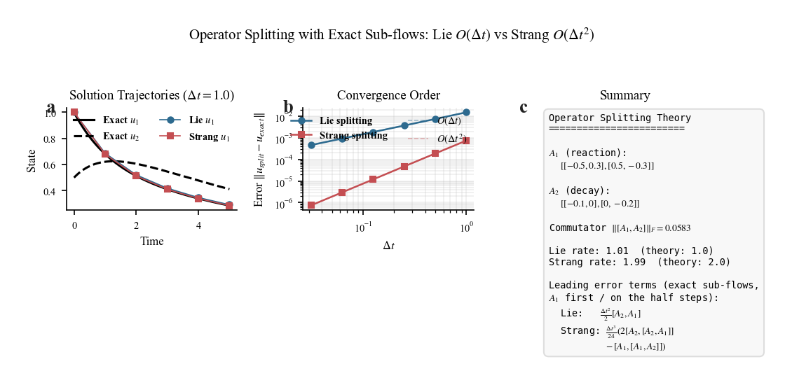

# 教程 08 -- 算子分裂：Lie 分裂与 Strang 分裂

## 1. 概述

本教程针对子流可精确求解（矩阵指数）的线性 ODE 比较 **Lie 分裂**与 **Strang 分裂**；在此条件下 Lie 为一阶（$O(\Delta t)$），Strang 为二阶（$O(\Delta t^2)$）。通过 log-log 误差-$\Delta t$ 图实证验证了收敛阶，并计算了交换子 $[A_1, A_2]$ 来解释分裂误差存在的原因。

### 为什么它很重要

在 RELIC 中，过程算子在每个时间组内按顺序应用。分裂误差取决于算子的非交换性。理解 Lie 与 Strang 的收敛性有助于建模者选择适当的分裂策略和时间步长（spatiotemporal_scale_topology.md，第 6 节）。

### 先决条件

- [教程 07](./07_multirate_execution.md)：多速率执行组

---

## 2. 数学基础

### 2.1 Lie 分裂（定义 6.1）

$$
\Phi_{\text{Lie}}^{\Delta t} = \Phi_{A_2}^{\Delta t} \circ \Phi_{A_1}^{\Delta t} \tag{1}
$$

**误差**：每步 $O(\Delta t^2)$ $\Rightarrow$ 全局 $O(\Delta t)$（针对光滑向量场的精确子流；若子积分器为近似方法，组合阶受子积分器阶数限制）。对子流为 $e^{\Delta t A_k}$、$A_1$ 先作用的线性算子，$\log \Phi_{\text{Lie}}^{\Delta t} - \Delta t(A_1 + A_2)$ 的首项为 $\frac{\Delta t^2}{2}[A_2, A_1]$。

### 2.2 Strang 分裂（定义 6.2）

$$
\Phi_{\text{Strang}}^{\Delta t} = \Phi_{A_1}^{\Delta t/2} \circ \Phi_{A_2}^{\Delta t} \circ \Phi_{A_1}^{\Delta t/2} \tag{2}
$$

**误差**：每步 $O(\Delta t^3)$ $\Rightarrow$ 全局 $O(\Delta t^2)$（针对光滑向量场的精确子流；若子积分器为近似方法，组合阶受子积分器阶数限制）。对子流为 $e^{\Delta t A_k}$、$A_1$ 位于半步的线性算子，

$$
\log \Phi_{\text{Strang}}^{\Delta t} = \Delta t(A_1 + A_2) + \frac{\Delta t^3}{24}\left(2[A_2,[A_2,A_1]] - [A_1,[A_1,A_2]]\right) + O(\Delta t^5)
$$

（非线性流在向量场约定下符号相反）。

对 fast 组的计划顺序 $F_1, \ldots, F_n$，RELIC 的 `splitting_mode = "strang"` 使用回文组合
$\Phi_{F_1}^{\Delta t/2} \circ \cdots \circ \Phi_{F_{n-1}}^{\Delta t/2} \circ \Phi_{F_n}^{\Delta t} \circ \Phi_{F_{n-1}}^{\Delta t/2} \circ \cdots \circ \Phi_{F_1}^{\Delta t/2}$
（$2n - 1$ 次子调用，各自单独提交）。当每个子调用都是光滑子向量场的精确子流时，该组合对称，对任意 $n$ 为二阶。每个子调用收到它所覆盖的区间：前半步与中间整步起点为 $t$，后半步起点为 $t + \Delta t/2$，因此非自治子流得到正确的阶段时间（若后半步从 $t$ 开始，会留下 $O(\Delta t^2)$ 的局部误差）。调用顺序本身不使数值子积分器对称。一步的有效阶为 $q = \min(s, \min_i p_i)$，其中 Lie 取 $s = 1$、Strang 取 $s = 2$，$p_i$ 由 `FunctorMetadata.sub_flow_accuracy` 声明（`EXACT` 视为无穷阶，`ORDER_2`、`ORDER_1`；只要有一个 Functor 为 `UNDECLARED`，$q$ 即为 "unverified"）；`RELICSimulator.get_splitting_order_report()` 返回 $q$。因此显式 Euler 子步组合仍为一阶。一个回归测试在含时变速率的旋转问题上测得步长减半的误差比约为 4.00（Strang，精确子流）、1.99（Lie）与 2.01（Strang，显式 Euler）。
若计划只有一个 fast Functor，则不进行分裂，有效阶等于该 Functor 声明的阶数。medium 与 slow 组不在这个组合之内，它们按各自的节奏顺序执行。

### 2.3 Lie 括号（交换子）

$$
[A_1, A_2] = A_1 A_2 - A_2 A_1 \tag{3}
$$

在精确子流下，$[A_1, A_2] = 0$ 使两种分裂都精确。$\|[A_1, A_2]\|_F$ 刻画 Lie 分裂的首项误差；Strang 的首项误差由嵌套交换子 $[A_2,[A_2,A_1]]$ 与 $[A_1,[A_1,A_2]]$ 决定。

> **参考文献**：Sportisse (2000)；Strang (1968)；spatiotemporal_scale_topology.md，第 6.1-6.2 节

---

## 3. 计算细节

### 3.1 测试系统

一个 2 分量耦合线性 ODE $du/dt = (A_1 + A_2)u$：

$$
A_1 = \begin{pmatrix} -0.5 & 0.3 \\ 0.5 & -0.3 \end{pmatrix} \quad (\text{反应}), \quad
A_2 = \begin{pmatrix} -0.1 & 0 \\ 0 & -0.2 \end{pmatrix} \quad (\text{衰减})
$$

- **精确解**：$u(t) = e^{(A_1 + A_2)t} u_0$，通过 `scipy.linalg.expm`
- **初始条件**：$u_0 = [1.0, 0.5]^\top$
- **终了时间**：$T = 5.0$

### 3.2 收敛研究

$\Delta t$ 取值：$\{1.0, 0.5, 0.25, 0.125, 0.0625, 0.03125\}$

| $\Delta t$ | Lie 误差                 | Strang 误差              |
| ---------- | ------------------------ | ------------------------ |
| 1.0        | $1.5 \times 10^{-2}$     | $7.5 \times 10^{-4}$     |
| 0.03125    | $4.6 \times 10^{-4}$     | $7.4 \times 10^{-7}$     |

（终了时刻误差取自脚本的误差数组，即图 (b) 中的数据；脚本不打印这些数值。）

实测收敛率：Lie $\approx 1.0$，Strang $\approx 2.0$（来自 log-log 回归）。

---

## 4. RELIC 实现映射

在每次 group 调用内，RELIC 按 plan order 依次执行 Functor（即 Lie 组合）。`splitting_mode`（`lie` 或 `strang`，见 `relic.core.simulator.execution_loop._execute_fast_group`）只改变 fast 组；medium 与 slow 组总是在 fast 组之后作为一次顺序调用执行。每次调用形如 `_execute_group(order, dt, start_time=...)`（`start_time` 没有默认值）；Strang 子调用共享一个 `GroupComposition`；`merge_sequential_updates` 保留最后一个普通诊断或 REPLACE 观测，对 ACCUMULATE 量和普通状态增量求和，并按 `h / H` 加权每秒速率（子步间为时间加权均值，同次组调用的 Functor 间求和）。执行中的边界速率阶段视图汇总本次组合各写者的最近贡献，不叠加上一步均率。提供方子步内可见最近一次归约后的速率，调用完成后可见该阶段均率。完整加权均率只在组合完成后发布，不产生第二次边界转移。保存的诊断使用同一规则；被拒绝的自适应尝试不留下诊断结果。本脚本是使用精确子流的独立 NumPy/SciPy 演示，不调用 RELIC 模拟器。

---

## 5. 图表与输出

### 5.1 图：算子分裂 (`08_operator_splitting.png`)



**图 (a)：解轨迹（$\Delta t = 1.0$）**

- 黑色曲线：$u_1$（实线）和 $u_2$（虚线）的精确解
- 蓝色圆圈：Lie 分裂结果（显示 $u_1$）；红色方块：Strang 分裂结果（显示 $u_1$）
- **关键结论**：在相同 $\Delta t$ 下，Strang 比 Lie 更紧密地跟踪精确解

**图 (b)：收敛阶（Log-Log）**

- Lie 误差（蓝色圆圈）遵循 $O(\Delta t)$ 参考斜率
- Strang 误差（红色方块）遵循 $O(\Delta t^2)$ 参考斜率
- **关键结论**：实证收敛率与理论预测匹配

**图 (c)：摘要框**

- 显示矩阵 $A_1$、$A_2$、交换子范数、实测收敛率和首项误差（精确子流；Lie 为 $\frac{\Delta t^2}{2}[A_2,A_1]$，Strang 为 $\frac{\Delta t^3}{24}(2[A_2,[A_2,A_1]] - [A_1,[A_1,A_2]])$）
- $\|[A_1, A_2]\|_F = 0.0583$ -- 非零确认算子不可交换
- **关键结论**：交换子大小驱动 Lie 分裂误差；嵌套交换子驱动 Strang 误差

---

## 6. 数学-RELIC 对比

| 指标                             | 理论 | 实测          | 匹配 |
| -------------------------------- | ---- | ------------- | ---- |
| Lie 收敛率                       | 1.0  | $\approx 1.0$ | PASS |
| Strang 收敛率                    | 2.0  | $\approx 2.0$ | PASS |
| $[A_1,A_2] = 0 \Rightarrow$ 精确 | 非零 | 误差存在      | PASS |

---

## 7. 控制台输出解释

```
[OK] Lie splitting convergence rate: 1.01 (expected ~1.0)
[OK] Strang splitting convergence rate: 1.99 (expected ~2.0)
  Commutator ||[A1,A2]||_F = 0.0583
```

---

## 8. 与其他教程的关联

| 教程                                     | 关系                                         |
| ---------------------------------------- | -------------------------------------------- |
| [教程 09](./09_adaptive_timestep.md)     | 在分裂内使用自适应 $\Delta t$                |
| [教程 12](./12_splitting_sensitivity.md) | 测量顺序相关的敏感性（$\chi_{\text{comm}}$） |

---

## 9. 参考文献

1. spatiotemporal_scale_topology.md，第 6.1-6.2 节（Lie 和 Strang 定义）
2. Strang, G. (1968). On the construction and comparison of difference schemes. _SIAM J. Numer. Anal._, 5(3), 506-517.
3. Sportisse, B. (2000). An analysis of operator splitting techniques. _J. Comp. Phys._, 161(1), 140-168.
4. Hundsdorfer, W. & Verwer, J.G. (2003). _Numerical Solution of Time-Dependent Advection-Diffusion-Reaction Equations_. Springer.
