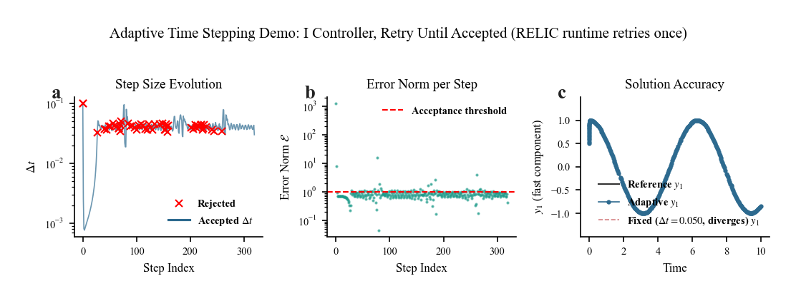

# 教程 09 -- 带误差控制的自适应时间步进

## 1. 概述

本教程演示使用安全因子（I-控制器）规则的**自适应时间步进**，通过步长加倍估计误差，反复重试被拒绝步直到接受。RELIC 度量 StateManager 在 fast 组实际提交的状态变化 $u_k=x'_k-x_k$：已积分量、按实际区间只积分一次的每秒速率或 FLUX、裁剪和分布式归约均计入。边界速率聚合量存储为速率，因此恒定速率贡献零状态变化。RELIC 对被拒绝步最多重试一次，重试结果不再二次检查。

### 为什么它很重要

固定时间步进要么浪费计算（过小），要么冒不稳定的风险（过大）。自适应步进自动解析刚性的快速动力学（$\lambda \approx -100$），同时对平滑的慢速动力学采取大步长。在 RELIC 中这是步长启发式，不是稳定性或 CFL 保证（coertheory.md，定理 3.6.8）。

### 先决条件

- [教程 08](./08_operator_splitting.md)：算子分裂概念

---

## 2. 数学基础

### 2.1 误差范数（定理 3.6.8）

$$
\mathcal{E} = \sqrt{\frac{1}{M} \sum_{k=1}^{M} \left(\frac{\Delta y_k}{\varepsilon_{\text{abs}} + \varepsilon_{\text{rel}} |y_k|}\right)^2} \tag{1}
$$

其中 $\Delta y_k$ 是本独立演示的步长加倍估计。RELIC 使用实际提交的变化 $u_k=x'_k-x_k$，而非返回的更新提案；$x_k$ 是 fast 组执行前的状态。归一化比值的平方先按每个变量的张量元素平均，再对受监测变量等权平均后开方。当 $x_k=300$ kg m$^{-2}$、$q=0.006$ kg m$^{-2}$ s$^{-1}$、$h=60$ s 时，提交变化为 0.36 kg m$^{-2}$，$\mathcal E\approx1.2$，触发一次约 49.3 s 的重试。2026-09-26 前直接使用速率会得到 $\mathcal E\approx0.02$；2026-09-23 前的 REPLACE 提案没有减去步前状态。运行时度量是控制启发式，不是截断误差估计。

### 2.2 步长控制

$$
\Delta t_{\text{new}} = \Delta t \cdot \min\!\left(f_{\max},\, \max\!\left(f_{\min},\, \frac{f_s}{\mathcal{E}^{1/(p+1)}}\right)\right) \tag{2}
$$

| 参数     | 符号       | 值  | 含义             |
| -------- | ---------- | --- | ---------------- |
| 安全因子 | $f_s$      | 0.9 | 保守乘子         |
| 最小因子 | $f_{\min}$ | 0.1 | 防止灾难性缩小   |
| 最大因子 | $f_{\max}$ | 5.0 | 防止过度激进增长 |
| 阶数     | $p$        | 1   | Euler 方法阶数   |

以上为演示取值（演示在 $\mathcal{E} = 0$ 时乘以 $f_{\max}$）。RELIC 运行时：指数固定为 $1/2$；接受时 $\Delta t_{\text{new}}=\Delta t\min(5,\max(0.1,0.9/\sqrt{\mathcal E}))$，$\mathcal E=0$ 时为 $2\Delta t$，再截断到 [`adaptive_dt_min`, `adaptive_dt_max`]。

### 2.3 拒绝-回滚-重试

演示：若 $\mathcal{E} > 1$，状态回滚，以 $\max(\Delta t_{\min}, 0.9\Delta t/\sqrt{\mathcal E})$ 反复重试直至接受。RELIC 运行时：若被拒绝的尝试长于 $\Delta t_{\min}$，fast 组回滚一次，以 $\max(\Delta t\max(0.1, 0.9/\sqrt{\mathcal E}), \Delta t_{\min})$ 重跑，该步长总是短于原尝试；该重试不再做误差检查而直接接受。尝试步长不大于 $\Delta t_{\min}$ 时不存在更短的重试：该尝试不回滚直接接受，记录一条写明 $\mathcal E$ 与 $\Delta t_{\min}$ 的 WARNING，下一步长按接受步规则给出。因此运行时接受步可能 $\mathcal E>1$，而 `run()` 不会越过结束时间。

> **参考文献**：coertheory.md，定理 3.6.8；Hairer & Wanner (1996)

---

## 3. 计算细节

### 3.1 刚性 ODE 系统

$$
\frac{dy_1}{dt} = -100(y_1 - \cos t), \quad \frac{dy_2}{dt} = -0.5 y_2 + \sin t
$$

- $y_1$：快速分量（刚性比 $\sim$200）
- $y_2$：慢速分量
- $y_0 = [0.5, 1.0]^\top$，$T = 10.0$

### 3.2 结果

- 自适应：269 个接受步与 51 次被拒绝的尝试（共 320 次尝试，每次含一个整步和两个半步 Euler 以估计误差）
- 固定（$\Delta t = 0.05$）：200 个前向 Euler 步；$|1 - 100\,\Delta t| = 4 > 1$，因此快速分量 $y_1$ 发散（$t = 10$ 时量级约 $10^{120}$）

---

## 4. RELIC 实现映射

本脚本是独立 NumPy 演示，不调用 RELIC 控制器。运行时仅在 `adaptive_dt_enabled` 为真时读取 `computation.scheduling.adaptive.atol`、`.rtol`、`.dt_min_seconds` 和 `.dt_max_factor`；显式 `adaptive_*` 设置覆盖这些值。0.9、0.1、5 和 2 仍是固定代码控制因子。度量采用 StateManager 实际提交的变化，包含速率积分、裁剪和归约。 更新名称先映射到实际 StateManager 目标（`delta_x` 到 `x`），按目标去重后才筛选监测变量并读取步前、步后状态；只读别名仍不可写。边界速率在组合发布完整均率后才进入度量，不采用部分均率。Strang 子调用使用 `GroupComposition` 和唯一的 `merge_sequential_updates` 规则：ACCUMULATE 量求和，每秒速率按 `h / H` 加权，诊断遵循其声明的观测或累积语义。长于 `adaptive_dt_min` 的拒绝尝试只在更短区间重试一次，不再检查便接受；不大于最小步长的尝试带警告接受。这是唯一运行时步长控制器。求解器 `forward(..., adaptive=True)` 已删除，传入 `adaptive` 抛出 `TypeError`。

---

## 5. 图表与输出

### 5.1 图：自适应时间步进 (`09_adaptive_timestep.png`)



图中为演示控制器（步长加倍、反复重试直至接受）。RELIC 运行时最多重试一次（尝试不大于 `adaptive_dt_min` 时不重试），重试结果不再检查即接受。

**图 (a)：步长演化**

- $\Delta t$ 对步索引的半对数图
- 红色叉号标记被拒绝的步（$\mathcal{E} > 1$）
- $\Delta t$ 在刚性瞬态期间缩小，在平滑阶段增大
- **关键结论**：控制器自动适应局部动力学

**图 (b)：每步误差范数**

- 每次尝试步的 $\mathcal{E}$ 散点图
- 红色虚线在 $\mathcal{E} = 1$ 处标记接受阈值
- 阈值以上的点对应被拒绝的步
- **关键结论**：本演示反复重试直至接受，因此每个接受步 $\mathcal E\le 1$；RELIC 运行时最多重试一次且不再检查即接受，不提供此保证

**图 (c)：解精度**

- 黑色：高分辨率参考解
- 蓝色圆圈：自适应步进结果
- 橙色虚线：固定步结果，仅在其位于坐标范围内时绘出（它在最初几步内即发散）
- **关键结论**：自适应步进跟随参考解，而 0.05 的固定步长对快速分量不稳定；自适应运行需要 320 次尝试，因此这里的优势在于稳定性与精度，而不是更少的步数

---

## 6. 演示结果（脚本未调用 RELIC 控制器）

| 指标                          | 理论              | 观测     | 匹配 |
| ----------------------------- | ----------------- | -------- | ---- |
| 拒绝准则                      | $\mathcal{E} > 1$ | 正确触发 | PASS |
| 拒绝时回滚                    | 状态 = 步前快照   | 已确认   | PASS |
| $\Delta t$ 在刚性区域附近缩小 | 预期              | 已观测   | PASS |
| $\Delta t$ 在平滑区域增大     | 预期              | 已观测   | PASS |
| RELIC 重试接受                | 最多重试一次（不大于 `adaptive_dt_min` 时不重试）、不再二次检查即接受 | 本脚本未执行 | -- |

---

## 7. 控制台输出解释

```
[OK] Adaptive stepping: 269 accepted steps, 51 rejected
  dt range: [0.000766, 0.1000]
```

---

## 8. 与其他教程的关联

| 教程                                          | 关系                         |
| --------------------------------------------- | ---------------------------- |
| [教程 05](./05_transactional_state_update.md) | 拒绝中使用的回滚机制         |
| [教程 24](./24_decidability_numerics_cfl.md)  | CFL 与扩散数诊断（与自适应控制器分开） |

---

## 9. 参考文献

1. coertheory.md，定理 3.6.8（带回滚的自适应步进）
2. spatiotemporal_scale_topology.md，第 7.1-7.3 节
3. Hairer, E. & Wanner, G. (1996). _Solving Ordinary Differential Equations II: Stiff and Differential-Algebraic Problems_. Springer.
