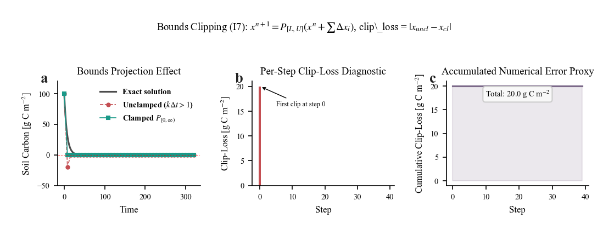

# 教程 10 -- 边界截断与截断损失诊断（I7）

## 1. 概述

本教程演示了 RELIC 的**边界投影** $P_{[L,U]}$ 及其关联的**截断损失诊断**（不变量 I7）。当采用激进 $\Delta t$ 的前向 Euler 将储库驱动为负值时，投影算子将值截断到物理界限，并精确记录截断了多少。

### 先决条件

- [教程 05](./05_transactional_state_update.md)：事务性状态更新

---

## 2. 数学基础

### 2.1 边界投影（定理 3.6.3）

$$
x^{n+1} = P_{[L,U]}\!\left(x^n + \sum_{i=1}^{k} \Delta x_i\right), \quad P_{[L,U]}(z) = \max(L, \min(z, U)) \tag{1}
$$

### 2.2 截断损失诊断

$$
x_{\text{unclamped}} := x^n + \sum_{i=1}^{k} \Delta x_i, \quad
\Delta x_{\text{clip}} := x_{\text{unclamped}} - x^{n+1} \tag{2}
$$

非负截断损失的幅度为：

$$
\text{clip\_magnitude} := \left|\Delta x_{\text{clip}}\right|. \tag{3}
$$

累积截断损失作为投影修正幅度的代理。非零截断损失表明 $\Delta t$ 过大或过程表述需要修正。

> **参考文献**：coertheory.md，定理 3.6.3；spatiotemporal_scale_topology.md，第 8.2 节

---

## 3. 计算细节

### 3.1 设置

- 一阶衰减：$dC/dt = -kC$，解析解 $C(t) = C_0 e^{-kt}$
- 前向 Euler：$C_{n+1} = C_n(1 - k\Delta t)$
- 当 $k\Delta t > 1$：前向 Euler 违反非负性，即使 $C_n\ge 0$ 也可能产生 $C_{n+1}<0$
- 当 $k\Delta t > 2$：前向 Euler 在幅值上也不稳定（$|1-k\Delta t|>1$）

### 3.2 两种场景

| 场景 | $\Delta t$ | $k\Delta t$ | 是否需要截断？   |
| ---- | ---------- | ----------- | ---------------- |
| 安全 | 1.0        | 0.15        | 否               |
| 激进 | 8.0        | 1.2         | 是（违反非负性） |

---

## 4. RELIC 实现映射

独立 NumPy 脚本绘制公式 (3) 的非负幅度。RELIC 状态提交记录的 `clip_loss.<variable>` 则是公式 (2) 的带符号量：上界移除为正、下界补入为负。记录修正量本身不闭合物理预算；不变量 I7 检查这一诊断通道。

---

## 5. 图表与输出

### 5.1 图：边界截断 (`10_bounds_clipping.png`)



**图 (a)：未截断 vs 截断轨迹**

- 黑色曲线：精确解析解（平滑指数衰减）
- 红色标记：$k\Delta t = 1.2$ 的未截断 Euler -- 第一步产生负值（$C_1<0$）
- 绿色标记：截断轨迹 -- 投影在 $L = 0$ 处截断，状态保持在界限处
- $C = 0$ 处的红色点线：物理下限
- **关键结论**：没有截断，激进 $\Delta t$ 产生非物理的负浓度

**图 (b)：每步截断损失**

- 显示每步截断损失幅度的条形图
- 在此设置中只有第一步发生截断（截断后 $C$ 保持在 0，后续提议值在界限内）
- 注释标记首次截断事件
- **关键结论**：截断损失仅在未截断值违反界限时非零

**图 (c)：累积截断损失**

- 阶梯函数：累积截断损失在首次截断事件时跳升，然后保持不变
- 文本框显示总截断损失
- **关键结论**：累积截断损失量化了激进时间步进引起的总数值误差

---

## 6. 数学-RELIC 对比

| 指标                              | 预期 | 观测 | 匹配 |
| --------------------------------- | ---- | ---- | ---- |
| 在 $k\Delta t > 1$ 时触发截断     | 是   | 是   | PASS |
| 在 $k\Delta t < 1$ 时截断损失 = 0 | 是   | 是   | PASS |
| $P_{[0,\infty)}(x) = \max(0, x)$  | 精确 | 精确 | PASS |

---

## 7. 控制台输出解释

```
[OK] Aggressive dt=8.0: 1 steps required clipping
  Total clip-loss = 20.00 g C m^-2
  k*dt = 1.2 (>1 -> violates non-negativity)
```

---

## 8. 与其他教程的关联

| 教程                                         | 关系                                    |
| -------------------------------------------- | --------------------------------------- |
| [教程 25](./25_invariant_contracts_i1_i7.md) | I7 不变量：界限截断始终产生截断损失诊断 |

---

## 9. 参考文献

1. coertheory.md，定理 3.6.3
2. spatiotemporal_scale_topology.md，第 8.2 节（不变量 I7）
3. Parton, W.J. et al. (1987). CENTURY 模型。
