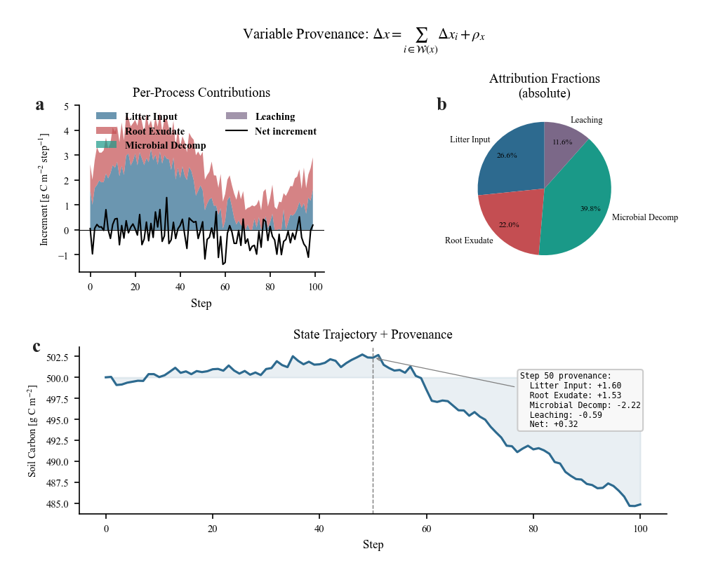

# 教程 11 -- 变量溯源与增量归因

## 1. 概述

本教程演示了 RELIC 的**变量溯源 (variable provenance)** 系统，该系统记录了每一步、每个变量的增量分解。它能够将状态变化归因到具体的过程，将预算残差从无法解释的数字转变为按过程级别贡献排序的清单。

### 先决条件

- [教程 03](./03_dag_topological_sort.md)：用于过程排序的 DAG 结构

---

## 2. 数学基础

### 2.1 增量分解（推论 3.6.5）

$$
x^{n+1} - x^n = \sum_{i \in \mathcal{W}(x)} \Delta x_i + \rho_x \tag{1}
$$

其中：

- $\mathcal{W}(x)$：对变量 $x$ 进行写操作的过程集合
- $\Delta x_i$：由过程 $i$ 贡献的增量
- $\rho_x$：系统修正项（截断限幅、约束执行等）

### 2.2 线性诊断归因

对于任意线性诊断量 $J(u) = w^\top u$：

$$
J(u^{n+1}) - J(u^n) = \sum_j w_j \sum_{i \in \mathcal{W}(u_j)} \Delta u_{j,i} + w^\top \rho \tag{2}
$$

> **参考文献**：coertheory.md，推论 3.6.5；spatiotemporal_scale_topology.md，第 10.1 节

---

## 3. 计算细节

### 3.1 四个作用于 `soil_carbon` 的过程

下表过程公式仅作概念标签。实际增量为预设季节正弦函数加固定种子的高斯噪声；脚本不计算枯落物、NPP、溶解碳或土壤过程 Functor。

| 过程                          | 方向 | 公式                                                          | 典型量级         |
| ----------------------------- | ---- | ------------------------------------------------------------- | ---------------- |
| 枯落物输入 (Litter Input)     | 正向 | $k_{\text{lit}} \cdot C_{\text{litter}} \cdot f(T)$           | $+3$（季节性）   |
| 根系分泌物 (Root Exudate)     | 正向 | $k_{\text{root}} \cdot \text{NPP} \cdot f(\text{season})$     | $+1.5$           |
| 微生物分解 (Microbial Decomp) | 负向 | $-k_{\text{dec}} \cdot C_{\text{soil}} \cdot f(T, \theta)$    | $-3.5$（季节性） |
| 淋溶 (Leaching)               | 负向 | $-k_{\text{leach}} \cdot C_{\text{diss}} \cdot \text{precip}$ | $-0.8$           |

- 100 个时间步，具有季节性调制和随机噪声
- 初始 `soil_carbon` = 500 g C m$^{-2}$

---

## 4. RELIC 实现映射

RELICSimulator 记录当前步增量和写入者，并通过 `get_variable_provenance()` 提供查询，这些记录参与步事务。StateManager 输出带符号的 `clip_loss.<variable>`，而公式 (1) 中实际施加的截断修正是 $\rho_x=-\text{clip\_loss}$，归因已施加变化时必须反转符号。本独立脚本不调用 RELIC，使用没有截断的合成增量。

---

## 5. 图表与输出

### 5.1 图：变量溯源 (`11_variable_provenance.png`)



**图 (a)：各过程贡献量（堆叠面积图）**

- 堆叠面积图显示各过程的正向（零线以上）和负向（零线以下）贡献
- 黑色线：每步净增量
- 枯落物输入和微生物分解中可见季节性振荡
- **关键结论**：各过程级别的贡献被单独追踪，且总和等于净变化量

**图 (b)：归因比例（饼图）**

- 饼图显示 100 步中各过程的绝对贡献占比
- 微生物分解通常占主导地位，其次是枯落物输入
- **关键结论**：识别出哪些过程驱动了最大的变化

**图 (c)：带溯源注释的状态轨迹**

- 土壤碳随时间的轨迹，在第 50 步处标有垂直线
- 注释框显示第 50 步的精确溯源记录：每个过程的贡献和净增量
- **关键结论**：任何一步的状态变化都可以完全归因到各个过程的贡献

---

## 6. 数学-RELIC 对比

观测列来自独立脚本，而非 RELIC 运行结果。

| 指标                                     | 理论     | 观测结果     | 匹配 |
| ---------------------------------------- | -------- | ------------ | ---- |
| $\sum \Delta x_i + \rho = x^{n+1} - x^n$ | 精确分解 | 每步均已验证 | PASS |
| 占比总和 = 100%                          | 依据定义 | 已确认       | PASS |

---

## 7. 控制台输出解释

```
[OK] Provenance tracking completed
  Soil C: 500.0 -> 484.9 g C m^-2
  Litter Input        : total = +149.1  fraction = 26.6%
  Root Exudate        : total = +123.4  fraction = 22.0%
  Microbial Decomp    : total = -222.8  fraction = 39.8%
  Leaching            : total = -64.8  fraction = 11.6%
```

---

## 8. 与其他教程的关联

| 教程                                         | 关系                               |
| -------------------------------------------- | ---------------------------------- |
| [教程 06](./06_conservation_ledger.md)       | 溯源将预算残差归因到各个过程       |
| [教程 25](./25_invariant_contracts_i1_i7.md) | I5（交换律）测试溯源是否与顺序无关 |

---

## 9. 参考文献

1. coertheory.md，推论 3.6.5（溯源与归因）
2. spatiotemporal_scale_topology.md，第 10.1 节，定义 10.1
