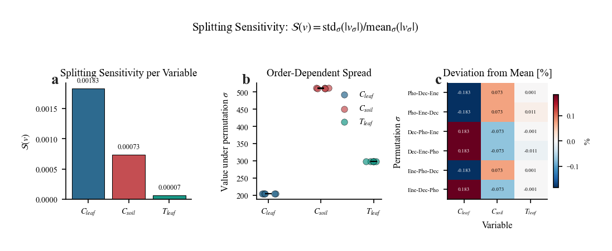

# 教程 12 -- 拆分敏感性（交换律诊断）

## 1. 概述

本教程演示了来自 coertheory.md 推论 3.6.4 的**拆分敏感性泛函** $\mathcal{S}(v)$。通过以全部 $3! = 6$ 种排列运行三个非交换算子（光合作用、分解、能量平衡），量化执行顺序对各状态变量的影响程度。

### 先决条件

- [教程 08](./08_operator_splitting.md)：算子拆分理论

---

## 2. 数学基础

### 2.1 拆分敏感性（推论 3.6.4）

$$
\mathcal{S}(v) = \frac{\text{std}_\sigma(|v_\sigma|)}{\text{mean}_\sigma(|v_\sigma|)} \tag{1}
$$

$$
\chi_{\text{comm}} = \max_v \mathcal{S}(v) \tag{2}
$$

其中 $\sigma$ 遍历算子执行顺序的所有排列：

- $\mathcal{S}(v)=0$：此样例中未观测到幅度差异；符号相反但幅度相等的变化不被此统计量识别。分母为零时未定义。这不是可交换性的证明。
- $\mathcal{S}(v) > 0$：变量 $v$ 对执行顺序敏感

> **参考文献**：coertheory.md，推论 3.6.4；spatiotemporal_scale_topology.md，定理 6.1

---

## 3. 计算细节

### 3.1 三个算子

| 算子     | 状态变量                                                               | 非线性                        |
| -------- | ---------------------------------------------------------------------- | ----------------------------- |
| 光合作用 | $C_{\text{leaf}} \uparrow$                                             | 高斯温度响应函数，峰值于 298K |
| 分解     | $C_{\text{leaf}} \downarrow$, $C_{\text{soil}} \uparrow$, $T \uparrow$ | 依赖 $C$ 的通量 + 热量        |
| 能量平衡 | $T \downarrow$                                                         | 牛顿冷却 + 反照率             |

状态向量：$x = [C_{\text{leaf}}, C_{\text{soil}}, T_{\text{leaf}}]^\top$，初始值 $x_0 = [200, 500, 298]^\top$

### 3.2 全部 6 种排列

由于算子是非线性的且温度与碳耦合，不同的排列顺序会产生不同的最终状态。对全部 $3! = 6$ 种排列收集结果并计算敏感性。

---

## 4. RELIC 实现映射

本独立 NumPy 脚本采样三个示例内核的六种次序，不调用 RELIC 模拟器诊断，也不证明 RELIC 会自动改变分裂策略。本例为正值，未触及公式 (1) 的零分母和符号不可见局限。

---

## 5. 图表与输出

### 5.1 图：拆分敏感性 (`12_splitting_sensitivity.png`)



**图 (a)：各变量的 $\mathcal{S}(v)$**

- 条形图展示 $C_{\text{leaf}}$、$C_{\text{soil}}$、$T_{\text{leaf}}$ 的拆分敏感性
- 各条形上方标注数值
- **关键结论**：在此配置中，$C_{\text{leaf}}$ 是对顺序最敏感的变量；排序取决于哪些非线性耦合占主导

**图 (b)：顺序依赖散布**

- 散点图展示 6 种排列下各变量的最终值
- 误差棒显示均值 $\pm$ 标准差
- **关键结论**：散布程度可视化了非交换性的大小

**图 (c)：偏差热力图**

- $6 \times 3$ 热力图，显示每个（排列，变量）对相对于均值的百分比偏差
- 红蓝发散色图；标注精确偏差值
- 行标签显示算子排列顺序（如 "Pho-Dec-Ene"）
- **关键结论**：识别哪些排列组合产生最大偏差

---

## 6. 数学-RELIC 对比

| 指标                                  | 理论 | 观测结果               | 匹配 |
| ------------------------------------- | ---- | ---------------------- | ---- |
| 交换算子的 $\mathcal{S}(v) = 0$       | 预期 | 本脚本未计算 | -- |
| 非线性耦合的 $\chi_{\text{comm}} > 0$ | 预期 | 已确认                 | PASS |
| $3!$ 种排列产生 6 种不同结果          | 预期 | 已观测                 | PASS |

---

## 7. 控制台输出解释

```
[OK] Splitting sensitivity computed over 6 permutations
  C_leaf: range = [204.2493, 205.0000], S = 0.001833
  C_soil: range = [510.0000, 510.7500], S = 0.000735
  T_leaf: range = [297.9700, 298.0375], S = 0.000066
  chi_comm = max S(v) = 0.001833
```

---

## 8. 与其他教程的关联

| 教程                                         | 关系                                |
| -------------------------------------------- | ----------------------------------- |
| [教程 08](./08_operator_splitting.md)        | 交换子 $[A_1,A_2]$ 量化线性非交换性 |
| [教程 25](./25_invariant_contracts_i1_i7.md) | I5（交换律）不变量正式测试此性质    |

---

## 9. 参考文献

1. coertheory.md，推论 3.6.4（拆分敏感性泛函）
2. spatiotemporal_scale_topology.md，定理 6.1（顺序敏感性）
3. Sportisse, B. (2000). An analysis of operator splitting techniques. _JCP_, 161, 140-168.
