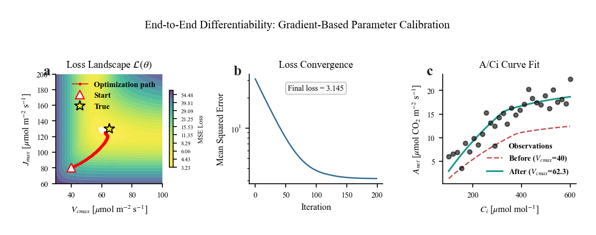

# 教程 13 -- 基于 PyTorch Autograd 的端到端可微性

## 1. 概述

本独立 PyTorch 脚本演示自动微分如何穿过一个简化的 Farquhar 内核以进行基于梯度的参数标定；它不运行 RELIC 模拟器。该内核针对合成 A/Ci 曲线数据进行优化，展示梯度 $\nabla_\theta \mathcal{L}$ 如何流经光滑的张量内核，这是在 RELIC Functor 中使用梯度的前提。

### 为什么它很重要

可微性是 RELIC 的设计目标：状态变量为 `torch.Tensor`，模拟器是 `torch.nn.Module`，因此梯度可沿实际执行的张量路径获得。边界截断、事件、速率组与自适应步长决策以及 `min` 等非光滑表达式会中断梯度或使其为零；在依赖梯度进行优化、伴随敏感性分析或数据同化之前，需在实际执行图上验证梯度。

### 先决条件

- 基本的 PyTorch 和 autograd 概念
- 光合作用基础（Farquhar 模型）

---

## 2. 数学基础

### 2.1 简化的 Farquhar 模型

净 CO$_2$ 同化速率：

$$
A = \min(A_c, A_j) - R_d \tag{1}
$$

其中：

$$
A_c = V_{c,\max} \frac{C_i - \Gamma^*}{C_i + K_c(1 + O/K_o)} \tag{2}
$$

$$
A_j = \frac{J \cdot (C_i - \Gamma^*)}{4(C_i + 2\Gamma^*)} \tag{3}
$$

电子传递速率 $J$ 由 $J_{\max}$ 和固定 PAR 参数化（如教程脚本中的实现）：

$$
J = \frac{J_{\max}\cdot \mathrm{PAR}}{\mathrm{PAR} + 2.1\,J_{\max}}. \tag{4}
$$

公式 (1) 中的 `min` 使 $A$ 分段光滑：在 $A_c = A_j$ 处不可微（此时自动微分把梯度平分给两个分支），其余位置自动微分只返回当前生效分支的梯度，因此未生效限制的参数梯度为零。

| 参数             | 符号         | 单位                       | 描述             |
| ---------------- | ------------ | -------------------------- | ---------------- |
| 最大羧化速率     | $V_{c,\max}$ | $\mu$mol m$^{-2}$ s$^{-1}$ | Rubisco 限制容量 |
| 最大电子传递速率 | $J_{\max}$   | $\mu$mol m$^{-2}$ s$^{-1}$ | 光限制容量       |
| CO$_2$ 补偿点    | $\Gamma^*$   | $\mu$mol mol$^{-1}$        | 光呼吸阈值       |
| 暗呼吸           | $R_d$        | $\mu$mol m$^{-2}$ s$^{-1}$ | 线粒体呼吸       |

> **参考文献**：Farquhar, G.D., von Caemmerer, S. & Berry, J.A. (1980). _Planta_, 149, 78-90.

### 2.2 损失函数

$$
\mathcal{L}(\theta) = \frac{1}{N} \sum_{i=1}^{N} \left(A_{\text{pred}}(C_i; \theta) - A_{\text{obs}}(C_i)\right)^2 \tag{5}
$$

### 2.3 基于梯度的优化

$$
\theta^{(k+1)} = \theta^{(k)} - \alpha \nabla_\theta \mathcal{L}(\theta^{(k)}) \tag{6}
$$

使用 Adam 优化器，学习率 $\alpha = 0.5$，优化 $V_{c,\max}$ 和 $J_{\max}$（通过公式 (4) 间接优化 $J$）。

---

## 3. 计算细节

- 使用已知"真实"参数生成合成 A/Ci 数据：$V_{c,\max}^* = 65$，$J_{\max}^* = 130$
- 向观测值注入加性高斯噪声（固定种子），模拟测量不确定性
- 初始猜测：$V_{c,\max}^{(0)} = 40$，$J_{\max}^{(0)} = 80$
- 200 次优化迭代
- 在 $50 \times 50$ 网格上计算损失曲面

---

## 4. RELIC 实现映射

| 概念     | RELIC 实现                                             |
| -------- | ------------------------------------------------------ |
| 可微参数 | ParameterManager 拥有的 `nn.Parameter` 由 Functor 按引用持有；私有模块参数另行区分 |
| 前向传播 | 受治理的 Functor 调用（`functor(state, time=..., dt=...)`）返回的张量沿光滑运算保留自动微分 |
| 损失计算 | 基于 `torch.Tensor` 的标准 PyTorch 损失                |
| 梯度流   | `loss.backward()` 自动计算 $\nabla_\theta \mathcal{L}$ |
| 优化器   | `torch.optim.Adam` 或等价方案                          |

---

管理器持有的绑定不在 Functor.parameters() 或 state_dict() 内；优化器应使用管理器的 get_trainable_parameters，持久化检查点通过格式 3 的 parameter_bindings 保存。对该绑定调用 parameter_sensitivity 会报 TypeError。这里的两参数 PyTorch 合成拟合不测试这些生命周期契约。

## 5. 图表与输出

### 5.1 图：可微性 (`13_differentiability.png`)



**图 (a)：损失曲面**

- $\mathcal{L}(V_{c,\max}, J_{\max})$ 的二维等高线图（对数尺度）
- 黄色星号：真实参数；白色三角：初始猜测；红色轨迹：优化路径
- **关键结论**：此合成拟合展示实际分段光滑路径上的可用梯度，不保证收敛到全局最小值。

**图 (b)：收敛情况**

- 对数尺度的损失 vs 迭代次数
- 约 50 次迭代内快速收敛
- **关键结论**：基于梯度的优化高效收敛

**图 (c)：预测与观测 A/Ci 曲线**

- 黑色圆圈：合成观测值
- 红色虚线：初始猜测的预测；绿色实线：优化后的预测
- **关键结论**：优化后，预测值与观测值紧密匹配

---

## 6. 数学-RELIC 对比

| 指标              | 预期                             | 观测结果                   | 匹配 |
| ----------------- | -------------------------------- | -------------------------- | ---- |
| 最终 $V_{c,\max}$ | $\approx 65$（含噪声数据）       | 62.3（真实值 = 65.0）      | PASS |
| 最终 $J_{\max}$   | $\approx 130$（含噪声数据）      | 125.3（真实值 = 130.0）    | PASS |
| 最终损失          | $> 0$（噪声底限 + 模型误差）     | 3.1452                     | PASS |
| 梯度可用性        | $\nabla_\theta \mathcal{L}$ 存在 | `loss.backward()` 成功执行 | PASS |

---

## 7. 控制台输出解释

```
[OK] Optimization converged
  Vcmax: 40.00 -> 62.30 (true: 65.0)
  Jmax:  80.00 -> 125.30 (true: 130.0)
  Final loss: 3.1452
```

---

## 8. 与其他教程的关联

| 教程                                       | 关系                           |
| ------------------------------------------ | ------------------------------ |
| [教程 14](./14_lyapunov_predictability.md) | 演示邻近 Lorenz 轨迹的有限时间发散分析 |

---

## 9. 参考文献

1. Farquhar, G.D., von Caemmerer, S. & Berry, J.A. (1980). A biochemical model of photosynthetic CO$_2$ assimilation. _Planta_, 149, 78-90.
2. Medlyn, B.E. et al. (2002). Temperature response of parameters of a biochemically based model. _Plant, Cell & Environment_, 25, 1167-1179.
3. Kingma, D.P. & Ba, J. (2015). Adam: A method for stochastic optimization. _ICLR_.
